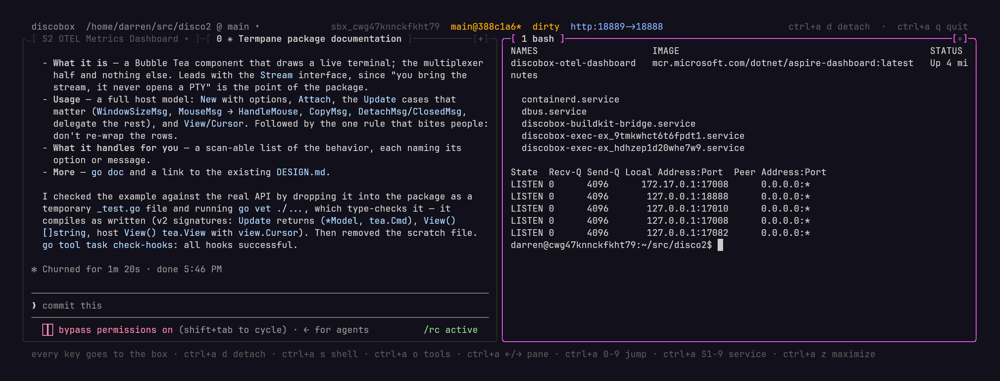
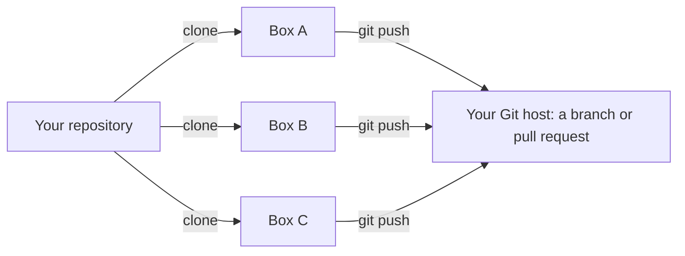

<div align="center">
  
</div>

Discobox runs coding agents in disposable environments, each with its own copy
of your source. Agents have passwordless sudo, nested Docker, a desktop, and a
browser, and you can connect through a terminal, SSH, or your editor.

Run as many agent sessions against one repository as you like, each in its own
box, while your own checkout stays yours. Source moves the way it already does
with git: a box clones your repository, the agent commits, and you merge those
commits back to your machine or push them as a pull request.

Claude Code, Codex, OpenCode, GitHub Copilot, omp, and pi are included; other terminal
agents can be packaged in an image. Discobox supports macOS, Linux, and Windows
and is under active development.

Public documentation: [the manual](docs/public/index.md).

## Getting started

Install with Homebrew, on macOS or Linux:

```bash
brew install discobox-ai/tap/discobox
```

Or with the install script:

```bash
curl -sSfL https://discobox.ai | sh
```

On Windows, from PowerShell:

```powershell
irm https://discobox.ai/install.ps1 | iex
```

Each of those installs the stable channel. [Release channels](#release-channels)
covers the newer ones and how to pin a version.

For a guided first experience, run:

```bash
discobox run discobox-ai/tour
```

The tour opens full screen inside the box before your selected harness and
needs no agent account. See the [tour guide](docs/public/getting-started.md#take-the-tour)
for continuing, exiting, replay and cleanup.

Open the console from your repository to create a box:

```bash
cd ~/src/my-project
discobox console
```

Work with the agent, have it commit the changes inside the box, and push them
to a Git remote. Review and merge them through your usual Git workflow.



### libkrun on Linux

Linux uses Docker by default. The optional `libkrun` provider needs a
Linux amd64 **server host** with usable `/dev/kvm`, `libkrun.so.1` on the
dynamic loader's path, and `passt` on the server's `PATH`. The Discobox
installer does not install these host dependencies. The server user needs
read/write access to `/dev/kvm` (usually through the `kvm` group).

Install libkrun and passt using your distribution's packages where available.
The library must export the APIs this server uses; an older package is rejected
with the missing symbol's name. Alternatively, with Nix and flakes enabled,
build the runtime from the published repository without a source checkout:

```bash
nix build github:discobox-ai/discobox#libkrun-runtime --out-link discobox-libkrun-runtime
```

Keep that output link so Nix retains the runtime. Configure the provider with
absolute paths to `discobox-libkrun-runtime/lib/libkrun.so.1` (`libkrunPath`)
and `discobox-libkrun-runtime/bin/passt` (`passtPath`), on the server host:

```bash
discobox admin provider create --type libkrun \
  --libkrun-path "$(realpath discobox-libkrun-runtime/lib/libkrun.so.1)" \
  --passt-path "$(realpath discobox-libkrun-runtime/bin/passt)"
```

See `discobox admin provider create --help=libkrun` for all settings.
Provider creation checks these software dependencies before accepting the
provider; KVM is checked when a VM starts. After changing the server's `PATH`
or dynamic loader environment, restart the server so its launchers inherit it.
Guest images and the patched kernel are downloaded automatically on first use.

## Many sessions, many boxes

An agent working in your checkout ties it up. You wait for it to finish, and a
second agent in the same directory edits the same files, switches the same
branch, and competes for the same ports and databases. Each box instead has its
own copy of the source, its own git repository, and its own services and Docker.
You can start a bug fix, a feature, and an experiment you may throw away, each in
its own box, and keep working in your own checkout while they run.

```bash
discobox run -d . 'fix the flaky retry test'
discobox run -d . 'add pagination to the users endpoint'
discobox run -d . 'try replacing the ORM with sqlc'
discobox ls
```

### It is just git

There is no special sync layer. Give an agent a computer of its own and it needs
the source the way you would on a new machine: clone the repository, make
changes, then merge them back or open a pull request. A box does exactly that,
so the only questions are where it clones from and where the work goes.



**Where a box clones from.** The source you name first, `.` for the
repository you are in, at the commit you have checked out. Only committed work
goes in: uncommitted changes stay behind unless you pass `--include-dirty`, and
then they arrive as uncommitted changes on that same commit. In
the box, `origin` is your repository, read-only: the agent can fetch from it but
cannot push to it, and nothing it does touches your files. `-i` brings more
sources into the same box, either another local checkout or a remote URL, whose
`origin` is then that remote.

**Where the work goes.** The agent commits in the box and pushes to a Git
remote. Open a pull request or fetch and merge that branch on your machine.

## Working with a box

- **Terminal and SSH:** Use the console or `discobox exec`. SSH configuration syncs
  automatically when a box is created, so `ssh $DISCOBOX_ID` works without manual
  setup. You can also connect by box name.
- **Editor and tools:** Use `discobox tools vscode` or `discobox tools zed` to
  open VS Code or Zed in the box's working directory; `discobox tools ls` lists
  every tool a box offers. Declare your own as a `.yaml` or a front-matter script
  in the box's `.discobox/tools` or in your own config directory's
  `discobox/tools` (ADR 0125). A script of yours with `runs: host` runs on
  your machine and is handed the CLI, server and project, so it can set the box
  up first: have the box download a program into its `~/.cache`, pinned by
  sha256 and checked before it runs (every box in the pool running as your user
  ID can write to that cache), copy your own
  `~/.config/<tool>` in (config only: a token or key goes in `discobox secret`,
  not in a copied file the box's agent can read), then open it there
  (ADR 26-11-03-982).
  `discobox tools --help` shows how to write one. Other editors with SSH remote
  support can also connect directly.
- **Desktop:** Access the box's graphical desktop and browser through VNC or
  noVNC, using port forwarding.
- **Toolchain:** direnv loads the project's declared environment, including
  Nix or mise configuration.
- **Automation:** The CLI and OpenAPI API support scripting box creation,
  credential bindings, and collecting results.

## Isolation and credentials

On Linux, a fresh installation uses the existing libkrun microVM provider when
KVM is usable, `passt` is on `PATH`, and `libkrun.so.1` is available to the dynamic
loader with block and network support (currently linux/amd64). Otherwise it
uses Docker and the launching CLI warns why: sandboxes share the host kernel
without a VM isolation boundary. The choice is saved with the default pool;
existing installations keep their provider. macOS uses Virtualization.framework
and Windows uses WSL.

Agents can install packages and run
commands inside the box without approval prompts. Outbound traffic passes
through a proxy with a separate mTLS identity for each box, destination policy,
and request auditing.

Managed credentials remain outside the box. Agents receive placeholders called
sentinels; the proxy substitutes the real credential only on the routes its
secret and its binding allow, and refuses a request on any other. A secret is
bound to a box, a harness or a whole project (`discobox secret bind`). An agent
can request additional access, which a human approves with routes and an
expiry.

See [discobox.ai](https://discobox.ai) for the full overview and
[architecture](https://discobox.ai/architecture).

## Release channels

Every release is published as a prerelease and marked stable by hand later, once
it has been in use for a while. That gives three channels, each newer and less
proven than the one before:

- **stable** — the newest release marked stable. This is what you get when you
  ask for nothing in particular.
- **latest** — the newest `vX.Y.Z` release, stable or not. A release joins it
  the moment it is cut.
- **edge** — the newest release of any kind, including the `-alpha`, `-beta`,
  and `-rc` builds cut to try a change before it becomes a release.

### Homebrew

The tap carries stable and latest as two formulae. `discobox-dev` installs
beside `discobox` and runs under its own name, so you can keep both:

```bash
brew install discobox-ai/tap/discobox      # stable, runs as discobox
brew install discobox-ai/tap/discobox-dev  # latest, runs as discobox-dev
```

The two share one state directory, one configuration, and one downloaded server,
so their servers cannot run at the same time; stop one before starting the
other. There is no edge formula — use the install script for that.

### Install script

```bash
curl -sSfL https://discobox.ai | sh                         # stable
curl -sSfL https://discobox.ai | sh -s -- --channel latest  # latest
curl -sSfL https://edge.discobox.ai | sh                    # edge
```

```powershell
irm https://discobox.ai/install.ps1 | iex                   # stable
irm https://edge.discobox.ai/install.ps1 | iex              # edge
$env:DISCOBOX_CHANNEL = 'latest'; irm https://discobox.ai/install.ps1 | iex
```

Unlike the tap, the script installs whichever channel you ask for as `discobox`,
over whatever is already there. Pass `--dir` or `-InstallDir` to keep two of
them side by side.

Pin one release instead of a channel:

```bash
curl -sSfL https://discobox.ai | sh -s -- --version v0.10.1
```

```powershell
& ([scriptblock]::Create((irm https://discobox.ai/install.ps1))) -Version v0.10.1
```

Both scripts take `--channel`, `--version`, `--dir`, and `--stage` — `-Channel`,
`-Version`, `-InstallDir`, `-Stage`, and `-NoModifyPath` in PowerShell — and
read `DISCOBOX_CHANNEL`, `DISCOBOX_VERSION`, `DISCOBOX_INSTALL_DIR`, and
`DISCOBOX_INSTALL_STAGE` from the environment, which is the only way to pass an
option through `iex`. A flag beats the environment, and a version beats a
channel. `install.sh --help` lists the rest; `install.ps1` documents them in
its header comment.

Either way you install the client only. The Discobox server is a separate
program, downloaded the first time something needs one locally and checked
against the digests the client carries; `--stage` fetches it during the install
instead of on first use.

## Uninstalling

To remove Discobox's data, downloaded servers and images, and configuration,
run `discobox admin uninstall`. It lists what it will delete and asks first, and
leaves the `discobox` command for your package manager to remove.

## Community

Ask questions, share what you are building, and follow development on
[Discord](https://discord.gg/BSFr7Fa7f2).

## License

See [LICENSE](LICENSE).
