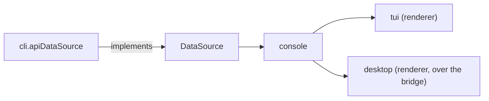
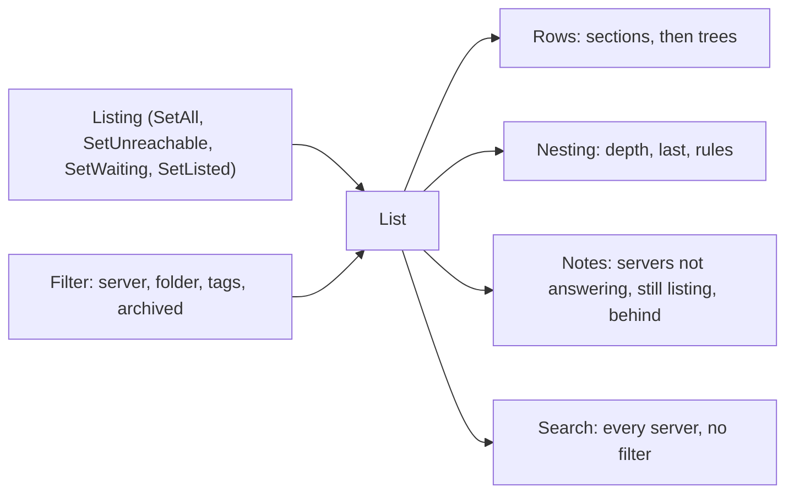
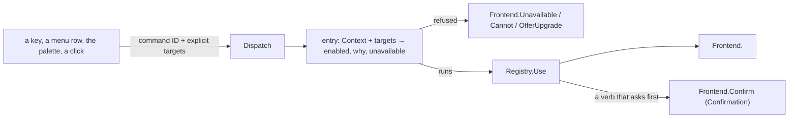
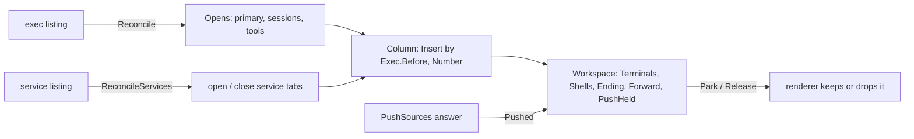
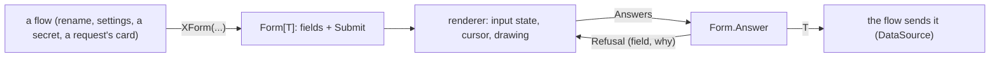
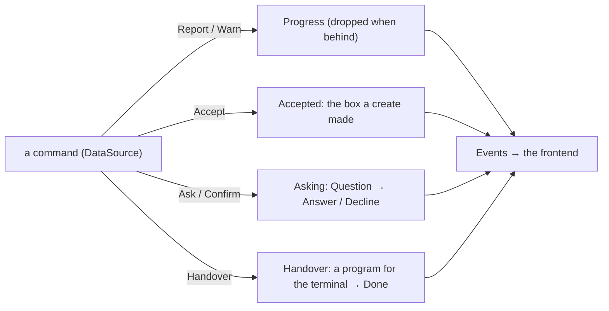

# console

The console core (ADR 26-11-07-876): what the console means, shared by every
frontend that draws it. `cli/internal/tui` is one renderer of it; the desktop
app is the other. Each renderer owns layout, focus, keys, pointer and drawing
(876 §2); this package owns the rules behind them.

## Shape

- **The desktop app reaches it through [`bridge`](bridge/DESIGN.md)**, which
  serves the core over a pipe: commands through `Dispatch`, questions and
  forms as descriptions, and what the app draws as subscriptions.
- **It imports no frontend**: not `internal/tui`, not `internal/cli`, and
  nothing of Bubble Tea or termpane. A rule a renderer needs is moved here,
  never exported back out of a renderer.
- **Navigation stays the renderer's** (876 §2). Which box is on screen, which
  tab has focus, whether there is a sidebar: a rule that depends on one is
  handed it explicitly by the renderer.

## The data seam

`data.go`. `DataSource` is the boundary between the console and the server,
and its types (`Sandbox`, `Session`, `Listing`, `Verb`, `Exec`, the secret,
credential, audit and issue types) are the console's vocabulary. The CLI
implements it once (`cli.apiDataSource`); every frontend reads through it.

What a box allows is answered from its own fields, here: `Attachable`,
`Startable`, `Repairable`, `Live`, its standing and status tags (`tags.go`),
its folder (`folder.go`), the issue or pull request it is tagged with
(`WorkNumber`). Presentation of those answers — layout, column budgets — is
the renderer's; the glyphs and their colour tokens are the spec's.

## The list

`list.go`, `query.go`. `List` is the box listing as the console shows it
(876 §1); a renderer embeds it and adds the cursor, the marks, scrolling and
drawing. It is a value, so a renderer tries a filter on a copy (the filter
card's counts) without touching the one on screen; a copy shares the listing,
so taking a listing or its marks is the original's to do.

- **Order is the core's.** `Rows` is the filtered rows as drawn: on every
  folder (`Grouped`), sections in `Folders` order — the window's own first —
  each newest-first as the listing has them; inside one, each box followed by
  the boxes it created (ADR 0111 §3). A box is drawn under the nearest
  creator the filter shows, wherever it is filed itself, and only there.
- **Nesting is structure, not glyphs.** `Nesting` says how deep a row is,
  whether it is its creator's last, and where a branch carries on above it;
  the renderer draws the branch (`├ └ │` in the TUI).
- **The filter is a value** (`Filter`): server, folder, tags (one value per
  key, `AddTag`) and the archived. `Revealing` is the view that shows one
  box whatever the person's filter hid (671 §5); a renderer holds it in
  place of theirs and puts theirs back, never saving it. `Filter.View` is
  the filter as saved (`Session.View`) and `Session.Restore` the filter a
  saved view opens on.
- **Row text is the core's.** `Sandbox.Remark` is what a row says in place
  of its name when picked out — naming the command that answers it, never a
  key, which is each frontend's binding — `StateWord` its state as a word,
  `List.Origin` where it came from (nothing on a nested row); `Notes` and
  `ListedAgo` are what the list says about servers. Glyphs, colours and
  column budgets are the renderer's.
- **An archive is listed from the press** (`MarkArchiving`) until a listing
  sent after its answer lands (`SettleArchives`), counted in listings sent.
- **Search ignores the filter** (`Search`, 671 §5): every listed server,
  archived only when asked for, matched by `Query` (fzf-style, smart case)
  within one field at a time (`MatchFields`), ranked by `Rank`; `Partial` and
  `Stale` are what it says about servers it has no or old rows from. Ranking
  boxes among commands is the palette's.

## The command registry

`commands.go` (ADR 26-11-06-671 §4, moved here by 876 §1). One `Command` per
thing the console does, by a stable ID: its label, detail and aliases, its
target (the window, or one box — a batch for the box's lifecycle commands),
and its bindings keyed by frontend (ADR 26-11-07-598 §2): `TUI` (bare keys,
the leader sequences, whether they repeat, leaderless chords, the menu path)
and `Desktop` (chords written with `primary`). Moving between panes and
boxes is commands like any other (`next pane`, `previous box`, `sidebar`):
where focus goes is each frontend's, the key that moves it the registry's.

- **Every key a frontend binds to reach a command or move between boxes
  and panes is here** (598 §3): the TUI's list, tree, leader and panes, the
  desktop app's shortcuts and list. A screen's own keys (an issue tab, the
  audit screen, a dialog, the desktop's menus and palette) are still that
  screen's. What is not a command —
  a cursor's motion, choosing a row, a pane by its number — is a `Gesture`:
  declared with each frontend's keys, never searched, counted or dispatched.
  A numbered gesture's sequences end in the digit it goes to.

- **Eligibility is the registry's.** `Entries`/`Entry` answer whether a
  command can act, and why not, from the targets' own fields and the
  `Context` the frontend hands it: workspace, pane, the list's keys, tree,
  the box whose workspace is open, the one box an attach window belongs to,
  and the credential inbox's answers for a box. A frontend never rewrites an
  entry's answer.
  `Lifecycle` is the box's action menu with its reasons.
- **Dispatch is against the core** (`Dispatch`): it resolves the command,
  refuses before entering a flow (nothing selected, a server gone, a
  context that rules it out, a lifecycle command its targets cannot take, a
  box whose image is gone), counts the use, then calls the one `Frontend`
  method that command enters. A target is the one given, never what is on
  screen; a window's command takes none. A box command's other
  preconditions (a tag to open, a request waiting) are refused by its flow,
  in its own words; `Entry` reports them so a frontend offers only what will
  act.
- **`Frontend` has a method per command.** A command is added as a registry
  entry, a case in `Dispatch` and a `Frontend` method together: the compiler
  holds every frontend to the method, and `TestEveryCommandDispatches` holds
  the registry to `Dispatch`. A frontend that cannot offer a command yet says
  so, and the parity ledger (`docs/console/parity.md`) says why. The flows
  behind the methods — dialogs, workspaces, pages — are the frontend's.
- **Use is counted once, as a flow is entered.** A command whose flow is
  also entered by gestures outside the registry (a page's row in the tree)
  counts itself there (`countedByFlow`). A command that only moves focus —
  a pane along, a box down the list — is never a use (`moves`): 671 §6
  counts a flow entered, not cursor movement, and a walk pressed in runs
  would top the palette. `Use`/`Usage` are the window's palette ranking
  (671 §6), and live as long as the `Registry` does.
- **The registry is tested here** for completeness (described, unambiguous
  aliases, no key reaching two things in any frontend's layer, primary
  without shift, every command dispatching to a flow of its own). Each
  frontend tests that it binds no key the registry does not hand it: the
  TUI's `TestConsoleCommandBindingCoverage`, the desktop app's
  `no_shortcut_is_written_outside_the_spec`.

## The spec

`spec.go` (876 §4). `NewSpec` is what every frontend draws the same way, as
data: the registry's commands and gestures with each frontend's bindings, the state and
agent glyphs (`StateGlyph`, `AgentGlyph`) by colour token, every colour
token in both palettes, and every space, radius and stroke token in points
(`Dimensions`), read from the design language's tokens (`assets/brand`,
363 §4). The type scale is not in it: its steps are rem on a page, and each
frontend sets its interface at its own size. `discobox desktop` hands it to the app on `hello`,
and `task generate` writes it to `desktop/src/spec.json`; the TUI draws the
same glyphs by each token's xterm index. Nothing in it is read out of a
renderer. Lists on the wire are never null. Its types are on the bridge's
wire, so the app's are generated from them with the bridge's
([bridge](bridge/DESIGN.md)).

- **The parity scenarios are here** (`testdata/parity`, 598 §5), written in
  registry IDs; `TestParityScenariosNameRegistryCommands` holds each step to
  a command both consoles bind from a pane. The TUI and the desktop app run
  them, each pressing its own binding.

## Workspaces

`workspace.go` (876 §1). `Workspace[P]` is one box's sessions as a window
holds them; a renderer instantiates it with its own pane type (`Tabbed`: the
pane's `Tab`, and closing its view) and adds focus, maximize and drawing. The
desktop app reaches the same rules through the bridge (`Sessions`,
`SessionTab`), never a copy of them.

- **The session's record says where it goes** (`Exec.Side`): the primary,
  harness terminals and services on the left, shells and then tools on the
  right. `Exec.Before` orders a column: services first in declaration order,
  tools last, the rest oldest first.
- **What opens is the core's.** `OpensAsTab`/`Sessions` is what an exec
  listing opens; `Reconcile` is that against what a workspace holds, is
  ending, and the renderer says it is already opening. It never closes:
  streams deliver their own exits. `ReconcileServices` both opens and
  closes, since the service listing is the whole truth about a declaration.
- **A tab is the core's, its drawing the renderer's.** `SessionTab`,
  `ServiceTab` and `ToolTab` say what a tab is and is called; `Tab.Name`
  prefers what the program titles itself. `Column.Number` is the number a tab
  wears — services counted apart, so one starting never renumbers a shell —
  and spelling it as a key is each frontend's binding.
- **An ending is decided once** (`Tab.End`): the primary ends the workspace,
  a tool or a broken stream ends the tab, a finished program holds its last
  screen. The renderer applies it to a workspace on screen and a parked one
  alike.
- **Parking keeps the streams and the push loop** (`Parkable`, `Park`): only a
  workspace with its primary is parked, and its port forward goes with the
  screen. `Release` closes every view; no session is ended by either.
- **The loops are the core's; only their clock is the renderer's.** The poll
  reads the exec and service listings every `WorkspacePollEvery` while the
  workspace is on screen, and each answer means what `Reconcile` and
  `ReconcileServices` say. The push loop makes one look (`PushLook`: skipped
  for a box this window does not push, holds copied, a whole-call failure
  answering nothing), applies it (`Pushed`: a refused source is held at the
  refused commit until a new one) and looks again `PushEvery` later, parked
  or not, and says what it did as `Progress`: a refusal, as a warning,
  outranks what moved, and a look that moved nothing says nothing. Naming a
  box that is not on screen is the renderer's. A renderer runs these on its
  own event loop — the TUI's ticks are Bubble Tea commands its tests drive
  one at a time — and drops an answer for a workspace it has left; it decides
  nothing about what a look does or means.

## Forms

`form.go` and the `forms_*.go` beside it (876 §1). Every question the console
asks as a card is a `Form[T]` here: its `Field`s — label, section, hint,
`Choice`s, the value it opens on, `When` it applies, `Locked`, `Required` — and
its `Submit`, which reads the `Answers` and returns the `T` they make (the
`BoxSettingsUpdate`, `NewSecret`, `NewBinding`…) or a `Refusal`.

- **Validation is the form's, never the renderer's.** `Answer` refuses a
  required field that applies and is empty, then whatever `Submit` refuses; a
  renderer shows the refusal on the card, against the field it names, and keeps
  what was typed. It never checks an answer itself.
- **An answer is only what changed** on a form that edits something stored
  (`SettingsForm`, `EditSecretForm`): compared with what its field opened
  holding (`Form.Opening`, each value as a field holds it: `OneLine`), so a
  save never writes back what nobody touched.
- **A field that does not apply is still a field**, with `Why` in place of its
  value: the renderer draws it, dimmed and stepped over.
- **Accept-or-decline cards** (the credential inbox: `ApprovalPartForm`,
  `TrustForm`, `RefreshForm`) check only the accept. What their answers say,
  unchecked, is read here too (`ReadApprovalPart`, `ReadTrust`,
  `ReadRefresh`): for declining, and for what the card shows as it is
  answered. A renderer never decodes an answer's keys itself.
- **An option's key is the answer**, not its place in a list: a renderer
  that had to rebuild the list to decode a position would hold a second copy
  of it.
- **What the form is for stays with its flow**: the title, the explanation
  around it, the waits and the call that sends the answer are the frontend's
  and the `DataSource`'s. The create card's source and item fields are forms
  (`SourceForm`, `ItemForm`); the run options the card is otherwise made of
  are the composer's.

## Narration and questions

`narration.go` (876 §1, 289 §2). A command that reports as it goes, or asks
while it runs, is handed a `*Narration`, never a frontend's function: `Run`,
`DeliverSource`, `Do` and `WatchProvisioning` all take one. The frontend that
started it reads `Events` until the starter closes it, and answers in its own
way: the TUI with its dialogs; the desktop bridge by sending each question to
the app, and declining a handover, which the app has no terminal for.

- **A step never blocks the work.** `Report` and `Warn` drop what a frontend
  has no room for; `Accept`, `Ask` and `Handover` wait, since what follows
  from them is not a status line. A reader drains until the feed closes.
- **A question is a description** (`Question`): a title, a body, and either
  `Choices` by key with a hint each, or none for a yes or no (`AnswerYes`,
  `DefaultNo` for a destruction nobody can undo). Its asker words it and
  reads its answer; the frontend draws it. Git's credential question is the
  CLI's (`cli.gitCredentialQuestion`), in the words `discobox run` uses.
- **Every question is answered exactly once**: a key, or `Decline` — dismissed
  (`context.Canceled`) or unaskable (`ErrNoFrontend`). A nil `*Narration` is a
  command nobody watches: it reports nowhere and declines every question, and
  `Decline` is that for a frontend that cannot ask yet.
- **What a command asks before it runs is the core's too**: `Confirmation`
  says which lifecycle verbs ask first (purging, which nothing undoes; nothing
  else, archiving included) and in what words, and `Dispatch` asks it on the
  way in (`Frontend.Confirm`, which sends the verb only on yes). A path that
  sends a verb outside the registry refuses one that asks rather than send it
  unasked; the desktop bridge sends none (`bridge`).
- **A yes or no is answered**, `AnswerYes` or `AnswerNo` — left any way but
  yes, it is no. Only a pick of one can be dismissed unanswered.
- **Which box is on screen stays the renderer's** (876 §2), and so does
  whether a report names its box: the push loop's `Progress` never does.

