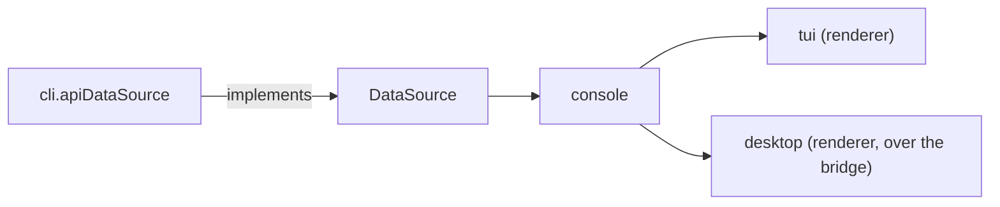
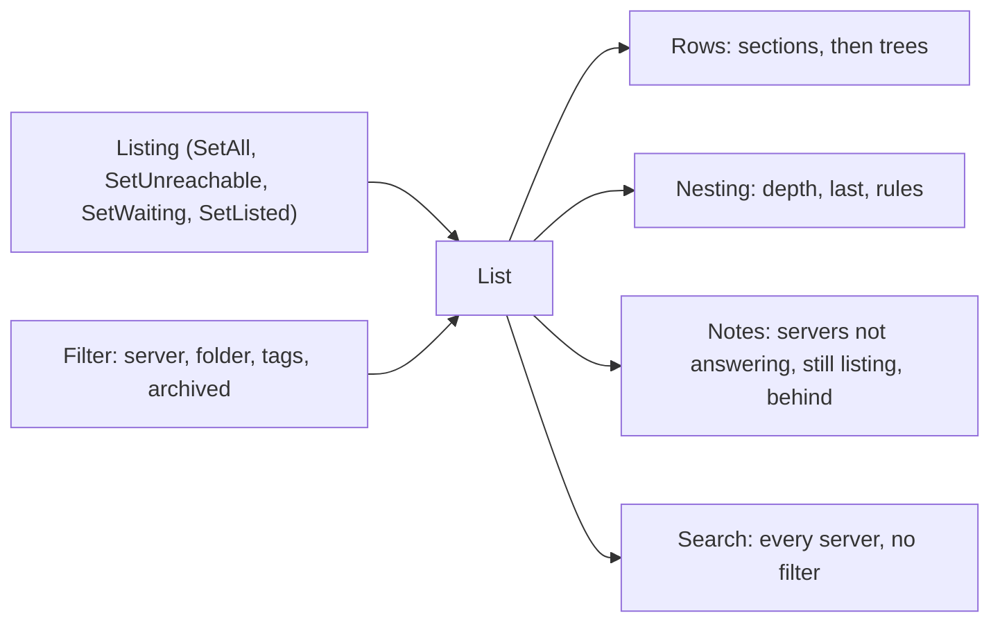
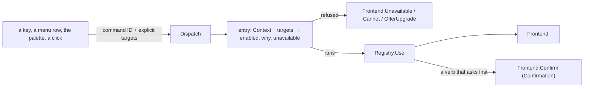
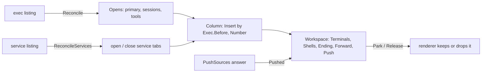
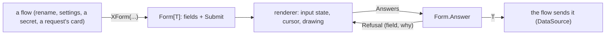
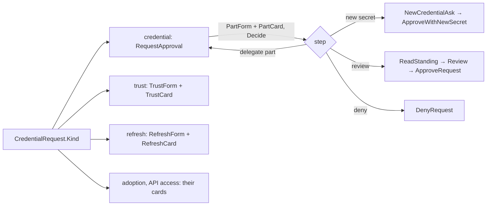
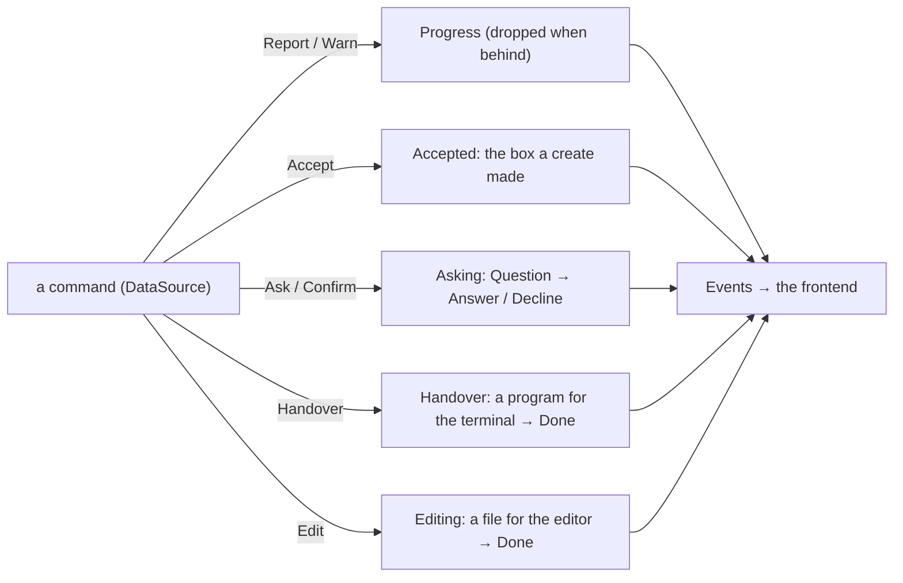

# console

The console core (ADR 26-11-07-876): what the console means, shared by every
frontend that draws it. `cli/internal/tui` is one renderer of it; the desktop
app is the other. Each renderer owns layout, focus, keys, pointer and drawing
(876 §2); this package owns the rules behind them.

## Shape

- **The desktop app reaches it through [`bridge`](bridge/DESIGN.md)**, which
  serves the core over a pipe: commands through `Dispatch`, questions and
  forms as descriptions, and what the app draws as subscriptions. The app's
  own design is [`desktop/DESIGN.md`](../../../desktop/DESIGN.md).
- **What one renderer lacks against the other is the parity ledger's**
  ([`docs/console/parity.md`](../../../docs/console/parity.md), 598 §1):
  every command, terminal behaviour and screen either console has.
- **It imports no frontend**: not `internal/tui`, not `internal/cli`, and
  nothing of Bubble Tea or termpane. A rule a renderer needs is moved here,
  never exported back out of a renderer.
- **Navigation stays the renderer's** (876 §2). Which box is on screen, which
  tab has focus, whether there is a sidebar: a rule that depends on one is
  handed it explicitly by the renderer.

## The data seam

`data.go`. `DataSource` is the boundary between the console and the server,
and its types (`Sandbox`, `Session`, `Listing`, `Verb`, `Exec`, the secret,
credential, audit and issue types) are the console's vocabulary. The CLI
implements it once (`cli.apiDataSource`); every frontend reads through it.

What a box allows is answered from its own fields, here: `Attachable`,
`Startable`, `Repairable`, `Live`, its standing and status tags (`tags.go`),
its folder (`folder.go`), the issue or pull request it is tagged with
(`WorkNumber`). Presentation of those answers — layout, column budgets — is
the renderer's; the glyphs and their colour tokens are the spec's.

## The list

`list.go`, `query.go`. `List` is the box listing as the console shows it
(876 §1); a renderer embeds it and adds the cursor, the marks, scrolling and
drawing. It is a value, so a renderer tries a filter on a copy (the filter
card's counts) without touching the one on screen; a copy shares the listing,
so taking a listing or its marks is the original's to do.

- **Order is the core's.** `Rows` is the filtered rows as drawn: on every
  folder (`Grouped`), sections in `Folders` order — the window's own first —
  each newest-first as the listing has them; inside one, each box followed by
  the boxes it created (ADR 0111 §3). A box is drawn under the nearest
  creator the filter shows, wherever it is filed itself, and only there.
- **Nesting is structure, not glyphs.** `Nesting` says how deep a row is,
  whether it is its creator's last, and where a branch carries on above it;
  the renderer draws the branch (`├ └ │` in the TUI).
- **The filter is a value** (`Filter`): server, folder, tags (one value per
  key, `AddTag`) and the archived. Its choices are the core's
  (`FilterChoices`, `choices.go`): each counted against the rest of the
  filter, with the filter marking it makes and, for a marked tag, letting it
  go; `FilterLabel` is how the filter reads. The TUI's card and the desktop's
  filter menu are drawn from them. `Revealing` is the view that shows one
  box whatever the person's filter hid (671 §5); a renderer holds it in
  place of theirs and puts theirs back, never saving it. `Filter.View` is
  the filter as saved (`Session.View`) and `Session.Restore` the filter a
  saved view opens on.
- **Row text is the core's.** `Sandbox.Remark` is what a row says in place
  of its name when picked out — naming the command that answers it, never a
  key, which is each frontend's binding — `StateWord` its state as a word,
  `List.Origin` where it came from (nothing on a nested row); `Notes` and
  `ListedAgo` are what the list says about servers. Glyphs, colours and
  column budgets are the renderer's.
- **An archive is listed from the press** (`MarkArchiving`) until a listing
  sent after its answer lands (`SettleArchives`), counted in listings sent.
- **Search ignores the filter** (`Search`, 671 §5): every listed server,
  archived only when asked for, matched by `Query` (fzf-style, smart case)
  within one field at a time (`MatchFields`), ranked by `Rank`; `Partial` and
  `Stale` are what it says about servers it has no or old rows from.
- **The palette's results are the core's** (`palette.go`, 671 §2, §5–6):
  `Registry.Palette` answers a `PaletteQuery` — the text, at most one chip
  (a command, or a box by its `BoxRef`), the archived scope, the box the
  window is on and the boxes it has visited — with the rows in the palette's
  order: boxes and commands with no chip, the boxes evaluated for a command
  chip, the box commands evaluated for a box chip; what cannot be chosen
  only when nothing can, with why. `PaletteCommit` is the exact alias and
  space that commits a chip as it is typed; `ChipShowsArchived` the chips
  that bring archived boxes into scope. Which row is picked, what a key or a
  press does with it, and the recent visits are each frontend's.

## The command registry

`commands.go` (ADR 26-11-06-671 §4, moved here by 876 §1). One `Command` per
thing the console does, by a stable ID: its label, detail and aliases, its
target (the window, or one box — a batch for the box's lifecycle commands),
and its bindings keyed by frontend (ADR 26-11-07-598 §2): `TUI` (bare keys,
the leader sequences, whether they repeat, leaderless chords, the menu path)
and `Desktop` (chords written with `primary`, and the `Menu` of the menu bar
the command is in, `Menus` in the bar's order: every command is in one, so
the desktop's in-window menu bar reaches every command by pointer as well as
by the palette; macOS's native menu bar is not built from it yet, #908).
Moving between panes and
boxes is commands like any other (`next pane`, `previous box`, `sidebar`):
where focus goes is each frontend's, the key that moves it the registry's.
A TUI command's leaderless chords are ones a classic terminal cannot encode
(598 §3): the palette's Ctrl-: — its main way in, so the one command bound
that way from everywhere — and the box walk's Ctrl-Shift-K/J. Each is one
key as the registry spells it; how a terminal reports that key on a layout
(Ctrl-: as Ctrl-Shift-;) the frontend folds onto it.

- **Every key a frontend binds to reach a command or move between boxes
  and panes is here** (598 §3): the TUI's list, tree, leader and panes, the
  desktop app's shortcuts and list. A screen's own keys (an issue tab, the
  audit screen, a dialog, the desktop's menus and palette) are still that
  screen's. What is not a command —
  a cursor's motion, choosing a row, a pane by its number — is a `Gesture`:
  declared with each frontend's keys, never searched, counted or dispatched.
  A numbered gesture's sequences end in the digit it goes to. The desktop's
  pane keys (copy, paste, find, a screen back or on) are gestures with no TUI
  binding: the TUI's terminal is the one it runs in, which keeps its own.
  `paste image` (Ctrl-V, Alt-V) is a pane gesture both consoles take, with no
  leader, on a harness terminal (`Tab.TakesImageKeys`). The desktop's `find`
  and `copy` serve its read-only cards too (the help, a harness's config
  card, an audit record). `edit in editor`
  (the TUI's Alt-E and F2, the desktop's primary+E) is a field's: the prompt
  and an issue tab's comment, handed to the person's editor.
- **An image pasted or dropped on a box's session is the core's to place**:
  which tabs take one (`Tab.TakesImages`) and which take the image keys
  (`TakesImageKeys`), the name it is written under (`PastedImageName`) and how
  long that may take (`PutImageTimeout`), whichever console carries it in
  through `DataSource.PutImage` — the TUI from its paste, the bridge from the
  desktop's `upload`. The name the clipboard or the app gave is never a path
  in the box.

- **Eligibility is the registry's.** `Entries`/`Entry` answer whether a
  command can act, and why not, from the targets' own fields and the
  `Context` the frontend hands it: workspace, pane, the list's keys, tree,
  the box whose workspace is open, the one box an attach window belongs to,
  whether the window draws its own palette (`Themed`: the desktop's, which
  `theme` picks through `ThemeQuestion` and `SaveAppearance`), and the
  credential inbox's answers for a box. A frontend never rewrites an
  entry's answer.
  `Lifecycle` is the box's action menu with its reasons.
- **Dispatch is against the core** (`Dispatch`): it resolves the command,
  refuses before entering a flow (nothing selected, a server gone, a
  context that rules it out, a lifecycle command its targets cannot take, a
  box whose image is gone), counts the use, then calls the one `Frontend`
  method that command enters. A target is the one given, never what is on
  screen; a window's command takes none. A box command's other
  preconditions (a tag to open, a request waiting) are refused by its flow,
  in its own words; `Entry` reports them so a frontend offers only what will
  act.
- **`Frontend` has a method per command.** A command is added as a registry
  entry, a case in `Dispatch` and a `Frontend` method together: the compiler
  holds every frontend to the method, and `TestEveryCommandDispatches` holds
  the registry to `Dispatch`. A frontend that cannot offer a command yet says
  so, and the parity ledger (`docs/console/parity.md`) says why. The flows
  behind the methods — dialogs, workspaces, pages — are the frontend's.
- **Use is counted once, as a flow is entered.** A command whose flow is
  also entered by gestures outside the registry (a page's row in the tree)
  counts itself there (`countedByFlow`). A command that only moves focus —
  a pane along, a box down the list — is never a use (`moves`): 671 §6
  counts a flow entered, not cursor movement, and a walk pressed in runs
  would top the palette. `Use`/`Usage` are the window's palette ranking
  (671 §6), and live as long as the `Registry` does.
- **The registry is tested here** for completeness (described, unambiguous
  aliases, no key reaching two things in any frontend's layer, primary
  without shift, every command dispatching to a flow of its own). Each
  frontend tests that it binds no key the registry does not hand it: the
  TUI's `TestConsoleCommandBindingCoverage`, the desktop app's
  `no_shortcut_is_written_outside_the_spec`.

## The spec

`spec.go` (876 §4). `NewSpec` is what every frontend draws the same way, as
data: the registry's commands and gestures with each frontend's bindings, the state and
agent glyphs (`StateGlyph`, `AgentGlyph`) by colour token, every colour
token in both palettes, and every space, radius and stroke token in points
(`Dimensions`), read from the design language's tokens (`assets/brand`,
363 §4). The type scale is not in it: its steps are rem on a page, and each
frontend sets its interface at its own size. `discobox desktop` hands it to the app on `hello`,
and `task generate` writes it to `desktop/src/spec.json`; the TUI draws the
same glyphs by each token's xterm index. Nothing in it is read out of a
renderer. Lists on the wire are never null. Its types are on the bridge's
wire, so the app's are generated from them with the bridge's
([bridge](bridge/DESIGN.md)).

- **The parity scenarios are here** (`testdata/parity`, 598 §5), written in
  registry IDs; `TestParityScenariosNameRegistryCommands` holds each step to
  what both consoles reach: in a workspace (`attach`), a command bound from a
  pane; in the list, a gesture or a command bound there — the desktop reaching
  a box's lifecycle through its row's menu; or, in a workspace, a service step
  (`service` and `verb`): the services command's menu, the service, then one of
  its verbs (`Service.Actions`) or its `output`, on the services the scenario
  declares for its first box (`services`, each with its status and logs); or
  a command through the palette (`palette`), from either: the palette opened
  with no leader (the TUI's chord from a pane, its bare key on the list), the
  command's label typed, Enter, and for a box's command Enter again on the
  box the palette lists first. A
  step expects only what it names (the workspace's terminals, shells, service
  tabs, focus and maximize, text the focused pane shows, and the row of the
  box on screen; the list's targets, marks and archived). The TUI and the
  desktop app run them, each pressing its own binding.

## Workspaces

`workspace.go` (876 §1). `Workspace[P]` is one box's sessions as a window
holds them; a renderer instantiates it with its own pane type (`Tabbed`: the
pane's `Tab`, and closing its view) and adds focus, maximize and drawing. The
desktop app reaches the same rules through the bridge (`Sessions`,
`SessionTab`), never a copy of them.

- **A tab's place in its column is the core's until a person moves it.**
  `Column.Insert` places what arrives (`Exec.Before`); a renderer may let a
  person drag a tab elsewhere in its column (the desktop's chips, 876 §2:
  how the console is operated is the renderer's), and then the order drawn,
  and the numbers it wears, are that renderer's from then on. The TUI has no
  such gesture.
- **The session's record says where it goes** (`Exec.Side`): the primary,
  harness terminals and services on the left, shells and then tools on the
  right. `Exec.Before` orders a column: services first in declaration order,
  tools last, the rest oldest first.
- **What opens is the core's.** `OpensAsTab`/`Sessions` is what an exec
  listing opens; `Reconcile` is that against what a workspace holds, is
  ending, and the renderer says it is already opening. It never closes:
  streams deliver their own exits. `ReconcileServices` both opens and
  closes, since the service listing is the whole truth about a declaration.
- **A tab is the core's, its drawing the renderer's.** `SessionTab`,
  `ServiceTab` and `ToolTab` say what a tab is and is called; `Tab.Name`
  prefers what the program titles itself. `Column.Number` is the number a tab
  wears — services counted apart, so one starting never renumbers a shell —
  and spelling it as a key is each frontend's binding.
- **A service's tab is the core's, and so is what it draws** (`services.go`).
  `ListedServiceTabs` (`workspace.go`) is the tabs a service listing opens —
  every service worth one (`Service.PaneWorthy`), on the run it reports
  (`RunKey`) — and `ReconcileServices` what that changes in a workspace held,
  built on it; the bridge sends the same tabs to the desktop app. `OpenService` is
  what a service's tab is opened on: its process, played in after the last of
  its transcript, or, for one not running, the card saying why with its last
  output under it; both renderers' panes open on it (the desktop's through the
  bridge). `Service.Actions` is the verbs its menu offers, each as it stands
  (only a declaration that cannot run refuses them, saying why), and
  `RunServiceVerb` runs one as offered, reading the service again first —
  every console's way to act on a service, from its menu or a key. The menu's
  other row, its output, is a renderer's tab to show. `NoServices` is what a
  box with none says.
- **An ending is decided once** (`Tab.End`): the primary ends the workspace,
  a tool or a broken stream ends the tab, a finished program holds its last
  screen. The renderer applies it to a workspace on screen and a parked one
  alike.
- **Parking keeps the streams and the push loop** (`Parkable`, `Park`): only a
  workspace with its primary is parked, and its port forward goes with the
  screen. `Release` closes every view; no session is ended by either.
- **The header is the core's** (`header.go`, `NewHeader`): what a
  workspace's header says of its box — its id, the issue and pull request its
  tags number (`WorkLinks`), its git position and word and how they read, its
  diff, its desktop, the ports it serves, the tags it says nothing of
  otherwise (`HeaderTags`), what its agent is doing (`AgentHeard`, from
  what the primary's stream has said and the poll), and what the window
  showing it is called (`PrimaryTitle`, the TUI's primary tab and title bar
  too: its name, else the title its primary set, and what its agent says).
  The git tone and the diff
  are the list's column's answers too (`GitTone`, `Changed`). The order the fields go in, their colors
  and what is given up for room are each renderer's. The TUI draws it, and the
  bridge serves it with the workspace's forward (`bridge`).
  - **Ports** are grouped by protocol (`http:3000,5173 · tcp:5432`), web
    first, a protocol this CLI does not know keeping its name and following,
    `unknown` as `?`. The bind address is never said: a forward dials from
    inside the box, where every reported port answers.
  - **A forwarded port** reads `local->remote` only when the forward had to
    move it; one that got its own number reads as the number.
  - **Only a forwarded web port links**, to its local end: a link to a port
    nothing listens on is worse than none, and a browser has nothing to do
    with a database socket. The desktop (`sandboxservices.DesktopID`) is its
    own link, labeled with its declaration's name, never a number among the
    ports.
- **Where a pane's link goes is the core's** (`links.go`). Finding a link on
  a screen is each renderer's terminal emulation (termpane, `term.rs`); what
  it reaches is answered here for both. `ForwardedURL` points a URL printed
  in a box — a loopback or wildcard host, on a port the forward bound — at
  `localhost:<local>`, and returns anything else as it came; it asks for the
  forward's bindings only once a URL could be the box's. `OpenedURL` applies that
  rewrite and permits only an absolute HTTP(S) URL with a host to reach this
  machine's URL handler; other links are refused with their original text
  quoted. An OSC 8 passed through to an outer terminal follows that terminal's
  policy instead. A box's address
  (`BoxLinkSchemes`, `IsBoxLink`; the spec's `LinkSchemes`) is a link the
  console answers itself (ADR 26-11-03-113): `ParseBoxLink`, on the reader's
  server (`LinkReaderServer`: the pane's box's, else the primary), or the
  listed server that says it is the one named (`BoxLinkServer`, by
  `DataSource.AddressedServer`, which matches the listed servers by endpoint
  and by peer ID, all at once within `AddressedServerTimeout`, and names one
  that did not answer, since the link may be its; never dialing or
  registering another), to the box with that ID or the one it
  alone prefixes (`AddressedBox`). Every refusal quotes the link, which the
  program in the pane wrote. What a renderer does with the box — the TUI's
  one-command window says how to open it instead — is its own.
- **The loops are the core's; only their clock is the renderer's.** The poll
  reads the exec and service listings every `WorkspacePollEvery` while the
  workspace is on screen, and each answer means what `Reconcile` and
  `ReconcileServices` say. The push loop (`push.go`, `AutoPush`, held per
  attached workspace) makes one look (`Look`: skipped for a box this window
  does not push, holds copied, a whole-call failure answering nothing),
  applies it (`Pushed`: a refused source is held at the refused commit until
  a new one) and looks again `PushEvery` later, parked or not, and says what
  it did as `Progress`: a refusal, as a warning, outranks what moved, and a
  look that moved nothing says nothing; a box not on screen is named
  (`PushedElsewhere`). The TUI runs it on its workspaces, the desktop bridge
  on each workspace the app holds attached (its push topic). A renderer runs these on its
  own event loop — the TUI's ticks are Bubble Tea commands its tests drive
  one at a time — and drops an answer for a workspace it has left; it decides
  nothing about what a look does or means.

## Forms

`form.go` and the `forms_*.go` beside it (876 §1). Every question the console
asks as a card is a `Form[T]` here: its `Field`s — label, section, hint,
`Choice`s, the value it opens on, `When` it applies, `Locked`, `Required` — and
its `Submit`, which reads the `Answers` and returns the `T` they make (the
`BoxSettingsUpdate`, `NewSecret`, `NewBinding`…) or a `Refusal`.

- **Validation is the form's, never the renderer's.** `Answer` refuses a
  required field that applies and is empty, then whatever `Submit` refuses; a
  renderer shows the refusal on the card, against the field it names, and keeps
  what was typed. It never checks an answer itself.
- **An answer is only what changed** on a form that edits something stored
  (`SettingsForm`, `EditSecretForm`): compared with what its field opened
  holding (`Form.Opening`, each value as a field holds it: `OneLine`), so a
  save never writes back what nobody touched.
- **A field that does not apply is still a field**, with `Why` in place of its
  value: the renderer draws it, dimmed and stepped over.
- **Accept-or-decline cards** (the credential inbox: `ApprovalPartForm`,
  `TrustForm`, `RefreshForm`) check only the accept. What their answers say,
  unchecked, is read here too (`ReadApprovalPart`, `ReadTrust`,
  `ReadRefresh`): for declining, and for what the card shows as it is
  answered. A renderer never decodes an answer's keys itself.
- **An option's key is the answer**, not its place in a list: a renderer
  that had to rebuild the list to decode a position would hold a second copy
  of it.
- **What the form is for stays with its flow**: the title, the explanation
  around it, the waits and the call that sends the answer are the frontend's
  and the `DataSource`'s. The TUI's create card types its sources and items
  into forms of their own (`SourceForm`, `ItemForm`).
- **A form can grow** (`Grow`): its fields for the answers so far, so a
  repeated row gains a field once its last is filled; a renderer keeps what was
  typed by key. `Note` is what the answers add up to (a create's command).

## Creating a box

`runoptions.go`, `create.go` (876 §1). `RunOptions` is every flag `discobox
run` takes, as rows: what each offers and leads with (the project's default
harness and pool first, so unchanged emits no flag), the sources the Source row
offers (the last create's, the window's directory, the project's, no source),
the summary under the composer (`Summary`), the request (`Request`,
`CardRequest`) and the command it previews (`CommandFor`). A window holds one —
the TUI's `optionSet`, the desktop bridge's — and a renderer adds only the
cursor and the drawing.

- **Unchanged emits nothing**: a row's default leads (index zero) or is
  named (`Unchanged`, the Source row's: wherever the list's folder is), so the
  request and the preview carry only what somebody chose.
- **The Source row's order moves only with a create**: the last create's
  source leads (`CutFrom`, kept across windows by `SaveLastSource`), then the
  window's directory, the project's sources, no source. The folder moving
  (`SetFolder`) points the row at it but never reorders it, or stepping
  through it would only ever reach two entries.
- **The Pool row is shown only with a pool to choose** (`Shown`), and keeps
  a chosen pool across listings by ID, and one named that the listing lacks.
- **The card is the run options' too**: `CardRows` are the settings it offers,
  `CardChoice` how a choice reads on it (`auto (claude)`).
- **A create past its card is one core flow** (`Create`), which both consoles
  call and answer through the create's `Narration`: which harness a project
  with no default runs (never the shell; the one chosen made the default,
  `Created.Defaulted`), then, once the working tree is read, what it carries
  (a repository's uncommitted work, excluding first and left as excluded; a
  directory in no repository, copying first and left as nothing created,
  naming the directory to count, `Question.Measure`), then the create. The
  order and what follows each answer are there alone; a question left that
  turns the create down is `ErrTurnedDown`, and once nothing is left to ask
  it says so (`Narration.Sending`) before it creates.
- **A form renderer gets them as forms**: `CreateForm` (the source — a choice
  or one typed — and `CardRows`) and `OptionsForm` (the source as the card
  asks it, and every other row shown). Keys are
  the rows' values, the note the command; a source typed or added is checked
  (`Resolve`, `DataSource.ResolveSource`) on submit, never on a draft.
  `TakeOptions` takes the
  options' answer whole, its source included (`NameSource`, `ChooseSource`), and
  `TakeCard` the card's (`CutFrom`): no flow finishes an answer by hand.

## Harnesses

`harnesses.go` (876 §1). The harnesses page's rules, which the TUI's screen
and the desktop's page both draw:

- **A harness's actions are the core's** (`Harness.Actions`): create a
  variant, make it the default, its config card, edit one of its files, reset
  it — each as it stands, one that does not apply kept with why. Which key
  takes each is the renderer's.
- **An action is taken through the core**, never on a listing a console read
  before: `OfferedHarness` reads the server's harnesses again and refuses what
  the menu would, in the offer's words (`HarnessOffer.Refusal`);
  `RunHarnessVerb` (the default, a reset answered) and `EditHarness` (a file,
  refusing one the harness does not carry) are built on it. Both consoles,
  and the bridge, call them, as `RunServiceVerb` for a service.
- **A reset asks first** (`ResetQuestion`, read by `ResetVerb`): a yes or no,
  or, for a harness carrying a person's own files, a pick of one keeping them
  first (ADR 26-11-04-711 §1), its choices the verbs by name.
- **The config card is rows** (`HarnessCard`): a label, a value in tones
  (plain, quiet, standout, command), and a file's first
  `HarnessCardFileLines` lines with how many are left; a file's notes beside
  its size are `HarnessFile.Notes`. Spelling a size, and naming the key that
  opens a file, are the renderer's.
- **A file is edited through the narration**: `EditHarness` calls
  `DataSource.EditHarnessFile`, which writes the file out under a text
  format's extension, has the frontend open it in its editor
  (`Narration.Edit`, below) and reads it back.
- **A box's harness changes** (ADR 26-11-02-152): `HarnessChanges.Offers` is
  what a review offers — saving a candidate that carries something, or one
  whose save is still being handed over; discarding a pending one — and
  `RunHarnessChange` saves or discards the candidate the review showed, by its
  ID: it reads the box's changes again and refuses a candidate the box has
  moved on from, or an offer that does not apply, in its words. What the
  review says is the core's too: `Summary`, `HarnessChangesSaving`,
  `HarnessChangesNothing` for a candidate carrying nothing, and each file's
  heading (`HarnessChangedFile.Label`, the shadowed sentence included). The
  TUI's band is the TUI's.
- **The explainer is the core's** (ADR 26-11-02-152): what it says
  (`HarnessChangesExplainer`, a pick between `ExplainReview` and
  `ExplainLater`), which box it is about (`HarnessChangesToExplain`: the one
  on screen with a change to save, else the first listed), and that the
  project owes it (`Session.ExplainHarnessChanges`, read from the project),
  recording it once answered, whichever way, and the words of a record that
  failed (`ExplainedHarnessChanges`), and whether the screen is free for it
  (`ExplainerScreen.Free`, over what each console reports of its screen, with
  `PromptQuiet`, which the spec carries to the desktop).

## Tools

`tools.go` (876 §1). The tools picker's rules, which the TUI's card and the
desktop's menu both draw; which tools a box has is the data source's (ADR
0125), and a tool's session is a tab like any other (`ToolTab`, `Exec.IsTool`):

- **What the picker lists is the core's** (`PickerTools`): every tool, and a
  declaration that cannot run with its reason, except one the merge refused
  beside a tool that runs under its id. `ToolIn` finds the one that runs.
  `Tool.Why` is why it cannot run against a box (its problem, else
  `AttachWhy`), `PickerDetail` what its row says, running or not: a tool runs
  while the box has a live session carrying it (`RunningTools`, in
  `workspace.go`).
- **A tool is run through the core**, never on a catalog a console read
  before: `OfferedTool` reads the box's tools again and refuses what the
  picker would; `RunHostTool` hands the box to one that runs on this machine,
  and words what came of it; `OpenTool` is a session of one that runs in the
  box — its live session when it is running, attached, else one made
  (`NewTool`) — so choosing a running tool never starts a second. Which tab
  takes the focus is the renderer's.
- **A tool's file is edited through the narration** (`EditTool`, refusing a
  file the tool does not carry; `DataSource.EditToolFile`), as a harness file
  is; `ToolFileDetail` and `ToolEdited` are what its row and the status line
  say. The copy is this machine's, so the box need not be up.
- **A box's addresses** (`AddressOffers`): its ssh command and git URL to
  copy, each with why there is none. Copying is the renderer's.

## Secrets

`secrets.go` (876 §1). The secrets page's rules, which the TUI's screen and
the desktop's page both draw. Every action is the call the `discobox secret`
commands make: a window that could do what the CLI could not would be a
second policy.

- **A row is the core's**: where the secret may go (`SecretWhere`, "sent
  nowhere" for none), and what stands on it (`SecretStandingOf`): its live
  bindings (`LiveBindings`, counted when drawn, since a binding lapses
  between reads), or "refused" when an upstream refuses it
  (`RefusedSecrets`, the page's server's rejections alone;
  `RejectionSummary`), whatever is bound to it. A binding may name the boxes
  listed on the secret's own server (`BindableBoxes`).
- **What reading says is a card** (`DetailSection`: a heading, label and
  value rows in a `CardTone`, and sentences): `DescribeSecret` (never the
  value), `DescribeBinding`, `DescribeDecision`. A binding is named for its
  target the way a person says it (`BindingTarget`: "harness NAME", never
  `harnessConfig`), by its variable (`BindingLabel`) and its row's detail
  (`BindingDetail`).
- **Destructions ask first, quick answer no**: `DeleteSecretQuestion`,
  `UnbindQuestion`, each saying what goes.
- **An action reads what it acts on again, itself** (as `RunHarnessVerb`
  does): `SaveSecret`, `DeleteSecret`, `Bind` and `Unbind` take IDs and read
  the secret (`OfferedSecret`), and the binding (`OfferedBinding`: a lapsed
  one is gone), before they act, and say what they did — an edit naming each
  part changed, and writing nothing when nothing did. Both consoles, and the
  bridge, act through them; the forms are `forms_secret.go`'s, and what a
  form says above it (`EditSecretNote`, `BindingFormNote`) and what the page
  says beside its secrets (`NoSecrets`, `BindThisSecret`,
  `BindingHistoryTitle`…) are here for every renderer to say.
- Which key or menu entry takes each action (`SecretAction`) is the
  renderer's.

## Audit

`audit.go` (876 §1). The audit timeline's rules, which the TUI's audit screen
and the desktop's audit view both draw; which trails, and how they are read,
is the data source's (`FollowAudit`, the reader `discobox admin audit ls
--follow` prints from):

- **Which records fold is the core's** (`AuditRuns`): consecutive records of
  one `Group` are one row, never across a record between them;
  `AuditRunSummary` is what that row says.
- **What a search lets through is the core's** (`AuditMatches`,
  `AuditSearch`): a `Query` matched against a row's trail and line, or the
  record's ID on its own — never letters borrowed from an ID nothing on the
  row shows; the runs fold over what it lets through. `AuditLit` is what it
  lights on a row as it reads (a folded run's own line), by rune in each of
  trail and line; `AuditTally`, `AuditBelow` (in `AuditBelowWords`, for a
  renderer counting below its own cursor) and `AuditNoMatch` are what the
  timeline says of it.
- **A record's time is a clock time** (`AuditTime`), with the date for one
  from another day.
- **What a record offers to read** (`AuditRecordDetail.AuditRecordings`): the
  recordings it has, response body first, each with its label; the titles a
  record and a recording are read under (`AuditRecordTitle`,
  `AuditRecordingTitle`), and what the timeline says with nothing to show
  (`AuditReading`, `AuditNothing`, `AuditUnreadable`). The cursor, following,
  the search's field and which key reads what are each renderer's.

## Issues and pull requests

`issue.go` (876 §1). The issue tab's rules: the GitHub issue or pull request
a box's `issue=` or `pr=` tag numbers, or why it has none (`Sandbox.Work`, which
the registry's entry refuses with too), read and acted on as the
person at this machine through the data source (`Issue`, `CommentOnIssue`,
`SetIssueState`, `MergePullRequest`, `PullReview`). The TUI's tab and the
desktop's draw them; the layout, colors and glyphs are each renderer's, a
tone (`IssueTone`) and a mark (`IssueMark`) naming what a word is.

- **What the tab says is the core's**: its name and page (`WorkLabel`,
  `WorkAddress`), the badge (`Issue.Badge`), whether it can merge and why not
  in GitHub's terms (`Issue.Ready`, `Issue.Merge`), whether GitHub has yet to
  say and it is read again soon (`Issue.Settling`, `PullSettleAfter`,
  `PullSettleTries`), each event's words (`Issue.EventText`, a merge's close
  left out by `TimelineShows`), the checks summed up
  (`PullRequest.CheckSummary`, `CheckMark`), what each reviewer and review
  said (`ReviewerSaid`, `ReviewSaid`), a thread's place and hunk, the
  reactions, and a push since the head the person was shown: `ShownHead`
  moves with the first read and the ones they asked for, never with a read on
  the tab's own clock, and says the head they saw (`PushedNotice`).
- **A body is made safe to render** (`MarkdownSource`): a character reference
  to what would be obeyed rather than shown is left as typed, for any
  renderer's markdown.
- **An act is asked as the core asks it**: a comment is posted as written
  (`CommentBody`); closing or reopening is `Issue.StateQuestion`, answered
  through `StateAnswer` — an issue closes as completed or not planned, a pull
  request one way, a merged one neither; merging is `Issue.MergeQuestion`, of
  the ways the repository allows, one it refuses offered with why
  (`Choice.Why`) and never taken (`MergeMethod`), refused outright only where
  GitHub could not merge it either, and naming the head the person was shown,
  which is what is merged. The act itself is the core's too, once its
  question is answered however a console asked it: `PostComment`,
  `ChangeIssueState`, `MergeIssue`, each refusing what its question would
  and wording what came of it.
- **A pull request's files changed are a session of their own**
  (`DataSource.PullReview`, `Exec.FilesChanged`), never listed as a tab: the
  TUI draws one inside its issue tab, the desktop as its own tab
  (`FilesTab`). Its start is given `ReviewStartTimeout`. Quitting it after
  typing at it is being done with it; one that ends untouched is held to be
  read (`Tab.End`, `Tab.Typed`).

## Requests and approvals

`requests.go`, `approval.go`, `notices.go` (876 §1). The credential inbox's
rules, which the TUI's dialogs and band and the desktop's sheets, notice and
requests table all draw. Nothing here decides what the server does: a card
collects an answer, and the server makes the binding.

- **What a request is called is the core's**: `Kind`, `RequestName`, its
  row (`RequestSubject`, `Requester`, `RequestsOn` a page's server), a
  workspace's words for it (`RequestNotice`, `RequestCall`), a notification's
  (`RequestArrival`), and what answering says (`Answered`, `AnswerFailed`,
  `StillWaiting`).
- **A credential request is answered card by card** (`RequestApproval`, a
  value copied at each step so any card can be gone back to): each part's
  form and card (`PartForm`, `PartCard`), where its answer goes next
  (`Decide`: the delegation's card, a denial, a new credential, the review),
  what the approval would replace read once the secret is chosen
  (`ReadStanding`), the review (`Review`: `ReplacedFields`, `RouteDiff`, what
  holds the variable), and the one approval sent with its lifetime always said
  (`Approval`, `ApproveRequest`, `ApproveWithNewSecret`). Route tables are
  `RouteTable` and `GrantRestriction`, aligned for a fixed-width face.
- **A card is answered by its actions** (`CardActions`, `CardAction`):
  accept (a refresh's refresh), the decline, and a credential part's Request
  JSON (`RawRequest`); only an accepting one is checked, and leaving a card
  leaves the request waiting (`LeaveWaiting`).
- **The other kinds have a card each**: `TrustCard`, `RefreshCard`,
  `AdoptionCard`, `APIAccessCard`; `DenyRequest` answers any kind no, and
  `ApproveAccess` and `TrustRequest` yes; a refresh's value is
  `DataSource.RefreshSecret`, between `Renewals.Start` and `Finish`. A request is read again
  before it is answered (`OfferedRequest`), as a secret is.
- **A refresh may be allowed for the window** (`Renewals`: its
  `RenewalPermits`, keyed by the server, the token and the exact command, and
  the renewals out, one per request): `Due` and `RenewByPermit` answer later
  refreshes without asking, and `Finish` says what came of any renewal and
  revokes the permit of one that failed.
- **A workspace shows one notice** (`notices.go`): a refused credential over
  the request it provoked, a harness change last (`NoticeKinds`), what it says
  (`Notice`, `NoticeFor`, `RejectionNotice`) and the command pressing it runs
  (`NoticeCommand`). A dismissal is of what the notice was about then
  (`Dismissals`: `Dismiss`, `Cover`, `Prune`, `ShownRejection`), the
  window's own, never sent to the server.
- **A refused credential's remedy** is signing in again for a harness's login
  (`SignInAgain`) or editing the secret on its own server (`RefusedSecret`).

## Narration and questions

`narration.go` (876 §1, 289 §2). A command that reports as it goes, or asks
while it runs, is handed a `*Narration`, never a frontend's function: `Run`,
`DeliverSource`, `Do` and `WatchProvisioning` all take one. The frontend that
started it reads `Events` until the starter closes it, and answers in its own
way: the TUI with its dialogs; the desktop bridge by sending each question to
the app, and declining a handover, which the app has no terminal for.

- **A step never blocks the work.** `Report` and `Warn` drop what a frontend
  has no room for; `Accept`, `Ask` and `Handover` wait, since what follows
  from them is not a status line. A reader drains until the feed closes.
- **A question is a description** (`Question`): a title, a body, and either
  `Choices` by key with a hint each, or none for a yes or no (`AnswerYes`,
  `DefaultNo` for a destruction nobody can undo). Its asker words it and
  reads its answer; the frontend draws it. Which key presses each answer is
  the question's too, as its words are (`Question.Presses`: y and n, a
  letter its asker gave a choice in `Choice.Press` — a close's c and n, a
  merge's s, c and r — a yes and a no in words of their own by y and n, any
  other pick by its place, `PickerPress`), so both consoles answer by the
  same keys; they are not per-console bindings (598 §2), because a
  question's answers are not commands. A typed answer counts only once the
  question has settled (`AnswerSettled`: up, and the typing paused, a key
  that only moves being no typing, `AnswerQuiet`, in the spec as
  `answerQuiet`), in both consoles, and stays settled once it has; a key held
  back is said on the card (`AnswerHeld`, in the spec as `answerHeld`): a
  question can come up under someone typing, who may type on into it. A form's picker on the desktop takes
  `PickerPress` too; the TUI draws its own cards. Git's credential question is the
  CLI's (`cli.gitCredentialQuestion`), in the words `discobox run` uses.
- **A file to edit is an event too** (`Edit`, `Editing`): a harness's or a
  tool's file on this machine that the frontend opens in its editor (the
  desktop bridge hands the app a copy under a text format's extension,
  `EditExtension`, written back once its Done says so) — the TUI hands the terminal to
  `$EDITOR`, the desktop bridge sends `edit` and waits for `saved` — and says
  `Done` once the person is finished with it, `context.Canceled` for one given
  up. The command reads the file back itself.
- **Every question is answered exactly once**: a key, or `Decline` — dismissed
  (`context.Canceled`) or unaskable (`ErrNoFrontend`). A nil `*Narration` is a
  command nobody watches: it reports nowhere and declines every question, and
  `Decline` is that for a frontend that cannot ask yet.
- **A question has a subject** (`Subject`), said on its own line above its
  body: the directory a create would carry. A question can name a directory
  to count (`Measure`): the console counts it while the question is up
  (`DataSource.MeasureDirectory`), every `MeasureEvery`, and says the count
  as it climbs in the core's words (`DirectoryTotal.Said`, sizes as `Bytes`
  spells them). A choice that is its question's yes or no in words of its
  own says so (`Choice.Means`), for a console that answers yes and no by a
  key of its own.
- **What a command asks before it runs is the core's too**: `Confirmation`
  says which lifecycle verbs ask first (purging, which nothing undoes; nothing
  else, archiving included) and in what words, and `Dispatch` asks it on the
  way in (`Frontend.Confirm`, which sends the verb only on yes). A path that
  sends a verb outside the registry refuses one that asks rather than send it
  unasked; the desktop bridge sends none (`bridge`).
- **A yes or no is answered**, `AnswerYes` or `AnswerNo` — left any way but
  yes, it is no. Only a pick of one can be dismissed unanswered.
- **Which box is on screen stays the renderer's** (876 §2), and so does
  whether a report names its box: the push loop's `Progress` never does.

