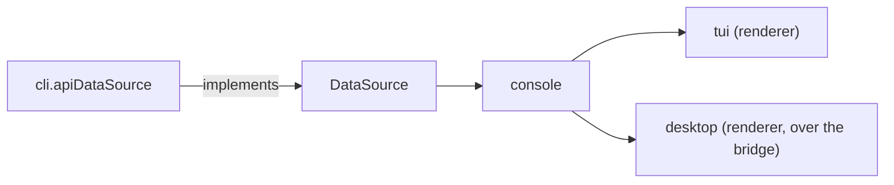

# console

The console core (ADR 26-11-07-876): what the console means, shared by every
frontend that draws it. `cli/internal/tui` is one renderer of it; the desktop
app is the other. Each renderer owns layout, focus, keys, pointer and drawing
(876 §2); this package owns the rules behind them.

## Shape

- **It imports no frontend**: not `internal/tui`, not `internal/cli`, and
  nothing of Bubble Tea or termpane. A rule a renderer needs is moved here,
  never exported back out of a renderer.
- **Navigation stays the renderer's** (876 §2). Which box is on screen, which
  tab has focus, whether there is a sidebar: a rule that depends on one is
  handed it explicitly by the renderer.

## The data seam

`data.go`. `DataSource` is the boundary between the console and the server,
and its types (`Sandbox`, `Session`, `Listing`, `Verb`, `Exec`, the secret,
credential, audit and issue types) are the console's vocabulary. The CLI
implements it once (`cli.apiDataSource`); every frontend reads through it.

What a box allows is answered from its own fields, here: `Attachable`,
`Startable`, `Repairable`, `Live`, its standing and status tags (`tags.go`),
its folder (`folder.go`), the issue or pull request it is tagged with
(`WorkNumber`). Presentation of those answers — glyphs, colours, column
budgets — is the renderer's.
