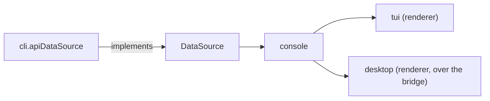
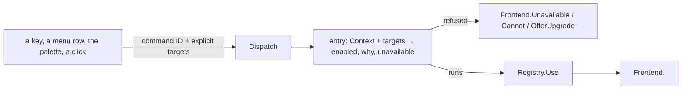

# console

The console core (ADR 26-11-07-876): what the console means, shared by every
frontend that draws it. `cli/internal/tui` is one renderer of it; the desktop
app is the other. Each renderer owns layout, focus, keys, pointer and drawing
(876 §2); this package owns the rules behind them.

## Shape

- **It imports no frontend**: not `internal/tui`, not `internal/cli`, and
  nothing of Bubble Tea or termpane. A rule a renderer needs is moved here,
  never exported back out of a renderer.
- **Navigation stays the renderer's** (876 §2). Which box is on screen, which
  tab has focus, whether there is a sidebar: a rule that depends on one is
  handed it explicitly by the renderer.

## The data seam

`data.go`. `DataSource` is the boundary between the console and the server,
and its types (`Sandbox`, `Session`, `Listing`, `Verb`, `Exec`, the secret,
credential, audit and issue types) are the console's vocabulary. The CLI
implements it once (`cli.apiDataSource`); every frontend reads through it.

What a box allows is answered from its own fields, here: `Attachable`,
`Startable`, `Repairable`, `Live`, its standing and status tags (`tags.go`),
its folder (`folder.go`), the issue or pull request it is tagged with
(`WorkNumber`). Presentation of those answers — glyphs, colours, column
budgets — is the renderer's.

## The command registry

`commands.go` (ADR 26-11-06-671 §4, moved here by 876 §1). One `Command` per
thing the console does, by a stable ID: its label, detail and aliases, its
target (the window, or one box — a batch for the box's lifecycle commands),
and its bindings keyed by frontend (ADR 26-11-07-598 §2): `TUI` (bare keys,
the leader sequence, the menu path) and `Desktop` (chords written with
`primary`).

- **Eligibility is the registry's.** `Entries`/`Entry` answer whether a
  command can act, and why not, from the targets' own fields and the
  `Context` the frontend hands it: workspace, pane, the list's keys, tree,
  the box whose workspace is open, the one box an attach window belongs to,
  and the credential inbox's answers for a box. A frontend never rewrites an
  entry's answer.
  `Lifecycle` is the box's action menu with its reasons.
- **Dispatch is against the core** (`Dispatch`): it resolves the command,
  refuses before entering a flow (nothing selected, a server gone, a
  context that rules it out, a lifecycle command its targets cannot take, a
  box whose image is gone), counts the use, then calls the one `Frontend`
  method that command enters. A target is the one given, never what is on
  screen; a window's command takes none. A box command's other
  preconditions (a tag to open, a request waiting) are refused by its flow,
  in its own words; `Entry` reports them so a frontend offers only what will
  act.
- **`Frontend` has a method per command.** A command is added as a registry
  entry, a case in `Dispatch` and a `Frontend` method together: the compiler
  holds every frontend to the method, and `TestEveryCommandDispatches` holds
  the registry to `Dispatch`. A frontend that cannot offer a command yet says
  so, and the parity ledger (`docs/console/parity.md`) says why. The flows
  behind the methods — dialogs, workspaces, pages — are the frontend's.
- **Use is counted once, as a flow is entered.** A command whose flow is
  also entered by gestures outside the registry (a page's row in the tree)
  counts itself there (`countedByFlow`); `Use`/`Usage` are the window's
  palette ranking (671 §6), and live as long as the `Registry` does.
- **The registry is tested here** for completeness (described, unambiguous
  aliases and keys, primary without shift, every command dispatching to a
  flow of its own); each frontend tests that its own bindings have entries.
