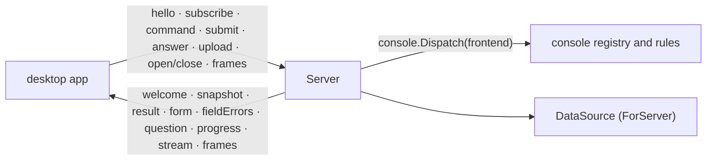

# console/bridge

The desktop bridge (ADR 26-11-07-289): the CLI's side of the pipe to the
desktop app. `discobox desktop` runs the app as its child and hands this
package its stdin and stdout and the window's `console.DataSource`
(`cli.apiDataSource`); `Server.Serve` serves the console core over them until
the app goes. The app's side is the `discobox-bridge` crate
(`desktop/bridge`), which `desktop/src/backend.rs` drives.

## The wire

- **Framing** (`frame.go`, 289 §1): kind, stream (u32), length (u32), payload,
  big-endian, one pipe each way. `KindJSON` is a `Message` on stream 0; every
  other kind is an execstream frame type on a terminal stream.
- **Messages** (`wire.go`, 289 §2): one envelope, `type` and the body of that
  type under the same name. No field is null (lists are `[]`, absent values
  omitted).
- **Generated types** (289 §3): the structs are the wire. `genwire`
  (`go generate`, from `go tool task generate`) writes their JSON Schema,
  `wire.schema.json`, by reflection, with their doc comments and each named
  string's constants as an enum; then the app's Rust types,
  `desktop/bridge/src/wire.rs`, from that schema alone. A field omitted when empty is
  optional; any other is required, and a pointer must be omitted when empty.
  It refuses what it cannot carry faithfully rather than guess: a type that
  marshals itself, a type that contains itself, a pointer to anything but a
  struct (nil would read as the zero value), an enum constant that is not a
  string literal, a name Rust cannot take or that the generated code uses.
  `task verify` fails on either file stale. The tests' fake app holds every
  message either way to the schema, so what the Go writes is what the app
  reads.
- **Contract suite** (289 §4): the app's real client
  (`desktop/bridge/tests/contract.rs`) against this `Server` over a fake core
  (`fakeCore`), across a pipe each way. The CLI's end is `TestContractCore`,
  run from this package's test binary as its own process, and skipped under
  `go test`: its boxes say what the core does, so each case — every message
  kind, frames before a stream attaches, a question while another
  command runs, a CLI exiting mid-command — is reached with a command. It
  runs in CI on Linux only, in `ci:desktop`.
- **Versions** (protocol 8; what each added is `wire.go`'s `Protocol`): `hello` carries `Protocol`; `welcome` answers with this side's,
  and with the spec and session only when they match. The app says which side
  is older and exits; nothing else is served to an app of another protocol.
  Protocol 1 had no envelope: its app's hello is answered with an error in its
  own shape (`send1`), and its CLI's answer to ours is read as protocol 1.

## Commands

`commands.go`. A `command` names a registry ID, explicit box keys and the
app's navigation (`Context`). The server resolves the keys against the last
listing, builds the core's `console.Context`, and runs `console.Dispatch` with
`frontend`, the bridge's `console.Frontend`, under `regMu` (the registry's use
counts are the window's palette ranking). What waits on a person, which a
rule may ask about, is read before (`inbox`: kept for a listing's beat, and
current while the app follows the requests topic). Each method returns an `outcome`,
run after the registry is let go, whose `Result` ends the command:

- **The core's work runs here**: verbs (narrated, purge through the core's
  `Confirmation`, an image gone through `UpgradeOffer`), rename and settings
  as the core's forms, a shell or terminal made and attached to the command's
  stream, a session ended, the source a box is owed delivered before attach.
- **The app's flows are handed back** as `StatusEnter`: focus, pages, menus,
  the workspace to open. `services` comes with the box's services as read
  for its menu, each with its verbs as the core offers them
  (`console.Service.Actions`); with a service and a verb in its args it runs
  that verb instead, refused as the core's actions refuse it. `harnesses`
  comes with the harnesses of the server the app names (`Args.Server`), each
  with its actions as the core offers them; with a harness and an action it
  does that to it instead — the card, the default, a reset asked first, a
  variant through its form, a file edited through `edit` and `saved` — and
  answers with the harnesses read again. `review config` comes with the box's
  harness changes and the core's offers; with a change and the candidate it
  showed it saves or discards that candidate (`console.RunHarnessChange`).
  Each of the three counts its use only as its flow opens. A box flow with preconditions the registry leaves to
  the flow (a tag, a request waiting) is refused here first, in the entry's
  words. The action menu comes with the core's entries; the palette's
  opening counts its use, and what it finds is the palette topic's.

Creating a box is the core's rules run here (`create.go`): the bridge holds
the window's run options (`console.RunOptions`), read against the last
listing's sources, the folder and server the app's list is on, that server's
harnesses and pools, as `new` and `options` start. `options` fills
`OptionsForm` and keeps the answer. `new` fills `CreateForm` for the prompt in
`Args`, cuts from the source answered (where the next opens,
`SaveLastSource`), asks the core's questions (`DefaultHarnessQuestion`,
`AskAboutWorkspace`), then runs the create narrated: its steps as progress,
the box as `accepted` the moment the server takes it, and `enter` with the box
— or `done` for one left detached. The composer topic is the options'
`Summary`, read as it is subscribed, and sent again as they change. They are
read again — the TUI's follow its harness listing the same way — when the app
subscribes the list with another folder or server (never on a listing's beat),
after any harness action on the harnesses page (`frontend.harnesses`), and
after a create's default-harness question sets a default (`NewBox`). The Server row follows the list's server,
as the TUI's does, and its harnesses and pools are that row's server's; a
server chosen on a sheet does not move the app's list back, since which server
the list shows is the app's navigation (the TUI's header and row are one
control); a `draft` message is the composer's
prompt, saved in order on the reader (`SaveDraft`), and `welcome` carries the
last one.

A running command talks to the app through `narrate` (progress, the box a
create made, questions, a file to edit as `edit`, answered by the app's
`saved`: finished with, given up, or why it could not be opened) and `fill` (a form until the core accepts its answers;
each field's `value` is what the core reads it holding, the app sends only
the answers the person changed, merged onto the form's opening; a refusal is
`fieldErrors`, a draft re-sends the form with `applies` and the values
recomputed). A form submitted is done once its command sends anything else —
a question, another form, a step — and the app takes the form down then, so a
command never reports while its form is still up: it reports once `fill` has
returned. Each question and form has its own ID, so one command waits on
its answer while others run. What is submitted to a form is kept in order
(`mailbox`): the pipe's reader never waits on a command, and drops nothing.

## Subscriptions

`subscriptions.go`. Each subscription follows one topic on its own until
unsubscribed, and sends a `snapshot` whole on subscribe and whenever what it
read changed: the listing, the machine's resources and the requests every
`console.ListPollEvery`, as the TUI reads them (the listing at once after a
command changes a box: `relist`); a box's sessions (`console.Sessions`, the
primary first, and only the primary for a box not running, since attaching it
is what waits for the box) every `console.WorkspacePollEvery`, in tab
order with its services' tabs (`console.ListedServiceTabs`) ahead of the primary,
each on its run: a service's tab is the one a snapshot closes, when it no
longer lists it on that run; provisioning
and the audit timeline as they report; and a workspace's header (`console.Header`)
with its ports at the local ports of a forward that lasts as long as the
subscription — the workspace's, which the app ends when it parks one — read
again whenever the forward binds or loses a port and whenever another listing
is read (`relisted`), never by reading the servers itself. A topic about one box
resolves the box once, as it starts, and follows it on its server; a box no
server lists ends it, and a server that could not be reached is tried again
every beat. Which box a
request or a refused credential is about is the core's rule
(`RequestsFor`, `RejectionsFor`), against the boxes listed.

The listing is the core's list (`console.List`, `wireListing`): every box
listed, and the rows the filter shows as drawn — section, nesting, remark,
origin — with the server notes, the filter, how it reads, its choices and
what the archived would add, and whether the filter narrows anything. The
filter is held by the app as the TUI holds its `List`'s (the rules of it are
the core's, which value it is is the renderer's): it subscribes with one, and
again under a new ID to change it, ending the old. With none the listing
opens on the view this machine's windows last left (`Session.Restore`); one
the app chooses is saved when the core says a window saves it
(`Session.Saves`), as the TUI's is. A listing subscribed with `Reveal`, a
box's key, is the core's `Revealing` view of it instead — where the palette
went to a box the filter hid — and is never saved.

The commands and the palette are about what the app asks, not about the
servers: each is read from what the bridge last read — the last listing
(`lastListing`, `cached`) and what last waited on a person
(`cachedContext`) — and sent again whenever another listing is read
(`relisted`), never by reading the servers itself. `commands` is every registry command as it stands for the app's
`Context` and the boxes it names, which the app's menus show enabled or with
why. `palette` is `console.Registry.Palette` for a `PaletteQuery` (the text,
a command or box chip, the archived scope, the box the window is on and the
boxes it went to, by key); text that commits a chip as it is typed
(`console.PaletteCommit`) is answered as the committed query and says so
(`Commit`), with what the search says about every server it searched
(`Partial`, `Stale`). The app subscribes again under a new ID for each query.

## Streams

`streams.go`. The app allocates a stream ID before it opens one (`open`, or a
shell or terminal command). Input, resize and repaint frames sent before it is
attached are kept, in order, and applied when it is; a stream that fails is
forgotten with them, and frames on a stream that ended are dropped. Output is
`Stdout` frames, the end one `Exit` frame carrying why; `stream` messages say
attached, failed, reconnecting, reconnected, and ended: an ended or failed
stream carries what that does to the workspace (`console.Tab.End`: the
workspace, the tab, or the tab held with its last screen and what it says), by
the tab the core made the session: one made here (shell, terminal) is attached
with the tab it was made as, and one the app opens is looked up in what its
box's sessions topic listed (`Server.tab`, the primary by its ID; kept while
anything follows the box's sessions); a service's tab is opened on what the
core opens for its service as that listing last said it
(`console.OpenService`): its process after its history, or its card. It is
sent before the Exit frame. `close` detaches a stream and ends
nothing in the box; the `end` command ends the session in the box first, and
closes its stream only once it has. What is kept early is bounded per stream
(`earlyLimit`), and a CloseInput frame is dropped (289 §1).

