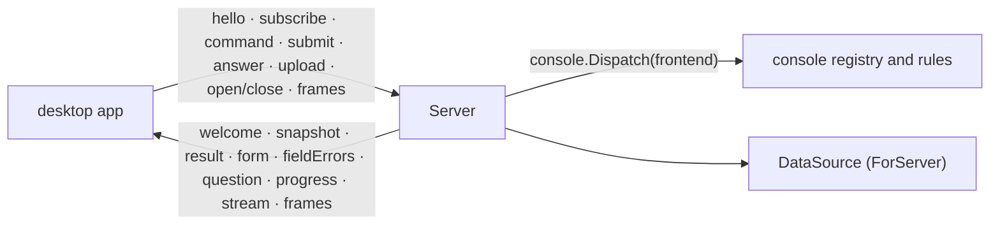

# console/bridge

The desktop bridge (ADR 26-11-07-289): the CLI's side of the pipe to the
desktop app. `discobox desktop` runs the app as its child and hands this
package its stdin and stdout and the window's `console.DataSource`
(`cli.apiDataSource`); `Server.Serve` serves the console core over them until
the app goes. The app's side is the `discobox-bridge` crate
(`desktop/bridge`), which `desktop/src/backend.rs` drives.

## The wire

- **Framing** (`frame.go`, 289 §1): kind, stream (u32), length (u32), payload,
  big-endian, one pipe each way. `KindJSON` is a `Message` on stream 0; every
  other kind is an execstream frame type on a terminal stream.
- **Messages** (`wire.go`, 289 §2): one envelope, `type` and the body of that
  type under the same name. No field is null (lists are `[]`, absent values
  omitted).
- **Generated types** (289 §3): the structs are the wire. `genwire`
  (`go generate`, from `go tool task generate`) writes their JSON Schema,
  `wire.schema.json`, by reflection, with their doc comments and each named
  string's constants as an enum; then the app's Rust types,
  `desktop/bridge/src/wire.rs`, from that schema alone. A field omitted when empty is
  optional; any other is required, and a pointer must be omitted when empty.
  It refuses what it cannot carry faithfully rather than guess: a type that
  marshals itself, a type that contains itself, a pointer to anything but a
  struct (nil would read as the zero value), an enum constant that is not a
  string literal, a name Rust cannot take or that the generated code uses.
  `task verify` fails on either file stale. The tests' fake app holds every
  message either way to the schema, so what the Go writes is what the app
  reads.
- **Contract suite** (289 §4): the app's real client
  (`desktop/bridge/tests/contract.rs`) against this `Server` over a fake core
  (`fakeCore`), across a pipe each way. The CLI's end is `TestContractCore`,
  run from this package's test binary as its own process, and skipped under
  `go test`: its boxes say what the core does, so each case — every message
  kind but `edit`, frames before a stream attaches, a question while another
  command runs, a CLI exiting mid-command — is reached with a command. It
  runs in CI on Linux only, in `ci:desktop`.
- **Versions**: `hello` carries `Protocol`; `welcome` answers with this side's,
  and with the spec and session only when they match. The app says which side
  is older and exits; nothing else is served to an app of another protocol.
  Protocol 1 had no envelope: its app's hello is answered with an error in its
  own shape (`send1`), and its CLI's answer to ours is read as protocol 1.

## Commands

`commands.go`. A `command` names a registry ID, explicit box keys and the
app's navigation (`Context`). The server resolves the keys against the last
listing, builds the core's `console.Context`, and runs `console.Dispatch` with
`frontend`, the bridge's `console.Frontend`, under `regMu` (the registry's use
counts are the window's palette ranking). What waits on a person, which a
rule may ask about, is read before (`inbox`: kept for a listing's beat, and
current while the app follows the requests topic). Each method returns an `outcome`,
run after the registry is let go, whose `Result` ends the command:

- **The core's work runs here**: verbs (narrated, purge through the core's
  `Confirmation`, an image gone through `UpgradeOffer`), rename and settings
  as the core's forms, a shell or terminal made and attached to the command's
  stream, a session ended, the source a box is owed delivered before attach.
- **The app's flows are handed back** as `StatusEnter`: focus, pages, menus,
  the workspace to open. A box flow with preconditions the registry leaves to
  the flow (a tag, a request waiting) is refused here first, in the entry's
  words. The palette and the action menu come with the core's entries.

A running command talks to the app through `narrate` (progress, the box a
create made, questions) and `fill` (a form until the core accepts its answers;
a refusal is `fieldErrors`, a draft re-sends the form with `applies`
recomputed). Each question and form has its own ID, so one command waits on
its answer while others run. What is submitted to a form is kept in order
(`mailbox`): the pipe's reader never waits on a command, and drops nothing.

## Subscriptions

`subscriptions.go`. Each subscription follows one topic on its own until
unsubscribed, and sends a `snapshot` whole on subscribe and whenever what it
read changed: the listing, the machine's resources and the requests every
`console.ListPollEvery`, as the TUI reads them (the listing at once after a
command changes a box: `relist`); a box's sessions (`console.Sessions`, the
primary first, and only the primary for a box not running, since attaching it
is what waits for the box) every `console.WorkspacePollEvery`; provisioning,
the audit timeline and port forwards as they report. A topic about one box
resolves the box once, as it starts, and follows it on its server; a box no
server lists ends it, and a server that could not be reached is tried again
every beat. Which box a
request or a refused credential is about is the core's rule
(`RequestsFor`, `RejectionsFor`), against the boxes listed.

The listing is the core's list (`console.List`, `wireListing`): every box
listed, and the rows the filter shows as drawn — section, nesting, remark,
origin — with the server notes, the filter, how it reads, its choices and
what the archived would add. The filter is the app's (876 §2): it subscribes
with one, and again under a new ID to change it. With none the listing opens
on the view this machine's windows last left (`Session.Restore`); one the app
chooses is saved as the TUI saves it (`SaveView`), unless the window was
opened nowhere.

## Streams

`streams.go`. The app allocates a stream ID before it opens one (`open`, or a
shell or terminal command). Input, resize and repaint frames sent before it is
attached are kept, in order, and applied when it is; a stream that fails is
forgotten with them, and frames on a stream that ended are dropped. Output is
`Stdout` frames, the end one `Exit` frame carrying why; `stream` messages say
attached, failed, reconnecting, reconnected. `close` detaches a stream and ends
nothing in the box; the `end` command ends the session in the box first, and
closes its stream only once it has. What is kept early is bounded per stream
(`earlyLimit`), and a CloseInput frame is dropped (289 §1).

`edit`/`saved` are on the wire for the waves that edit harness and tool files;
nothing the core runs over the bridge asks for one yet.
