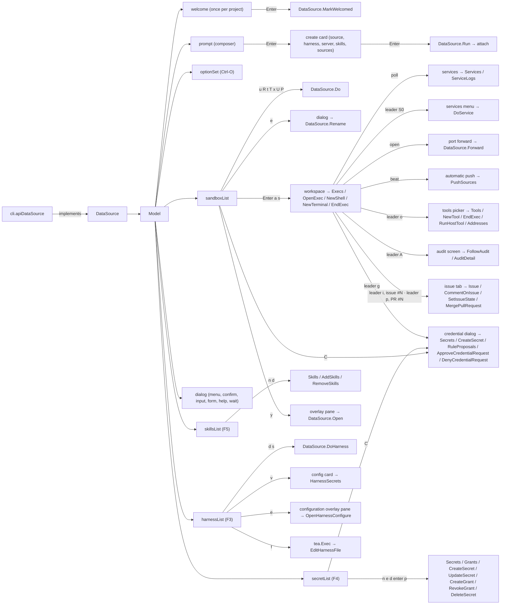

# tui

The `discobox console` window: it opens on the project's sandboxes, with a
prompt for a new one a press of Esc away — and in that prompt when there are
none.

## Shape

Elm/Model-View-Update on Bubble Tea v2 (`charm.land/bubbletea/v2`, `bubbles/v2`,
`lipgloss/v2`). One model, not a screen stack: the window is a prompt, a list,
and one modal layer over both. All IO happens in `tea.Cmd`s, never in `Update` —
with one deliberate exception, the draft saved on the way out (`draft.go`).



Harness configuration is a local PTY-backed overlay pane running the same
`discobox admin harness configure` command available from a shell. Its border
names the flow as harness configuration, while the header outside the terminal
shows the harness bundle's optional configuration reminder. This keeps prompts
drawn by the harness visually inside a setup flow rather than presenting them
as an ordinary harness session.

The same header carries a **warning about the ports the flow declared and this
machine cannot give it** (`Harness.ConfigPorts`, `configurePortWarning`), in the
harness bundle's own words — Codex's says to sign in by device code instead,
since its browser sign-in redirects to a `localhost:1455` that was not there to
forward. The command in the pane binds those ports and prints the same words,
but a full-screen sign-in paints over its terminal within seconds; the header
is where the words survive the session. The window does not bind anything: it
asks `DataSource.LocalPortsInUse` just before opening the flow, so the probe has
let go by the time the command binds for real, and draws the answer in the
header's error color. An ephemeral entry is not probed: its port is whatever the
sandbox listens on later, so only the command can say it was taken. On a row too narrow for both, the warning outranks the
reminder — the reminder says how the flow goes, the warning says why it will
not.


## The skills screen

`skills.go`, on `F5`: the skills every new discobox gets, wherever each is kept
(ADR 26-10-14-894). The project's skills sources on the header's server come
first, in the order a create adds them, then client.yaml's `run.skills`, which
are this machine's whichever server the header is on. Each row says where it
is kept. It is `discobox skills` folded into the window, and the secrets
screen's shape: `n` asks for one value and `DataSource.AddSkills` files it by
what it is, read as `--skills` reads it — a repository, a Git URL or GitHub
`owner/repo` with `[@REF][//PATH]`, with the project, a directory in
client.yaml — so there is one thing to type rather than a list to choose. Each
row reads in its short spelling (`sourceref.Display`: `owner/repo//skills`, a
directory from `~`), which is itself what `n` takes; `d` asks before `RemoveSkills` takes the row out of
where it is kept, and says that discoboxes already made keep theirs. ←→ move
the server as on the other two screens, and a listing read for a server the
header has since left is dropped (`skillsLoaded`).

## The secrets screen

`F4`, beside the harnesses screen and built the same way: a list on a function
key, one letter per action, and every action the same API call the `discobox
secret` commands make. A window that could approve something the CLI could not
would be a second policy. See `secrets.go`.

**Three tables, read downwards.** The secrets on top, what is waiting on a
person underneath, and under that the approval rules (below). The first two
belong on one screen because they are one question: which of these credentials
answers this request. Off the bottom of the secrets is the requests table and
off the top of that is the secrets again, the way the discobox list and the
prompt hand focus to each other; Tab goes down through the tables and round,
and Esc — not Tab — leaves. The requests table takes only the rows it needs, up to
a third of the screen, so "nothing is waiting" costs one line rather than half
the window, and the secrets take only the rows they have, so the two tables sit
together with two blank rows between them. What is left over falls below them
both rather than between: the window keeps its full height without putting a
screen of nothing between two tables that are read as one. A request row says what is being asked for, where it may go, who is
waiting (an agent, the proxy on a discobox's behalf, or a person) and for how
long; Enter answers that one, while `C` answers the oldest from anywhere. The
lower table's height is counted from its rows, so `syncRequestRows` lays the
window out again whenever a poll changes how many there are.

A secret row is what tells one credential from another: its name, the host it is
bound to — spelled `any host` rather than left blank, because blank reads as
"not loaded" and this is a fact about the secret — how many grants stand on it,
and when it last changed. Its kind and its grant limit are not there. They are
facts about a credential rather than ways to pick one out of a list, and a row
carrying every field is a row nobody reads; Enter opens the secret, and they are
in it. Grants are read for the whole project in one call and counted per row,
rather than a call per row.

`Enter` **opens the secret**: what it is, then what may use it. For a token
that is its kind, its binding and the ceiling on its grants — spelled `forever`
when nothing limits them, since zero is the answer "no limit" and `never`, how a
zero duration reads everywhere else, would say the opposite; for an OAuth
credential it is also where it renews, whose client it is, what the grant may
do, when the access token goes stale, and — said plainly, because it is the one
thing that makes an OAuth credential useless — whether it can renew itself at
all. None of it is the credential: not the access token, not the refresh token.
The rows under it are the grants, and the first one **makes one**, so a
credential with nothing standing on it is somewhere to decide who may use it
rather than a dead end naming another command. `n` stores a new credential and
`e` edits one, both on the same form (`secretForm`); `d` deletes, saying how
many live grants go with it and defaulting to No. `C` answers the oldest
request waiting anywhere in the project — including one no discobox owns, which
the list's row mark cannot carry and which would otherwise have no home.

**The rules are a third table, under the requests** (`projectrules.go`,
`ruleList`,
[ADR 26-10-12-330](../../../docs/adr/26-10-12-330-a-credential-request-may-be-answered-by-a-rule-the-judge-reads.md)
§§1, 4): a rule answers requests nobody is shown, so what the project holds is
on the screen, not behind a key. They are read with the screen's own load
(`loadSecrets`, `DataSource.Rules`) and cleared with it on a change of server.
A rules read that fails alone — a server that predates the route — does not
take the screen down: the secrets and requests load, and the table says
`cannot read rules: <error>` on one dim line (`ruleList.fail`), holding no rows
and taking no cursor until the next load reads them.

- **focus** (`Model.table`, `tableBelow`/`tableAbove`/`nextTable`): ↓ off the
  bottom of a table reaches the next one down that has a row, ↑ off the top
  the one above, Tab goes down the screen and round to the secrets, and a
  press says which table it landed in (`hitRuleRow`). An empty table is a line
  and takes no cursor — except the rules read and found empty, whose line is
  where `n` makes the first one (`rulesReachable`) — in a window too short to
  draw it too, since moving into the rules swaps them in; a rules listing not
  read, or failed, takes none.
- **a row**: credential (a secret by name), state (`enabled`/`disabled`/
  `lapsed`), which discoboxes — its repositories cut to the column, or
  `every discobox`, led by `delegates` for a rule to delegate, which only an
  older server made — its policy's
  statements as one line (`ruleRowPolicy`), and expiry. The credential and
  repositories columns are as wide as the table's widest, within bounds, and
  the policy takes the rest of the row and is cut to it; in a narrow row the
  repositories give up room to the policy first. Expiry drops first as the
  window narrows, then the policy, then
  the repositories; the credential and state stay. No rules is a line saying
  `n` makes one, and that auto approve does too.
- **height** (`layout`): the rules take their rows up to a quarter of the
  screen, as the requests take a third. A window too short for a row of each
  table leaves one of the lower two out — the rules unless they have the keys,
  then the requests (`rulesHidden`, `requestsHidden`); one left out is neither
  drawn nor marked.
- **keys on a rule row** (`ruleHints`): `n` makes a rule, Enter reads it, `e`
  edits it, `s` disables or enables it (the key line says which), `d` deletes
  it behind a question. On the empty table the key line is `n` alone.
- **the card** (`openRule`, `showRule`): read fresh, with the grants the rule
  minted by rule (`GrantFilter.RuleID`). The review card's own sections, drawn
  from the same `Rule` value (`ruleFactsSection`, `ruleSections`,
  `ruleHandsOut`; `approval.asRule` is the rule a review is of), with state,
  the cap on each grant, expiry, and who made it and when (`ruleText` is the
  rule's whole text on every card that shows one; its policy is drawn as the
  request card draws one, by `policyview.Unbound`, each variable bare since a
  rule binds it to whichever discobox asks). Its rows are `e`, `s`,
  `d`, and the grants still standing, named by their discobox: Enter reads one
  and `x` revokes it, through the secret's own cards (`reviewGrant`,
  `confirmRevokeGrant`). Esc is back on the rule's row.
- **making and editing** (`ruleedit.go`): see below.

**A rule is made and edited a step at a time** (`ruleDraft`, `ruleStep`),
on the cards auto approve uses, generalised so both flows share them: the
discoboxes step (`askDiscoboxes`), a list typed a line at a time
(`askLines`), a lifetime menu (`askDuration`), and the rule's whole text
(`ruleText`) on a last card that asks, defaulting to No.

- **the steps**, in order: the credential (a new rule only: a well-known ID a
  project secret answers, or a project secret; one bound to no host is
  disabled and says why), which discoboxes (repositories chosen and named on
  one card, below, or every discobox, its own row), what it approves (its
  policy, a line each: below), its longest grant (presets, `the secret's
  own limit`, custom; it opens on an hour, the server's default), when it
  lapses (opens on `never lapses`; an edit of a rule that lapses has `as it
  is` first), and the rule.
- **back and forth**: each step opens on what the draft holds now, and Esc is
  the step before, so nothing chosen is lost walking back. Esc never changes
  a word: a list step hands back its list as it stands, half-typed text and an
  edit not yet confirmed included, and the draft keeps it (`ruleDraft.policy`,
  `ruleDraft.repositories`). Leaving the first step closes the flow, or goes
  back to the card an edit was begun on.
- **a list** (`askLines`, `lines.go`): the lines written, then the new line,
  as the input card's rows — `viewItems`, marked as a menu's are, answered by
  `dialog.itemPress` rather than the field's action, and drawn in the normal
  text colour (`dialog.inlineRows`). The line under the cursor is its own
  editor, in its place (`dialog.editor`, a `textarea` sized by
  `layoutEditor`): every row of it wrapped and the cursor in it, so a
  sentence is never echoed in a second field, cut, or scrolled sideways; only
  the `❯` and the cursor say which line it is. Every line wraps by the
  editor's own rule at the editor's width (`editorLines`, the column it keeps
  for the cursor included), so selecting a line never moves where it breaks.
  A wrapped row is drawn whole
  while the card has room for it, and one row, scrolling under the cursor,
  when it does not. The section title holds still ("what it approves",
  "repositories"). A rule's policy lines are numbered `1.`, `2.`… right-aligned past
  nine, the new line the next number, a wrapped line set in under its text
  (`linesAsk.numbered`, drawn in the menu's key column); repositories are
  not, since ticks and names are not an order. ↑ and ↓ move between lines,
  keeping what was typed on the one left; a press on a line takes it up as ↑
  would, and the wheel walks the list as the keys do (`dialog.keyFirst`).
  Enter on a line keeps the edit in its place, and on one emptied removes it
  — the key line says so. Moving off a line never removes it. Enter on the
  new line, empty, finishes the list, refused when it must have one. Each
  line carries what it draws and what it sends (`listLine`): a line the
  server holds is drawn made safe and sent in the server's own text
  (`Rule.Stored`) until the person changes it, so an edit never rewrites a
  line nobody touched — for a policy, what is compared and sent is the policy
  read back from the lines as sent. The key line puts Esc second, after the one key the
  position needs most, and is short enough to stay whole at 90 columns: a key
  line is cut from its tail, and the way out must survive.
- **the repositories** are one list with picks above its lines
  (`newPickList`, `repositoryList`): every repository the console knows for
  the project — an edited rule's own first, chosen, then those of the
  project's discoboxes on the rule's server (`Sandbox.RepositoryIdentity`,
  their primary source reduced by `sourceref.NormalizeRemote` as the server
  reduces it, and drawn through `terminalSafe` as `Sandbox.RepositoryShown`
  while the raw identity is what is sent) and of its other rules, each once,
  sorted. The picks are rows too: a press ticks or clears one. ↑ from the
  first line reaches them; Space or Enter ticks or clears the one under the
  cursor, and on a pick the field takes no keys — a paste there is refused on
  the card (`dialog.pasteRefused`), not dropped. An entry typed that is one
  of the picks, however spelled (`repositoryIdentity`), chooses that pick
  instead of being a second line. Finishing needs one chosen or named.
- **the policy** (`rulepolicy.go`) is written as discobox-access writes one:
  each statement its sentence (`policy.Format`), then each word that is not a
  default as `word = what it means` (`policyText`; a line opening with
  `allow` or `deny` is always a statement). The list is read back
  (`parsedPolicy`: `policy.Parse` a line at a time, then `Policy.Validate`,
  and at least one allow) as it is written, and what keeps it from being a
  rule's policy is a section under the steps' own, a line each, with
  `policy.Grammar` once (`policyProblemsSection`); finishing it then is
  refused where it was typed (`notAPolicyYet`). The draft draws the policy
  read from the lines as drawn and sends the one read from them as sent
  (`listPolicy`).
- **an edit** starts on which discoboxes — the credential is what a rule is —
  with every step prefilled from the rule. The last card says what changes,
  before → after, with the policy it approved before drawn whole, and sends
  only those (`RuleChange`, `DataSource.UpdateRule`); one that changes
  nothing sends nothing. A policy is a change when it says something else
  (`samePolicy`), not when its lines were only reordered.
- **a new rule** sends what was chosen (`NewRule`, `DataSource.CreateRule`):
  a well-known ID alone, which the server answers with the secret marked for
  it; the cap always, zero being the secret's own limit; every discobox in so
  many words; and the hosts the last card reads — the well-known
  credential's, or the secret's binding — so the rule stored is the rule
  read. The purpose is the server's default, to use, except for a rule made
  of a delegation grant.
- **a rule made of a grant** (`reviewGrant`'s `n` row, `proposeGrantRule`,
  `grantRuleProposed`): the grant card offers it when the grant carries a
  policy (`Grant.Approved`),
  stands on a secret, and no rule minted it (otherwise the row says why).
  `DataSource.GrantRuleProposals` is waited on as auto approve's proposal is,
  Esc stopping it. The draft (`ruleDraft.from`) is a new rule whose
  credential, hosts and purpose are the grant's — for the well-known ID when
  its secret answers one — so it starts on which discoboxes, Esc there going
  back to the grant: the asking discobox's repository ticked, the judge's
  policy when it covers the grant's and the grant's own otherwise, said on
  the policy step as auto approve says it (`policySections` with
  `grantOrigin`), and each grant as long as this one was given. A
  delegation grant is offered no rule: none approves a delegation yet (ADR
  26-10-22-689 §4).
- **a refusal** comes back whole on a card whose Esc is the step it is about
  (`refusedStep`, read from the server's own words: repositories, the policy, the
  cap, the expiry, the credential; anything else is the last card), opened on
  what was chosen.

Disabling sends only `enabled` (`DataSource.SetRuleEnabled`) and asks nothing:
it mints nothing more and revokes nothing, and the same key undoes it. Deleting
asks, defaulting to No, and says the grants it minted stay to be revoked one by
one. Each change re-reads the screen, which keeps the cursor on the rule or, for
one deleted, on the row that took its place, and one made from the card comes
back to the card (`ruleActed`); a revoke comes back the same way
(`secretActionMsg.after`). A refusal is an error card.

**A decision is one card, not a run of questions** (`form.go`, `dlgForm`). A
pre-approval or a new secret has seven or eight parts, and a sequence of
modals is the wrong shape for a decision whose parts are read against each
other: nothing can be revised without abandoning the run, the answers already
given are off screen by the third question, and the shape of what is being
granted is only visible once it has been granted. A form asks everything at
once, in the same label/value column a card is read as — the thing being built
looks like the thing it will be when it is read back.

Rows that a given answer makes irrelevant are **dimmed and stepped over, not
taken away**. Choosing "an OAuth credential" must not produce four fields nobody
knew were coming, and a card that reflowed under the cursor would be a card that
moved the row being answered. An unanswerable row says which it is: not yet
applicable (`only for an OAuth credential`), or not editable at all
(`unchanged — type to replace it`). One `hint` line under the form carries the
sentence for the row — or the picker option — under the cursor.

A picker is stepped through with ←→, and **Enter lists every option** under the
row, each with its meaning (`form.listing`): ↑↓ walk the list, Enter or a press
takes one, Esc closes the list rather than the card, and the hint line says the
whole of the highlighted option. Because Enter on a picker lists, **ctrl+s
accepts a card from any row**, and the key line offers the card's own "enter …"
on ctrl+s while the cursor is on a picker (`formHints`).

That line keeps **`hintRows` rows whether or not it has anything to say**. A
dialog is drawn from its content and a sentence wraps to as many rows as it
needs, so an explanation that ran to three rows on one row of the form and one
on the next made the window taller and shorter as the cursor moved down it —
every row under the cursor shifting while somebody is reading them, on a card
whose whole point is that it holds still. A sentence longer than the allowance
is folded onto its last row and cut with an ellipsis.

**Create and edit are the same form** (`secretForm`). Editing opens on what the
credential is and takes everything the server will change: the name, the
binding, the grant limit, and the value. A value cannot be read *back* — nothing
here can — but it can be replaced, and a card that would not take one made
rotating a token a matter of deleting the secret and storing it again, taking
every grant standing on it along with it. The value rows say
`unchanged — type to replace it`, and leaving them empty is the ordinary answer.

**A secret's routes are one row each** (`secretRouteRows`), under their own
rule at the foot of the card, with one empty row after them for another. Each
is typed as the CLI's `--route` takes it, `HOST[/PATH][=USE]`. A use is a
sentence that may hold any punctuation, so no separator could share a row
between two. A row that is not a route is refused on the card. Emptying a row
drops that route, and emptying them all clears them (ADR 26-10-02-924). The
detail card lists each route as `allowed` or `judged: <use>`.

The **kind** is the one row an existing credential locks: a token and an oauth
credential are stored and renewed differently, and the server has no answer for
a secret that changes from one to the other — that is a new credential, and
deleting the old one is somebody's decision rather than a side effect of an
edit.

**A value is replaced whole** (`replacementValue`). The server stores one value
per secret and overwrites it, so half an oauth credential is not a smaller
change — it is the rest of it dropped. Touching any part of one means supplying
all of it, and since the two tokens are exactly the part nobody can copy off the
card, this is refused on the form rather than sent: `replacing an oauth
credential means its access token too`. The renewal fields are prefilled from
the stored credential, because those *are* readable, so rotating tokens does not
mean retyping the endpoint.

**The sentinel format is the card's last row** (`formFormat`), under its own
heading, because it is an override almost nobody makes: the shape is read from
the value, and the row sits off the path a person tabs down to store a
credential. Only a *chosen* format opens filled in; one read from the value is
the row's placeholder, so saving an untouched card sends no format and cannot
turn a derived shape into a choice nobody made. Emptying a chosen one clears it.
A template is parsed on the card with the server's parser (`secretformat`), so a
mistyped one is refused with the card still up. Reading the credential says the
format and whether it was set or read.

**One form, one call** (`DataSource.UpdateSecret`, `SecretUpdate`). The host,
the limit, the name and the value are one endpoint, and a card whose rows were
saved by a call each would half-apply when the second failed and report two
things where a person did one. Every field of `SecretUpdate` is a
pointer, because absence has to be spelled differently from the values: an empty
host releases a binding and a zero limit allows grants that never expire, so
neither can stand for "unchanged".

**A lifetime is asked as the answers people give** (`ttlRows`, `ttlSeconds`):
1 hour, 1 day, 1 week, 1 month, forever, and a typed one behind `custom…`.
Seconds alone was a field nobody could answer without arithmetic, and `604800`
is not a week to anyone reading it back. The presets, their spelling and what
the typed row accepts all come from `cli/internal/lifetime`, which is also what
the `discobox secret` flags parse — a window offering a month the flags could
not express would be a second vocabulary for one decision. On a secret the row is labelled **grant limit**,
not "grants last": the value is a ceiling, and "grants last 1 day" states it as
the lifetime every grant on the credential gets, which is the opposite of what
it does. Reading the credential says it the same way. A new credential is stored with **no limit** unless one is
chosen: a limit is a decision about how long consent may last, and a default one
is a decision nobody made — it expires grants mid-task, far from this form, and
teaches people to grant again rather than to pick a limit. The limit travels
*with* the credential (`NewSecret.MaxTTLSeconds`) rather than being set by a
second call, because a secret that exists for even a moment without one is a
secret limited by whatever the server's default happens to be, and zero is sent
explicitly since leaving it out would mean exactly that.

**A form that is not answered stays up, holding what was typed.** A missing
required row or a lifetime that cannot be read puts the reason on the hint line
and the cursor on the row; closing the card and reporting onto the screen behind
it would throw away everything already entered.

**Reading a grant is not the same key as ending one.** In the grants list
`Enter` reads — scope, where it may go, when it lapses, and for a grant minted
by approving an agent's request, every approved use with the ID an agent
presents to `discobox-access run --use`, and the approved policy, rendered as
the request card renders one, its variables as they resolved at approval.
`x` withdraws, behind a confirm.
Revoking on `Enter` put ending a credential one keystroke from looking at one,
on the key that means "open this" everywhere else in the window.

**A lapsed grant is hidden until asked for.** It authorizes nothing, so the
row's count and the list leave it out; a row under "Grant this secret…" says how
many there are and `a` shows or hides them.

**A question answered "no" leaves you where it was asked.** Declining a revoke
returns to the grants, leaving a grant you were reading returns to the grants,
and declining a rebind returns to the credential picker. A dialog that closes
onto the screen behind it, having done nothing and said nothing, is how a
deliberate "not that one" reads as the window ignoring the keypress.

**The window says "harness", the wire says `harnessConfig`.** The resource is a
harness config and the API's scope value is `harnessConfig`; a person calls it
the harness, and one `scopeLabel` turns the first into the second everywhere it
is drawn. A window that used both would be teaching two names for one thing.

**A grant is asked how it may be used.** An injected credential is an
environment variable, and everything in the box shares the environment; one with
declared uses is not in the box at all — `discobox-access` takes it one use at a
time, for one command, and the value dies minutes later. So the form asks, and
the narrow answer brings out the variable the wrapped command receives it in and
the job it is granted for. It opens on the ordinary kind: a pre-approval is
usually a credential somebody wants the box simply to have, and the narrow kind
is mostly what an agent's own request mints. The job is what the agent names to
take a value. The narrow kind carries a policy too (#312), which is what `run`'s
judge holds the command up against: Enter on the form opens a second step
(`askGrantPolicy`), the line list a rule's policy is written in — a statement
a line, then `word = what it means` — read as it is written (`parsedPolicy`,
`policyProblemsSection`), and the grant is minted only once the lines are a
policy that allows something. Esc goes back to the form as it was answered,
and the lines are kept for the way forward again. It is asked at every
scope: the binding it needs is per discobox, but the grant is minted when that
discobox's agent first asks, so a project grant can carry uses without knowing
which boxes it will cover — and then only a policy that names no variable,
which only a discobox resolves.

**`p` grants a secret before anything asks for it** — the pre-approval an
operator makes because they already know the answer. Scope first, since it
decides whether there is a key to ask for next: a project grant needs none, and
a discobox or harness is picked out of what the window already holds
rather than typed as an ID that has to be right. Then the host, opening on the
secret's own binding, and the lifetime, opening on the secret's limit. That
question says the limit rather than leaving the server to refuse what is over
it: a capped credential cannot be granted forever, and learning that from a
rejection teaches the rule one rejection at a time.

**`e` edits what a secret says about itself** — the two statements of the same
kind: which hosts it may reach, and how long a grant on it may live. Neither
touches the value, which nothing in the window can read.

Every action re-reads the listing rather than patching what is on screen: a
screen that guesses at the new state is a screen that drifts from the server.

## The credential inbox

An agent inside a discobox can ask a person for a credential it was not
provisioned with ([ADR 0031](../../../docs/adr/0031-agent-credentials-are-a-portable-protocol-with-ephemeral-sentinels.md)),
and until somebody answers, it is blocked. The window's job is to make that
visible without letting it take the screen. See `credentials.go`.

**It holds trust requests too** ([ADR 0149](../../../docs/adr/0149-a-host-certificate-is-trusted-for-one-sandbox-when-a-person-pins-it.md)).
The poll reads the server's `approval-requests`, which lists credential and
trust asks together, so each beat is still one inbox call per server. A trust
ask is a `CredentialRequest` with `Trust` set — marked, bannered, and listed
like any other — whose dialog (`trusts.go`) asks which certificate from the
chain the pool was shown to pin, the server's default first and the leaf's key
last, then how long, from an hour to a month: a trust always lapses.

**It holds refresh requests too** ([ADR 26-09-25-122](../../../docs/adr/26-09-25-122-a-token-may-expire-and-suggest-the-command-that-renews-it.md)).
A token whose value went stale or was refused asks for a new one; the item is a
`CredentialRequest` with `Refresh` set, and its dialog (`refresh.go`) shows the
token's command before anything runs and offers to run it once, run it for the
session, take a typed value, or dismiss. The command runs in the data source, on
this machine, without a shell (`refreshcmd`). "For the session" is a permission
in the window's memory, keyed by server, token, and the exact command
(`sessionKey`): the poll answers that pair's next asks unprompted
(`renewBySession`), an edited command asks a person again, and a failure drops
the permission. A request's "New credential…" is F4's own new-secret form,
filled from the request (see below), so a well-known credential that suggests
a command is stored from it by default there; F4's new token picks between
entering a value and getting it from a command, with how long a value lasts
(5m unless chosen, or the lifetime a well-known credential says its value really has — a day for GitHub; minutes to a day, not a grant's weeks and months), which the
edit card changes for any token. F4's kind offers every
well-known credential with a value after token and OAuth: choosing one fills in
its name, host, and command (`fillWellKnown`, leaving alone what was typed) and
stores a token that answers that ID from the start.

**It is polled, not pushed.** The requests are read on the same 5s tick as the
listing; there is no client-facing event stream to subscribe to
([ADR 0061](../../../docs/adr/0061-the-client-facing-project-event-stream-is-removed.md)),
and an approval is answered on human time anyway. One read serves both the row
and the workspace: `setCredentialRequests` indexes by discobox and stamps the
count onto the rows, so the draw stays a pure function of what the list holds.

**It is every server's, and each request is answered on its own**
([ADR 0131](../../../docs/adr/0131-the-launcher-answers-every-servers-credential-requests-and-names-the-server-its-config-screens-edit.md) §1).
`CredentialRequest.Server` names where it waits, and everything that answers
it — the secrets offered, a credential typed in, the approval, the denial —
is sent there, because only that server's secrets can answer it. So a
registered server's discobox is marked and bannered like the primary's, and
the card names the server once there is more than one.

**The list marks, and never interrupts.** A row with a request waiting wears a
`!` beside the upgrade arrow, in the error color rather than the warning one —
an upgrade can wait, an agent cannot. Nothing raises a dialog on its own: a
request can arrive at any moment, and a window that takes the screen mid
sentence teaches you to answer without reading. `C` on the row opens the
question; the key is capitalized because approving a credential is not a
keystroke to hit by accident, and `g` is already the top of every list here.

**The workspace says it loudly, at both ends.** Looking at one discobox is the
one place the window knows you are already attending to it, so the request gets
a band of its own under the header *and* one above the keys, naming what is
being asked for and the leader key that answers it. Two, because the screen
between them is a full terminal: whichever end of it you are reading, the
question is in reach. The bands exist only while something is waiting, and so
does the hit test, which is re-recorded by every draw. The band itself is
`banner.go` — see **The attention band** below.

**The leader answers on `g`, not on the list's letter** (`credentialsLeaderKey`).
This is the one place the workspace does not carry the list's key: the leader's
`c` opens another terminal, and a shift away from it sat the dialog that hands
out a credential — two commands one modifier apart, one of them consequential
and reached for in a hurry, on a screen whose banner is asking you to hurry.
There is no list in the workspace for `g` to be the top of, so it is free, and
it is the letter of the thing it does.

**The dialog decides nothing.** It shows what was asked — the credential, the
env var, the host, the justification, the uses the agent declared, and the
policy it asks for (ADR 26-10-20-782 §3; `policyLines`, drawn from the
`policyview` rendering the data source made safe, and highlighted as syntax
by its tokens' kinds in the code-block palette, `policySpans`) — and collects
two answers,
one per step: which secret answers it (a project secret, a credential typed in
on the spot, or a denial), then how long the grant lives. Everything else
follows the request on the server, which is what keeps this and `discobox
secret request approve` the same act. A policy is the one thing an approval
sends back: the request's own, as the card read it, resolved values and all,
which the server holds the grant to — what `approve --policy-as-asked` sends.
Only a request with a policy, asking to use a credential, is offered auto
approve (`Ruleable`): a rule holds a request's policy to its own, and
approves no delegation (ADR 26-10-22-689). `r` shows the request as the server sent it, as JSON
highlighted as a code block is (`showRawRequest`), for when the rendering is
not enough; Esc goes back to the card. Every secret is offered,
including one bound to another host: greying those out left the one secret that
plainly answers the request unpickable, so the binding is asked about on the
way through instead (`confirmGrantHost`), in the words the server would refuse
it with. A request may name several hosts (ADR 26-10-02-393): the card shows
them all, a binding must cover every one, and a credential typed in on the spot
is bound to the site they share — or to nothing, when they share none
(`CredentialRequest.binding`).

**How long is a required second step** (`askLifetime`, through
`askDuration`, which the rule flows share). Choosing a secret opens
a card of its own — 1 hour, 1 day, 1 week, 1 month, forever, and `custom…` for a
typed one — with the cursor on the lifetime the agent asked for
(`CredentialRequest.GrantTTL`, shown on the request card as "wanted for"), else
on **1 hour**, so Enter is the default answer. An ask that is not a preset is
added in its place among them (`lifetimeChoices`) and marked as the agent's. It
is a step rather than a field on the request card because it is the half of an
approval nobody thinks to look for: a window that did not ask would hand out
whatever the server defaults to without anyone having read it. A card that has
to be answered is one that gets read.
`Approval.TTLSeconds` is always sent, zero included, and zero means forever
rather than "whatever the secret allows". The hour is
`agentcreds.DefaultGrantTTL`, and the server grants the same lifetime — the
agent's ask, else the hour, within the secret's limit — to an approval that
names none, which is what `discobox secret request approve` sends when
`--grant-ttl` is left out, so approving a request mints the same grant from
either side. An agent cannot ask
for forever, nor for longer than thirty days (`agentcreds.MaxGrantTTLSeconds`,
enforced at the ask and again in `agentcreds.AskedGrantTTL`), so the default is
never a grant that does not lapse. An ask that is not a whole positive number of
seconds is no row at all (`lifetimeChoices`) and the step opens on the hour:
a row's identity is its second count, and one that shared forever's count would
otherwise take the cursor.

The steps run: request → binding question, only when the secret is bound
elsewhere → lifetime → limit question, only when the lifetime is over the
secret's cap → approve; for a new credential, request → lifetime → the
new-secret form → store and approve. A new credential takes its lifetime
*before* its token, so going back never has to hold a token that was already
typed. "Auto approve" adds its own
between the binding question and the lifetime, and one before the approve; see
below.

**A gate is let in, not answered** (`askAboutGate`). A request for a
credential with nothing behind it — the discobox API, `ai.discobox.sandbox` —
has no secret to choose and no value to type, so its card offers Approve and
Deny alone, then the lifetime, and the approval names no secret. It says what
approving gives the discobox — the power to create discoboxes and hand them
credentials, on a create or by answering their requests, but only within what
it is separately delegated — because the ordinary card describes one
credential, and this is every one it is delegated.

**A new credential is the secrets screen's form, filled from the request**
(`askNewCredentialForm`, `fillFromRequest`, `secretForm`, `secretFromForm`).
A well-known ID is chosen as the form's kind, so `fillWellKnown` fills its
name, host, the command that prints it — with "get it from a command" chosen
— and how long a value lasts; any other ask fills the name, kind and host it
asks for. A name the project already holds for that kind and host is the
first free one instead (`freeSecretName`, "github-2"), which the server would
otherwise refuse the create for. Every field stays editable. Saving stores it
and approves the request with it for the lifetime chosen (`createAndApprove`:
a command is run by the data source, and a refusal after the store says what
was already done); a grant limit shorter than that lifetime is refused on the
form, before anything is stored. Esc from the form is the request, still
waiting. A well-known ID the project already has a secret marked for is
filled as a plain token instead — the same name, host and command — since
the server marks no second one; the form says why, and stored that way it
answers only this request. The request card has no separate "From a
command…" row: the form stores from the command by default, so nothing is
lost. **Esc, or No,
goes back exactly one step**: from the lifetime to the binding question if one
was asked, else to the request; from a typed lifetime to the presets; from the
limit question to wherever the lifetime was chosen; from the new-credential
form to the request. The answers so far travel as one `approval` value, copied rather than
changed at each step, so the dialog before is rebuilt from the approval as it
stood when that dialog was asked — agreeing to a rebind, backing out of the
lifetime, and agreeing again binds once.

**A lifetime the credential does not allow asks before it is refused**
(`confirmGrantLimit`). A secret's grant limit is a ceiling the server enforces
at minting, so the request card names it on each secret's row, the lifetime
step marks every choice over it, and choosing one anyway offers to raise it —
one question, defaulting to No, since raising it is a decision about the
credential rather than something a grant does in passing. Nothing any question
agrees to is applied until the last step. Then the binding and the limit ride on
the approval itself (`finishApproval`), and the server writes them with the
grant or not at all. A refused approval leaves the credential as it was, and a
failure never has a changed secret to report.

**"Auto approve" answers a request with the rule that answers the next one**
(`rules.go`, [ADR 26-10-12-330](../../../docs/adr/26-10-12-330-a-credential-request-may-be-answered-by-a-rule-the-judge-reads.md) §§7–9).
`A` on the request card and on a gate's — capitalized for the reason `C` is, and
on a gate a shift away from the `a` that approves once — is offered only on an
agent's own ask carrying a policy (`CredentialRequest.Ruleable`, as the
server's `ruleProposable`): a request the proxy opened, an ask of uses alone,
a refresh, and a trust stay a person's each time. It is the same
`approval` value with `auto` set, on the same chain, with four steps added:

- **what answers** (`askRuleSecret`): the project's secrets, and "New
  credential…" — the request card's own new-credential form
  (`newCredentialForm`), filled from the request. It is stored when the form
  is saved, and the form says so, rather than deferred to the rule's `y`: the
  steps after it — the binding and limit questions, and the server holding
  the rule to the secret marked for a well-known ID, which storing one of
  that kind marks — are then about a secret that exists (`ruleSecretStored`
  goes on with it chosen). The form says both consequences: it is stored on
  save, and for a well-known ID it answers every request for that ID from
  then on, even if the rule is declined. Leaving the flow without a rule after
  storing it — back to this step, or a refusal — says what was stored and that
  `d` on the secrets table removes it (`storedNote`, `approval.stored`). For
  an ID the project already has a secret marked for, the row is disabled and
  says why: a rule for the ID answers with that secret, edited on F4. Esc from
  the form is this step, nothing stored.
  Auto approve is offered with no secret stored; this row is then its only
  one. A gate skips the step.
- **the wait** (`proposeRules`): `DataSource.RuleProposals` takes a minute or
  two, so a status card is up; Esc cancels the call and goes back, and an
  answer landing after that is dropped (`ruleProposalsMsg.wait`) rather than
  raising a dialog on its own.
- **which discoboxes** (`askAutoDiscoboxes`, through `askDiscoboxes`): three
  rows and no sentence. "Discoboxes of `<repository>`" — the asking
  discobox's (`RuleProposals.Repository`), first and under the cursor;
  "Discoboxes of repositories you choose or name…", the new/edit rule flow's
  known-repositories list (`knownRepositories`) with the asker's ticked; and
  "Every discobox in this project", whose detail says what that does. A
  discobox with no repository (a local source with no remote) gets the other
  two and a section saying why. No model wrote anything: the server compares
  repositories, which are sent in the server's text (`RepositoryStored`,
  `approval.repositoriesShown` for drawing). Every discobox is its own value
  (`ApprovalRule.EveryDiscobox`), set by that row alone and passed on by the
  data source only from it; a rule with no repository that did not say it is
  drawn as `not chosen` and sent saying neither.
- **its policy** (`askRuleContent`): one list (`askLines`), the policy a
  line each as a rule is edited (above). It opens on the policy the
  project's judge wrote (`RuleProposals.Written`, the same work on any target
  of its kind) when it was found to cover this request, each line drawn whole
  and wrapped, sent in the server's text until edited; otherwise on the
  policy as asked (`CredentialRequest.PolicyShown`, sent as `Policy`), so
  there is always something to edit. A section says which
  (`policySections`): the model's, with what holding it to the request found
  and why; changed, that the finding was on it as written and the server
  holds this one to the request when the rule is made; or why the list
  starts from the ask — the model's did not cover it (drawn, with the
  reason), could not be a rule's (its statements as written, with the
  server's refusal), or no model wrote one (the server's `Note`). A policy
  left as asked is not sent with the rule (`approval.rule.Policy` nil): the
  server takes the request's. The approval itself names the request's policy
  as read, as every approval of one does (`Approval.Policy`). The steps after the
  proposals hand the step before them the approval as it now stands
  (`askAutoDiscoboxes`, `askRuleContent`), so what was written — half-typed
  included — rides every step back and forward.
- **the rule** (`reviewRule`), after the lifetime and its limit question: the
  full text — credential, hosts, purpose, what answers it, the repositories it
  is for, its whole policy, the lifetime, and any change to the secret — as a y/n
  defaulting to No. A rule that names no repository says it `approves for
  discoboxes that do not exist yet, including ones a discobox creates`
  (`everyDiscobox`); one for a gate says what it hands out in the request
  card's own words (`gateGives`). It is never for a delegation, which no
  rule approves yet (`Ruleable`, ADR 26-10-22-689 §4).

The rule rides on the approval (`Approval.Rule`), one write; its cap is left
for the server, which takes the lifetime chosen. A refusal — the server holds
a hand-written policy to the request and makes no rule that would not cover
it — keeps the server's sentence on the failure card, and Esc there goes back
to the rule so other discoboxes or another policy can be chosen
(`credentialAnsweredMsg.again`).

**The request card lists the rules that were tried** (`ruleTestsSection`,
`CredentialRequest.RuleTests`): each rule's ID, the stage that decided, and the
reason, or that it is still being judged — a request is in front of a person
because none covered it.

## The attention band

The workspace is one screen of terminal with a header above it and a hints line
below, and the band is the one exception it allows: a bar painted across the
window, drawn **twice** — under the header and again above the keys — so that
whichever end of a full screen of output you are reading, the same thing is in
reach. `banner.go` owns it; each band supplies only its own sentence.

There are three, in this order of precedence, and **only one is ever on screen**
(`bannerShowing`): a credential an upstream has refused (`rejections.go`), then
a harness with no credentials bound (`uncredentialed.go`), then a credential
request waiting on this discobox (`credentials.go`). A screen carrying two
exception bars has a second header rather than an exception. Work that is ready
to apply gets no band: the header and the list already say `ready`, and the band
is for something that needs somebody.

**The refusal outranks the request** — which is the opposite of what it looks
like it should be, since a request is a person being waited on right now. The
two are usually the same event: the agent takes the 401, concludes it needs a
credential, and asks for one. Showing the request hides the cause and offers
the one action that cannot help, because handing over another credential leaves
the dead one bound to the harness and the new one belonging to nobody. So the
refusal stays up until it is dealt with, says how many requests are queued
behind it, and nothing is made unreachable by that: both leader keys are bound
whichever band is drawn, and the list and the secrets screen still show pending
requests.

The band is **painted, and the text keeps its own colors over it** (`bannerRow`,
`attentionMark`/`attentionText`/`attentionHint`): a field of color,
a mark, the subject in bold, the call to action in the middle, and the key in
dim grey on the right. Reversed video puts the terminal's own background on a
colored field — a slab at a glance, and a struggle to read at a sentence. The
field, `colAlertBG`, is a dark red under an amber `⚠`. The key is pinned to the
right and the subject is what gives way when the window narrows: a bar that says
a credential is waiting but not what to press about it has said the less useful
half.

**Any band can be dismissed** — its `✕`, pinned after the key, or leader+`b` —
and **a dismissal is of one occurrence, never of the band** (`banner.go`). Each
band names what it is about (`bannerInstance`): the refusal by credential, host
and when it was first seen; the signed-out harness by the harness; the request
by the requests waiting (a set: answering one leaves the rest dismissed, a new
one shows). A dismissal holds its band down only while it covers everything the
band would say, and every read that feeds a band — the listing, the refusals,
the inbox — forgets what it shows is over (`pruneDismissed`), so something fixed
and broken again is shown again even when nothing distinguishes the two. A band
back up for something new is about the new thing (`shownRejection`), not what
was dismissed. Dismissing shows the band queued behind it. Dismissals are per
discobox and the window's own: nothing reaches the server, and a new window
shows whatever still applies.

**The call is a chip, centered in the row itself** (`bannerChip`,
`spreadCenterPin`): the one thing on the bar that is not a statement, drawn as
its own field inside the band's, in the middle of the window rather than at the
end of a sentence a reader who has stopped seeing the header never reaches. It
is centered in the row and not in the gap the subject leaves, so it holds still
as the subject changes length, and it is pushed off center rather than through a
subject long enough to reach it. It goes before the key does and goes whole: a
chip reading `click to ap…` is a button with a typo on it.

**The refused credential's band** (`rejections.go`, ADR 0132) says which
credential was refused and where, because that sentence is the one thing nobody
inside a discobox can work out: from in there, a credential the upstream refuses
looks exactly like Discobox failing to deliver one. Its call is the remedy that
fits the credential — a harness's own is re-configured (the setup opens as an
overlay over the box, and ends back on it), and any other secret's value is
replaced from the same card the secrets screen opens. Nothing on it may read as
an invitation to sign in *inside* the box: that cannot work and cannot stick,
since the sandbox agent restores the delivered sentinel within 30 seconds
(ADR 0059). The rejections it draws from are polled beside the credential inbox
and also mark the secrets screen's rows, so one read answers both.

**The signed-out harness's band** (`uncredentialed.go`) says the harness has a
configure flow and no credentials bound — it was configured without signing in,
or what it signed in with was deleted. It is about the harness not being set up,
not about anything failing, and it means one of two things. For a harness that
needs a credential (Claude Code, Codex) what it sends goes out bare and fails,
from inside the box, exactly like a refusal — the same problem one step
earlier. For one with a free tier (opencode) nothing fails: it runs, just not
on anything the user chose, and is flagged on purpose, because working by
default is why nobody would otherwise know it is meant to be configured. Not a
false positive to fix. A discobox with nothing bound is allowed; the band only
says so.
It shares the refusal's paint, its key (`rejectedKey`, which answers whichever
of the two is up), its remedy (the harness's setup, on the discobox's own
server) and its rule against pointing inside the box. It sits under the refusal,
which is the more specific sentence, and over the request, which is the symptom.
It costs no poll: the listing carries each harness's bound-secret count
(`HarnessConfig.boundSecrets`), so the band reads the listing's row rather than
the one the workspace was opened from, and a configure that binds something
takes it down on the refresh its completion asks for. It steps aside while that
harness's own setup is the screen.

**The request's chip throbs** (`armBannerPulse`): the field under `click to
answer` steps up through `colAlertChip`/`colAlertMid`/`colAlertLit` and back,
four beats of 400ms — a heartbeat rather than a blink, and never down to the
band's own color, because a bar that flashes on and off is one the eye learns to
look past. It is the only thing in the window that moves without somebody having
done something. The refused and signed-out bands' chips are deliberately still:
a credential that has been dead a while, or a harness with none, will still be
so in a minute, and an animation spent on them is attention the waiting agent
does not get. The clock is armed and disarmed from `Model.Update`, where every
way the band can come and go is seen at once, and each beat names the run it
belongs to so a band that goes and comes back is one clock rather than two.

**The band is a button.** It records its span *and which band it was* as it is
drawn, the way the tabs and the maximize controls record theirs, and a press
anywhere on it acts — the whole band, not the words on it, since a bar that size
that only answered on its text would be a bar that mostly does nothing. It owns
the gesture rather than falling through to the chrome's selection: a bar you
click must not also start a drag-select of its own text. The span and the kind
go the moment the band does, so a stale hit test cannot act on something nobody
is looking at.

**A click opens what the band is about** (`pressBanner`): the credential
dialog, or the remedy for a refused or missing credential — the same place the
band's leader key goes.

Because the bands take their rows from the panes rather than adding them to the
frame, the panes are re-laid out when one appears or goes — and the geometry is
**two counts, not one**:

- `bannerTop` (0 or 1) is how far everything below the header moved. The
  hardware cursor (`paneOrigin`, and `paneCursor` through it) and every mouse
  hit test measure down from the header, and only what is *above* the boxes
  moves them.
- `bannerCost` (0 or 2) is how much shorter the boxes are, which is what
  `paneRows` spends.

A single number answering both
"how far down did the boxes move" and "how much shorter are they" is exactly the
shape that puts a terminal's cursor a row away from the cell it is drawn in, for
the rest of the session — so they are separate functions, and the one that means
position is named for the top.

## The desktop is a link, not a port

A sandbox that ships a graphical desktop declares it as a service with the id
`sandboxservices.DesktopID` ([ADR 26-09-05-409](../../../docs/adr/26-09-05-409-an-image-declares-services-in-the-format-a-repository-does.md)),
and the workspace header draws it as its own field — the declaration's own name,
hyperlinked to the local end of its forward — rather than as a number in
`portsField`'s protocol groups.

It is a different offer. `http:6900` beside a dev server invites opening it as
if it were one, and the port number is not the useful thing about a desktop:
"open the desktop" is the whole of it.

Nothing here knows what 6900 is. The match is on the service id, so a desktop
declared on another port is still recognized and a plain listener that happens
to be on 6900 is still listed as a port. The id lives in the root module's
`sandboxservices` because the sandbox that reports it and this client that
matches it are in different nested modules, and a string duplicated across two
modules is a string that drifts.

The link is drawn only when the forward has bound it, the same rule
`portEntry` follows: an offer to open something unreachable is worse than no
offer.

## An issue or pull request tag is a link

A discobox tagged `issue=N` or `pr=N` whose source is a GitHub repository —
the URL a remote source clones, or the upstream a local one's branch tracked
(`Sandbox.Repository`, from `sourceref.GitHubURL`) — links that
tag to the issue or pull request (`Sandbox.tagURL`). Without a GitHub
repository the tag is plain: `issue=4` alone does not say whose issue 4.

- **On the list**, the tag on the row is the link. The row cannot mark it —
  rows are marked after they are drawn — so `row` hands its links back and
  `view` marks them over the row. The wheel and the right button look through
  a link to the row under it (`zones.beneathLinks`): a link has no answer to
  them.
- **In the workspace**, the header carries them as `issue #4 · PR #9`
  (`workField`) after the id, and gives them up last: they say what the work
  is for. A plain click on either opens it as a tab, below, rather than the
  browser (`hitIssue`, `hitPull`); Ctrl-click still follows the link.

## A pull request's status is a colored tag

A discobox tagged `ready` or `blocked` — where its pull request stands, as the
delivering skills tag it (`deliver-issue` and `develop`, "Ready, blocked,
merged"): ready for a human merge, or waiting on somebody — draws that tag bold,
green or red, where the row's other tags are dim. This `ready` is the pull
request's, not the work's `ready` to apply that the header and list already
spell out. The row itself is not painted: a list of boxes banded green and red
is too busy to read, and the cursor and selection are the only bands a row
carries. The status is drawn first among the row's tags (`Sandbox.rowTags`), so
it is the last a long name pushes off. `blocked` wins over `ready`: it is the
one waiting on a person. `merged`, the third of the set, is not colored: the
work is done and asks nothing of anyone.

A credential request waiting on a person, or an agent that reports it is
`blocked` (below), makes the box blocked too (`Sandbox.standing`), tag or no
tag — an agent asking for a credential is as stuck as a pull request waiting on
somebody. On the row that is the red `!` beside the harness (`PendingRequests`)
and the agent's red `◆`; the workspace header says `blocked` in place of the git
word.

## What the agent reports is a glyph beside the state

What the program in a box's primary terminal last reported of itself over
OSC 7501 (`Sandbox.Agent`, ADR 26-10-16-424 §5) is the second glyph on a row,
right after the box's own state dot: `▶` working, `◇` idle (dim), `◆` blocked
(red), `✓` done, `×` failed (red), and a blank cell for no report, so the
names stay in line. Each is a shape as well as a color, so working and blocked
are told apart where the colors are close. Under the cursor, a blocked or
failed agent's message takes the name's place, the way a box's error does.
Without color the word takes `running`'s place in the state column, since
every report implies a running box, and a failed agent is `failed` rather
than the box's own `error`. The status is the client's reading of the
listing's agent status (`cli.sandboxProgramStatus`): the primary session's,
made displayable, and none for a box that is not running, whose row keeps the
last status it posted.

The window also speaks it to the terminal it runs in (`programstatus.go`, §6):
once that terminal answers the probe `Init` sends, the status of the box the
window is on — the workspace's box, or the list's cursor row while the list
has focus — is sent as that terminal's root record, again whenever it changes,
and as a clear when there is none. The probe is the OSC 7501 query followed by a
DA1 request: a terminal answers in order, so device attributes with no 7501
answer before them are a terminal that does not know the protocol. That
terminal is sent no record; instead the primary box's status leads the window
title as the row's glyph (`statusTitlePrefix`, `▶ Claude Code`). The shim
answers the probe for the program in the box whatever the outer terminal
knows (ADR §1), and a program told the protocol is there may stop putting its
activity in its title, as Claude Code does, so the bare title
would say less than the program meant to. Plain `discobox attach` has no
such fallback: it relays the program's bytes untouched (ADR §6), so it has
no title of its own to lead with a glyph, and a terminal without the
protocol there shows the program's title as the program wrote it. The workspace's box speaks from its primary
pane's stream (`termpane.WithOSC`) while the last report it heard is newer
than the poll, which lags nothing; a poll observed since then wins, since it
carries the shim's lifetime rules — a record dropped because its process left
the foreground — that the pane cannot keep. A repaint on attach carries no
report, so until the pane hears one the poll stands in, and an OSC 133 `A`
prompt or the session ending drops what the stream said. The
record is re-encoded from the parsed fields, never relayed as bytes. The
window clears it once the program has ended (`clearProgramStatus`, from
`Run`), since Bubble Tea resets only what it set itself, and `termguard`
clears it after a crash.

The workspace header says it in the same colors (`paneHeaderFields`).
`blocked` — the tag, a request waiting, or an agent reporting it is blocked
(`Sandbox.standing`) — takes the git word's place, in
red, whatever git says, since waiting on a person outranks the work's state. It
is a field of its own ahead of the git summary rather than the word itself: a
narrowing header gives the word up early, because its mark is on the git
position, and no mark there says blocked; and a press on it does not open the
diff the summary opens. `ready` turns the work's own `ready` green when the two
agree. A `#ready` box whose work is in some other state keeps that state's
word: the header does not claim a state the work is not in.

## The issue tab

The issue a discobox is tagged with, read in the workspace (`issue.go`):
everything its page shows — title, state, author, assignees, labels, type,
milestone, sub-issues, the description, and the timeline of comments and
events — with markdown rendered by glamour, a field to comment from, and `x`
to close it (as completed or not planned) or reopen it. It is opened by a plain
click on the header's `issue #N`, or `leader i`.

The pull request a discobox is tagged with is the same tab, behind `PR #N` and
`leader p` (`pull.go`). To GitHub a pull request is an issue — one timeline,
one way to comment, one way to close — so it is one read (`Issue.Pull`) and one
pane, not a second viewer, and everything below holds for it. What it adds:

- **The rest of its page.** The badge (open, draft, merged, closed) and who
  wants what merged into where; among the facts the reviewers and what each
  last said, the size of the change, and the checks — how they stand, then each
  one that has not passed, a link to its own page; a list that is not all of
  them (`ChecksPartial`) says so, so a row of passes is not read as the whole. In the timeline a push is its commits, a review is its verdict,
  its summary, and each thread it started on the diff under the lines it is
  about, replies with it.
- **Files changed is discobox-review, run in the discobox** (`pullreview.go`,
  `DataSource.PullReview`, [ADR 26-10-23-614](../../../docs/adr/26-10-23-614-a-pull-requests-files-changed-are-discobox-review-run-in-its-discobox.md)),
  behind `f`: `discobox-review -base <BaseSHA> -head <HeadSHA>`, the image's
  binary, in the box's primary source, measured between the two commits the
  tab last read. It reads the commits the discobox has and keeps its review in
  the discobox's git directory, so it is the review the agent left there — the
  card, every reviewer's approvals and comments — with everything the diff
  tool does but checking out and editing. Before it starts, the box has to have
  the pull request's branch checked out — the review shown is that branch's —
  and its head, or the tab says which is missing. A base the box has not
  fetched — GitHub's is the base branch's tip now — is measured around from
  the base branch (`-fallback-base origin/<base>`), which gives the same merge
  base. It is drawn in the tab under its head from a terminal of its own
  (`reviewWindow`), not a tab: the session is labeled (`Exec.FilesChanged`)
  and the workspace's listing never opens one. Every key but the leader is
  the window's, `f`, `r` and `c` among them, so quitting it (`q`) is the way
  back to the conversation, where it was read to; while it is starting,
  nothing is sent and `q` or Esc goes back, and a start that has not come in
  two minutes is given up on. A session that ends before anything was typed
  at it ended on its own, and its last screen stays up until a key. Each `f`
  starts a session over the head the tab last read, so a push read on the
  tab's clock never moves the one on screen. The session ends with the
  window, the tab, the workspace and the console, which waits for those ends
  on its way out (`EndReviews`); one a crash leaves behind runs on unlisted.
  What its session sends comes back tagged to the window (`reviewMsg`), so a
  replaced window's is dropped and a session started for one is ended. The
  pointer is read against where its grid was drawn; its gestures are held as
  a terminal pane's are (`mouseCapture`), and a press in it clears every
  other selection.
- **Whether it can merge is the first thing under the title** (`mergeBanner`),
  in GitHub's own terms (`mergeable_state`): a band across the tab when it is ready —
  open, not a draft, and clean, which is no conflicts, checks passed and every
  required review in — and otherwise the one reason it is not. The band's `m`
  is a control, marked from the row it is drawn on. Ready also marks
  the tab (`PR #9 ●`), so it shows from whichever pane has the keys. GitHub
  works the state out when first asked, so the client's full read asks again
  before it answers and a read that still came back unknown is asked again in
  a moment, a few times (`pullSettle`); past that the bar says GitHub has not
  said, which is what it tells a reader with no token — so with none the
  client asks once and does not wait.
- **`m` merges, asking which way** (`askMerge`): squash, a merge commit, or
  rebase, with the ways the repository does not allow shown and not takeable;
  a repository that will not say which it allows is asked by trying. None of
  the answers is on `m`: its second press is not one. The merge
  names the head commit that was read, so a branch pushed to since is refused
  rather than merged unseen — and since the tab reads itself again on its own
  clock, a read that brings a new head says so on the tab until the person asks
  for one (`pushed`, `r`), and the question names the commit it would merge.
  Only what GitHub could not do either is refused
  here — a draft, a conflict; a pull request a rule blocks is GitHub's to
  refuse, with its own reason, since someone allowed to bypass the rule may.
- **Closing is one question.** A pull request closes one way, unmerged, and a
  merged one is past closing and reopening. Reviewing is not done from here.
- **The number is what GitHub says it is.** The tag a tab was opened from names
  it until the first read; `issue=9` on a pull request is then a pull request,
  title and page.

- **It looks like the window, not like the page.** The page is the model for
  what is shown, never for how. Markdown is rendered in the window's palette
  (`markdownStyle`), not the renderer's: the terminal's own text, headings in
  the accent, code in a sentence in the header's link blue and a block of it highlighted
  in discobox-review's syntax colors, neither with a field behind it. A title is
  the accent and bold; a comment, a review and a file's diff are headed by the
  list's group bar (`groupBar`); what happened between comments is a table as
  the audit screen's is, time first (`eventRows`); a state is the list's dot,
  filled and colored or hollow and dim, beside its word; a label is a dot in
  its color and its name; a reaction is its name and a count. Nothing is a
  painted field but a bar and the row under a cursor.
- **A tab, not a screen.** It is a pane in the shells column (`pane.issue`),
  so it is everything a tab is for free: a number, a place in `leader ←/→`,
  the column's `[+]` and `[x]`, `leader X`, and the whole key map behind the
  leader. Its termpane is never attached to a stream — it is there for the key
  map, which termpane answers with nothing attached — and the box draws the
  issue in place of a grid. Opening the same issue again focuses its tab.
- **Its keys are its own, never a terminal's.** Every key but the leader
  sequence goes to the issue (`issueKeyPress`), the way a finished pane's do;
  a press focuses it and goes on into the window's selection, and the wheel
  scrolls it.
- **What it does to GitHub is deliberate.** Enter is a newline in a comment, so
  `Ctrl-S` posts; `Alt-E` writes it in `$EDITOR` (`editText`, the prompt's own
  round trip). `x` asks before it closes or reopens, since everyone watching
  the issue hears about it. A refused post keeps every word; whatever lands,
  the issue is read again and scrolled to the foot to show it.
- **GitHub is read from this machine, as its person** (`DataSource.Issue`,
  `CommentOnIssue`, `SetIssueState`, `cli/internal/github`): the token `gh` is
  logged in with, or `GH_TOKEN` / `GITHUB_TOKEN`. Nothing goes through the
  discobox or the server. With no token a public issue still reads, at most
  every five minutes; a change says how to log in.
- **What GitHub says is display data.** The issue arrives in this package's own
  types (`Issue`), every string already escaped by the data source: a title or
  a comment carrying an escape sequence is shown, not obeyed. What a page is
  written with is not escaped with it, in what is written to be read — a
  title, a body, a commit's message: the invisible hints at where a line may
  break are dropped, and the joiners in an emoji sequence kept. A name, a path,
  a branch and a diff keep every invisible character shown, so two that differ
  are never drawn as one. A body is markdown, whose renderer decodes character
  references: `markdownSource` leaves undecoded any that names a character
  which would not be let through as itself. The links glamour
  draws in a comment are controls like the header's, marked from the lines as
  drawn (`lineLinks`) and lit under the pointer from the same walk
  (`litLink`) — the absolute http and https ones only (`webLink`): a click
  hands the URL to this machine's handler, which opens a `file://` or a custom
  scheme a stranger wrote as readily as a page. Any other link is taken out of
  the rendered lines (`webLinksOnly`), leaving its text, so the terminal's own
  Ctrl-click cannot follow it either.
- **Kept fresh, not live.** Read in full on open, on `r` and after a change,
  and every minute (`issueRefreshEvery`) as cheaply as the data source can say
  nothing changed (`DataSource.Issue`'s `full`); its messages are addressed to the pane by id,
  so a read for a tab that has closed is dropped, and carry the read's number,
  so only the latest one asked for is taken. The `x` question stands over the
  tab (`dialog.over`) and goes when it does. A failed read leaves the last
  one on screen under the reason. The rendered lines are cached per read and
  width, since glamour on every frame is a cost the frame rate pays.

## The audit screen

`leader A` in the workspace draws one discobox's audit trails over it as a
single followed timeline — what `discobox admin audit ls --follow` prints —
and Enter opens a record on the scrolling card, as `audit get` prints it. It is
drawn in the box a tool window would have and takes the keys and the mouse
(`onScreen` is empty under it); the panes keep running, unresized.

- **One reader.** `FollowAudit` and `AuditDetail` are the commands' own code
  (`auditTimelineTrails`, `readAudit`, `writeAuditRecord`), not a second
  implementation: the screen cannot show a different timeline than the
  command prints.
- **Oldest at the top, cursor on the newest.** Moving off the newest stops
  following, so an arriving record never moves the row being read; moving back
  onto it, or End, follows again.
- **Nothing is dropped.** Unlike narration, the feed blocks rather than drops:
  the follower's position is already past a record it has handed over.
  Closing the screen cancels the follow, which releases a blocked send. The
  screen holds the newest `auditHistory` records.
- **Runs fold.** Consecutive records with one `Group` — the CLI gives an http
  exchange its method, status and origin — are one row with a count; Enter or
  → opens it, ← folds it. Only consecutive ones: folding across a record from
  another trail would reorder what happened. Rows are rebuilt as records
  arrive and the cursor is found again by its record's ID, so a run growing
  under it never moves it.
- **Bodies are one key from the record.** An http record's card offers the
  recordings the pool kept (`AuditRecordDetail.Recordings`) on `b`, `r` and
  `s` — the card's own `offers` — and a body opens on a card whose `back` is
  the record, so every way of closing it returns there. `AuditBody` is the
  `audit http --body` read, escaped, JSON laid out, cut at 1 MiB with the
  command for the rest.
- **`/` filters, fzf-style.** Each word must appear in order, not
  together; every word must match; smart case (`fuzzy.go`, fzf's first
  algorithm, so the lit window is the tight one). Matched against what a row
  says, or its ID on its own — never a line with the ID appended, since every
  http ID starts "http" and a term would borrow its letters. Results stay in
  timeline order rather than ranked: in an audit trail the order is the
  information. Runs fold over what the filter lets through, arrivals are
  filtered as they come, and Esc clears the filter before it closes anything.
- **Silence is explained.** Every poll reports the trails it could not reach,
  drawn at the foot of the box, so a stopped discobox's in-box trails read as
  missing rather than quiet.

## Pushing, without being asked

The other direction from apply, and deliberately not shaped like it. While a
workspace is open on a discobox, the window sends whatever has been committed
here since it was created into the origin that discobox fetches from
([ADR 26-09-05-008](../../../docs/adr/26-09-05-008-an-attached-client-pushes-the-commits-made-where-it-runs.md)).
Nobody presses anything. See `push.go`.

**It is safe to do unasked because of what the target is.** The origin a
client pushes a source into belongs to one discobox — its namespace of the
pool's cache, or for a discobox created earlier a bare repository of its own —
which the discobox only ever fetches
([ADR 0058](../../../docs/adr/0058-a-push-delivered-source-has-a-pool-side-origin.md),
[ADR 26-10-10-545](../../../docs/adr/26-10-10-545-git-reaches-a-pool-only-from-a-client-and-is-cached-there-per-remote.md)).
A push moves `discobox/<branch>` (`origin/<branch>` in an earlier discobox;
`SourcePush.Remote` says which) and stops: nothing in the discobox is
checked out, rebased or interrupted, and uncommitted work in it cannot be
touched. Apply is the opposite — it writes the developer's own working tree —
which is why apply waits for its key and this is not offered at all.

**The trigger is an attach, and the workspace is one.** The rule is not about
this window: a client with a terminal attached pushes, which is why `discobox
attach --raw` does it too (`internal/cli/push_auto.go`). Here that means opening
the workspace — which attaches — and its own 5s beat (`autoPushEvery`, the
listing's) for as long as it stays open. The cursor moving down the list pushes
nothing: nothing is attached to that row. The loop is push → answer → schedule
rather than a free-running tick, so a transfer that outlasts the beat is never
overlapped by the next one, and it ends with the workspace's generation like
every other poll there.

**The row says whether the discobox is worth asking about** (`Sandbox.Pushable`,
`pushable` in `internal/cli/push_auto.go`): a source delivered by pushing it,
this machine recorded as the origin host, and a state that can take one. A
discobox still awaiting its source is excluded on purpose: a push to a parked
one is its create's delivery, which starts it. That delivery happens when the
workspace opens instead (`Sandbox.AwaitsDelivery`, `deliverSource`), before
anything attaches
([ADR 26-09-24-005](../../../docs/adr/26-09-24-005-attaching-to-a-discobox-awaiting-its-source-delivers-it.md)).
A delivery that fails closes the workspace the way a primary that never came up
does.

**The idle beat costs two ref reads** (`sandboxpush.Resolve`): the branch tip
against the lease this client last pushed. No transport, no control-plane
request. The discobox's sources and their repository roots are resolved once and
held for the life of the window, since a source's delivery, slug and directory
are fixed at create.

**Nothing is forced, and a refusal is reported once.** The push is
`discobox push` with no flags, so the lease and the related-history check are
ADR 0058 §6's and the window never overrides them. A source that was refused is
held at the commit it failed on (`pushHeld`, passed back as `held`) and resolved
but not re-sent until the branch moves — or until the origin turns out to hold
that commit anyway, which is what answering the refusal by hand looks like from
here, since `discobox push --force` moves the lease rather than the branch.
Otherwise a standing refusal would be a permanent red status line with a
rejected transfer behind it every five seconds.
What went is one status line; nothing to send says nothing at all.

## Many servers

The window reads every server the CLI knows (ADR 0116 §4) and otherwise knows
servers only by name. `List` returns a `Listing`: the rows, each with
`Sandbox.Server` naming its server, and `Unreachable`, the servers that did not
answer — the primary among them, since a window that polls goes on listing the
servers that are up when one goes down ([ADR 0122](../../docs/adr/0122-a-window-that-polls-lists-the-servers-that-answer.md)).
A dead primary is reported as an error rather than a note, because every other
thing on the screen is its. A server still being asked is in
neither, so a slow server draws no note the next poll takes back. Which of them
is on screen is the header's to say.

`List` comes back with what the servers have said, not with the answer to a
question just asked: how that snapshot is kept, and why no one server can hold
it up, is the data source's (`cli/DESIGN.md`, "Many Servers"). The window's part
is that a poll is cheap and may return the same rows twice.

**Slow is said, fast is silent.** There is no spinner on the listing: an
indicator that runs on every refresh is one nobody reads, and every refresh
against a local server is milliseconds. Two things say it instead, and they say
different things:

- `Listing.Waiting` names the servers a poll left in flight with nothing of
  theirs to show, and each gets the section a server that did not answer gets,
  saying `still listing` rather than `not answering` (`sandboxList.waiting`).
  Their rows are on the way, not missing, and the two read differently.
- `sandboxList.slow` puts `still listing` on the band where the count goes, for
  the *whole listing* being late — still out when the next refresh was due
  (`listingSlowAfter`, one `refreshEvery`). That is the window with one server,
  which has no other server's rows to draw and no name to put a note under; a
  multi-server poll comes back inside `listPatience`, so its slowness shows up
  in the sections instead. `Model.listPoll` holds when the refresh still out
  went — there is only ever one, see `cli/DESIGN.md` — and a `listingSlowMsg`
  coming due asks it how long that has been (`poll.late`) rather than taking
  its own arrival as the answer: a timer is never cancelled when a listing
  lands early, so one left over from a refresh that landed in milliseconds
  would otherwise judge whatever is out five seconds later.

**Rows that have stopped keeping up say how old they are.** Both of the above
are about a read being late; neither covers rows that are kept on screen while
their server is slow to answer again — a server that answered once and then
hung, or a window with one server whose last read failed. Those rows look
current and are not, which is a window that looks stuck. `Listing.Listed` says
when each server's rows were answered (`""` for a window with one server), and
once they are older than `listingStaleAfter` (three refreshes, so an ordinary
poll never trips it) `sandboxList.listedAgo` says so — `listed 40s ago`:

- on the band, in place of the count, when the rows on screen are one
  server's (`oneServer`: a window with one server, or the header filtered to
  one); it outranks `still listing`, being the same news with its size;
- otherwise as a note after the rows, `server beta  listed 1m ago`, beside the
  ones for a server not answering or still listing (`behind`): the rows sit
  among every other server's in their folders, so the note is what says which
  of them are old;
- in the workspace header, right after the id (`paneHeaderFields`), since
  everything after the id is read off the same listing.

None of these touch the invitation to create the first discobox. That waits
on `sandboxList.loaded`: until a listing has landed, "no discoboxes here yet" is
an answer about the project that nobody has. Once one has, it stays put whether
or not the next refresh is late — the one screen a new user reads must not blink
at them every time a poll runs long.

**The header's filter is one control** (`filter.go`). The list can be
narrowed to one server (`server.go`, `sandboxList.server`), one folder
(`folder.go`) and any number of tags (`tags.go`, `sandboxList.tags`), and the header
carries all three as one line naming only what is narrowed — `server beta ·
~/src/foo @ main · #wip #ticket=ENG-12 ▾`, or `all discoboxes ▾` (a folder
that is a GitHub repository reads `owner/repo on github`, with no directory or
branch: the Source row in the run options says what is cut). Enter or a click opens one card
(`filterPicker`, `dlgFilter`) with a group per filter: the servers when
`Session.Servers` has more than one (`all servers` first, the primary next),
the folders, and the tags once any discobox inside the other two carries one
([ADR 0136](../../../docs/adr/0136-a-sandboxs-meta-lives-in-the-sandbox-and-the-server-caches-it.md)),
as the rows spell them (`#wip`, `#ticket=ENG-12`). Space or a click marks a
choice in its group; Enter marks the row under the cursor too and applies every
mark at once (`applyFilter`). The tags are the one group that takes several
marks, drawn as boxes (`□ ■`) rather than dots: Space or a click turns a tag on
and off (`filterPicker.toggle`), `all tags` clears them, and a discobox is
listed when it carries every tag marked — `discobox ls --tag` repeated. A
discobox holds one value per key, so marking `#ticket=ENG-13` lets go of
`#ticket=ENG-12` rather than narrowing to what nothing carries. Enter
only ever turns its row on (`filterPicker.pick`), so the key that applies the
card never drops the tag under the cursor. So ↓ Enter changes one filter, as any other list
in the window takes its highlighted row, narrowing two is one trip rather than
one dropdown each, and nothing the card shows moves the list under it until
Enter. Esc applies nothing. Over the harnesses and secrets screens the primary
is drawn marked under `all servers` (`filterPicker.shows`) without being
written into the card's list, and a marked row marks nothing again, so an
untouched Enter there moves nothing behind the screen. The card is drawn in a
window over its rows that keeps the cursor on screen (`filterPicker.offset`):
every server, folder and tag at once is taller than a short terminal. A
chosen folder or tag stays among the choices after its last box leaves it, so
the choice never vanishes from under what the list is showing. The tags narrow
the list only; unlike the other two they say nothing about where a create goes.

**The filters are one filter.** `sandboxList.rows` applies the server, the
folder and the tags together, and everything that counts discoboxes counts what it
draws (`sandboxList.count`) — the band, the archived offer — so a filter added
to one count cannot be forgotten in another. The card counts the same way: it holds a copy of the list carrying
the marks so far, and each choice's count is what the list would show with
that choice marked beside the others. The folders offered are the ones on the
server marked and the tags the ones inside both, re-read as marks change,
because the filter a choice leaves in place is part of what the choice will
list.

**The server on screen is the server the prompt creates on.** The header filter
and the run options' Server row are one control in both directions: `applyFilter` (and `cycleServer` on the
harnesses and secrets screens) → `optionSet.setServer`, and
`Model.followServer` back the other way when the row is cycled in the panel. So
narrowing the list to a machine is also the way to send the next prompt there.
`all servers` is no answer to which server, so a create from there goes to the
primary — `--server` unset, as §5 has it.

**The harnesses and secrets screens are the header's server's**
([ADR 0131](../../../docs/adr/0131-the-launcher-answers-every-servers-credential-requests-and-names-the-server-its-config-screens-edit.md) §2,
`Model.configServer`): the server the filter names, or the primary under `all
servers`. The filter stays drawn over them as `server <name>`, and its card
there offers the servers alone, without `all servers`, which nothing can be
added to; ←→ on either screen moves it (`cycleServer`). It is the same control, so a server chosen there is the list's
after Esc, and opening one from `all servers` and leaving leaves it there.
Since the configured server is always where the next create goes, one list of
harnesses serves the screen, the run options and the questions a run asks
before it creates. A change of server drops the rows kept for the last one
(`configServerChanged`) and a load that lands for a server the header has left
is not drawn (`harnessesLoadedMsg.server`, `secretsLoadedListMsg.server`): a
secret listed under `server beta` that is alpha's is the mistake this screen
exists to prevent. The secrets screen's request table is its server's
(`syncRequestRows`), and a grant's discobox choices are too.

The machine line is the primary's figures
(`DataSource.Resources`), and is drawn only while the list shows the primary's
discoboxes (`sandboxList.onPrimary`) — unnamed above a list narrowed to another
server, it reads as that server's capacity, which is the number checked before
creating there.

**The list is sectioned by folder, and by nothing else**
([ADR 26-10-14-585](../../../docs/adr/26-10-14-585-a-console-folder-is-a-github-repository-and-servers-are-not-sections.md);
`sandboxList.grouped`, `sectionOf`): on `all folders`, in the card's order,
the window's own first, since the rows carry no folder column. A list narrowed
to one folder has no sections, because the header has said the name. Rows are
newest-first within a section, a created discobox under its creator (see "A
discobox a discobox created is drawn under it"), and each is introduced by the band the list's
own title is drawn as (`renderTitle`, in the dim of the two) — the folder's
label with that section's count. A band rather than a line of text because a
bare name above a list of discoboxes is one more name among them, and reads as
a row whose glyph went missing.

**Servers are not sections.** Which server a discobox is on is answered by
narrowing the header to that server; a band per server split one repository's
discoboxes across as many sections as there were servers, which is the
grouping nobody reads the list for. The two things still said by server are
about its rows as a whole rather than about where they belong. A server whose
rows are *missing*: `server <name>` and `not answering` (or `still listing`), a
band with no rows under it — rows that are missing say why rather than
vanishing. And a server whose rows are here but *old*: `server <name>` and
`listed 1m ago`, the same band, because its rows are spread through the
folders above and have no section of their own to say it on (see Many
servers). Each says what is wrong in its own words, so the one band carries
both.

**A GitHub repository is one folder** ([ADR 26-10-14-585](../../../docs/adr/26-10-14-585-a-console-folder-is-a-github-repository-and-servers-are-not-sections.md);
`Sandbox.folder`, `Sandbox.RepositoryKey`). A clone in a directory, the
`owner/repo` shorthand and every spelling of the URL are filed under as many
origin keys and are one repository, so a discobox whose source resolved to one
when it was cut (`Sandbox.Repository`: the URL a remote source clones, or the
remote a local checkout recorded as its upstream) is in the repository's
folder, named `owner/repo on github`. The key is the data source's
(`sourceref.GitHubKey`, `owner/repo` lower-cased as GitHub
compares it); this package compares it and derives none. That folder is what
the filter's card offers and what a section is, on every machine and server at
once. A source that resolved to none is in the folder it is filed under, as
before. The window's own folder is the repository its checkout resolves to
*now* (`Session.RepositoryKey`, as a create from it would record it), and also
keeps the discoboxes filed under the window's key that resolved to nothing. A
discobox is in the repository it resolved to when it was cut, so in a fork one
cut while the branch tracked the upstream is in the upstream's folder, not the
window's. `discobox ls` and `apply` still go by the origin key; the header is a
filter, and a filter that merges clones sends nothing anywhere. A repository's folder cuts from the window's own source
when it is the window's, and otherwise from what its newest discobox was cut
from when that can be cut from here — a URL, or a directory of this machine's
— and from the repository itself when not.

A header is a label and not a row: the cursor never lands on one, and the
mouse walks past it onto the block (`drawn.rows`, marked from the walk that
draws). Scrolling counts headers as the lines they are, which is why the window
adjusts its own offset where it draws rather than in `clamp`: only the draw
knows what a row costs. A server that did not answer is said where its
discoboxes would have been and nowhere else (`sandboxList.missing`): showing
every server, or showing that one. It is also reported once, when that changes
(`reportUnreachable`) — the list is polled, and a complaint on every refresh is
one you stop reading.

Every `DataSource` method that takes a sandbox ID is routed by the CLI to the
server the row was listed from (`apiDataSource.at`), so nothing here carries a
server beside an ID. The run options carry a **Server** row — last, and only
when `Session.Servers` has more than one — whose first choice is the primary, marked
`(primary)`, so an untouched panel creates where it always did; anything else
is `RunRequest.Server`, and `--server <name>` in the preview. It is the header's
filter from the other side (above). Every harness, secret and grant call takes
the server by name (ADR 0131 §3) — the configured server, or the request's
own.

## Decisions

**One flourish** (`shimmer.go`): a band of color travels once across "discobox"
in the placeholder when the window opens — about a second — then the prompt is a
prompt. The hues advance with the frame as well as with the letter, so what
crosses the word is a moving rainbow rather than a bright spot. It runs only
where there is color to run it on, and stops on the first keystroke — a
flourish that plays over your own words is not one. Every character from the
second on carries its own color, because the textarea renders the placeholder
inside a style of its own; the *first* is left bare because the textarea puts
the cursor on the placeholder's first grapheme cluster, taken off the raw
string, and an escape there gets split with its remainder printed as text.

**Full screen, from the first frame.** `View` sets `AltScreen` on every frame
(per frame, which is how Bubble Tea v2 takes it), so the window owns the
terminal and what was on screen before comes back when it exits. The list
fills whatever rows the composer and chrome leave it rather than shrinking to
its contents, so the frame is always exactly the terminal's height.

On the alternate screen the runtime drops to the primary screen around an exec
and repaints on resize, so the window keeps no settle-timer after a resize and
reclaims no rows before `tea.Exec`.

**Four kinds of action.** A `Verb` goes to the API and returns, so the window
stays up and reports on its status line. Archive invoked from a workspace is the
exception: putting that discobox away also detaches its local streams and
returns to the list, where the result is reported. An `Interaction` is drawn in
the window (`pane.go`/`workspace.go`, over the `termpane` module): attach and
shell open
the workspace screen onto the discobox's own terminals, and apply is an overlay
pane over whichever screen asked for it. Every interaction takes exactly one
discobox, which is what a pane shows, and says so on the menu with the reason
when a selection holds more. The window never steps aside for a discobox
action; the `exec` field is the `tea.Exec` handoff `$EDITOR` still needs — on a
harness's file or a tool's config — and exists as a field only so a test can
run one without a terminal to release.

**The row carries both of the server's state axes** (`Sandbox.State`,
`Sandbox.HasRuntime`). Existence and power are separate fields on the server
(ADR 0034 §§1–2), and its `displayState` — which `State` is narrowed from —
merges them error-first: a latched `ErrorMessage` reads `error` however healthily
the container is running, and a settled failure is never cleared without new
intent (ADR 0017 §4). That is right for the mark on the row and wrong for the
guards, so the row keeps the power axis beside it. `HasRuntime` is the presence
of `runtimeState` on the wire, which the API omits until the pool agent has
reported (absent is not `stopped`).

`StateRepairing` is a repair recorded and not yet landed, typed or automatic
(ADR 26-10-12-711 §8). It is drawn as `StateStarting` is — the busy glyph and
color — and guarded as it is: attachable, because the server holds an action
until the repair lands.
For a repair nobody typed, `Sandbox.Message` says what set it off and the
failure it answers, and the row under the cursor shows it in place of the name,
as it shows an error's. Once that repair is over the row keeps it as
`Sandbox.Repaired` (`AutomaticRepair`), and `statusIdentity` says so after the
description — `repaired automatically 5m ago; it had failed with: …`, or
`automatic repair failed …` for a box in error on the generation of a repair
that never landed —
because a repair that worked cleared the failure from everywhere else.

`attachable` asks that axis, not the state name: anything with a container can be
joined, because the pool agent starts a stopped one on demand when the attach
arrives (ADR 0017 §12), and only archived — no container by intent — and a box
nothing ever reported on that is neither starting nor being repaired are refused. An errored discobox with a live container
attaches, and `attachWhy` sends the one that has nothing behind it to repair
(ADR 0035) rather than naming its state back at it. Guards written as a list of
states are the wedge ADR 0017 §4 describes.

`repairable` puts repair (`R`, `VerbRepair`) on the list for every box but an
archived one, which unarchive brings back and the server refuses to repair
(ADR 0035). A latched error and no container ever reported are the shapes ADR
0035 exists for, and where `attachWhy` points, but a box can be broken behind
any state — a running container whose harness is not, a create or repair that
will never land — so the list leaves that call to the user, as the server does.
Repair rebuilds on the current image (ADR 0064), which is why its detail says
so and why it is not merely a heavier upgrade: upgrade needs a newer image to
exist, repair does not.

**A box whose image is gone is offered the upgrade** (`imageoffer.go`). The
server classifies a failure on an image the pool cannot obtain
(`errorReason: image_unavailable`, `Sandbox.ImageUnavailable`), and no attach
gets past it. So attach, shell and either editor on such a row ask whether to upgrade
it — re-pinned to the harness's current image, work kept — when `Upgrade` says
there is one, and say there is nothing to move to when not. It is checked ahead
of the attach guard, whose answer for a box with no container is repair: that
also rebuilds on the current image, but it is the heavier of the two, and
upgrade is the one the failure names. An attach that fails before the row says
why reads a listing of its own (`checkImageOffer`) and offers from that. It is
not left to the next listing, which may be the poll's, requested before the
failure was recorded. The dialog answers the attach the user just made, so it
is not the unprompted interruption the list otherwise refuses to raise.

**Rename is a third kind, and only in the list** (`renameKey`, `askRename`). It
is not a `Verb` — a verb is a word the window already has, and this one needs a
name typed first — so `e` opens the input dialog on the name the discobox
*already has*: the usual edit is a word added to a name that is nearly right,
and a blank line would make that a retype. Enter on the unchanged name is the
same as Esc, since neither asked for anything. It takes exactly one discobox,
because a name is a name and a selection cannot share one. The name it sets is
the one in the discobox's meta (`DataSource.Rename`, the write `discobox rename`
makes, ADR 26-10-12-026), which the row shows from then on in place of the
title its harness set — so a row showing a title can be renamed, where it could
not while rename edited the configured name the row was not showing. A stopped
discobox is started to take it, as it is for a tag, so an archived one, which
cannot be started, refuses it with the reason. Enter on what is shown is still
"unchanged" on a box nobody has named: that text is the harness's title,
spinner glyph and all, and accepting it would freeze it as the name. An empty
line clears a name that was given (`Sandbox.GivenName`), which puts the title
back, as `discobox rename` with no name does. It is deliberately
absent from `verbs`/`interactions`, which is what keeps it off the workspace
screen: rename needs a name typed into a dialog, and a discobox you are
already looking at is one you know the name of.

**The status line's right end names the discobox under the cursor**
(`statusIdentity`): its id, and the name it is configured with. Neither is on
the row. The name a row shows is the server's display name, which is the
name it was given or, until it has one, the primary terminal's window title —
so the configured name, the handle the box was created with and a `discobox`
command still takes, is exactly what goes missing while a box is working; and
the id was on no screen but the workspace banner, which meant attaching to read
it. The row carries both names (`Sandbox.Name`, `Sandbox.ConfigName`).

The id leads and the name follows, in the banner's own colors — muted for the
id, which is there to be looked up rather than read, plain text for the name —
so the two screens name a discobox the same way. A box that was never named has
no second half: the server names it by its id, which has already been said.

It is drawn only while the list has focus, because only then is a cursor drawn
on a row, and it is pinned there (`spreadPin`): a row too narrow for both gives
up key hints rather than the one thing on the line that is written down nowhere
else — F1 spells every key out. `statusKeys` takes the room it has and drops
whole offers from the tail to fit it (`fitFields`), on the workspace's copy of
the line as well: half a key hint is not one.

**Messages have a row of their own, above the keys** (`statusMessage`). Every
screen's foot is two rows: what just happened (a result, an error, the busy
line) and under it the keys. A message never displaces the keys, so an error
that stays until something is done does not also hide what there is to do. The
row is drawn blank when there is nothing to say, so a message coming and going
moves nothing. A message has nothing to drop, so one too long for its room is
cut out of the middle (`truncateMiddle`), because an error's start says what
failed and its end says why.

**A message clears on the next key or click; an error does not time out.** A
message that is not an error also goes after `statusHolds`. An error stays
until something is done, and typing into the prompt is not that
(`typingIntoPrompt`): a create fails a minute after its Enter, often while the
next prompt is being written, and would otherwise be gone before anyone read it.

**A host tool is a request that returns** (`runHostTool`,
`DataSource.RunHostTool`). It is neither a `Verb` — it changes nothing about the
discobox — nor a session: it is a tool declared to run on this machine
(ADR 0125), handed the sandbox, and the window carries on exactly where it was.
It is reached only from the tools picker inside a discobox, never from the
list: the list is for acting on boxes, and opening one in an editor is working
in it. Every host row is offered whether or not its program is on PATH: which
builds exist is a question only the launch can answer, and it answers with an
error naming what it looked for (`tools.ProgramError`), leading with the names
because the status line cuts from the middle (`truncateMiddle`). The run writes
an `ssh_config` and reports what it wrote, so `apiDataSource.RunHostTool` gives
it `io.Discard` for both streams — a stray line of stderr would draw over a
full-screen window — and lets the error carry what went wrong to the status
line. `DataSource.Run` refreshes the same `ssh_config` after a create, and obeys
the same rule from the other side: it passes a `noteFunc` that reports onto the
busy line, so "wrote …/config" is narration rather than a line drawn across the
frame.

**Services are the left column's first group, and their panes are read-only**
(`services.go`, ADR 0070 §7).

They are drawn from a **listing of their own**, polled beside the exec listing,
and this is the one place the workspace needs a second seam. A service is an
exec, so a running one is in `GET /execs` — but a service that never started,
failed at boot, or cannot run at all has no exec to be in it, and that is
exactly the service whose absence has to be visible. A tab strip drawn from the
exec listing alone is silent about the only one you need to hear about.

Which services get a tab is "would its absence be a surprise": running, failed,
exited, or an unrunnable declaration. A service **stopped on purpose** does
not — you know, and a pane to dismiss every time would be the window nagging.
A pane with no live process draws a card instead: what it is, what state it is
in, why, and then whatever its last run printed, since after a crash the output
is the reason. The card is a `textTerminal` rather than a new kind of pane,
because a pane already knows how to draw, scroll, select and copy a stream, and
teaching the tab strip, the focus, the mouse and the layout about a second kind
would buy none of that.

**A service pane opens on its history, and never on the keys.** A plain exec
has no screen to repaint from (`shimruntime.Runtime.EnableScreen` installs the replayer
for TTY execs only), so attaching to a running service starts at "now" and the
pane sits empty until it next says something — which for a server that has
finished booting is a long time. The transcript is played in ahead of the live
stream (`historyTerminal`), tailed at a line boundary so the cut never lands
inside an escape sequence. It is read *before* the attach, so the seam can only
lose a moment of output rather than repeat one: a repeated chunk reads as the
service having done something twice, which is worse than a gap.

Focus stays off it. Nobody asked for a service — it appeared because the
discobox is running it — and it is read-only, so focus there is focus nowhere.
An arriving service preserves the pane being worked in by pointer rather than
index, since the arrival may have shifted it along the strip; and the primary
claims its column's active index when it lands, because it usually lands *last*
(it waits on its harness install while a service is already running) and would
otherwise leave the tab that got there first holding the keys. It sets the index
only, so a shell explicitly asked for still keeps them.

**On a service, `t` and `T` are the service's.** They are the list's own stop
and start keys, re-read as the focused service's rather than the discobox's —
the same rule that makes those keys mean the discobox *on screen* rather than
the row the list left its cursor on, applied one level further in. A service is
the only kind of pane with a lifecycle of its own to apply them to.

Only those two move. Upgrade, archive and the rest have no meaning for a
service and keep meaning the discobox, and restart — which the list has no verb
for — stays on the services menu rather than taking a key that means something
else on every other pane.

**A service tab says when it has something you have not read** (`pane.unread`,
`termpane.Model.OutputSeq`). A service is the one pane you deliberately look
away from — that is what running it in the background means — so its tab is
where it has to say that something happened. Only services are marked: a shell
running a build would wear the mark permanently while telling you nothing you
did not already know. A pane on screen is a pane being read, so its output is
seen as it arrives, and `markSeen` runs after every message rather than at each
of the several places focus can move, so no new way to move it can forget.

Unlike the exec listing, the service listing **both opens and closes** panes: a
service is a declaration and the listing is the whole truth about it, so each
service has exactly one writer. A pane records the run it was opened on
(`pane.serviceRun`, `Service.runKey`) so the poll can tell one still looking at
what the server reports from one whose service has since restarted — which
keeps the same exec id (ADR 0038) and moves only its start time — stopped, or
been fixed.

The left side is `[services, terminals]`: what the discobox is running on your
behalf, the code itself running and the harness working on it, while the right
side is what you opened by hand. Only shells — and tools put away after them —
split the window, so a discobox
with three services and no shell still draws its terminal at the full width.
Within the column the two kinds are *grouped* rather than strictly aged
(`execBefore`), and the services come first: they are the discobox's own
standing furniture — the same ones in the same order every time the workspace
opens — while the terminals are what you add to it, so a group that never
moves goes above the group that does. `column.insert` carries `pane.service`
into the comparison, since a pane described by id and age alone would sort as
though it were a terminal. Services are then ordered among themselves by
`Exec.ServiceOrder`, their position in the repository's declaration order, so
the strip reads the way `.discobox/services` does — and the way `discobox admin
service ls` does — and holds still across a restart, which is also what `S1`
and `S2` have to mean.

Two things follow from a service running on pipes rather than a PTY: the pane
sends nothing and translates bare line feeds (`termpane.WithReadOnly` — there
is no stdin at the far end to reach, and no line discipline to have supplied
the carriage returns), and a column is not only TTY sessions, the one
clause of ADR 0054 §2 this widens, and only for sessions the sandbox itself
records as services.

The running services are therefore already on screen, which is what decides
what a key has to reach: the ones that are *not*. `leader S0` opens the menu of
everything declared, read from the server each time rather than cached — a
service stopped from another window, or one whose file was added a minute ago,
is exactly what it is being opened to find out about. Choosing one offers
start, stop and restart, all three always, because the sandbox settles what each
means for the state the service is actually in and a menu that greys out the
verb you came for is arguing with a service that has since moved on.

**The workspace screen is one discobox as the server has it** (`workspace.go`).
Opening it attaches to the primary terminal — the virtual `ExecPrimary` id,
which the sandbox resolves and revives itself — *and* to every other live TTY
session the exec listing reports. Both sides are the same thing, a `column`
(`column.go`): a strip of panes with one visible at a time, in
session-creation order. `Model.terminals` is the left, `Model.shells` the
right, and `onShells` says which has the keys — unless one column has been
maximized over the other, below.

**Which side a session is drawn on is the server's own record, not a layout
this window keeps** (`terminalExec`, ADR-0054). A harness terminal — the
primary, or any exec created in terminal mode, which carries the harness it
runs — is a terminal and goes on the left; everything else is a shell and goes
on the right. So the workspace mirrors the server rather than remembering what
was opened here: a session started from another window appears on its own side,
and reopening the screen restores the same two columns anyone else's window
would draw.

The leader plus `s` always creates a new shell and plus `c` a new terminal —
never going to one; `a` is a place rather than an opener, and focuses the
primary. With no shells the terminals take the full width, and another
terminal is a tab in the box the primary already has rather than a third
column.

**The primary is pane 0, always, and always the leftmost terminal tab.** It is
attached under the virtual id, which carries no creation time, so it sorts to
the head of the terminals whatever order the attaches land in — and it is the
one pane whose ending ends the workspace (`pane.primary`). It is not the
head of its *column*, which the services take, so `Model.primary` finds it by
its flag and `a` focuses it by pointer.

**There are two countings, because there are two kinds of pane** (`column.tabKey`).
A terminal or a shell wears a bare digit, counted across the screen from the
primary — terminals then shells, `tabBase` being where each column's digits
start — and that is what the leader's digits jump along (`numbered`,
`jumpPane`). A service wears `S1`, `S2`, counted within the left column from
one, and answers to the leader's `S` chord (`services`, `jumpService`).

One shared set of numbers would not hold still. A service starts and stops on
the discobox's schedule rather than yours, so one appearing would renumber
every shell to its right: the digit you were reaching for would move while you
were reaching for it. Split, a shell's number depends only on the terminals, which
you create yourself.

The arrows are the exception and still walk the whole strip in drawn order,
services included (`panes`, `paneOrdinal`, `focusOrdinal`): `←`/`→` is a
position on screen, not a name. A column draws its strip once there is more
than one pane on the whole screen: the labels appear exactly when they mean
something.

While the screen is up, a generation-guarded tick loop polls `DataSource.Execs`
(~2s) and opens a tab for every live TTY session it does not already show,
deduped by exec id against open tabs and in-flight attaches (`connecting`) —
which is also what folds the leader-`s` optimistic tab and its listing entry
into one. It is a poll rather than a subscription because the control plane has
no exec event stream: exec state lives on the sandbox-agent and `/execs` is a
raw proxy, so there is nothing server-side to subscribe to. The seam is a
snapshot, so the tick loop is the only thing a stream would have to replace.
`Execs` and `Services` answer `ErrNotRunning` for a discobox that is not
running: the server answers those reads from what the discobox last posted
rather than start it (ADR 26-10-11-657), and a tab opened from that would
attach to a session that went down with the box, and start it. So the poll
never restarts a discobox stopped under an open workspace. The poll only ever *adds*: the attach streams deliver their own
exits (`termpane.ClosedMsg` is the sole driver of the exited transition), so
each tab transition has exactly one writer. Detach (`leader d`) leaves the
whole workspace — every stream closed at once, every session still running —
and `wsGen` is bumped so stale ticks and in-flight opens are dropped rather
than resurrecting a screen that was left. The primary session ending ends the
workspace too: it is above all a view onto that session.

**A window can be one command's own** (`Model.oneShot`): `discobox attach`
opens it on one discobox (`WithAttach`, `Model.attach`) and `discobox run` opens
it on one run request (`WithRun`, `Model.pendingRun`), instead of either command
streaming a terminal of its own.

- An attach opens its workspace from `Init`, on the row the command already has
  rather than waiting for the listing — which is still read, since the header
  and the workspace's keys take the discobox back off it (`currentBox`).
- A run is *not* started from `Init`. It waits for the harness listing
  (`harnessesLoaded` → `startPendingRun`), because the questions the window asks
  ahead of a create — a project with no default harness, a harness that has
  never been set up — are asked off that listing; started before it arrived, the
  run would meet the server's refusal instead of the question. From there it is
  `runRequest`, the same path Enter in the prompt takes, so the question about
  uncommitted work and the wait are the window's own, whoever asked for the run.
- Such a window never shows the list. The wait has the screen from the first
  frame (`Model.waitDialog`, `creatingTitle`) and stays up through the create,
  becoming the wait on the discobox itself once there is one to name; a create
  that fails takes it down, because a report belongs on a screen somebody can
  read it on. The console's own runs keep the list they were started from and
  report on the busy line there.
- Leaving that wait leaves the window (`onCancel` → `Model.exit`), because
  there is no list behind it to stop watching *from*. The discobox is not
  touched: it was created before the wait went up, or is being created by a
  request the server already has, and it carries on coming up with nothing
  attached to it. The console's wait keeps the plain "Esc stops watching",
  which there means going back to the list the discobox will appear in — and
  staying on it: the workspace that was opening under the wait is closed with
  it, so the discobox coming up does not take the screen back.
- The window is the attach on what it opened or made — a run becomes one in
  `created` — so every way out of the workspace is the way out of the window:
  the leader's `d` and the primary session ending both go through `Model.exit`,
  and an attach that never came up exits carrying its own failure, which `Run`
  hands back as the command's error. A run's window also hands back the
  discobox it made (`Model.made`), and `discobox run` names it on stderr once
  the window is gone, since the screen that named it went with the window; a
  window left before the create came back has none to name. The key still
  reads `detach`, because that is what it does to the discobox — nothing
  stops — and the header drops the `leader q quit` half beside it, since quit
  and detach are the same act in such a window and offering both reads as a
  choice between them.
- An archive from the workspace — the leader's `x`, or a successful apply's
  archive — closes the workspace as it starts, like the launcher's, but waits
  for the answer on a screen of its own rather than the list, then exits,
  carrying the failure if there was one (`archiveWorkspace`, `verbDone`'s
  `leave`). Esc does not take that wait down, and its key line names no key:
  the window going takes the process with it, and an archive cut off on its
  way to the server is one nobody can say happened. Ctrl-C still quits, as it
  does on every screen of the window.
- The composer is unreachable in such a window, so the console's draft is
  neither restored into it nor written over (`restoreDraft`, `draftToSave`), and
  the introduction is not shown (`New`): there is no prompt for it to interrupt
  and no screen for it to hand over to.

A tab strip is laid into its box's top border (`tabbedEdge`, a `titledEdge`
with several titles), so it costs no grid row and both halves come out the same
height. Tabs are titled by the application's own title, else the session's
command basename, else its harness, else its id tail — the primary by its
action, since the virtual id names no session — and each carries the number it
answers to. The visible tab is lit and never clipped, and an overgrown strip
shows a window around it with an ellipsis at the clipped end. Hidden tabs keep
emulating off-screen at their drawn size, so flipping to one shows where it is
now.

**The tools are a third kind of pane, and the only one that outlives being
looked at** (`tools.go`, ADR-26-08-27-302, ADR-0134). A tool's pane lives in the shells
column, sorted after every shell (`execBefore`), and `Model.toolShown` is the one
with the whole window, if any; `screenPane` is the one pane with the whole
screen, the apply overlay or the showing tool, and every place that asked
`overlay != nil` asks it instead.

- The catalog is not this package's (ADR 0125): `DataSource.Tools` merges the
  CLI's, the discobox's image and primary source, and the user's declarations,
  and the picker asks for it each time it opens (`resolveTools` →
  `toolsResolved`, cached per box in `Model.toolCatalogs` so a reopen draws the
  last answer while the next arrives). A row's identity is `toolRowKey(id)`;
  its press is the key the declaration asked for, given first come, first served
  by `toolKeys` and never one the card already uses (`e`, `s`, `g`, `q`, `j`,
  `k`). A declaration with a problem is a disabled row with the reason. `Tool.Host`
  is what `runTool` dispatches on: a host tool is run, a sandbox tool is opened.
  The header's git summary runs `tools.DiffID` (`ai.discobox.diff`) through
  `runToolWhenKnown`, which waits for the catalog when it is not known yet —
  whichever declaration of that id wins, so a repository or user diff tool
  replaces discobox-review there too. The picker is on the leader's
  `o`, because `t` is stop and `x` is archive in the key map the two screens
  share.
- A tool session is a plain TTY exec labeled `metadata.tool` = the tool's id,
  created with no workdir so it lands in the discobox's primary source
  directory. `NewTool` takes the id and the data source looks the declaration
  up again, so what runs is what the declarations say now. A labeled session is
  a tool whether or not the catalog has arrived, so a reattach draws it first. `Exec.Tool` carries it back off the listing; `toolExec` is asked
  before `terminalExec`, because a tool is neither a terminal nor a shell.
- The two buttons are not the same button (`toolControls`). `[-]` puts the
  window away — the leader's own way out of a screen does the same — and the
  tool becomes its tab after the shells: drawn at the column's width, session
  running, stream attached, so it stays in sight and shows where it has got
  to. The focus goes back where the workspace had it, and the tab is not made
  the column's visible one unless there is nothing else there — with no shells,
  the tool is what opens the right column. On that tab in the split, the
  column's `[+]` and `leader z` mean the tool's own window rather than the
  column's maximize (`pressButton`, `zoomPaneMsg`); with the column maximized
  they restore it as on any tab, so a tool left as the last tab cannot hold the
  window. `[x]` is `endPane`, on the shifted `X`, the
  same key and the same bracket a column's own end button wears
  (`columnControls`) — in the window or on the tab, `X` ends what you are
  looking at. The kill goes out after the pane is already gone and the exec id
  is recorded in `Model.ending`, so the poll that still lists the session does
  not pick the tool straight back up.
- A tool keeps the strip's whole key map, since it is in the strip either way.
  While it has the window, the keys that would move or open something under it
  (`movePaneMsg`, the digits, `paneActionMsg`, the services chord) answer
  instead of acting.
- **A tool that exits takes its window — or its tab — with it** (`paneClosed`),
  unlike every other non-primary pane. Quitting discobox-review or fresh is how you say you
  are done with it, so a held screen captioned with its exit would be one more
  thing to dismiss after every look at the diff — and there is nothing left to
  reopen anyway. A broken stream is still reported on the status line, since
  the screen that would have carried the reason went with the window. That is
  why no tool pane is ever `exited`: the picker's rows are running or not open
  at all.
- The sessions live in the discobox, so the poll picks up every labeled one it
  finds and puts it away — a tab after the shells — rather than showing it:
  attaching to a discobox should show you the discobox. That is what makes a diff survive quitting the
  console, and the only client-side state it needs is `ending`, which says
  which of them this window has just killed.
- A tool can carry a **config** (`ToolFile`, `tui_tools.go`), declared as
  `files:` with its default beside the declaration. The copy lives on
  this machine under `os.UserConfigDir()/discobox/tools/<tool>/<name>`, created
  from the tool's `Default` the first time anything reads it, and `e` in the
  picker opens it in `$EDITOR` — the real path, in place, so a dotfile manager
  can have it too. `NewTool` puts it into the discobox before the session
  starts, through one files API write that fails where something is there
  already (`installToolFiles`, ADR 26-10-22-499). It is a default, not a sync: an edit changes what
  the *next* discobox gets. `Name` and `Home` may differ — fresh's config is
  `config.jsonc` locally and `config.json` in the box, because the tool dictates
  where it reads from while the local extension is what makes editors color it
  — and the delivered copy carries a vim modeline for the copy whose name is not
  ours. See ADR 26-08-27-302.
- Not every carried file is configuration. fresh takes two: its config, and a
  seed for the live-diff plugin's *state* (`orchestrator/state/live_diff.json`),
  which is how a plugin that is off by default arrives on. The mechanism does
  not care — a path under the run user's home and some bytes — which is what
  makes it able to answer "have it set up the way I like it" rather than only
  "have it configured".
- A file's `Home` is a fixed path. State keyed on what only the discobox knows
  is the tool's own script's to write: fresh's *trust* decision, keyed on the
  working directory as fresh encodes it, is recorded by the image's
  `20-fresh.sh` before it execs fresh — without it every box opens Restricted
  forever.
- What a tool runs is what it takes to open the discobox, not just the binary
  name: `fresh .` rather than `fresh`, because fresh opens a directory — file
  tree, workspace, the lot — only when handed exactly one, and comes up on an
  empty buffer otherwise.
- **The last two rows are not tools: they are the discobox's addresses**
  (`addressSSHKey`, `addressGitKey`, `DataSource.Addresses`). `s` prints and
  copies `ssh <name>`, `g` the `ssh://<name>/<workdir>` git URL, and both are
  the whole of what it takes from any shell on this machine. They are in the
  picker because the question is the picker's — how do I get at this box — and
  they are printed rather than captioned, because what makes them worth a row
  is reading one and seeing that there is nothing else to it. Resolving them
  writes the project's managed `ssh_config`, which is the only thing that makes
  either true (the server binds no SSH port: ADR 0057, ADR 0074), so the card
  cannot print them until a lookup returns — `resolveAddresses` starts one when
  the card opens and `addressesResolved` builds the card again, since a row's
  callback is fixed when the card is. The cache is `Model.addresses`, keyed by
  discobox: an entry present and empty is a lookup in flight, and a failed one
  is retried on the next open rather than kept as the answer.
- **A copy leaves the card up** (`action.stays`, `action.note`,
  `Model.copied`). The row that was taken says `copied` in the window's OK
  color at the end of itself, budgeted out of its own detail so a pressed row
  is never wider than the card. These are the only menu rows in the window that
  answer in place: closing would take the confirmation away with the card meant
  to carry it, and the address beside it is usually the next thing wanted. The
  receipt is matched on the address text, not on which key was pressed, and is
  cleared when the card opens — it belongs to the press that earned it.

**The hints row is one row and drops rather than wraps** (`fitHints`).
`paneRows` budgets exactly one keys row and one message row under the boxes,
so another would have to come out of the panes — and a row that came and went,
a hints line that grew by a fragment or a message row drawn only while there is
a message, would resize every attached terminal, then resize it back. The
message row is drawn empty for the same reason. Both rows are below the boxes,
so they cost the panes height and never move where they start: `paneOrigin`
counts only what is above them. So the parts arrive
most-worth-keeping first and the tail goes instead, the way the banner gives up
its edges (`paneHeaderFields`, `fitFields`). What survives at any width is the
way out.

**Either column can take the whole window** (`maximized`, `toggleMaximized`).
Each box wears a `[+]`/`[-]` button at the right end of its top border
(`columnControls`, laid in by `titledEdge` and `tabbedEdge` the same way the
titles are), and `leader z` is the same toggle — a workspace control only a
mouse can reach is one half the users cannot reach at all. `columns` is the one
place the two widths are worked out, by tab count rather than off the model, so
the attaches that are sized before their panes exist agree with the layout they
land in. The hidden column is sized for the whole window too, on the rule that
already governs hidden tabs: it keeps emulating, and coming back to it must show
a screen drawn at the size it is shown at.

Which column is maximized *follows the focus* rather than being pinned, so
there is exactly one visible box and it is always the one taking the keys.
Pressing a button therefore also focuses its box, and `leader ←/→` or a digit
moves the maximized view rather than typing into something off-screen. The last
tab closing drops the maximize, since there is then nothing to maximize over.
`onScreen` is what is actually drawn, and the mouse routes against it: the
overlay alone, the two columns of a split, or the single maximized box.

**A pane you opened is one you can end** (`endPane`, `endablePane`). Beside the
maximize button, a column box wears an `[x]` when the pane it is showing is
yours to end, and `leader X` is the same act — the same letter the tool window
ends on, because it is the same act on the same screen. It ends *that* session
and takes *that* tab: the tabs beside it are other sessions, and a button that
took them all is one nobody dares press.

The primary and the services wear none, which is what makes what the button is
offered on exactly what it works on. The primary is the session the workspace
is a view onto — ending it ends the screen, which is what detaching and
quitting already are, and neither kills anything — and a service starts and
stops on the discobox's schedule, on the two verbs its own pane already offers.

It is the one place this window ends a session rather than closing a view of
one — the tool window's `[x]` is the same call on the pane that has the window
— and it goes the same way round every time: the pane goes first and
`DataSource.EndExec` is sent after it, since what the press asked for is that
this session is gone. The exec id is then recorded in `Model.ending`, which
`workspaceExecs` skips over — the poll runs behind the kill, and without it the
very next tick would open the pane straight back up off a listing that still
reports it live.

An entry is never forgotten while the workspace lasts. The tick re-arms
alongside `listExecs` rather than after its answer, so two listings can be in
flight and the older can land last: an answer saying the session is gone is no
proof that a later one will say the same. Exec ids are not reused, so holding
the id costs nothing, `closeWorkspace` drops the map whole, and `endExecFailed`
is the one thing that takes an id back out — a kill the server refused leaves a
session still running, and hiding that would leave no way back to it short of
attaching again.

`Model.paneBox` is the discobox the screen is showing, and every one of the
list's own keys is bound behind the leader against it (`paneOptions` over
`interactions` and `verbs`, dispatched through the list's own `actOn`) — one key
map for the two screens, with the same enabled checks and the same
confirmations. `currentBox` re-reads it from the listing at dispatch time, since
the workspace was opened on a snapshot and a diffstat that has since arrived
changes what is offered. The leader plus `h`/`l` or the arrows moves along the
strip the screen is — the services, the terminals, then the shells — stopping
at the ends rather than wrapping, and the leader plus a digit jumps straight to
the pane wearing that number, tmux-style: 0 the primary, and the rest counted
across the screen from it. The leader plus `S` and a digit is the services' own
version of the same jump.

Two of the list's keys mean something else here, because from the workspace
they are openers rather than places: `a` focuses the primary, and `s` opens
another shell. The third opener has no counterpart in the list — `c` opens
another terminal, on screen's and tmux's create key, since `t` is stop and the
key map is the list's.

**A command that finishes takes the screen.** `Model.overlay` is apply running
full width — over the workspace, where the terminals stay connected, unresized
and undrawn underneath, and over the list, where it is the whole screen. Its
report is not something to read in half a window beside a harness scrolling
past, and when it closes what was under it is exactly as it was: the workspace
still running, or the list on the row it was opened from (`closeOverlay` →
`leavePanes`). `openOverlay` sets `paneBox` either way, so the banner names the
discobox the command is running against on both paths. `focusedPane` returns the
overlay while it is up, which is what puts the keys, the cursor, the mouse and
the hints on it without a second path through any of them.

**A finished pane keeps its screen, and can be read back through.** The
distinction is positional now: the primary does not hold (its end is the
workspace's) and neither does a tool (its window was the program — see the
tools above), while every other tab and the overlay do. A terminal or shell
that exits stays as
a readable tab, and a command that ran, printed and returned stays as the
screen — an apply with little to say is over in a moment, and a pane that
vanished with it would be a screen you never got to read. What it says it was is
the command's own result where there is one (`exitVerdict`, over the optional
`ExitReporter`): a nonzero exit reads "failed · exit N" in the banner and the
hints, in the error color, because a screen captioned "finished" over an apply
that printed why it could not is disagreeing with itself. A terminal that is a
session rather than a command has no such verdict and is simply finished. The
pane says so, and
its keys become the reader's (`readFinished`): the arrows and pgup/pgdn walk
back through output longer than the pane, `g`/`G` jump to the ends, the wheel
scrolls, `h`/`l` still leave for another pane, and only the keys that mean done
— `q`, Esc, Enter, Ctrl-C — dismiss it. The leader is the exception to that
handover (`finishedKey`): a held screen is a pane with the window still around
it, so the prefix's chords keep working on it — another pane, a new shell, the
tools, quit — because a screen where every window key did nothing until it had
been dismissed would be blocking you at exactly the moment you are deciding
what to do next. They stay termpane's to resolve, so the chords are declared in
one place, and a sequence already open there (`PrefixPending`, the prefix armed
or a lead waiting) is left to finish rather than losing its second keystroke to
the reader. Dismissal is local tab closure, not
detach: the session is already over, and the way to be rid of a *running* shell
is to exit it — there is deliberately no kill-tab key.

A successful apply is the useful exception to the generic finished-pane flow:
its report stays on screen and immediately opens a two-choice menu over it.
Archive is selected by default; detach leaves the discobox running. The menu's
body names every destination the apply wrote and the local commits it created
there (`appliedSourceSections`), read from the structured report the child
`discobox apply` leaves beside its terminal output (`ApplyResultReporter`)
rather than parsed off the screen. Either
choice detaches from the workspace, while Esc dismisses only the menu and
returns to the readable apply result. The choice is carried out as it is made,
not posted back as a message, so a key typed after it reads the screen the
choice left rather than a report already gone. The menu is about the report
under it (`dialog.over`) and goes with it: a session that ends while the menu
is up takes the question away along with the workspace. A failed apply opens no cleanup menu; it
keeps the ordinary reader keys so the failure remains the decision in front of
the user.

**Messages from a pane are addressed to it** (`paneMsg`, `fromPane`). Every
command a pane produces is tagged with its id, because `termpane.ClosedMsg` says
only "the session ended" — and a pane that has just been closed still has a read
in flight, whose parting message would otherwise be taken for the survivor's and
close a session nobody asked to end. Keys go to the focused pane; mouse events
go to the pane under the pointer (`routeMouse`); everything a pane's own
commands produced goes to the pane it came from.

**A pane takes the whole window, and wears the border itself.** Attached, the
purple box is drawn around the terminal grid with a cell of air inside it, so
the terminal's output never touches the frame, and everything else sits
*outside* it: one banner above, then the bordered grid, then the keys below.

The banner carries all three of where you are, which discobox this is, and the
way out — the id is folded into its centre rather than given a line of its own,
muted, since it is there to be looked up when wanted rather than read on every
glance. It is centered in the row rather than in what is left of it, so the
transport's status appearing on the right does not shift it, and `spreadCenter`
*shortens* it rather than dropping it when the row is tight: a name that
silently disappears at some widths is worse than a shortened one. The captions are indented to line up with the
terminal's own output rather than with the border.

**Where the work sits in git rides in the banner after the id**
(`paneHeaderFields`): the position and its mark, the mark spelled out, and
the diffstat — the list's own git columns, drawn by the list's own `gitStyle`
and `diffText` in the list's own colors, so the two screens cannot drift apart
on what a color or a mark means. It is read through `currentBox` off the
listing the tick refreshes whichever screen is up, not off the snapshot the
workspace was opened on: a header saying "clean" over a session that has been
committing for an hour is worse than no header at all, and it is the same read
the leader keys dispatch against, so a screen that offers `apply` is one whose
banner already said there was something to apply. It costs no request — the
agent pushes git state and the diffstat through the control plane with the
listing.

**What the discobox is serving rides at the end of them** (`portsField`), from
the same push
([ADR 0046](../../../docs/adr/0046-listening-ports-are-polled-and-probed-in-the-background.md)),
grouped by protocol — `http:3000,5173,8080 · https:8443 · tcp:22,5432,6379 · udp:53`.
Grouped rather than one `protocol/port` per port because the protocol is the
repetitive half: a sandbox running three dev servers said "http" three times for
no information, on the row least able to spare it. The protocol leads its group
because it is what decides whether a port is worth opening — `http:5173` is a
page, `tcp:5432` is a database — and the groups run in that order of usefulness,
web first, with any protocol this CLI does not know keeping its own name and
following them. `unknown` draws as `?`: the longest word for the least
information, on the one port where the number is all there is to say. The
separator is the hints line's own `·`, so a group reads as "and" rather than as
a new banner field, which is two spaces.

The bind address is left off entirely: a forward dials from *inside* the
sandbox, where a loopback-only listener answers exactly as a wildcard one does,
so the address would be a field that never changes what you can do. Nothing
listening prints nothing, which is also what an agent that has not reported yet
looks like.

**The workspace forwards those ports, and the header says where to** —
`http:8082->8080,3000->3000 · tcp:5433->5432`. Opening the workspace opens a port
forward (`DataSource.Forward`, `startForward`) and detaching closes it, so the
local ports live exactly as long as the screen that shows them; the mechanics
are `internal/portforward`, the same forwarder `discobox proxy` runs, over the same
tunnel. A port that gets bound while the screen is up appears on it with no key
pressed: the forward wakes the window (`Forward.Events`) and the header redraws
from `Forward.Bindings`. The forward is keyed by number *and* transport
(`portKey`): a sandbox's `tcp:53` and `udp:53` are two ports, drawn in two
groups, and the forward may have given them two local numbers
([ADR 0109](../../../docs/adr/0109-a-bound-udp-port-is-listed-and-forwarded-as-datagrams.md)).
A URL on a pane's screen is only ever a TCP port's, so the link rewriter looks
up only those.

Both numbers are drawn even when they match. `3000->3000` says the port is
reachable *here*, which a bare `3000` — the shape every unforwarded port already
has — cannot; the arrow is the mark of "this one is open", and a mark that
vanished exactly when the forward got the number it asked for would be the wrong
way round.

A forwarded **web** port is also an OSC 8 link to the local end of it
(`portEntry`, `hyperlink`), so a dev server is one click away rather than a URL
to assemble by hand. Only forwarded ones, because a link to a port nothing is
listening on is worse than no link, and only web ones, because OSC 8 hands the
URL to whatever opens `http://` and there is nothing for a browser to do with a
Postgres socket. The sequences occupy no cells, so every measure and truncation
on this row goes on working on the text; a terminal that does not know OSC 8
shows `8082->8080` and drops the rest, which is why the label is the numbers
rather than a word like "open" that would only mean something where the link
works.

**The window opens those links itself as well** (`hitURL`, `Model.openLink`,
`openURL`). The OSC 8 is what a terminal's Ctrl-click follows; the gesture
people actually make at something that looks like a link is a plain click, and
while the window is asking for the mouse that click arrives here rather than at
the terminal. So each link is a marked span that lights under the pointer and
opens on a press, exactly as a key hint is a button for its key — and it stays
an OSC 8 link while it is lit, because taking the Ctrl-click away where the
pointer is would be the wrong half to lose. What opens it is the platform's own
URL handler (`open`, `rundll32`, `xdg-open`, and PowerShell from WSL, whose
browser is Windows' — the same boundary the links cross by naming `localhost`
rather than an address) on the machine the window runs on; a Ctrl-click opens
it on the terminal's instead, and the two differ over SSH. The launcher is
waited on briefly (`launch`), because its exit status is the only word on
whether anything opened — `xdg-open` with no desktop session starts fine and
exits 3 — and one still running past that is the browser it exec'd, taken as
opened. It runs on the window's context with the cancellation taken off: a
page opened from here should outlive the window that opened it. A double click
opens the page once.

**A press with Ctrl held is left to the terminal**, which is following the OSC 8
itself; answering it too would open the page twice wherever the terminal also
reports the press. The trade-off is deliberate: a terminal that reports
Ctrl-click to an application tracking the mouse, rather than following the
link, gets nothing from it — which is what Ctrl-click did there before the
links were pressable — and the plain click is the gesture that works
everywhere. Of the two failures, a page opened twice is the worse one.

This is why the banner is drawn in spans (`headerSpan`, `paneHeaderField`)
rather than as one string per field. A field's parts can be separately
pressable — the port groups are one field and every forwarded web port in it is
its own link — and `paneHeaderFields.render` walks those spans once to mark
them, light the one under the pointer, and mark the git summary, from the same
widths and the same centered origin the row is drawn at.

**The panes' own links are pointed at the local end too** (`forwardedURL`,
`termpane.WithLinkRewrite`). A server prints the address it bound —
`listening on http://0.0.0.0:8080` — inside the sandbox, where that is true; on
this side of the forward the port is whatever was free and the bind address is
not one a browser can open. So every pane is built with a rewriter: a URL naming
a loopback or wildcard host on a port the forward has bound becomes
`http://localhost:<local>`, keeping path and query, and anything else is handed
back as it came. The name and not the address, for the same reason the header
uses it: under WSL2 the Windows side reaches the listener by `localhost`, and a
literal 127.0.0.1 sent to a browser there is that machine's own loopback.

The pane's half of it — retargeting the links an application emits, and linking
plain text only where the rewriter moves it — is `termpane`'s; see its design
doc. What is disco's is the answer: only bound ports move, which is the rule the
arrows follow, and everything else is returned unchanged so the terminal drawing
the window keeps doing its own URL detection on it.

The window never drives the forward. It has no address to dial with — a `Port`
drops the bind address, above — and nothing to decide: the set follows what the
sandbox announces, which is what the header is already drawn from. So the seam
is "start one, draw what it bound, close it", and the polling, the local port
search and the splicing stay on the other side of it.

**The banner's edges are given up before its middle** (`viewPaneHeader`). The
middle is what the window is about; the edges are context the screen carries
elsewhere, so a row too narrow for all three drops edges first, one at a time,
in the order each is worth least *here*:

1. the keys, because the hints line under the grid says the same thing and is
   never dropped;
2. then `discobox` itself — it names the program rather than the work, and you can
   see which program you are in;
3. then the folder, which every row of the list this workspace was opened from
   already shared, and which the list is one key away.

What the transport is doing is not among them: it displaces the keys while it
is happening, and unlike them it is written down nowhere else, so it holds its
place all the way down.

Only a middle that still does not fit drops its own fields, whole from the
right — the ports first, since they are the only field with no bound on their
width (a compose stack brings up as many as it likes), then, in the list's own
order, the diffstat, which the apply report gives you anyway, then the word,
whose mark is on the position regardless, then the issue and pull request
tags. The id never goes, and the age of a listing that has stopped keeping up
(`listed 40s ago`, right after the id) is the last to: everything after it is
read off that listing. `paneHeaderFields.fit` is the
step — `fitFields`' drop-whole-from-the-right rule, over spans — and
`centerRoom` is what it measures against, the same width
`spreadCenter` would have cut them to, which is what keeps the two from
disagreeing about what fits.

**What the discobox and the machine are using ride the row's right edge, inside
the keys** (`withResources`, `paneResourceFields`, `resourceGroups`), grouped by
resource — `cpu 12% (4.2/24)  mem 1.2G (9.0/32G)  disk 3.4G (32G free)` — with
this discobox's figure leading each group and the machine's in parentheses
beside it. Grouped by resource rather than by owner because the two figures are
read against each other: what this discobox costs means something only beside
what there is, and naming each resource once per owner spends the cells the
comparison needs. They are the list's own usage columns and machine row, colored
on the same thresholds (`shareStyle`), read off the same listing and readout the
tick refreshes, and written short (`shortBytes`) — they exist only in room left
over, so every cell one keeps is a cell it might not get.

They are not in the middle, and that is the point. They change on the refresh —
a cpu figure gains a digit, the machine's halves come and go in a block — and a
middle that grew and shrank on a clock would re-center every few seconds,
carrying the pressable things with it: the git summary opens the diff, every
forwarded port is a link. So they are fitted *after* a concession has won, into
the room between the middle and the keys, measured from where the middle sits
without them and with `resourceAir` either side. That budget is what makes the
rest provable: the widest readout it allows still ends a clear gap short of the
keys, so `spreadCenter` neither cuts the middle nor pushes it off its centered
start, and the row gives up no edge for them — they take only what nothing else
wanted. The budget is measured against the row's edges at their widest, whether
or not this row still draws them: a row too narrow to keep an edge gave it up
because the middle needed its room, and room an edge just vacated is not room to
spare. Measured that way the arithmetic answers for itself — on every concession
that gave an edge up the room comes out negative. They are drawn after the keys
are marked, since the keys' hit map is made at the far end of the row and the
readouts sit inside them.

What goes first as the room shrinks is the machine's halves, and they go
together: a row that kept the frame on the cpu and dropped it on the memory
would be making half a comparison. They go together for the same reason when
the machine is only half measured — its free space comes from a statfs that
answers before the agent has two cpu samples to difference — which is the one
state the list's machine row cannot reach, since it draws nothing at all until
the whole report is known. After that it is whole groups from the right, in the
list's order. A group needs the discobox's own figure: a bare figure in a banner
about one discobox reads as that discobox's, so a discobox nothing has measured
says nothing here and the machine is read on the list screen, where it has a row
of its own. What is unmeasured is left off rather than dotted — the dot holds a
cell under its label in the list, and here there is neither.

The title the application sets is laid into the top border (`titledEdge`) as
`──[ title ]──`, not above it: it names the terminal rather than the window, and
a border is a line the eye already follows, so a word set into it costs no row.
The brackets are what make it read as set into the line — bare text with space
either side leaves the border looking broken where the title sits. Too long to
sit in the line with rule either side and it is dropped; the terminal's own
title bar carries it too.

Unattached the window is the other way round: one box holding all of it. The two
are different shapes because they are different things — a console is a window
with parts, and a pane is a terminal with captions. Focus becomes `focusPane` and *every* key goes to the sandbox
except the reserved ones — and which those are depends on what is in the pane
(`paneOptions`).

**Ctrl-C is the application's, in every pane.** Nothing the window reserves
stands between a program and its own interrupt, so `paneOptions` passes an empty
detach key to `termpane.WithPrefix` and the ways out are `leader d` — the
key screen, tmux and a plain `discobox attach` all detach on — and `leader q`,
which quits the whole window, the exit Ctrl-C is everywhere else. Both sit in
the header's top right. Taking Ctrl-C in an attach as "back out of this" reads
well right up until it is wrong:
someone who types it to stop an agent and gets a detached session instead has
not stopped anything, and nothing on the screen says so. One key with two
meanings depending on what is in the pane is worse than the keystroke it saved.
The window's own Ctrl-C-quits is therefore suppressed for the whole workspace
screen rather than for the panes that took the key. Either way the leader plus
`m` takes the mouse from a box that is using it and gives it back, and the
second key of a leader pair matches with or without Ctrl held. Typing the
leader itself takes it twice in full: its bare letter is `a` under the default
Ctrl-A, and that is attach.

**Ctrl-L repaints and re-reads, and is not consumed doing it** (`repaintKey`,
the `tea.KeyPressMsg` case in `update`). The redraw is `tea.ClearScreen`: Bubble
Tea throws away its picture of the screen and writes every cell again, which is
what clears clutter written over the window by something that was not the
window. It cannot clear what a *pane* is showing — that is drawn from the
emulator's grid and would be drawn from it again identically — so the key is
batched with the normal dispatch rather than returned instead of it, and in a
pane goes on to the far end (`termpane` reserves nothing for Ctrl-L). It is
handled in `update` rather than in `updateKey` because it routes to nobody;
every other screen — a dialog, the options panel, the harnesses — gets the
redraw for the same reason, without any of them having to know the key exists.

In a pane it also asks the sandbox for the screen (`updatePane`, on the way to
`termpane.Model.Repaint`). That is the half the local redraw cannot do, and the
case it is for is two clients on one terminal: this window and another window
on the same discobox, or the same terminal open on two machines. The exec's PTY
is whatever size the last of them sent, so the one that lost is reading a layout
meant for somebody else's window, and it has no way to know that happened. So
the repaint re-asserts this pane's size before it asks — the size is what makes
the program lay out again, and the ask is what makes the answer arrive without
waiting for the program to say something next. Not while the leader is pending:
there Ctrl-L is the second half of `leader l`, which moves the pane. One press,
three repaints where they are all available: the window's own, the sandbox's
picture of the screen, and the program's own redraw behind it.

Taking the size takes it *from* the other client, which is the same bargain a
resize always was: one terminal, one size, last one to say wins. Between two
windows that is symmetric — whoever presses Ctrl-L next takes it back. A
`discobox attach --raw` on the other end is not: `pkg/execstream/client.Session`
sends a size only when its own terminal changes and has no repaint to ask with,
so it cannot take the size back without its user physically resizing the
window. Giving it the same two frames is what would close that, and is not done
here.

The re-read (`rereadNow`) is because a person reaching for a repaint is asking
whether the screen is current, and a fresh paint of an old listing is half an
answer. It sends the beat's one-at-a-time reads (`reread`: the listing, the
machine readout, the credential inbox, the refused credentials) and not the
harnesses, which are not one at a time. A press while the listing is out asks
for another when that one lands rather than stacking a second, and once it is
late (`listingSlowAfter`) the status line says how long it has been out.

**F1, `F3`, `F4`, `F5` and Ctrl-O are the window's own keys** (`updateKey`), answered
ahead of every screen's dispatch *and* ahead of the run options panel. They are
the way between screens as much as the way into one: the header offers `F3`,
`F4` and `F5` from everywhere and the panel's harness row names `F3` in its hint, so a
surface that swallowed the key to its neighbour would make those offers a lie
for exactly as long as somebody was reading them. All but F1 are guarded by
`!m.inPanes()` — inside a pane every key is the sandbox's. Each is a toggle,
and the four surfaces are peers: the harnesses, the secrets, the skills and
the run options each put the others away on their way in — `openHarnesses`,
`openSecrets`, `openSkills`, and the `optionsKey` branch of `updateKey` — so Esc from any of
them goes back to the console rather than to a surface left standing
underneath. That is not tidiness. A surface left open under another still
answers its own key from the dispatch above, so the key would close something
nobody could see and change no frame at all; a fifth peer added here has to
clear the other four for the same reason.

**The leader is configurable, and it is not this package's.** `--leader`/
`DISCOBOX_LEADER` (`internal/keys.NormalizeLeader`, `WithLeader`) because the
leader is the key that *collides* — it has to be a chord nothing you run in a
sandbox wants, and which that is depends on what you run. It cannot be Ctrl-C:
that one is never the window's to take, and a leader that took it would take it
from every program the window ever draws. Its default and its spelling live in
`internal/keys` rather than here, because a plain `discobox attach` detaches behind
the same key: one leader for both terminals discobox shows you is one thing to
learn and one thing to change. Outside a pane the window arms the leader itself
(`leaderArmed`), so `leader q` quits from every screen but the prompt, where
Ctrl-A stays the composer's start of line; a leader followed by any other key
is as though it had not been pressed.

**The window answers the mouse on every screen it draws over the terminal**
(`View`, `mouse.go`, ADR 0088). Native selection is traded for the
window's own, which is every multiplexer's bargain — struck once, for the whole
window, so the pointer never means one thing on one screen and another on the
next.

**The attributes that are the terminal's, not the frame's, are stamped in one
place** (`View`). `AltScreen`, `MouseMode` and `WindowTitle` are the same on
every frame, so `View` sets all three on the way out instead of each builder
setting them for itself. This is a correction: the builders used to, and the
one that drew every modal — the dialogs, the options panel and the
introduction — set `AltScreen` alone. `MouseMode`'s zero
value is `MouseModeNone`, so each of those frames told the terminal to stop
reporting the mouse, and every modal was unclickable while its own key handling
went on working. Nothing in the hit map or the press handling was wrong, which
is why it survived: `hitDialogItem` and `pressDialogItem` are correct and were
never reached. A builder cannot forget an attribute it does not set.

**What a press means is a lookup in the hit map the last frame left behind**
(`zones.go`). There is no widget tree here — every screen is strings joined to
strings — so each renderer marks the controls it drew, in the coordinates it
drew them in, and whatever places the block pushes the origin it placed it at
(`zones.push`/`pop`; a modal is rendered before it can be centered, so `place`
shifts its marks once instead). Positions are never computed a second time: a
column header budgeted apart from its rows drifts off them, which is why
`tailColumns` budgets both, and a hit map that drifts is invisible until
someone reports a click landing on the wrong thing. A list records which rows it actually drew
(`drawn`) in the loop that drew them, for the same reason.

A press on a row points at it and focuses its list, then goes on into the
selection so the row's text stays drag-selectable; the second press opens it
(attach, the same as Enter, on the row under the pointer rather than on
whatever is marked). The right button is that row's menu — the one `.` opens —
unless a selection is showing, which it copies and clears instead. The wheel
scrolls what is under the pointer without taking the keyboard, by moving that
list's cursor, because the viewport follows the cursor (`clamp`) and an offset
of its own would be snapped back by the next refresh. The middle button pastes
the last selection, which is what the middle button pastes everywhere else
(`Model.primaryText` — X11's primary, not the clipboard).

Every screen the window draws marks its own controls: the rows of all four
lists (`markList`), the header's filter, the workspace header's git summary
(which opens discobox-review) and its links (the desktop and the forwarded web
ports), the composer and the strip under it, the
title band's two offers, a menu's rows and a card's, the run options and the
arrows on them, the confirmation's two answers, and the introduction's one
instruction. `.` opens the same menu the right button does, on the discobox
list and on the harnesses — a menu the pointer can reach and the keyboard
cannot would be half a feature.

A card's own key line is `dialog.keys`, a `[]hint` drawn and marked exactly as
the status line's is; `dialog.footer` is what is left, which is prose — the
caveat the question carries — and stays text. A card that is only read
(`dlgText`, `dlgMessage`) has its key line under the body instead
(`viewSearch`), and it is pressable on the same terms.

The run options are the same kind of surface and answer the same way: rows,
the `‹ ›` on them, and a key line. A row that can be stepped keeps its two
arrow columns whether or not they are lit — a value that jumped sideways as the
pointer crossed it would be a panel that fidgets — and they light on the cursor
row and on the row under the pointer, so the press that lights them is the
press that uses them. Both columns are marked on every stepping row, lit or
not: a target that only exists once the pointer has stopped is one the first
click misses.

**The panel shows the command it describes, spelled `discobox run SOURCE -p '...'`**
(`optionSet.command`). What is on screen has to be reproducible from a shell —
a panel offering something the command cannot is the thing to avoid — and
`run` is the only command that makes a discobox
([ADR 26-09-25-027](../../../docs/adr/26-09-25-027-only-new-makes-a-discobox.md)).
Global flags (`--server`, `--project`) go in front of `run`, its own after
it, SOURCE first — `.` for the window's own directory, or `--no-source` in its
place — and `--include-dirty` only when the row says include, since leaving it
out is `run`'s default and the window's question has no flag. The prompt is
`-p` rather than trailing words because the composer
holds one piece of text and sends it as one argument, which is exactly what
`-p` is.

A card's text field takes a caret from a press (`hitInput`, `pressInput`) — the
dialog's own field, and a form's typed rows, which take the form cursor with
them. A field that has scrolled sideways declines rather than guessing: the
textinput keeps its horizontal offset to itself, and a caret landing somewhere
other than where it was clicked is worse than one that did not move. A modal is drawn **twice**
(`place`): once to measure, and once at the origin that measurement gives it.
A card is centered on whatever it comes out at, so where it lands is not known
until it has been drawn, and a renderer that shades the row under the pointer
has to know before it draws — which no amount of moving its marks afterwards
can give it. What is left over — prose, borders, column headings, a dialog's
text input — is not a control and drives the selection instead. A dialog's
input takes no caret from a press: the textinput has no coordinate to give it,
and the field is already focused when the card opens.

**A hint that names a key is a button for that key.** `hints()` answers in
`hint` pairs — what it says, and the keystrokes it stands for, several of them
for a leader chord — and `viewHints` draws them, marks the pressable ones, and
shades whichever the pointer is on, in one walk: drawing and marking are the
same arithmetic, and a hint highlighted somewhere other than where it is
pressed would be a button that lies about itself. A press is handled as those
key presses through the handler the keyboard reaches, so the two cannot come to
mean different things.

**A control the pointer is resting on is drawn as live** (`styles.hover` — the
window's one accent, bold so a terminal with no color shows it too; not
underlined, which lipgloss renders one escape per character on a hint redrawn
at every mouse move). The
window asks for all-motion (`View`) and answers a bare move itself
(`Model.hover`): a sandbox is sent the move only when it asked for motion, so
one subscribed to buttons alone gets no more than before. The renderer asks
`zones.hovering` with the numbers it is about to mark with. A menu's rows and a card's shade too, in the label
alone: the chevron stays the cursor's, so what the pointer is on and what Enter
would run never say the same thing. The four screen lists are left out — their
cursor is a whole-row background that already competes with the marks and the
selection colors, and a third band chasing the pointer across them would be
one too many. The list's title band is the same idea from the other side
(`markBand`): the archived offer and the mark count are its own keys, aimed at
the list wherever the keyboard happens to be.

**The composer's selection is the textarea's own**, not the chrome's
(`bubbles/v2` v2.2.1: `PositionAt`, `BeginSelection`, `SelectedText`): a field
you type into needs a selection that typing replaces. Word and line selection
there are walked in screen columns (`promptWord`), because that is the
coordinate the textarea takes a selection in.

Inside a pane, events route by position rather than focus — a left press latches the
pane it landed in until release (`routeMouse`, `paneAt`, `Model.mouseCapture`)
and also focuses it — and are translated into that pane's grid at the same
origin its cursor is placed at (`paneOrigin`). The cell of air the box draws
each side of the grid routes to the pane too, and a press or a wheel tick on
it is pulled onto the column of grid beside it (`translateMouse`): it is
breathing room for the eye rather than a gutter between two things, so a drag
that starts one cell wide of the text selects from the edge of that text and
goes on wrapping down the pane's own lines instead of running as a chrome
selection across the whole frame. Only that one cell, and only across — the
grid meets the box's top and bottom edges, and a pointer further out is
genuinely outside.

What an event *does* is the
pane's decision (`termpane.HandleMouse`, ADR 0036): forwarded to a sandbox
that asked for the mouse, selection otherwise, the wheel to whoever can
scroll. A finished selection — or a copy chord or right click over one, or an
OSC 52 copy the sandbox's own application made — arrives as
`termpane.CopyMsg` and goes to the OS clipboard (`osClipboard`, which crosses
the WSL boundary as base64 because everything else there decodes by code
page), falling back to OSC 52 only when there is no OS clipboard to write —
never both, because they can land on the same clipboard with the last writer
winning, and OSC 52 is the writer terminals mis-decode. `ctrl+a m` seizes the
mouse from a sandbox that asked for it, for
when you would rather copy a stack trace than click on it; the seizure is the
window's, applied to whichever pane events route to.

The chrome — the header with the sandbox id, the hints line, the borders, and
on the window's own screens everything that is not the composer — is selectable
too (`chrome.go`): a press nothing else claims drives a second
`selection.Model` over the composed frame itself, drawn back into cells
(`parseChrome`), flat rows with nothing wrapped. Before the selection, the
press means what the cell means (the hit map, and `focusChromeAt`): a tab label selects its
tab — the strip records where each label landed as it is drawn
(`tabbedEdge`, `Model.tabSpans`) — a bracketed control on a top border does what
it says (`Model.buttonSpans`, one list for the tool window's `[-]`/`[x]` and a
column's `[+]`/`[x]`, which are never on screen together), and any other cell of
a pane's border focuses that pane; the gesture then continues into the chrome
selection, so border text stays drag-selectable — except after a control that
acted outright, which takes the gesture so it does not also drag-select its own
label. The word rules make the
sandbox id one double-click. One selection is on screen at a time — a pane
press clears the chrome's and vice versa — and a chrome selection whose rows
no longer read back identically is cleared rather than left highlighting
whatever the recompose moved under it, which means status-line selections
honestly die — and so does a header selection the moment the git state under
it moves, which is the same honesty: the row it was made on is no longer the
row on screen. Copies, copy chords, and the right-click copy go through the
same `copyText` path as the panes'. Ctrl-C is among the chords only inside a
pane, where the key is the sandbox's; on the window's own screens it is the
quit, and a quit that sometimes copies is one you cannot press without looking.
Detaching returns to the list with the cursor still on the sandbox it was
opened on.

The title an application sets goes two places: its own pane's top border
(`titledEdge`), which says what that terminal is running, and the real
terminal's own title bar (`windowTitle` → `View.WindowTitle`), which is how you
find the window among the others you have open. The title bar
always carries the primary terminal's title — never the focused tab's or
the overlay's — because it is read from outside the window, where what matters
is which discobox this is and what its agent is doing; a tab or a report is
something you are doing inside the window and already looking at. With no
primary the terminal's title is left exactly as the shell that started the
window left it. On a terminal that does not know OSC 7501 the title is led by the
primary box's status glyph (see the agent glyph section above). Messages the window does not handle fall through to the pane, because the
terminal's output arrives as `termpane`'s own unexported messages and nothing
here can name them.

**The box is drawn by hand.** `Model.box` writes the border itself instead of
using a bordered lipgloss style, because such a style re-wraps any line as wide
as the box — and a re-wrapped terminal grid shifts every row below the wrap,
putting the hardware cursor on the wrong line for the rest of the session.
`paneCursor`'s offsets are exact for the same reason.

**The window is a box.** A rounded border in the mark's own purple (`colMark`)
all the way round. Everything inside is laid out at `inner()` —
`width - boxChrome`, the two edges plus a padding cell each side — and the
composer's own rules stop short of the border so they read as separators rather
than as the box broken in half. A dialog stands *in place of* the window and
carries its own border instead.

**A dialog takes most of the window, centered** (`dialogWidth`/`dialogHeight`).
It is the only thing on screen while it is up, so a box pinned to a fixed 90
columns in the top-left left a wide terminal empty on two sides of a card that
was scrolling. It takes 90% of each axis, and all of an axis below the
threshold where a margin costs more than the frame gives. The run options panel
is sized by the same rule: it is the same kind of modal surface, and two of them
at two sizes read as two different things.

Height is an allowance, not a size — a dialog grows into it and stops at its
content — so the config card fills a tall terminal while "Disable Codex?" stays
the size of the question. Body lines are truncated to the inner width as well as
wrapped to it: a line the wrapper cannot break comes back wider than the box,
lipgloss wraps it again, and the extra row makes the frame taller than the
terminal. A path the question is about is the dialog's `subject`, a row of its
own above the body cut from the middle, so a long path cannot push the answers
down — the body itself always wraps, because a question cut off mid-sentence
cannot be answered.

**Every card fits the window, with its answers on it** (`dialog.view`,
`viewFoot`). What is under the body — the question, what answers it, the caveat
and the key line — is measured first, and the body takes the rows the allowance
has left, scrolling when it has more. A body drawn whole pushed the answers off
the bottom of any window shorter than the card, which a lead discobox's request
for the discobox API is in an ordinary one: ten uses, and `Approve` and `Deny`
below the last row, answerable only by someone who already knew their keys.
This is one rule for every kind of card rather than a property of the two that
are read, so a new kind of card cannot be the one that runs off the screen.
The wheel over the body scrolls it on all of them; the keys are `↑↓` on a card that is
only read and `PgUp`/`PgDn` on one with answers, whose arrows walk the answers
— the hint under a cut body names whichever applies. A menu longer than its
share of the window (`viewItems`: a request offered every secret of a large
project) is windowed too, following its cursor and saying how many rows there
are; it takes the rows the body does not need, and half of them when the body
is long too. The rows under the body are counted as the box wraps them
(`rowsOf`), so a key line wider than a narrow card costs the two rows it draws.
The wheel over a menu or a form moves its cursor, as it does on every list in
the window; over the body it scrolls. Two things are still not cut: a form's
rows, and the floor of three rows a body or a menu is left with, so a window
too short for the answers and that floor is one the card overruns after all.

**A card of facts is a column, not a paragraph** (`section`, `field`, `line`,
`answerLabel`). What a credential is, what a grant covers, what an agent is
asking for: these are sets of facts an approval turns on, and a fact that has to
be found inside a sentence is a fact that gets skipped by somebody answering
their fourth request of the morning. A dialog carries named sections of aligned
label/value rows instead of prose, with the label column measured across the
whole card so the values stand in one column down it. The question itself is an
`answerLabel` — a rule in the window's accent, drawn against the thing that
answers it — and the caveats go in the wrapping `footer`. Bodies and sections
render to the same list of lines, so a card scrolls and is searched exactly as a
paragraph does.

**A menu row's key is not its identity** (`action.key`, `action.press`). Most of
what this window offers to choose between is identified by something nobody can
type — a secret's ID, a grant's ID, a scope's wire name — and a menu that
printed those in the column where keystrokes go was offering keys that do not
exist while wrecking the alignment of every row beside them. `press` is the
accelerator and the only one of the two ever drawn; a menu whose rows have none
has no key column at all.

**A dialog with no answer is how a wait is drawn** (`dlgStatus`,
`statusDialog`). A console left on screen with a line under it while a pool
comes up and gigabytes arrive looks idle beside a list you can still act on,
and the next thing that happens is a terminal appearing without warning. So
once the create returns, the window goes to the discobox being made
(`created`, "Starting <name>"), and the provisioning narration (`narration.go`) reports into the
dialog's body rather than only onto the busy line. Enter does not dismiss it:
there is nothing to answer, and closing it would drop the user onto a pane that
has not attached. `provisioningDoneMsg` takes it down; Esc gives up the view of
the discobox, not the discobox.

**A paste is routed like a keystroke** (`updatePaste`, `dialog.paste`). A
terminal reports a bracketed paste as one message of its own rather than as the
keys it would have taken to type, so it reaches nothing that only handles
`tea.KeyPressMsg`, and a dialog asking for a token would be one that could not
be pasted into, with the token landing in the composer behind it. It
follows the same layering typing does: the modal first, then the focused pane,
then the composer, and nothing at all on a screen drawn in place of the composer.
Input dialogs carry no character limit, because a credential is as long as
whoever issued it made it and a truncated one fails later as a wrong password.

**A paste that means an image is carried into the discobox** (`imagepaste.go`,
`DataSource.PutImage`, `cli/internal/clipimage`). A discobox has no clipboard
and cannot open this machine's files, so an agent asked to paste a screenshot
has nothing to read. Into a session in a discobox, three inputs mean an image:
Ctrl-V or Alt-V on a harness terminal with an image on the OS clipboard (the
keys the agents bind; shells are left out, where Ctrl-V is quoted-insert and the
probe would cost a PowerShell start on WSL per press), an empty bracketed paste
(what a terminal sends when its paste found no text), and a paste whose every
word is a path to an image file here (a dragged file; Windows paths go through
`wslpath`). The image is written into the discobox through its files API, under
`/tmp/discobox-paste` as the discobox's user (ADR 26-10-22-499), and the
path it landed at is pasted instead — the shape a dragged file has, which every
agent takes as an image. With no image, the key or paste goes through as it
came.

On Ctrl-V the Windows clipboard watch (`Model.clipWatch`,
`cli/internal/clipwatch`, started by `Run`) answers first. Text that reached
the clipboard within a second before the key is a dictation tool pasting what it
heard, and is pasted as text: the tool restores the clipboard within half a
second, faster than a read started from WSL completes. An image on it is read and
carried in as above; anything else lets the key through without reading the
clipboard at all. What the clipboard held when the watch started is not a
change, so it is never pasted as dictation. Off Windows and WSL the watch is
never live and the key reads the clipboard when it arrives; a watch that should
be running and is not is said once, on the first Ctrl-V. While one is in flight
the pane's keys and pastes are held (`pane.imageHeld`) and delivered after it,
so typing behind a paste does not overtake it — all but the leader and the key
after it, which are the window's commands.

What a paste names is often text a discobox wrote (a link it showed, or put on
the clipboard over OSC 52), so `clipimage` reads only a file that is an image
by its name and its bytes, and only from this machine's own drives: no `file://`
link with a query or fragment, no Windows share.

**The introduction is shown once, and the project is what remembers**
(`welcome.go`, `WithWelcome`, `DataSource.MarkWelcomed`). Every other screen
assumes you know what a discobox is; this one says so, and then never again. The
flag lives on the project (`model.Project.Welcomed`) rather than beside the
CLI's local state, so it does not re-welcome the same person on a second machine
or skip the second person on a shared project. Whether to show it is settled
before `tui.Run` rather than when the session load returns: the first run is the
slowest load there is, and a welcome that arrived late would arrive over a
prompt already being typed into. It takes every key — only Enter does anything —
so a press aimed at the introduction cannot reach a screen the user has not seen.

It stands in front of `discobox run`'s window too, when the project has not
been welcomed: the run this window was opened to make proceeds behind it the
same way every other load does, and Enter uncovers whatever it has gotten to —
still waiting, or already the workspace. `discobox attach` is the one window it
never covers (`New`): there is nothing behind the workspace it opens
directly on for the introduction to hand over to.

**A scrolling body is searched with `/`** (`updateText`, `viewBody`). The help
is pages long and the config card is most of a screen, so the way to a line in
either is to say what is on it: `/` opens a line at the foot of the box, the
body goes to the first match as the query is typed, Enter puts the line away
and keeps the matches, `n` and `N` walk them, and Esc — the search line's, while
one is open — abandons it and puts the body back where it was.

**`c` takes the whole body**, not the drawn part (`dialog.copy`, set by
`Model.readableDialog`). A card longer than the window has no other way out of it,
and reading a key reference somewhere else is a fair thing to want. The field
is nil unless a `*Model` wires one — the clipboard is the window's, not the
dialog's — and the key is then neither offered nor answered. Both scrolling
cards wire it, through `Model.readableDialog`: the help and a harness's
configuration. The copy is `ansi.Strip`ped on the way out, because the config
card renders through `styles` and what belongs on a clipboard is the text
rather than a screenshot of it.

The copy reports on the card itself, beside the key line (`dialog.copied`), not
through `Model.copyText`'s status line: a dialog is drawn *in place of* the
window, so there is no status row under it, and the key that closes the card
clears `m.status` on its way through `updateKey`. This is the trap
`Model.copiedNote` already solved for the tools card's address rows.

Matching and counting happen in the *draw*, not at the key. The body is wrapped
to the window, so which line a word falls on, and how many lines hold it, is
only known once there is a width to wrap to; a key press moves an index and asks
for a seek, and the draw wraps the index back into range and scrolls a third of
a screen above the match so it arrives with the section heading over it. Matches
are found against `ansi.Strip`ped text, because the config card carries color
and a query should not have to be typed around the escapes in it.

A match wears the list's own bands — `colSelectedBG` for a row the search found,
`colBothBG` for the row it is pointing at, painted by `highlight` — over the
list's own chevron column, which a scrolling body keeps whether or not a search
is open: a body that re-wrapped under the search line would move the very text
the search had just found, and where there is no color the chevron is the whole
of the answer. A body that fits its window offers no search at all.

**The window fits the terminal.** `windowChrome` is what the box, header, list
title, blanks, composer and status cost before a single sandbox is drawn; the
list gives up rows for the composer as it grows and takes none at all when
there is no room. A frame one row too tall scrolls the terminal, which is the
one thing the renderer cannot redraw its way out of.

Pool preload is reported through the sandbox launch's normal busy status. The
console has no independent prepull subscription or reserved setup row.

**The header's filters are kept, one set per machine** (`view.go`,
[ADR 26-10-20-596](../../../docs/adr/26-10-20-596-the-console-keeps-one-memory-per-machine-and-the-last-source-leads.md)). A window opens on
`Session.View`: the server, folder and tags the last window on this machine was
left on, whatever directory it is opened in — or, with nothing saved, every
server, every folder and every tag, the zero `ListView`. What the command line
named outranks it (`Session.ServerChosen`): `--server` opens on the primary it
made. The console takes no source from the command line; its own folder is the
directory it runs in. That narrowing is taken as what
the store has, so it is saved only once the filters move off it. They are
written through `DataSource.SaveView` exactly when a draft is, on the listing's
tick when they have moved and from `closeWindow` on the way out, and never by a
one-shot window, whose header nobody chose. The folder is carried whole (key,
label, source) because the window opens on it before any listing has landed to
name it; a saved server no longer registered opens as every server. A create's
card is answered with where that one discobox is cut from (`askHowToCreate`),
and answering it leaves the view where it was.

**An unsent prompt outlives the window** (`draft.go`). What is in the composer
is written through `DataSource.SaveDraft`, one draft per machine, and
`Session.Draft` is what the next window opens holding, wherever it is opened. Closing a
terminal is not a decision to throw away several lines you thought about.

Written on the listing's own tick, and only when the field has moved since this
window last wrote it, so an idle window writes nothing while it is open and a
window killed outright loses seconds rather than the prompt. The keys that close
the window (`closeWindow`) write it from `Update` instead — a command batched
with `tea.Quit` races the runtime shutting down, and a prompt lost on the way out
is the whole of what this exists to prevent. On the way out a prompt still in the
composer is written whether or not it moved, the restored draft included: the
draft is one per machine and another window may have written over it since, so
the window closed last is the one whose prompt comes back. Only an empty composer
that was never anything else writes nothing. A failed write is reported and not
retried until the prompt changes again: the alternative is a window repeating
itself about the same broken disk every five seconds.

Restoring is into an empty composer only. The session lands a moment after the
window is up and the cursor is in the field from the first frame, so anything
typed in that moment wins.

**The composer grows to `promptMaxRows` and then scrolls.** The textarea's
`DynamicHeight` sizes it from its contents — soft-wrapped rows counted, not just
typed newlines — between one row and three, so `layout` sets its width first and
reads the height back rather than computing one. Three rows is enough to see the
sentence you are still writing; a field that kept growing would take the window
over for a prompt you are only halfway through.

**Modified Enter writes a newline.** Shift-Enter, Ctrl-Enter, Alt-Enter, and
Ctrl-J all keep the prompt open and split the line. Enhanced terminals report
the Enter chords distinctly; Ctrl-J also covers terminals that encode
Ctrl-Enter as the traditional line-feed control byte.

`ComposePrompt` (`compose.go`) is the server-independent field `run SOURCE -`
opens before its normal creation flow, including detached and raw runs. It
uses the same textarea word keymap and external-editor round trip, with Enter
for newlines and Ctrl-D to submit. Esc/Ctrl-C returns no prompt; it owns no
console draft or session state. It draws inline on the supplied writer (the
command's stderr), leaving stdout for the run's output and the preceding
shell history visible. The textarea starts at two rows and grows with wrapped
content up to the terminal height, then scrolls. Its viewport limit never
limits the prompt's content. Leaving the composer clears its rows.
Esc on a nonempty buffer asks before discarding: `y` exits, `n` or Esc keeps
editing. This confirmation holds keys and pastes so they cannot change the
buffer behind it. Ctrl-C cancels directly outside the confirmation.

**Enter's prompt is spent when the server takes the create, and not before**
(`submitting`, `promptSpentMsg`, `DataSource.Run`'s `accepted`). From Enter
until the server answers, the composer is read-only and a second Enter does
nothing: its text is what is being sent. It is blurred for that stretch, so it
draws as not taking input — no cursor, dimmed text, muted rules and chips. Accepted, the composer is emptied —
before the source is delivered and the discobox comes up, which is most of the
wait — and only if it still holds the prompt that was sent, since a draft can
land in an empty one. Turned down, the prompt is handed back as it was. A run
that fails after the server took it says the discobox was created, because a
report that it was not sends somebody to retype a spent prompt.

**The panes carry this window's keymap** (`paneKeymap`, `pane.go`). A pane's
encoder answers only what the program inside it negotiated, and nothing
negotiates a modified Enter — Claude Code disables both keyboard protocols on
the way in — so a faithful pane reports Shift-Enter as a plain return and
submits the prompt. The window binds the chords instead, to what
`/terminal-setup` writes into iTerm2, VS Code and Alacritty: `\x1b\r` for
Shift-Enter, a line feed for Ctrl-Enter. The decision is the window's, declared
where it can be read and changed; see `termpane`'s `WithKeys`.

**The composer is a readline** (`readline.go`). The field answers GNU readline's
emacs mode, because anyone who has typed at a shell prompt has those motions in
their fingers and a field that answers Ctrl-A but not Ctrl-Y invites the muscle
memory and then drops half of it. The textarea brings most of it; `promptKey`
brings the rest, and is where every key that is not the window's own ends up:

- `promptKeyMap` adds Ctrl-← and Ctrl-→ to the emacs word keys. Readline binds
  no such key itself, but it is what terminals send and what the distributed
  inputrc files bind. Bubbles' single-line input already had them, which is why
  they worked in a dialog and not here.
- The kill ring, on `Model.edits`. The textarea's kills discard the text;
  `remember` keeps it for Ctrl-Y, and a run of kills accumulates into one entry
  so a line taken apart a word at a time comes back in one yank. What was killed
  is read back out of the buffer by `removed` rather than reimplementing each
  kill: the textarea deletes one span and nothing else, so the span is what lies
  between the ends the two values still share.
- Undo, on Ctrl-_, as a stack of `promptState` — value and cursor. A run of
  self-inserting keys is coalesced into one entry; a paste, which reaches the
  composer through `updatePaste` rather than as keys, is one of its own. `promptEditor.reset` drops
  the history where the buffer was not edited but replaced: a run, or the draft
  the window opened with.
- Alt-T, transpose words, which the textarea has no operation for.

Deliberately absent: yank-pop, which needs a ring deeper than one entry; the
history keys, since the composer has no history to walk — the draft is the one
thing it remembers and it comes back on its own; and vi mode.

**The mark sits at the head of what it marks.** `logo.column()` is the art plus
a `logoGutter` on each side — one between it and the box, one between it and the
list. In the full window `logo.view` draws it from the top and pads below: a
mark belongs beside the first rows of the list, not floating halfway down a
column of them. The art's own rows stay aligned to each other: it is
a picture, so the block moves, not the lines within it.

**The harnesses are the window's, not another program's** (`harnesses.go`).
`discobox configure` is this screen — `WithHarnesses()` opens the window
straight onto it — rather than a menu of its own over the same harnesses, because
choosing a harness to run and setting one up are the same job from two ends, and
two lists of harnesses with two sets of keys is one too many. `F3` opens it from
anywhere in the window, including from the run options, whose harness row names
`F3` in its hint.

It is drawn as the discobox list is drawn and acts as it does — chevron cursor,
colored state glyph, a letter per action, the same modal layer for the file
picker, the confirmation and the card — because it is the same kind of screen.
`e` enables or reconfigures, `d` disables (asking first, since deconfigure
deletes what the setup wrote, and releasing the project default when the target
holds it), `s` makes it the default, `v` reads the whole configuration, `f`
edits one of its files.

`.` — and the right button on a row — opens those five as a menu
(`harnessMenu`), each one that does not apply kept on it with the reason, and
Enter is `e`. It stops short of one of the list's keys: there is no `r` — the
screen re-reads itself on the tick while it is up, and after every action, so a
key for it would ask for what is already happening.

The setup runs in the configuration pane described at the top of this doc.
`$EDITOR` — on one of a harness's files, and on a tool's config (`tools.go`) —
goes through `tea.Exec` (`harnessExec`) rather than a pane: it is a local
program that draws its own screen, and unlike apply it is not one of this CLI's
own commands with a discobox to name. `F3` is a function key because the prompt takes every
letter as text and the list has spent them on its own actions, and it is inert
inside a pane, where every key is the sandbox's.

The listing is read at startup, not when the screen is opened, because the run
options' harness choices are built from it (`optionSet.setHarnesses`): enabling
one makes it selectable without the window being reopened, and the default leads
the list so an unchanged option emits no `--harness` at all. A harness no pool
in the project can run — none hosts a platform its image is published for and
runs the kind of image it is (`Harness.Unhosted`, ADR 0145 §1, ADR 26-10-09-106
§4) — is left out of the choices — create would refuse it — and stays on this
screen, whose card names its platforms and that no pool here runs it. When that harness is the project default, the hint names it
and says why it is not offered, rather than that there is no default. It is the one source
of what harnesses exist — `Session` carries none — and is re-read after every
action rather than on a clock, except while the screen itself is up.

The config card is the one place the window shows a file's contents, capped at a
screenful with a note saying `f` opens the rest in an editor: a card is
something to glance at. Which secret answers each variable a harness needs
costs a request of its own (`HarnessSecrets`), so it is asked for when the card
is opened rather than for every row of a listing.

**One data seam.** Everything the window needs is on `DataSource` (`data.go`),
implemented once in `cli.apiDataSource`. The interactive actions there build and
execute the real Cobra commands, so the console runs `discobox apply` and the
rest rather than a second implementation that drifts from them.

**Color is a value, not a global.** `detectColor` reads the profile once and
`styles.color` carries it. Without color the state glyph gives way to the state
spelled out in a column (the agent's glyph to its word, in the same column), the mark is dropped entirely (it is shading, not line
art), and every style is the identity. `highlight` writes the row background
escape by hand and re-asserts it after both spellings of the reset, because a
style cannot paint across content that carries its own colors.

**The machine gets a row of its own, and is never called a pool.** A pool is
how the system is built — one machine's worth of capacity that discoboxes are
scheduled into — and the person reading this window has exactly one and has
never heard of it (`machineText`). The row under the list says what Discobox has
here and how much of it is in use, which is what somebody about to start another
discobox wants to know.

It is a row rather than a third fact on the title band. The band was carrying
the scope, the count and the machine at once and reading as none of them; the
count belongs to the list, which is filtered to a folder, and the machine does
not. It sits *above* the band, because it is the frame the list is read inside —
how much room there is — and a frame belongs before the thing it frames. With
nothing to report there is no row at all.

Used covers everything Discobox runs, the discoboxes and the machinery beside
them both — the shared builder above all, which on a machine mid-build is most
of it. Which half is busy is what `discobox admin pool resources` answers; the
question here is only whether there is room.

Disk leads with what is left, since the filesystem holds more than Discobox and
what Discobox has taken says nothing on its own about whether the next discobox
will fit. Behind it the taken half is split into data and cache — the discoboxes'
own trees against the shared cache and the builder's store — because that split
is the difference between deleting somebody's work and reclaiming something that
rebuilds itself. The split is the first thing dropped on a narrow window, before
any whole figure goes.

The figures drop from the right when the window is too narrow for all three, and
a figure is dropped whole rather than truncated: `mem 9.0/3` is a wrong number
where an absent one is merely absent.

**The usage columns are labeled, by the same arithmetic that lays them out.**
`cpu mem disk` sit over their own cells (`sandboxList.header`), because "1.2 GiB"
beside "94%" does not say which is memory and which is disk. Only those three
are labeled — the name, the state and the git position are read without help,
and a header over every column would spend a line spelling out what the rows
already make plain.

The labels and the rows share `tailColumns`, which is a type rather than a
closure for exactly that reason: a header budgeted separately drifts out of line
the moment a column drops on a narrowing window, and a label over the wrong
column is worse than no label. The header is skipped on a window too short for a
row to survive being labeled.

**The usage columns are amounts, and only the cpu is a share.** `Usage` carries
what the pool agent reported (ADR 0071). What a row is read for is what this
discobox costs beside the one under it, and a percentage of the whole machine
answers a question about the machine instead — so memory is the bytes it holds
and disk the bytes it has taken. The share is still what colors them, so a
discobox filling the box is noticed without the number having to be read.

Memory is **resident** size, the sum of what `top` calls RES. Virtual is address
space reserved rather than memory held — a process that maps a large file
inflates it without consuming anything — so it tells one discobox's weight from
another's not at all. It is also not the cgroup's charge, which the machine row
uses: the charge includes reclaimable page cache and is the right number to read
against the machine's capacity, where this is the right number to read against
another discobox. The two do not sum to each other and are not meant to.

The cpu share's denominator is the host capacity its own pool reports, since the
pool's own size is usually zero meaning "sized by the host", and a share of zero
is not a share. The listing already carries each discobox's pool, so the column
costs no extra request.

It has two `Known` flags because it is two measurements on two schedules. CPU
and memory arrive together on every report; disk is a walk on the agent's own
adaptive interval, so a discobox created since the last sweep has one and not
the other.

The same split is why stopping a discobox empties the first two cells and not
the third. Stopping frees cpu and memory; it frees no disk at all, and a stopped
discobox is often exactly the one whose disk is worth seeing — so the agent
walks a stopped discobox's trees, and the row draws what it finds. Each cell draws a dot rather than a zero where it is unmeasured:
`0 B` reads as holding nothing, which is a claim about the discobox where a dot
is a claim about what we know. Measured and unmeasured share one layout, so a
dot sits in the cell its figure would have — with two layouts, resizing the
cells puts the dots under the wrong columns.

**The folder is a header control, not a column.** The label in the header is
which folder's sandboxes are listed (`folder.go`). A folder is a GitHub
repository when the source resolved to one (above). Otherwise it is an origin key
([ADR 0111](../../../docs/adr/0111-the-origin-is-the-client-and-its-key-names-where-the-source-came-from.md)):
a machine, and where the discoboxes in it had their source from — a directory or
a repository URL — matched by the key the server stored on each row
(`Sandbox.OriginKey`) and named by that source, so a URL is a folder the way a
directory is. The header opens on the folder the saved view names,
or on `allFolders` (see "The header's filters are kept, one set per machine"); the window's
own folder (`Session.RepositoryKey` when its checkout is on GitHub, otherwise
`Session.OriginKey`, where a discobox cut here is filed) leads the
filter card's folders, with every folder something is filed in beside it. A folder of this machine's also holds its
discoboxes with no source, which are filed under the machine alone
(`Session.HostKey`), so that key is never
offered as a folder of its own. The choices come from the listing itself, so the
only folders offered are ones with something in them (plus the window's own,
always, since that is where a new sandbox would go). Because every row on screen
has already been filtered to one folder — or is nested under one that has —
the row carries no folder column: it would repeat one value down the whole list.

**A discobox a discobox created is drawn under it** (`Sandbox.CreatedBy`,
`sandboxList.nest`). A lead and the workers it launched are one piece of work,
so the rows are ordered as trees: a created discobox directly under its
creator, behind a dim branch (`├ `, `└ `) that sits after the state glyph —
the glyphs stay one column — and comes out of the name's width. Tops, and the
rows under one creator, keep the listing's order.

Nesting does not re-file anything. A discobox's folder is still its own — the
key the server stored, or its GitHub repository (below) — and a created discobox's is often not its creator's:
one cut from a checkout inside the creator records the creator as the machine
and a path inside it, and nothing makes a creator and what it creates share a
source. So a discobox is drawn under its creator wherever the creator is
drawn, whatever folder it is filed in, *and* in its own folder like any other
row. Where those are the same section it is drawn once, nested. Where they are
not — `all folders`, with the two filed apart — it is on two rows: nested
under its creator, and in its own folder's section, nested under nothing and
carrying the `from …` qualifier below. A row nested under its creator drops
that qualifier, which would name the creator as a machine. The header's count
and a command's targets are of discoboxes, so one on two rows counts and is
acted on once (`targets`, `selectionCount`); a refresh keeps the cursor on the
row it was on (`Sandbox.under`).

The filters that are about the discobox itself — server, tags, archived —
apply to a nested row as to any (`shown`); only the folder does not. A row
nests under the nearest creator that is shown, so one whose creator is
archived and hidden, or lacks a tag the header names, moves up a level, or is
drawn in its own folder alone. Creators are looked up per server, since an ID
is one server's.

Every count is of the discoboxes the list draws (`sandboxList.count`): the
band, a section, the filter card's choices, the archived offer, a committed
visual range. So a folder's count on the card includes what is nested under
its discoboxes, and can be more than `discobox ls` lists there. The tags the
card offers are the folder's own discoboxes' (`tagChoices`): a tag only a
nested row carries would narrow the list to nothing, since its creator lacks
it.

**A discobox created on another machine says so beside its name**
(`Sandbox.elsewhere`). A folder's name cannot say it: two machines can hold the
same path, and under "all folders" their discoboxes sit side by side with
nothing else on the row to tell them apart. So the row carries
`OriginHostID`/`OriginHost` and the window carries `Session.HostID`, and a row
whose origin host is not this one is qualified `from wilma (host_zzzz45)` in dim
text after the name. Another machine's folder carries the same qualifier in the
filter's card, since it would otherwise read exactly like this machine's.

It is a qualifier on the name rather than a column of its own: what it answers
is "why is this here", which is a question about the name it sits beside, and
no other row has anything to put in such a column. It comes out of the name's
own cells and drops rather than cutting the name below what the tail columns
already reserve for it — one `nameReserve`, held to by `tailColumns.add` and by
the qualifier alike, because two numbers for "how narrow a name may get" drift
the moment either is tuned. The name never goes. The host id is cut to its
prefix and six characters (`shortHostID`): the hostname is what a person reads,
and the id is there to tell two machines answering to `ubuntu` apart, which six
characters do as well as sixteen. An identity somebody set for themselves
through `DISCOBOX_HOST_ID` is not a generated id and is said whole.

**A client identity is not quite a machine, so the hostname is dropped when it
is our own.** `hostid` is stored per user under XDG, and a config directory
that does not survive the run — CI, a container — mints a new one next time. A
row like that did come from another identity, and saying so is right: it is the
same fact `apply` refuses on, so the row says why before it is tried. Naming
the hostname for it is what would be wrong — "from wilma" while sitting on
wilma reads as a mistake — so `Session.Host` carries this machine's hostname
and a row recording that same name is qualified by its id alone.

Both halves are facts on the row rather than text handed to it: the row
compares `Sandbox.OriginHostID` against `Session.HostID` and writes the
qualifier itself. An unknown local identity marks nothing at all — a window
that cannot say what is local cannot say what is remote either.

Moving the folder also moves *where Enter creates*: `optionSet.setFolder` points
the run source at it. The two are not one control, though: a window opens its
Source row on the last create's source (`Session.LastSource`) whatever folder the
header opens on, and each create leaves the row on its answer without moving the
header (ADR 26-10-20-596), so the next create opens there. `request()` leaves
`Source` empty when it is the session's own directory, since that is already
what `discobox run` resolves to, and the chip strip shows the source only when
it differs from what the header says — a strip repeating the header is one you
stop reading.

**The Source row is a selector, and it moves the header back** (`options.go`).
It offers what the project has actually been cut from — `sandboxList.sources()`,
off the same listing the filter's folders are built from — plus `no source`.
Left and right cycle in place and Enter opens the whole list, whose last row is
the one entry that is not a source but the input field for a source the
listing has never seen, written as `run`'s SOURCE takes it (`LOCATION[@REF][//PATH]`,
ADR 26-10-15-664).

**One source is one choice.** Discoboxes cut from one repository may have
spelled it several ways — with or without `.git`, with or without a trailing
slash, in any case on GitHub — and the row and `sources()` offer those once,
comparing by
`sourceref.Ref.CloneKey` (`sourceKey`, `sameSource`): only spellings fetched
over one transport merge, so choosing the https one never runs another
discobox's ssh, http or `git://` URL, which is a choice of its own. A ref is
part of which source it is, so `owner/repo@dev` is its own choice too. A local
source's folder is the directory the data source resolved (`Source.Directory`),
never one split off its value here, since a directory's own name may hold `@`.
Each
choice reads in the short spelling `sourceref.Display` gives it, from
`Session.Home` — `owner/repo` for GitHub over https, any other remote's URL
without `.git`, a directory from `~` — which is a value the input field takes
back. The skills screen's rows carry their label from the data source
(`SkillsEntry.Label`). `on github` is the folder header's word alone.

Sources and folders are not the same list. A folder is where a discobox is
*listed* — a GitHub repository, or a machine and a source — so a repository is
one folder holding many sources, and any other source cut on two machines is
two folders; a source is what can be *cut from here*. So the row carries
`Source`/`SourceRemote`/`SourceOriginKey` beside `OriginKey` rather than one
being worked out from the other, and the listing says which of the two a value
is rather than this package resolving it: whether `owner/repo` is a directory
here belongs to the creation path, and so does a key — an origin key or a
repository's: this package derives none. It parses a value only through
`sourceref`, to compare and spell it. A repository's folder holds several sources, and the
Source row still offers each: a clone and the URL are one place to list and
two things to cut from.

The link runs both ways: the header moves the source (`setFolder`), and choosing
a source moves the header to the folder that source's discoboxes are filed under
(`followSource`, `Model.followSource`). A directory or a URL files under its own
folder, whose key the listing reported (`Source.OriginKey`) or the check of a
typed source did (`ResolveSource` — a typed directory files under its
repository root, which is not what was typed), or under its GitHub repository's
when either reported one (`Source.RepositoryKey`). `no source` and the window's own
source file under the window's folder, which holds this machine's sourceless
discoboxes too. A source nothing has reported on is not followed.

**Enter opens the create card, every time** (`create.go`, `askHowToCreate`).
The card is the Source row's own choices as a list, and under it the settings
worth a second look before a discobox is made: the harness, the server when
`Session.Servers` has more than one, and what is brought in beside the source —
`--no-project-skills` (Project skills, on unless turned off: the project's
skills repositories, which the create copies in ahead of the rest, ADR
26-10-14-894 §2), `--user-skills`, `--skills` and `-i`. The cursor opens in the list and Enter
there creates, so a create that changes nothing is Enter twice. The settings
open folded, as their rule and the chip strip's summary of what they are set to
(the harness always, anything else only once chosen), with the command preview
held back with them: most creates choose a source and nothing else. Tab, or a
press on the folded line, unfolds them for the rest of the card. Tab is the only
way down into the settings and goes round (list → each setting → list); ↑↓ in
the list stop at its ends, so they stay on the one thing most creates choose
between. Enter on a setting creates too, except on a repeated row (skills,
additional sources), where it asks for another value and the field returns to
the card.

- **The source answered is this one discobox's, not a filter.** `request` takes
  it without the header moving, so the list shows what it showed once the
  create is done. It is the last answer (`lastCut`): it leads the Source row,
  the row is set to it (`optionSet.cutFrom`), and `DataSource.SaveLastSource`
  keeps it for the next window, which opens its row on `Session.LastSource`
  (ADR 26-10-20-596). The card opens on the row's
  choice, so the next create is one Enter from the same place until the header
  or the row is moved to name another. With nothing ever answered, the card
  opens on the folder the header is on, or the window's own directory on "all
  folders". "All folders" names no place, so once there is a last answer,
  moving the header there goes back to it (`setFolder`) rather than to the
  window's own directory.
- **The settings are the run options' own rows**, not copies: what is changed
  on the card is what the panel and the chip strip say afterwards, the Server
  row moves the header as it does from the panel (`followServer`), and a
  harness listing that lands while the card is up redraws its row. Only the
  wording differs: an unchosen harness reads `auto (<default>)` on the card.
- **An additional source is checked like a typed primary** (`askForItem`,
  `option.checked` → `DataSource.ResolveSource`). A skills directory is not:
  nothing on the data seam reads one before the create does.
- A window whose session has not landed yet has no directory or sources to
  offer, so it is left to `discobox run`'s own resolution, the way a prompt
  submitted before the harnesses land is. The run a window was opened on
  (`WithRun`) is a whole command already and skips the card — unless it left
  its source unsaid (`askSource`), when the card is put up once both the
  session and the harness listing have landed (`startPendingRun`), with the
  rows prefilled from the command's flags (`optionSet.prefill`) and what the
  card has no row for (`--grant`, `--pool`, the prompt's own tokens) carried
  from the request (`createCard.base`). Its cursor opens on the directory the
  command ran in, which is what no SOURCE meant before it asked. Leaving that
  card any way — Esc or q, from it or from a field it opened, or Ctrl-C —
  ends the window with `errNothingCreated` (`Model.createDialog`), and
  answering it puts the wait screen back for the run (`cutFrom`).

**A path typed by hand is checked before the window takes it**
(`DataSource.ResolveSource`, `Model.resolveSource`). The list's own choices are
places the project has already been cut from; the field takes anything. A
directory that is not there fails the create seconds later, with the field gone
and the path to retype from memory — so it is refused while the field is still
open, which reopens holding what was typed and saying what is wrong with it. The
check belongs on the data seam rather than here: this package touches no
filesystem, and what counts as a remote, how `~` expands, and what `DIR@REF`
splits into are the create path's to answer.

Because the header follows the row, the row's order cannot follow the header.
Leading with the current folder would reorder the choices every time the list
moved, and left-right would then only ever reach the first two of them. The order
is fixed (the session's directory, the listing's sources, `no source`) and which
entry counts as unchanged is carried by `option.unchanged` instead — so the panel
can stay silent about a source the header already names without the ordering
being what says it.

The harness is on the strip by the same rule: only a chosen one is named.
Lighting it whether or not it was chosen would name the project default as
though someone had picked it, which is both a line you stop reading and a claim
the window cannot stand behind — an unset harness emits no `--harness` at all,
and what it resolves to is settled by the server at create, from the default as
it is then rather than as this listing last saw it.

The strip goes with it: with nothing chosen there is nothing to introduce, so
the `⏵⏵` marker is not drawn either and the line is empty. A marker that is
always there is one more thing on screen that never changes.

**The harness row claims nothing it cannot stand behind.** Index zero is the
project default where the project has one, and `(default)` where it does not —
never whichever harness happens to have been registered first, which is what put
a name there that the window then emitted no flag for. There is no `none` among
the choices: running without a coding harness is the `shell` harness (ADR 0043),
one of the project's like any other, so a second way to say it would be a second
thing to keep true.

Submitting a prompt in a project with no default and nothing chosen stops the
run and asks which harness the project should run (`askForADefaultHarness`).
The server refuses that create outright (ADR 0048), so the alternative is the
same refusal a moment later with the answer left to the user to find — and this
is the only point that knows what the project has to offer. A harness that
already works becomes the default outright; one that does not is set up first
and made the default when that succeeds, because a setup that left the project
still without one would ask the same question on the next prompt.

`shell` is not among those choices. It runs like any other harness and is chosen
like any other, but a project whose default is a login shell has no coding
harness by default, which is the state the question exists to leave. It is told
apart by `harness.ShellSlug`, the reserved name, rather than by a literal of the
console's own. A project holding nothing else says so instead of opening a menu
with no choices on it.

Both questions interrupt a run, so answering one runs it. The request travels
with the choice and comes back as `resumeRunMsg` once everything it was waiting
for has happened — the setup, then the default. It resumes at `startRun`, past
the questions rather than at the top of `run`: they have been answered, and the
listing has not necessarily caught up, so re-asking would ask the same one
twice. A setup that fails resumes nothing; the harness still cannot carry the
run, and the reason has just been reported.

None of this fires before the listing has landed: an empty listing and one still
in flight look the same and mean opposite things, so a prompt is never refused
on the strength of what has not arrived.

Choosing a harness that has never been through its setup stops the run and
offers the setup instead (`askToSetUpHarness`). The server refuses that sandbox
at create, so the alternative is the same refusal a few seconds later with
nothing to do about it; yes runs the same flow `e` runs on the harnesses screen.
A harness that declares no setup is told apart from one that is merely missing
it — there is nothing to offer, so the window says so rather than asking a
question whose yes does nothing.

**What a create carries in is asked before it is made** (`DataSource.Workspace`,
`workspaceChecked`). Enter first reads what the source directory would carry. A
repository with uncommitted changes asks whether to include them as a snapshot,
naming a few of the paths; a directory that is not a repository asks whether to
copy it in at all (`askToCopyDirectory`), with the size counted while the
question is up (`DataSource.MeasureDirectory`) rather than before it, because
walking a home directory takes long enough that waiting for the number would be
the thing the question exists to avoid. Both are `includeDirtyDialog`, and Esc
means no, since the discobox is created either way. They answer different
fields and lead differently. The dirty question's answer is `IncludeDirty`,
with excluding first, so Enter keeps the committed history. The copy
question's is `CopyDirectory`, with copying first: there is no commit to start
from instead, and the size is the reason to ask. A run `discobox run` opened
has already answered `IncludeDirty`, so only the copy question is still asked
(`startRun`). A repository with no commits yet is asked neither — its files go
in whatever is answered — and `Workspace` reports it as carrying nothing to ask
about.

**Focus is a ladder, and its ends stop.** Prompt, discoboxes, filter, bottom
to top, and the arrows climb it one rung at a time: Up off the top of the list
reaches the filter; Down steps back the same way, and past the last row
returns to the prompt. Neither end wraps — Down at the prompt stays in the
prompt and Up at the filter stays there, because a key that jumped from one
end to the other would be moving the opposite way to the one it names.

Tab is the one key that does go round, in the order Up climbs: prompt →
discoboxes → filter → prompt. Esc is the short way straight out to the prompt
from any stop. With an empty list, leaving the prompt lands on the filter
instead — that is exactly when it is the control you want, and refusing to
move would leave no way to reach it. Down from there passes straight through
the empty list to the prompt: there is nothing to move through, and the empty
list's own line says to type a prompt.

**The window opens on the first discobox, and in the prompt only when there
is none** (`openOnList`). Somebody with discoboxes is far more often coming
back to one than starting another. It is decided once, when the first listing
and the session have both landed — the rows that count are the ones the saved
filters leave — and not at all once a key, a paste or a click has got there
first: that has already said where the keys go, and a listing arriving a
moment later must not take them out of a half-typed word. Only one that
reached the prompt or the list counts (`touched`): the introduction's Enter, a
dialog's answer, or a key on the harnesses or secrets screen or a workspace
went to that, and Ctrl-L to nobody. A listing with no rows that is still
waiting on a server does not decide either — the rows may all be on the slow
one. A window that opened in the prompt stays there when a discobox turns up
later. A restored draft does not change it: the draft is in the composer
either way, and Esc reaches it. A one-command window (`oneShot`) opens on its
workspace and is not asked.

**A prompt with text in it keeps Up.** Up leaves the composer only while the
composer is empty; with anything typed it is a cursor key in the text, and
holding it walks to the top and stops there. Otherwise the last press of a key
you were using to reread your own paragraph moves focus out from under you. Tab
is the way out, being a key you press once and mean, and the strip under the
composer offers Up only while it works.

Where the cursor lands entering the list is `listLanding`, and only decides the
*first* time (`sandboxList.visited`): Up is a direction, so it lands on the row
nearest the prompt — the last; Tab lands at the top. After that every key returns the cursor to the sandbox it was left on, because leaving
the list to type something and coming back is not the same as arriving at it.
`resetCursor` clears `visited` when the folder, server, or tag changes: a
different set of sandboxes is a list nobody has chosen a row in.

**The git column is where the work sits now.** Every row carries a
branch@commit, and once the sandbox's agent has reported (`GitState`, relayed
with the listing per ADR 0030) it is the position the working tree is on today
rather than the commit the sandbox was cut from. The mark on it is the state
of the work, most losable first: `*` in warning while the tree holds
uncommitted content, `⇡` in the default text for work committed ahead of every
host, which no apply has landed and an apply would take, `✓` in green when the head commit is the last one applied — the state
where nothing in the sandbox would be lost — and unmarked dim when it sits
clean where it was cut. An applied row shows the host-side commit its apply
produced rather than the sandbox head, since that is the SHA findable in the
local repository. The column beside it spells the mark out
(`dirty` / `ready` / `applied` / `clean` / `-`), in the mark's color, so
the code never has to be decoded — the same words `discobox ls` prints. Until anything reports, the row falls
back to the spawn position, starred when a snapshot of uncommitted work was
carried in. `discobox ls` prints the same column, plus the derivation spelled as
a word (`dirty` / `ready` / `applied` / `clean`), from the same
`cli.sandboxGitStatus` seam — one derivation, two spellings.

**Diffstats arrive with the listing.** The sandbox-agent measures
`git diff --shortstat` against the spawn commit its manifest records,
forwarded to the merge base with upstream once the sandbox has fetched so
pulled commits do not count (ADR 0018's base rule, carried into the agent by
ADR 0037), and reports the counts with the rest of its status — so the column
costs the list nothing and no git runs anywhere on its behalf — a fetch per
row would be an exec waking every stopped sandbox just to draw a column. `DiffStat.Known` separates "nothing changed"
from "nothing reported yet", which is what keeps apply available on a row
whose report has not landed.

**Keys are matched by name, not keystroke.** Bubble Tea reports a typed `V` as
`shift+v` and a space as `space`; the key list promises letters, so `keyName`
prefers the text the terminal sent. Shift-Backspace is folded onto Backspace
before anything looks at it (`unshiftBackspace`, at the head of `updateKey`):
a terminal on the Kitty keyboard protocol reports the two as different keys,
nothing — here or in the textarea's key map — binds the shifted one, and a
Backspace that deletes nothing because Shift was held is not a key anyone can
use.

**A sandbox is a "discobox" on screen**, or a "box" where the column is tight —
counts, key hints, menu details. The API type is still `Sandbox`; only what is
rendered changes, so the code keeps the control plane's word for it and the user
gets the product's.

## The Busy Line Says What It Is Waiting For

The busy line answers "is this window alive"; creating a discobox is where that
stops being enough. Behind a cold image pull the wait is minutes, and one word
held for all of it is indistinguishable from a hang
([ADR 0060](../../../docs/adr/0060-provisioning-progress-is-a-recorded-phase-the-client-polls.md)).

Two kinds of work report onto that line, and `narration.go` makes them the same
to the window. Creating and pushing a source are the client's own steps,
reported by the shared creation path through `DataSource.Run`. Provisioning is
the pool agent's, read off the discobox record by `DataSource.WatchProvisioning`
while the attach waits. Both arrive as lines; the window's only job is to put
the newest one where the busy line goes.

- A warning is not a step, and the next step would replace it before anyone
  read it. So it is a line of its own on the feed: `DataSource.Run` takes a
  `warn` callback beside `report`, and the feed marks the line
  (`narrationLine.warning`), never its text. It becomes a status of its own
  (`statusW`) rather than the busy line. It does not go with `statusHolds`,
  the create finishing leaves it standing (`created` holds back its "created
  …"), and it goes with the next key or click, as any message does. Any other
  message replaces it, because some are said only once. Uncommitted changes
  `run` left out are reported this way, as are a repository settings file's
  warnings. A warning is kept whichever operation owns the busy line when it
  lands: a create's is usually read after the attach that follows has taken
  the line over, and the generation that drops a stale step would drop it too.
  So a superseded feed is still read until its operation closes it.
- One operation owns the line. Opening a feed ends the one before it, and each
  feed carries the generation it was opened at, so a report still in flight when
  an operation ends is dropped rather than landing on what replaced it.
- Reports never block the work. The feed is buffered and its sends are dropped
  when full: a status line must not be able to stall what it describes.
- The operation closes its feed when it returns, which is what releases the
  command reading it. That is why the reader is batched alongside the work
  rather than started independently — the two have the same lifetime.
- The workspace's watch ends when a session connects, not when the workspace
  closes: the discobox agent accepts an attach only once the terminal is
  launched and installed, so a connected session means there is nothing left to
  say. It reports nothing at all for a discobox that is already up, so attaching
  to a running one still shows only `attach…`.

## Files

| file | what it holds |
| --- | --- |
| `data.go` | `Sandbox`, `Session`, `Harness`, `RunRequest`, `Verb`, `Interaction`, `DataSource` |
| `harnesses.go` | the harnesses screen: the list, its actions, the config card, `F3` |
| `filter.go` | the header's filter: the line naming what is narrowed, the card that marks a server, folder and tags, and applying them together |
| `folder.go` | a folder: the origin key it files under, and what it holds |
| `server.go` | the server the list shows and a create goes to, and the config screens' ←→ over it |
| `tags.go` | the tags the list can be narrowed to, and how one reads |
| `shimmer.go` | the opening glint over "discobox" in the placeholder |
| `model.go` | the window: update, actions, run, layout, view, help |
| `list.go` | the sandbox pane: filters, selection, visual range, row rendering |
| `options.go` | `discobox run`'s flags as a panel, the chip strip, the command preview |
| `create.go` | the create card Enter opens: the source list, the settings under it reached by Tab |
| `dialog.go` | the one modal layer: message, confirm, action menu, input, form, help, the labelled-section card, and the `/` search over a scrolling body |
| `form.go` | the form dialog: rows typed into or chosen between, the ones an answer makes irrelevant dimmed and stepped over |
| `theme.go` | the palette and every style, built against the detected profile |
| `logo.go` | the mark, embedded from `logo.chars` as captured |
| `editor.go` | Alt-E or F2: the prompt in `$EDITOR` |
| `readline.go` | the composer's emacs mode: the word keys, the kill ring, undo, transpose words |
| `pane.go` | one terminal pane: its keys, messages, chrome and cursor |
| `banner.go` | the workspace's attention band: which one is up, where it landed, and what a press on it does |
| `credentials.go` | the credential inbox: the marks, the band's sentence, and the dialog that answers — which secret, and for how long |
| `rules.go` | "auto approve": the proposals, the two choices, and the rule read whole before it is made |
| `projectrules.go` | the secrets screen's third table, the project's approval rules, and a rule's card: the rule whole with the grants it minted, and disabling, deleting and revoking |
| `trusts.go` | a trust request's dialog: which certificate to pin, and for how long |
| `refresh.go` | a refresh request's dialog, and the session permission that answers the next one unprompted |
| `apply.go` | apply: its key, and what is offered when it succeeds |
| `push.go` | the automatic push: the beat it runs on, what it says, and what it holds back after a refusal |
| `column.go` | one side of the workspace: a strip of panes, one visible |
| `workspace.go` | the workspace screen: open, poll/reconcile, tabs, detach, the port forward |
| `services.go` | the discobox's declared services: the menu behind the leader, and the three verbs |
| `tools.go` | the tools: the catalog, the picker, the tool window and its `[-]`/`[x]` |
| `issue.go` | the issue tab: a GitHub issue or pull request as a pane of the shells column, its keys, the comment field, closing and reopening, and how the page is laid out as lines |
| `pull.go` | what a pull request's page adds to the issue tab: the badge and branches, the merge bar and merging, reviewers, checks, and pushes and reviews with their threads |
| `pullreview.go` | a pull request's files changed: discobox-review run in the discobox between the pull request's two commits (`DataSource.PullReview`), a session each `f`, drawn in the tab with its keys but the leader, ended with the window, the tab, the workspace and the console (`EndReviews`) |
| `audit.go` | the audit screen: the followed timeline over the workspace, its search, and a record's card |
| `fuzzy.go` | the fzf-style matcher the audit search filters and lights with |
| `narration.go` | what a slow operation is doing, on the busy line |
| `tui.go` | `Run`: the program the CLI starts against a `DataSource` |
| `secrets.go` | the secrets screen (`F4`): the three tables' focus and frame, the secrets table, a secret's card and grants, the secret and grant forms |
| `skills.go` | the skills screen (`F5`): the project's skills sources and client.yaml's `run.skills`, added to and removed from by what a value is |
| `requests.go` | the secrets screen's lower table: the credential requests waiting on a person |
| `welcome.go` | the once-per-project introduction |
| `draft.go` | the unsent prompt, saved per machine and restored |
| `mouse.go` | the mouse: mode, routing, presses, hover, the wheel |
| `zones.go` | the hit map a frame records as it draws |
| `chrome.go` | the chrome selection over the composed frame |
| `clipboard.go` | writing the OS clipboard, WSL included; reading it for an image paste is `cli/internal/clipimage`'s |
| `imagepaste.go` | a paste that means an image, carried into the discobox and pasted as its path there |
| `links.go` | where a pane's URLs and the header's links point, and opening one |
| `util.go` | row helpers: padding, spreading, centering, fitting fields to a row |

## Looking at it without a terminal

```bash
go test ./internal/tui -run TestFrames -v
```

renders every state — prompt, list, multiselect, visual, archived, action menu,
options, the create card, harnesses, the config card, help — to the test log.

## Testing seams

Every command the window returns either does work and returns, or waits by
design. The waits go through two package seams, so a test can tell them from
work without timing anything:

- **`tick`** sets every timer (it is `tea.Tick`).
- **`listen`** wraps every command that waits for something to happen — a
  terminal's next output (`termpane.WithListen`) or event, the forward's
  events, an audit or narration feed, a follow or a provisioning watch.

In tests (`TestMain`) the two hand back markers (`timerMsg`, `listenerMsg`)
instead of waiting. `drain` runs every other command to its end, bounded by
`commandWait`, and fails the test naming one that does not finish; it never
fires a timer or runs a listener. The driver, which stands in for the runtime, fires timers when due
and runs listeners as the runtime would. The cursor's blink, the one timer a
widget sets itself, is named in `libraryTimers`.


Credential consent during source delivery uses the operation's narration feed:
a question waits for the dialog's answer, and Git's credential process runs via
`tea.ExecProcess` with stdout captured by the delivery layer. A stale feed
answers no; dismissing the question falls back to client fetch and push.

A selected sandbox with a pending harness capture offers `H` to review it; the
same action is in its action menu and on the workspace leader plus `H`. Agent errors, blocking questions, and
provisioning still take precedence in the row. The review card displays the
server's validated settings and credential identities, never secret values.
Long settings scroll with PgUp/PgDn while save/discard actions remain visible.
Save and discard retain the exact displayed candidate ID. A diagnostic-only
candidate cannot be saved; refresh explicitly reads a new preview. Conflicts
remain explicit and direct the user to `admin harness reconsider` selections.
Nothing saves automatically.
