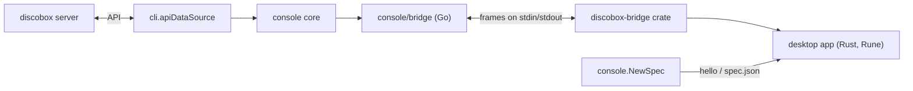

# desktop

`discobox desktop`: the console as a native app, in Rust on
[Rune](https://github.com/anomalyco/rune) (pinned to a `dev` revision in
`Cargo.toml`). It is the console core's second renderer
([`cli/internal/console`](../cli/internal/console/DESIGN.md), ADR
26-11-07-876); the TUI ([`cli/internal/tui`](../cli/internal/tui/DESIGN.md))
is the first. What a person does with it is in the Console guide's "The
desktop app" ([`docs/public/console.md`](../docs/public/console.md#the-desktop-app));
what it lacks against
the TUI, and why, is in the parity ledger
([`docs/console/parity.md`](../docs/console/parity.md)).

The decisions are the accepted ADRs:
- [26-11-07-876](../docs/adr/26-11-07-876-the-console-is-one-core-with-two-renderers.md): one core, two renderers;
- [26-11-07-983](../docs/adr/26-11-07-983-discobox-desktop-downloads-its-app-and-serves-it-over-stdio.md): delivery and the process;
- [26-11-07-289](../docs/adr/26-11-07-289-the-desktop-bridge-carries-the-console-core.md): the bridge;
- [26-11-07-598](../docs/adr/26-11-07-598-each-console-binds-commands-the-way-its-platform-does.md): bindings and parity;
- [26-11-07-363](../docs/adr/26-11-07-363-the-desktop-keeps-the-console-identity-drawn-natively.md): identity.

## Shape

- **The app holds no credentials and talks to no server.** `discobox desktop`
  runs it as a child process with `--bridge` and serves it the console core
  over stdin and stdout ([`bridge`](../cli/internal/console/bridge/DESIGN.md)).
  Every transport, login and reconnect is the CLI's.
- **What the console means is the core's; how it is operated is the app's**
  (876 §2). The app owns layout, focus, selection, scrolling, keys and the
  pointer, drawing, terminal emulation (`alacritty_terminal`), and the
  platform's menus, notifications, clipboard and drag and drop. Order, rows,
  eligibility and its reasons, which sessions a workspace holds, forms,
  questions and where a link goes all arrive from the core. A rule the app
  would need to re-derive is a core change, never a copy in Rust.
- **Every registry command the app answers goes to the core as a `command`**,
  with the app's navigation as its context (the box on screen, the focused
  tab); the app enters its own flow when the result says `enter`.
  `ANSWERED` in `main.rs` is the list. A command not in it says so when run,
  and has an entry in the parity ledger
  (`command_tests::every_registry_command_is_answered_or_in_the_ledger`).

## The bridge client

`bridge/` is the `discobox-bridge` crate, with nothing of the window in it,
so its contract suite drives the client the app uses without building the
app, which a binary crate's tests cannot reach. It holds frames over any pipe, the opening `hello` and its version checks, and a reader
handing on what arrives. Its types (`bridge/src/wire.rs`) are generated from
`cli/internal/console/bridge/wire.schema.json`, itself generated from the
bridge's Go types; none is written by hand. Its contract suite
(`bridge/tests/contract.rs`) runs this client against the CLI's real bridge
serving a fake core (`TestContractCore`).

`src/backend.rs` puts the client on stdin and stdout and hands its messages
to the window as events. Without `--bridge` it is a mock answering the same
messages with local shells, which the tests and the headless scenes run on.

The listing, a workspace's sessions, its header, the palette, the composer,
the requests, an issue and the audit timeline are subscriptions; terminals are
execstream frames on streams the app allocates.

## The list

The core's `console.List`, over the listing topic: rows in order, folder
sections, each box under the one that made it (drawn as strokes), the remark a
picked row says in place of its name, the server notes, and the filter with
its choices.

- **The filter is held by the app**, which subscribes again to change it. The
  filter control at the list's head (and `servers`) opens the core's choices
  with their counts; `archived` shows or hides the archived.
- **Selection is the app's**: Space marks a row, Shift-Space draws a range the
  cursor extends, `clear selection` lets them go; a primary-click marks,
  Shift-click marks a run. A lifecycle verb from a row's menu or the palette
  acts on every marked box in one batch the core rules on; the marks go once it
  has acted.

## The workspace

The core's sessions in two columns (`Workspace` in `main.rs`), framed, with
tab chips in each frame's edge.

- **Layout is the app's.** The divider drags where the columns split (each
  keeps a fifth of the width) and a double press halves them; a chip drags
  along its strip to reorder its column, closes its session (or dismisses a
  held tab), and maximizes its column on a double press.
- **Leaving a box parks its workspace**, as the core's `Park` does: streams
  stay attached and screens keep emulating, but it polls nothing and its ports
  are not forwarded until it is back on screen. One whose primary never
  arrived is let go instead; `detach` lets the one on screen go.
- **What an ending does is the core's** (`Tab.End`, on the stream's `ended`):
  the primary takes the workspace with it, a broken stream or a tool takes its
  tab and says why, and a program that finished is held with its last screen
  and a faint dot on its chip; a gold dot and note while its stream
  reconnects.
- **Services are tabs** at the head of the terminals column while the core
  says they are worth one: read-only, stopped rather than ended, and numbered
  apart (`service`, `primary+alt+1`–`9`) so one starting never renumbers a
  tab. The `services` menu lists every declared service with its verbs as the
  core offers them.
- **The header is the core's** (`console.Header`, over the header topic, whose
  subscription is the workspace's port forward): what the agent is doing
  (`Header.Agent`, the core's choice between the primary's OSC 7501 report and
  the poll), the box's id, its issue and pull request, git position, diff,
  desktop, ports (a forwarded web port is a link) and tags.
- **A notice under the header** says a box a request waits on, a refused
  credential affects, or a captured harness change, one at a time in the
  core's precedence; pressing it runs its command, its close is `dismiss`.

## Panes

`src/term.rs`: a pane is a terminal on `alacritty_terminal`, with termpane's
behaviours, each held by a test listed in the ledger's "Terminal behaviours".
Selection, copy and paste (bracketed when asked), OSC 52 copies (reads get
nothing; only the box on screen copies), OSC 8 and text links followed where
the core says (the bridge's `follow`: a box's localhost URL at its forwarded
port, a box address to that box), mouse reporting as the program asked (taken
back by `mouse` or Shift), the wheel to whoever can scroll, find through the
scrollback, wide characters, the input method's composition, and `repaint`.

A pane link is followed only if it is a web address or a box address. After
the forward rewrite, `console.OpenedURL` permits only absolute HTTP(S) URLs
with a host to reach this machine's URL handler; box addresses are answered
inside the console. Other targets are refused with the original link quoted
on the status line.

**Images are carried in** (`src/paste.rs`): a box cannot read this machine's
clipboard or files, so an image pasted, under `paste image` on a harness
terminal, or dropped on a pane is written into the box by the core (`upload`)
and the path it landed at pasted in its place. Which panes take images and the
image keys is the core's (`Tab.images`, `Tab.image_keys`). Input is held
meanwhile and sent after the paths; one image at a time per pane. Files that
are not all images are pasted as paths, quoted for a shell.

## Keys and the spec

The core's spec (`cli/internal/console/spec.go`), handed over on `hello` and
written to `src/spec.json` for the mock: the registry's commands by ID with
each frontend's bindings and menus, the gestures, the glyphs, and the design
language's tokens.

- **Every shortcut is the spec's** (`src/keys.rs`): a command's or a
  gesture's (the list's cursor, a tab by its number, copy, paste, find).
  `primary` is ⌘ on macOS and Ctrl+Shift elsewhere (598 §2). A key no binding
  takes goes to the focused terminal. Overlays (menus, the palette, sheets,
  pages) keep their own keys while they are open.
  `no_shortcut_is_written_outside_the_spec` fails on a key matched by hand.
- **Where focus goes is the app's**; which key moves it is the registry's
  (`next pane`, `previous box`, `sidebar`).

## Sheets

`src/sheet.rs`: the core's forms and questions as a modal panel that takes
every key and press until answered (on macOS the native menu's commands wait
too).

- **A form** is what the core says it is about, then its fields, each opening
  on its value as the core reads it: typed, a picker, or dimmed with why. A
  masked value is never drawn. The app holds the answers, sends a draft as one
  changes (the form returns with what applies recomputed), and submits only
  fields the person changed. A refusal is said under the field it names.
- **A question** is a yes or no, or a pick of one, answered with the arrows
  and Enter. A destruction
  (`defaultNo`) opens on No and draws its yes in the error colour, so Enter
  never destroys.
- **Sheets queue** in arrival order; each goes when its command's result lands,
  or once a submitted form's command goes on (asks, fills another form, reports
  a step).
- **A file is edited in the person's editor**: the core sends `edit` with a
  copy under a text extension; the app opens it with the platform's opener by
  type (`open -t`, Notepad, `xdg-open`; never a shell or a name a box chose)
  and waits on a sheet: Done answers `saved`, Esc gives it up.

## Pages and panels

One page is up at a time, beside the list in place of the workspace, which
goes on underneath; a box taking the screen closes it. Each page's keys are its
own while it is up; Shift+F10, the context-menu key or a secondary press opens
its actions as the core offers them.

- **Harnesses** (`src/harnesses.rs`): the narrowed server's harnesses, a
  harness's config card, its default, reset, variant and files. A box's harness
  changes (`review config`) are a panel: the candidate's standing, what saving
  does, diffs, credentials, diagnostics and the core's offers.
- **The harness changes explainer**: while the requests topic names a box the
  project owes it about (`Requests.explain`), the window asks for it once
  (`explain_if_owed`, `review config` with `explain`, `Pending::Explain`) on a
  screen the core's rule reads as free (`explainer_screen_free`, the core's
  `ExplainerScreen.Free` over this window's facts: nothing in front, no
  workspace with the focus on its panes, no prompt being written within the
  spec's `prompt_quiet`). It checks on every poll, and again once the poll's
  events are taken, so it asks in the poll the snapshot naming the box lands
  in. The bridge asks the core's question and records it once answered;
  Review changes opens the panel, and leaving it says nothing.
- **Secrets** (`src/secrets.rs`): the narrowed server's secrets and the
  requests waiting on it; a secret read as a panel with its bindings, its
  history, and new, edit, bind, unbind and delete through the core's forms and
  questions.
- **Audit** (`src/audit.rs`): a box's timeline, oldest at the top; the cursor
  follows the newest until moved off, then holds its row and counts what is
  newer. A run of one kind is one row that opens and folds; a record is read
  in full over the window with its recordings. `/` (or the find gesture)
  searches it as it is typed: the core says what the search lets through, the
  runs folded over it, what it lights (bold in the accent) and how many of how
  many, the app subscribing again for each query before it ends the last.
  Enter keeps the search, Esc clears it before it leaves; a held row and
  opened runs stay as they were while the search lets them through.

## Tools, issues, requests

- **Tools** (`src/tools.rs`): the tools menu lists the core's tools with why
  one cannot run, its ssh command and git URL to copy, and each tool's files.
  A tool that runs in the box is a tab given the window as it opens; it gives
  the window back when it goes, to the layout it took, unless the person
  changed the layout since. A running tool is shown, never started twice. A
  tool on this machine is handed the box.
- **Issues and pull requests** (`src/issue.rs`): tabs among the shells, drawn
  from the issue topic with Rune's Markdown in the window's tokens. A link in
  them opens only when it is a web address (`open_link`): strangers write that
  Markdown, and this machine's URL handler opens a `file://` or a custom
  scheme as readily as a page. Comment,
  close, merge (the ways the repository allows, at the head the tab showed) and
  files changed (discobox-review in the box, on a tab given the window). The
  tab follows only while its workspace is on screen and says when the branch
  moved since it was shown.
- **Requests and approvals**: the core's cards as sheets, with Accept and Deny
  in place of one submit; a card opens with the keys on none of its actions,
  so a field's Enter never answers. A request arriving while the window is open
  is raised as a native notification (`src/notify.rs`, the session bus's
  notification service on Linux, its body escaped for the service's markup);
  pressing it opens that request's card, which still asks for Accept. What was waiting as the window opened
  raises none.

## Creating a box

The core's `console.RunOptions`, held by the bridge.

- **The composer**, under the list, is what the new box is given to do: Return
  creates, Shift+Return is a new line; under it, what a create would be made
  with (the composer topic). Its prompt is told to the CLI once still and on
  the way out, and the next window opens on it.
- **`new`** opens the create card as a sheet, asks what the core asks before a
  create, says its steps on the status line, and opens the box's workspace,
  which says what the box is being made to do (the provisioning topic).
  `options` is every run option as a sheet.
- **A folder dropped on the composer** is where the next create is cut from,
  checked by the core as a typed source is.

## Command surfaces

598 §2: every registry command is reachable without its shortcut.

- **The palette** (`primary+k`) is ADR 26-11-06-671's: a query and at most one
  chip, a box or a command, in either order. What it finds and in what order
  is the core's (the palette topic). Enter on a box goes to it, through a view
  that is never saved when the filter hides it.
- **The menu bar**: off macOS drawn in the window (F10), from each command's
  desktop `menu`, every entry ruled on by the core where it was opened (the
  commands topic), disabled with why. On macOS the native menu bar is a hand
  list (`MENU` in `main.rs`), which the ledger records.
- **Context menus**: a box's actions from its row, its header or Shift+F10; a
  pane's is the `Session` menu.
- **Help** (F1) lists every command by its menu, with its shortcut; tooltips
  give each control's command's detail and shortcut.

## The look

ADR 26-11-07-363 (`src/theme.rs`, `src/icons.rs`, `src/mark.rs`): JetBrains
Mono throughout, bundled from `fonts/` (SIL OFL); the spec's colour, space,
radius and stroke tokens in both palettes, following the system's appearance;
terminal content keeps the program's colours on the sunken ground; the TUI's
devices drawn natively (rounded frames, chips in a frame's edge, keycaps, icon
buttons, the mark as vector art); spring motion for focus, chips, the sidebar
and maximize, never in terminal content; a status line for messages only.
`identity_tests` fails on TUI character art in the chrome, a colour or length
that is not a token, or a colour written outside the theme.

## Delivery

`discobox desktop` runs the app named by `--binary` or
`DISCOBOX_DESKTOP_BINARY`; otherwise, on Linux, a release CLI downloads the app
its desktop manifest pins into `<discobox state>/desktop/<digest>/`, and a
development CLI runs the one beside it
([`cli/DESIGN.md`](../cli/DESIGN.md)). Elsewhere it says the platform is not
yet supported (983 §4). The release builds Linux amd64 and arm64
(`release:desktop`, in `nix develop .#desktop`), linked by zig against glibc
`DESKTOP_GLIBC`; Wayland, X11, xkbcommon and Vulkan are loaded at run time.

## Files

| File | What |
| --- | --- |
| `src/main.rs` | State: boxes, workspaces (parked or live), panes, focus; commands, their results and the flows they enter; `run_command`, `ANSWERED` |
| `bridge/src/wire.rs` | The wire's types, generated (`go tool task generate`) from `cli/internal/console/bridge/wire.schema.json`. Never edited by hand |
| `bridge/src/lib.rs` | The bridge client: frames, `hello` and its version checks, the reader |
| `bridge/tests/contract.rs` | The contract suite against the CLI's real bridge serving a fake core |
| `src/backend.rs` | The bridge client on stdin/stdout as the window's events, and the mock |
| `src/view.rs` | The list, the sidebar, the workspace (header, columns, split, chips), frames |
| `src/overlay.rs` | The palette, the menu bar and its menus, a box's and a pane's menus, the help, the filter menu |
| `src/sheet.rs` | Forms, questions and edits as sheets: the queue, held answers, drafts, refusals, the editor wait |
| `src/issue.rs` | A box's issue and pull request as tabs |
| `src/tools.rs` | The tools menu, a tool's tab given the window, a host tool, a tool's files, an address copied |
| `src/audit.rs` | A box's audit view, and its search |
| `src/harnesses.rs` | The harnesses page and a box's harness changes reviewed |
| `src/secrets.rs` | The secrets page, its requests table, and the core's cards as this window draws them |
| `src/paste.rs` | Images pasted or dropped carried into the box; a folder dropped on the composer |
| `src/notify.rs` | A request raised as a native notification, and a press on one taken back to the window |
| `src/keys.rs` | Shortcuts from the spec (`primary` per platform); keys as xterm bytes |
| `src/term.rs` | A pane's terminal |
| `src/theme.rs` | Tokens in both palettes and the appearance that picks one; the bundled faces; springs |
| `src/icons.rs`, `src/mark.rs` | Vector icons, and the mark from `assets/brand/logo-purple.svg` |
| `fonts/` | JetBrains Mono 2.304 at the chrome's weights and the italic, and its licence |

## Tests

| File | What it holds |
| --- | --- |
| `src/parity_tests.rs` | `cli/internal/console/testdata/parity` with the desktop's keys |
| `src/command_tests.rs` | Commands reach no further than what they name; every registry command answered or in the ledger; no shortcut outside the spec |
| `src/surface_tests.rs` | Every command in a menu and found by the palette; the palette's orders, Esc and reveal; menus that say why not |
| `src/workspace_tests.rs` | Parking, endings, chips dragged, the split, the header's links |
| `src/service_tests.rs` | Services as tabs, numbered apart, stopped not ended; the services menu |
| `src/sheet_tests.rs` | Rename, settings and purge through sheets: drafts, a refusal, Enter on a destruction |
| `src/create_tests.rs` | The composer, the create card and run options on the mock |
| `src/paste_tests.rs` | Images pasted, under the image key, or dropped; a folder on the composer |
| `src/issue_tests.rs` | Issue and pull request tabs: merge, comment, close, files changed, following on screen |
| `src/tool_tests.rs` | The tools menu, a tool given the window and giving it back, a host tool, files, an address copied |
| `src/request_tests.rs` | A notice and its dismissal, a card answered and left, the requests table, a notification pressed |
| `src/secret_tests.rs` | The secrets page and its sheets, the history, refresh |
| `src/audit_tests.rs` | The timeline followed and held, runs, a record and a recording read, the timeline searched |
| `src/harness_tests.rs` | The harnesses page, its card and actions, a file edited, harness changes reviewed, the explainer asked once on a free screen |
| `src/identity_tests.rs` | No TUI character art, every colour and length a token, the bundled face measured |

The Go side, its parity scenarios included, runs in every CI job; the app's
own tests, the contract suite and the headless scenes run in `ci:desktop`, on
Linux only.
