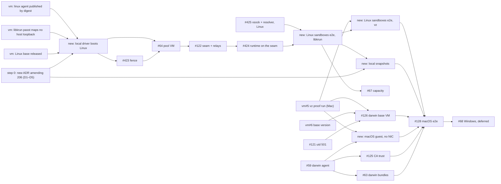

# Task — Local VM pools on vz: macOS and Linux sandboxes (#42)

Implements [ADR 26-10-31-206](../adr/26-10-31-206-a-local-vm-pool-runs-its-agent-in-a-linux-vm-the-server-runs-and-its-sandboxes-reach-it-only-over-vsock.md),
together with the new ADR that step 0 proposes. #42 is now this track alone:
the boxd track is done (#127, #129), and the docker driver (#341, #487, #608)
is not part of it.

Sequencing lives here, not in an ADR or any `DESIGN.md`. Delete this file
when #42 closes; the design docs carry the end state.

## Tags

- **[Linux]** can be built and proven on a Linux host, or in CI. CI includes
  a macOS runner, which compiles and lints darwin but boots no VM.
  - On Linux, only **libkrun** (amd64 with KVM) proves anything that needs a
    real guest: the pool VM, the fence, a sandbox with no network device.
  - disco-vm's `fake` driver cannot. Its "guest" is a process on the test
    host, it holds no egress fence, and it attaches volumes vz and libkrun
    lack. So `fake` covers routing, relays and unit tests only.
- **[Mac]** needs an Apple-silicon Mac booting vz guests.
- **[Linux → Mac]** is built and tested on Linux, and closes with one check
  on a Mac.

## Scope

- A `vm` pool on a **local driver** runs its agent in a Linux **pool VM**.
  The server makes every VM. A sandbox VM has no network device and reaches
  its pool only over vsock, through the server's relay (206 §§1–3).
- **Two guest platforms.** A sandbox takes its pool's platform
  (26-11-01-122 §2), so a local pool is either `linux` (Linux sandbox VMs
  from disco-vm's Linux base) or `darwin` (macOS sandbox VMs). 206 deferred
  Linux sandboxes on a local pool; step 0's ADR brings them in.
- **vz on a Mac** is the product. **libkrun on Linux** is the proving ground,
  if step 0 decides it (D2). It runs the same local-driver path
  (`*local.Driver`, shim, `Ports`, `Egress: [none]`, `Commit`), so everything
  but the darwin guest is proven on Linux first.
- Windows (hcs) stays deferred (#68).

## What moved since 206 (2026-10-31)

discobox pins disco-vm at `5682ac6`, which is disco-vm's `main`.

| # | disco-vm today | what it means for 206 |
|---|---|---|
| V1 | Linux guests on vz (vm ADR 26-10-31-990, vm#27 closed by vm#29): `VZLinuxBootLoader` and a raw ext4 root. **Each boot appends the guest agent from `$DISCO_VM_AGENT`**: a static linux `disco-vm`, built from the embedded module version, whose protocol is checked. | discobox's shim is its own binary, and 106 §2 has the server ship "no disco-vm binary beside itself" (`shim.go`). A linux agent must still reach every local shim on both hosts. How is a decision (**D5**). No issue covers it. |
| V2 | The Linux base is **unpublished**. There is no `linux/v*` tag, and `linuximage.DefaultBase` is the tag `ghcr.io/discobox-ai/disco-vm-linux:v1`, not a digest. It installs no `nftables`. | 206 §1 wants the base pinned by digest, with `nft` and `nftables.service` (for #423). Nothing in disco-vm tracks either. libkrun's DESIGN row is ⬜ until a release carries its kernel, so **every libkrun proof waits on step 1.1**. |
| V3 | No network device is `Egress{}`: on vz for macOS and Linux guests (990 §5), and on libkrun (vm ADR 26-11-03-530). It is in code, and ⬜ on a Mac. Warm stages are gone (vm ADR 26-11-03-606). | vm#5's code exists. What is left is proving it on a Mac. |
| V4 | `Dial` reaches only the agent port (7300) and the service port (7302) (vm ADR 26-11-03-247, Proposed but enforced in code), through the shim's **owner-only `shim.sock`** (990 §4). `Socket` forwards take any guest port. `Service.URL` is still a loopback TCP port any local process reaches (vm#45). | 206's "a service endpoint only the embedder can reach" is met by `Engine.Dial(ServicePort)`, provided the server never uses `Service.URL`. vm#45 is not a blocker. |
| V5 | **A shim outlives its caller by design** (990 §4: "a sandbox's way out must not depend on its caller's process"). vm#8 is open and not built. | This contradicts 106 §2 ("A local machine lives no longer than its server"), the providers' VM Lifetime rule and `server/providers/REVIEW.md` ("Do not reintroduce VM adoption"). **Decision D1.** |
| V6 | **There are only VMs** (vm ADRs 26-11-03-606 and 868). A VM is made fresh from the driver's base, `From` a committed VM, or by `Install`. vz has no base for macOS, so a macOS VM comes only from an install or a committed VM. | 206 §2's "sandbox image" becomes a committed VM. discobox ADR 26-11-03-986 has the pool commit a plan snapshot on its own engine, which a local pool's agent does not have. **Decision D3.** |
| V7 | Scope is `Pool` (vm ADR 26-11-04-412). `MaxRunning` is counted per disco-vm pool; vm#63 makes it host-wide. | discobox puts every local VM in one disco-vm pool (`localPool = "discobox"`), so vz's two macOS guests are already counted host-wide. vm#63 does not block. That single namespace also means snapshot names must be scoped by the server (D3). |
| V8 | vz and libkrun attach no data volume and have no `Upgrade` (vm ADR 26-11-02-180 Deferred, 26-11-03-782). | The machine runtime's no-volume path (as on boxd) applies, and `/.discobox/data` is on the root disk. Nothing to build. |
| V9 | **libkrun** (vm ADR 26-11-03-530) is a local driver for Linux guests: `Ports`, `Egress: [none]`, `Commit`, a runtime pulled by digest, and a run-time refusal of anything but amd64 with KVM. Its passt runs with defaults (`boot.go`: `--fd 3 --foreground --quiet`), so the guest's gateway reaches the host's loopback. discobox links it nowhere. | It can carry the whole Linux-guest path on Linux. But discobox already has a `libkrun` provider whose passt maps no host loopback (`krunvm`: `--map-host-loopback none --no-map-gw --tcp-ports none --udp-ports none`). **Decision D2**, and step 1.3. |

On discobox's side, nothing of 206 has shipped: `hostAgent` still answers
`errHostAgentNotStaged`, and no seam or vsock hop exists. These have landed
since 206:

- 26-11-01-122: a harness is only a bundle, and a sandbox's platform is its
  pool's. "A macOS harness" is no longer a thing; a darwin pool is.
- 26-11-03-986: machine pools commit plan snapshots
  (`machinesnapshot.go`).
- `e06a0085`: a rebuild on a new root.
- `discobox apply` is removed (`8153c0b3`).

## Step 0 — Settle the design (docs only) [Linux]

Write **a new Proposed ADR that amends 206**. 206's status line points to it
("Amended by …"), as 0039's and 0002's do. Step 0 makes new decisions with
rejected alternatives, and narrows ADRs written after 206 (986, 122), so it
is not an in-place correction. Only 206's own correction goes in 206 as a
dated note: V4, the endpoint is `Engine.Dial`, never `Service.URL`.

The new ADR records:

- **Linux sandboxes on a local pool**, taken out of 206's Deferred:
  - Its recorded condition was VM cost on one Mac. The reason now is that
    the Linux path is the one provable without a Mac, and it is the same
    design.
  - A local pool's platform is `linux` or `darwin`.
  - A linux pool's sandbox VMs are fresh VMs of the Linux base its pool VM
    uses, created with no network device. Every hop of §3 is unchanged.
- **"Sandbox image" becomes committed VMs** (V6):
  - For a darwin pool, the server installs macOS once per host and macOS
    version, adds the account (#121), and commits the result as the **darwin
    base VM**.
  - Sandboxes and snapshots are created `From` it.
  - Installing may use a network. No VM it makes ever has one.
- **The base's contract** gains `nftables` (V2).
- **D1, the lifetime of a local VM** (V5).
  - **(a)** Keep 106 §2 and 206 §1: every local VM dies with the server, by
    a lifeline the server holds. That means disco-vm builds vm#8 as an
    option an embedder asks for, and amends its 990 §4 for embedders that
    ask.
  - **(b)** Take 990 §4: local VMs outlive the server. Then the new ADR must
    also:
    - supersede 106 §2's lifetime rule and its Deferred entry ("revisited if
      pool VMs ever stop dying with the server");
    - say why local disco-vm VMs differ from `server/providers/DESIGN.md`'s
      VM Lifetime rule;
    - rewrite that section and `server/providers/REVIEW.md`'s "Do not
      reintroduce VM adoption".

    (b) also needs work no step owns yet:
    - re-adopting running shims;
    - listening again on every control-plane and per-sandbox socket;
    - handling version skew after a server upgrade, when an old shim and
      guest agent meet a new engine.
  - **Recommended: (a).** It keeps one VM lifetime rule across every
    provider, and needs no adoption. A sandbox fails closed either way.
    (b) is revisited under 106's own Deferred condition.
- **D2, libkrun on Linux** (V9).
  - discobox already runs libkrun VMs (`server/providers/libkrun`, ADR 0062
    §9, ADR 0101). Making disco-vm's libkrun a supported local driver as
    well would be a second construction of a libkrun VM.
  - 106 Deferred holds that convergence ("the vz and libkrun drivers could
    become adapters over pkg/engine"), until disco-vm boots Linux from a
    released image by digest, which step 1.1 meets.
  - **Recommended:** link disco-vm's libkrun into the `vm` provider **as the
    Linux proving ground only**, under a build tag that tests and `task dev`
    set, never as a configuration a released server offers. Leave
    convergence to 106's Deferred entry, revisited after step 1.1.
  - Even as a test rig, its pool VM keeps a network device, so step 1.3 is
    required.
- **D3, snapshots on a local pool** (V6, V7).
  - **(a)** The seam gains "snapshot a plan".
  - **(b)** Local pools never snapshot.
  - (a) must hold 206 §2's rule that no pool can change an image another
    pool's sandboxes are made from:
    - The server derives the snapshot's name and plan key itself, scoped to
      the pool on the tagged stream, and keeps the done record on its side.
      All local VMs share one disco-vm pool (V7), so a pool-chosen name
      would let one pool rebuild another's.
    - The build VM has no network device, and its forwards are
      server-derived, as a sandbox's are. No endpoint or port is taken from
      the plan.
    - From the `SnapshotPlan`, only `Env`, `Features` and the proxy material
      are taken; the rest is refused. A bundle is placed only if the
      server's asset service serves its digest. The only command run is
      `discobox-sandbox-agent snapshot`.
  - **Recommended: (a), built after the first end-to-end run.** Until then
    the seam reports no `Commit`, and the runtime takes 868's no-commit path:
    every sandbox is provisioned fresh. A darwin sandbox is `From` the darwin
    base VM.
- **D4, the darwin agent's delivery.** The owner answered on #126 that the
  agent is copied in at every boot from the sandbox's pinned bundles. So #63
  becomes a darwin/arm64 **agent bundle** and **platform bundle** (with a
  launchd unit), not release assets beside the server.
- **D5, how the linux disco-vm agent reaches a local shim** (V1).
  - It is a guest artifact. `server/providers/REVIEW.md` says a guest
    artifact goes on its own release line and is pulled by digest, as
    `vm-image` and libkrun's kernel are. 106 §2 says the server ships no
    disco-vm binary beside itself.
  - **Recommended:** disco-vm publishes its static linux agent per module
    version, as a digest-pinned OCI artifact. discobox pins that digest
    beside the vm module version and pulls it like `vm-image`. The protocol
    check at boot catches a mismatch.
  - Rejected: a binary beside the server (breaks 106 §2), and an asset of the
    server's release manifest (a third delivery path for guest artifacts).

Also step 0: the issue edits in the plan PR's body, which the lead applies.

## Step 1 — disco-vm, in parallel with step 2

1. **[Linux]** *new, vm*: **the Linux base is released and pinned.**
   - The first `linux/v*` release, and `DefaultBase` by digest.
   - `nftables` in the base.
   - libkrun's kernel config (`krun-kernel.config`) keeps nf_tables and what
     BuildKit needs (767).

   It blocks #423, #64 and every libkrun proof (V2).
2. **[Mac]** vm#5, rewritten as **the vz proof run**. It turns vz's ⬜ rows
   in disco-vm's `DESIGN.md` to ✅ on a Mac:
   - a Linux guest beside a macOS one;
   - no network device on both OSes;
   - `Dial` through `shim.sock`;
   - `Socket` forwards;
   - fresh VMs from the base;
   - commit and `From` on both OSes;
   - `machinetest` and `internal/e2e` with `DISCO_VM_DRIVER=vz`.

   It blocks the Mac half of 2.1, 2.2, 2.3 and 3.1, and 4.4, 4.6 and 4.7.
   It blocks nothing on Linux.
3. **[Linux]** *new, vm*: **libkrun's passt maps no host loopback and
   forwards no ports**, with discobox's `krunvm` flags as the reference.
   - It blocks D2's use.
   - Step 2.1 proves from a pool VM that the gateway does not reach a
     listener on the host's loopback.
4. **[Linux, then Mac]** *new, vm*: the linux agent published as a
   digest-pinned artifact per module version (D5).
5. vm#8: built under D1(a) as an embedder's lifeline; closed under D1(b).
6. **[Mac]** vm#6, for the darwin pin (step 4.6 only).
7. vm#63 and vm#45: not blockers (V7, V4).

## Step 2 — The local path, on Linux

1. **[Linux → Mac]** *new*: **a local driver boots Linux guests** (V1, D2,
   D5).
   - The server pulls the pinned linux agent (1.4) and sets
     `$DISCO_VM_AGENT` in every local shim's environment.
   - disco-vm's libkrun is linked into linux builds under D2's build tag,
     and is refused at run time off amd64. It is local by type (`isLocal`) as
     soon as it is linked, so until #64 a libkrun `vm` pool answers
     `errHostAgentNotStaged`, as vz's does.
   - Proven on Linux when a libkrun VM boots from the pinned base and its
     gateway does not reach host loopback (1.3). On a Mac, when vz boots it.
2. **[Linux → Mac]** #423: the fence step in `ProvisionBox`, proven on a
   libkrun pool VM. The rule set reads back, and after a reboot it loads
   before the pool's units. `fake` cannot prove it (Tags).
3. **[Linux → Mac]** #64: the pool VM, and `hostAgent` goes. Proven on
   libkrun on Linux, and on vz on a Mac.
4. **[Linux]** #122: the seam on the pool's tagged stream, connect, and the
   per-sandbox tunnel relays.
   - It reaches endpoints by `Engine.Dial`, takes the pool's platform into
     account, and reports no `Commit` (D3).
   - Its routing and refusals are unit-tested on `fake`; its relays end to
     end on libkrun.
5. **[Linux]** #424: the machine runtime drives the seam, the vsock hop row,
   and the pool agent listens on vsock.
6. **[Linux]** #425, narrowed to the agent and the Linux guest:
   - the agent listens on vsock, and the bridges dial vsock;
   - on a box with no network device, the DNS stub is `resolv.conf`'s
     resolver.

   Its macOS half moves to 4.4.

## Step 3 — Linux sandboxes, end to end

1. **[Linux → Mac]** *new*: **a local linux pool runs Linux sandboxes end to
   end.** First on libkrun on Linux, which needs nothing from a Mac. Then on
   vz on a Mac, after vm#5. This is the first working local pool, and #128's
   model for the darwin one.
2. **[Linux → Mac]** #67: capacity is the host's, less the pool VM. On a Mac,
   `schedulable` closes at two macOS guests.
3. **[Linux]** *new*: **snapshots on a local pool**, the seam's snapshot
   route with D3(a)'s rules. Proven on libkrun, with tests that one pool
   cannot name, rebuild or drop another's snapshot. The darwin pool takes it
   in 4.7.

## Step 4 — macOS sandboxes

1. **[Linux]** #121: the uid ADR (501 and up for darwin) and `sandboxuser`.
2. **[Linux, CI macOS runner; Mac for the guest half]** #59: the darwin
   agent.
   - The build tags, the launchd unit and the test lane run natively on CI's
     macOS runner.
   - Only "starts in a disco-vm macOS guest" needs a Mac.
3. **[Linux, CI macOS runner]** #63, rewritten (D4): the darwin/arm64 agent
   bundle and platform bundle, signed and pinned, served by the server's
   asset service.
4. **[Mac]** *new*, split from #425: **a macOS guest with no network device**.
   - `pkg/vsock` dials and listens in a darwin guest.
   - The DNS stub is the system resolver, aliased on `lo0`.
   - It carries §4's proof of which resolver configuration holds.
5. **[Mac]** #125: the pool's CA in the guest's System keychain.
6. **[Mac]** #126, rewritten: **the darwin base VM** (V6). The server
   installs macOS, adds the account (uid 501 and up), commits the VM once per
   host and macOS version, and pins that version (vm#6). No sandbox agent is
   baked in.
7. **[Mac]** #128: macOS sandboxes end to end, on a darwin pool with
   snapshots (3.3).

## Step 5 — Later

- #68 Windows (hcs): unchanged, deferred until #128.

## Order at a glance

`LINL` is 3.1's Linux half (libkrun); `LINM` is its Mac half (vz).

Steps 4.1–4.3 can start at any time, beside step 2. Nothing on Linux waits
on a Mac.

## Done when (#42)

- A local `vm` pool of platform `linux` makes a sandbox with no network
  device that you can attach to and run a harness in. Its only way out is
  its pool's proxy. It fetches the developer's new commits and pushes its
  work home with `git push`.
  - This holds on vz on a Mac.
  - With D2, it holds on libkrun on Linux too, as the proving ground.
- The same holds on a Mac for a pool of platform `darwin`.
- Every affected `DESIGN.md` describes the new state.
- `server/providers/REVIEW.md` carries:
  - 206's rule that every host-side value of a seam request is the server's;
  - the rule that a seam-built snapshot is named and scoped by the server,
    never by a pool (D3);
  - wherever the local libkrun path lands, the rule that a driver change
    must not undo a network restriction discobox set by hand (1.3).
