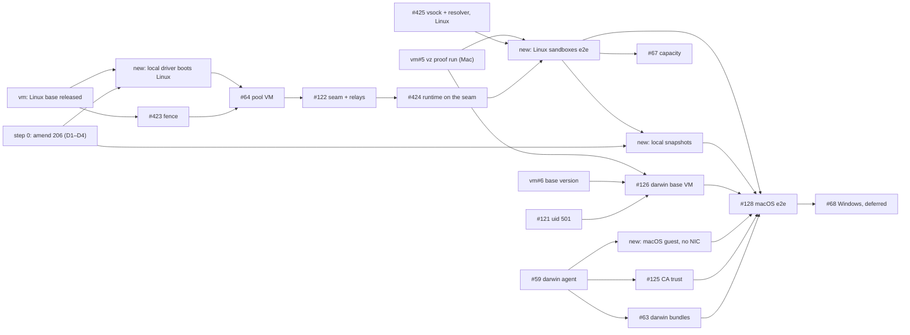

# Task — Local VM pools on vz: macOS and Linux sandboxes (#42)

Implements [ADR 26-10-31-206](../adr/26-10-31-206-a-local-vm-pool-runs-its-agent-in-a-linux-vm-the-server-runs-and-its-sandboxes-reach-it-only-over-vsock.md)
and the amendment step 0 proposes. #42 is now this track alone: the boxd track
is done (#127, #129), and the docker driver (#341, #487, #608) is not part of
it.

Sequencing lives here, not in the ADR or any `DESIGN.md`. Delete this file
when #42 closes; the design docs carry the end state.

**Tags.** **[Linux]** can be built and proven on a Linux host: on the `fake`
driver, on libkrun (amd64 with KVM), or in CI. That includes CI's macOS
runner, which compiles and lints darwin but boots no VM. **[Mac]** needs an
Apple-silicon Mac booting vz guests. **[Linux → Mac]** is built and tested on
Linux, and closes with one check on a Mac.

## Scope

- A `vm` pool on a **local driver** runs its agent in a Linux **pool VM**.
  The server makes every VM, and a sandbox VM has no network device and
  reaches its pool only over vsock, through the server's relay (206 §§1–3).
- **Two guest platforms.** A sandbox takes its pool's platform
  (26-11-01-122 §2), so a local pool is either `linux` (Linux sandbox VMs
  from disco-vm's Linux base) or `darwin` (macOS sandbox VMs). 206 deferred
  Linux sandboxes on a local pool; this scope brings them in (step 0).
- **vz on a Mac**, and, if step 0 decides it, **libkrun on Linux**. libkrun is
  the same local-driver path (`*local.Driver`, shim, `Ports`,
  `Egress: [none]`, `Commit`), so everything but the darwin guest can be
  proven on Linux first.
- Windows (hcs) stays deferred (#68).

## What moved since 206 (2026-10-31)

discobox pins disco-vm at `5682ac6`, which is disco-vm's `main`.

| # | disco-vm today | what it means for 206 |
|---|---|---|
| V1 | Linux guests on vz (vm ADR 26-10-31-990, vm#27 closed by vm#29): `VZLinuxBootLoader`, a raw ext4 root. **Each boot appends the guest agent from `$DISCO_VM_AGENT`**, a static linux `disco-vm` built from the embedded module version, and its protocol is checked. | discobox's shim is its own binary (`driverConfig`: "the server ships no disco-vm binary"). On a Mac it must ship a linux/arm64 `disco-vm` agent and hand it to every shim. libkrun on Linux needs the same (`agentBinary`). No issue covers it yet. |
| V2 | The Linux base is **unpublished**: no `linux/v*` tag, and `linuximage.DefaultBase` is the tag `ghcr.io/discobox-ai/disco-vm-linux:v1`, not a digest. It installs no `nftables`. | 206 §1 wants it pinned by digest, with `nft` and `nftables.service` (for #423). Nothing in disco-vm tracks either. |
| V3 | No network device is `Egress{}` on vz (macOS and Linux guests) and on libkrun (990 §5). It is in code, and ⬜ on a Mac. Warm stages are gone (vm ADR 26-11-03-606). | vm#5's code exists. What is left is proving it on a Mac. |
| V4 | `Dial` reaches the agent port (7300) and the service port (7302) alone (vm ADR 26-11-03-247), through the shim's **owner-only `shim.sock`** (990 §4). `Socket` forwards take any guest port. `Service.URL` is still a loopback TCP port any local process reaches (vm#45). | 206's "a service endpoint only the embedder can reach" is met by `Engine.Dial(ServicePort)`, as long as the server never uses `Service.URL`. vm#45 is not a blocker. |
| V5 | **A shim outlives its caller by design** (990 §4: "a sandbox's way out must not depend on its caller's process"). vm#8 is open and not built. | This contradicts 206 §1 ("dies with the server … vm#8") and #128's `SIGKILL` check. **Decision D1.** |
| V6 | **There are only VMs** (vm ADRs 26-11-03-606 and 868): a VM is made fresh from the driver's base, `From` a committed VM, or by `Install`. vz has no base for macOS, so a macOS VM comes only from an install or a committed VM. | 206 §2's "sandbox image" becomes a committed VM. discobox ADR 26-11-03-986 has the pool commit a plan snapshot on its own engine, which a local pool's agent does not have. **Decision D3.** |
| V7 | Scope is `Pool` (vm ADR 26-11-04-412). `MaxRunning` is counted per disco-vm pool; vm#63 makes it host-wide. | discobox puts every local VM in one disco-vm pool (`localPool = "discobox"`), so vz's two macOS guests are already counted host-wide. vm#63 does not block. |
| V8 | vz and libkrun attach no data volume and have no `Upgrade` (vm ADR 26-11-02-180 Deferred, 26-11-03-782). | The machine runtime's no-volume path (as on boxd) applies. `/.discobox/data` is on the root disk. Nothing to build. |
| V9 | **libkrun** (vm ADR 26-11-03-530) is a local driver for Linux guests on linux/amd64 with KVM: `Ports`, `Egress: [none]`, `Commit`, and its runtime pulled by digest. discobox links it nowhere. | It can carry the whole Linux-guest path on Linux. **Decision D2.** |

On discobox's side, nothing of 206 has shipped. `hostAgent` still answers
`errHostAgentNotStaged`, and no seam or vsock hop exists, so 206 can be
amended rather than superseded. These have landed since 206:

- 26-11-01-122: a harness is only a bundle, and a sandbox's platform is its
  pool's. "A macOS harness" is no longer a thing; a darwin pool is.
- 26-11-03-986: machine pools commit plan snapshots
  (`machinesnapshot.go`).
- `e06a0085`: a rebuild on a new root.
- `discobox apply` is removed (`8153c0b3`).

## Step 0 — Settle the design (docs only) [Linux]

Amend 206 in place, with a dated note (nothing has shipped against it), in
one docs-only PR:

- **Linux sandboxes on a local pool** move out of Deferred. A local pool's
  platform is `linux` or `darwin`. A linux pool's sandbox VMs are fresh VMs of
  the same Linux base as its pool VM, created with no network device. Every
  hop of §3 is unchanged.
- **The endpoint only the server reaches** is `Engine.Dial` of the agent port
  or the service port, through the shim's owner-only socket. `Service.URL` is
  never used for a local VM (V4).
- **"Sandbox image" becomes committed VMs** (V6). For a darwin pool, the
  server installs macOS once per host and macOS version, adds the account
  (#121), and commits it as the **darwin base VM**. Sandboxes and snapshots
  are created `From` it. Install may use a network; no VM it makes ever has
  one.
- **The Linux agent a local Linux guest boots** comes from the server's
  release, built from the disco-vm module the server embeds (V1).
- **The base's contract** gains `nftables` (V2).
- Decide and record:
  - **D1, the lifetime of a local VM** (V5). Either (a) keep 206, have
    disco-vm build vm#8, and supersede its 990 §4 in part; or (b) take 990
    §4. Under (b), local VMs outlive the server. The server re-adopts them on
    start and serves its forward sockets again at the same paths (a forward's
    path is fixed at create). While the server is down, a sandbox is cut off:
    no network device and no relay, so it fails closed. **Recommended: (b).**
    disco-vm accepted it after 206, the fence holds either way, and restarting
    the server stops killing sandboxes. Cost: a crashed server's VMs keep
    their memory until the server returns or the pool is removed.
  - **D2, libkrun as a local driver** (V9). Link it into linux/amd64 builds of
    the `vm` provider, so a `vm` pool with `driver: libkrun` is a local pool.
    **Recommended: yes**, as a supported driver, not only a test rig. It makes
    steps 2–3 provable on Linux, and gives Linux hosts a Docker-free pool.
  - **D3, snapshots on a local pool** (V6). Either (a) the seam gains
    "snapshot a plan": the server builds and commits it from the pool's
    `SnapshotPlan` and pinned digests its asset service serves, running only
    `discobox-sandbox-agent snapshot`; or (b) local pools never snapshot.
    **Recommended: (a), built after the first end-to-end run.** Until then the
    seam reports no `Commit`, and the runtime takes 868's no-commit path:
    every Linux sandbox is fresh and provisioned. A darwin pool cannot
    snapshot until (a), so each darwin sandbox is `From` the darwin base VM
    and fully provisioned.
  - **D4, the darwin agent's delivery.** Per the owner's answer on #126 it is
    copied in at every boot from the sandbox's pinned bundles. So #63 becomes
    a darwin/arm64 **agent bundle** and **platform bundle** (with a launchd
    unit), not release assets beside the server.

Also step 0: the issue edits in the plan PR's body, which the lead applies.

## Step 1 — disco-vm, in parallel with step 2

1. **[Linux]** *new, vm*: the Linux base is released and pinned. This means
   the first `linux/v*` release, `DefaultBase` by digest, and `nftables` in
   the base. libkrun's kernel config (`krun-kernel.config`) keeps nf_tables
   and what BuildKit needs (767). Blocks #423 and #64.
2. **[Mac]** vm#5, rewritten as **the vz proof run**. It turns vz's ⬜ rows
   in disco-vm's `DESIGN.md` to ✅ on a Mac:
   - a Linux guest beside a macOS one;
   - no network device on both OSes;
   - `Dial` through `shim.sock`;
   - `Socket` forwards;
   - fresh VMs from the base;
   - commit and `From` on both OSes;
   - `machinetest` and `internal/e2e` with `DISCO_VM_DRIVER=vz`.

   It blocks the Mac half of every step below, and nothing on Linux.
3. vm#8: closed under D1(b), built under D1(a).
4. **[Mac]** vm#6, for the darwin pin (step 4.6 only).
5. vm#63 and vm#45: not blockers (V7, V4).

## Step 2 — The local path, on Linux

1. **[Linux → Mac]** *new*: **a local driver boots Linux guests** (V1, D2).
   - The release builds a static linux `disco-vm` for each architecture, from
     the vm module version `go.mod` pins.
   - The server finds it (beside itself, or as an asset of its release
     manifest, as ADR 0099 stages the server) and sets `$DISCO_VM_AGENT` in
     every local shim's environment.
   - libkrun is linked into linux/amd64 builds (`drivers_linux.go`).
   - `Validate` accepts `driver: libkrun` as local.
   - Done on Linux when a `vm` provider on libkrun runs a Linux VM from the
     pinned base. On a Mac, when vz does.
2. **[Linux → Mac]** #423: the fence step in `ProvisionBox`. Prove it on a
   libkrun pool VM: the rule set reads back, and after a reboot it loads
   before the pool's units.
3. **[Linux → Mac]** #64: the pool VM, and `hostAgent` goes. It works on
   `fake` and libkrun on Linux; vz on a Mac.
4. **[Linux]** #122: the seam on the pool's tagged stream, connect, and the
   per-sandbox tunnel relays. It reaches endpoints by `Engine.Dial`, takes
   the pool's platform into account, and reports no `Commit` (D3).
5. **[Linux]** #424: the machine runtime drives the seam, the vsock hop row,
   and the pool agent listens on vsock.
6. **[Linux]** #425, narrowed to the agent and the Linux guest. The agent
   listens on vsock, the bridges dial vsock, and on a box with no network
   device the DNS stub is `resolv.conf`'s resolver. Its macOS half moves to
   4.4.

## Step 3 — Linux sandboxes, end to end

1. **[Linux → Mac]** *new*: **a local linux pool runs Linux sandboxes end to
   end.** First on libkrun on Linux, then on vz on a Mac. This is the first
   working local pool, and #128's model for the darwin one.
2. **[Linux → Mac]** #67: capacity is the host's, less the pool VM. On a Mac,
   `schedulable` closes at two macOS guests.
3. **[Linux]** *new*: **snapshots on a local pool**, the seam's snapshot
   route (D3(a)). It is proven on libkrun. The darwin pool takes it in 4.7.

## Step 4 — macOS sandboxes

1. **[Linux]** #121: the uid ADR (501 and up for darwin) and `sandboxuser`.
2. **[Linux, CI macOS runner; Mac for the guest half]** #59: the darwin
   agent. The build tags, the launchd unit and the test lane run natively on
   CI's macOS runner. Only "starts in a disco-vm macOS guest" needs a Mac.
3. **[Linux, CI macOS runner]** #63, rewritten (D4): the darwin/arm64 agent
   bundle and platform bundle, signed and pinned, served by the server's
   asset service.
4. **[Mac]** *new*, split from #425: **a macOS guest with no network device**.
   `pkg/vsock` dials and listens in a darwin guest, the DNS stub is the system
   resolver (aliased on `lo0`), and §4's proof of which resolver
   configuration holds.
5. **[Mac]** #125: the pool's CA in the guest's System keychain.
6. **[Mac]** #126, rewritten: **the darwin base VM** (V6). The server
   installs macOS, adds the account (uid 501 and up), commits the VM once per
   host and macOS version, and pins that version (vm#6). No sandbox agent is
   baked in.
7. **[Mac]** #128: macOS sandboxes end to end, on a darwin pool with
   snapshots (3.3).

## Step 5 — Later

- #68 Windows (hcs): unchanged, deferred until #128.

## Order at a glance

Step 4.1–4.3 can start at any time, beside step 2.

## Done when (#42)

- A local `vm` pool of platform `linux` makes a sandbox with no network
  device that you can attach to and run a harness in. Its only way out is
  its pool's proxy. It fetches the developer's new commits and pushes its
  work home with `git push`. This holds on libkrun on Linux (if D2) and on
  vz on a Mac.
- The same holds on a Mac for a pool of platform `darwin`.
- Every affected `DESIGN.md` describes the new state, and
  `server/providers/REVIEW.md` carries 206's host-side-values rule.
