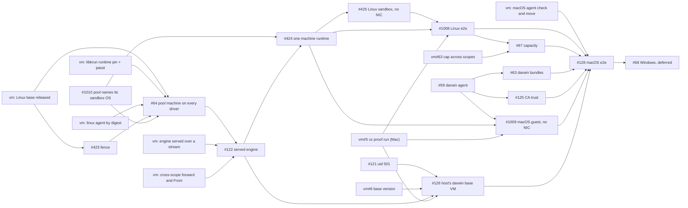

# Task — One vm pool shape on every driver: macOS and Linux sandboxes on a Mac (#42)

Implements [ADR 26-11-11-963](../adr/26-11-11-963-one-vm-provider-type-every-pool-runs-a-linux-pool-agent-in-a-machine-its-driver-makes.md),
"One vm provider type: every pool runs a Linux pool agent in a machine its
driver makes", merged in #1003. #42 is this track alone: the boxd track is
done (#127, #129), and the docker driver (#341, #487, #608) is not part of
it.

The ADR is the spec. This file holds only the order of the work, which steps
need a Mac, and which issue each step is. Delete it when #42 closes; the
design docs carry the end state.

## Direction (owner, 2026-11-10)

> For the discovm driver we need to drop the idea of local vs remote. There
> is no such thing; they are just one driver type. The local was supposed to
> run the pool agent on the host, whereas now we always want to run a pool
> agent, and the pool agent is Linux platform.

ADR 963 records it:

- **One pool shape.** Every `vm` pool, on every driver, runs the ordinary
  Linux pool agent in a pool machine made from the driver's base (§1).
- **"Held" names only where machines run.** A *held driver* (vz, libkrun,
  hcs) is one whose VMs this server's engine holds under shims. The provider
  tells it apart by what disco-vm reports: `Capabilities.Ports` and
  `Keys: none`. It changes only how things are reached:

| | a held driver (vz, libkrun) | any other driver (boxd) |
|---|---|---|
| The server reaches the pool agent (§4) | `Engine.Dial` of the pool machine's service port, then the control-plane channel | the machine's URL, then the same channel where there is no `controlPlaneUrl` |
| The pool agent's engine reaches its driver (§3) | the server's engine, served only on the pool's tagged channel, under an allow-list | the provider's service, with the key the provider issues or delivers |
| A sandbox reaches its pool (§5) | no network device; the server's one peer forward to the pool machine, carrying the tunnel with the agent's TLS kept | isolated on the pool's network, at the pool's private URL |

The scope layout is boxd's on every driver (§2): the pool machine in the
provider's scope, the pool's sandboxes and snapshots in the pool's own. No
persisted machine moves.

## Tags

- **[Linux]** can be built and proven on a Linux host, or in CI, which
  includes a macOS runner that compiles and lints darwin but boots no VM.
  - On Linux only **libkrun** (amd64 with KVM) proves anything that needs a
    real guest: a pool machine, the fence, a sandbox with no network device.
  - disco-vm's `fake` driver covers protocols, routing and unit tests only.
    Its "guest" is a process on the test host, it holds no egress fence, and
    it attaches volumes vz and libkrun lack.
- **[Mac]** needs an Apple-silicon Mac booting vz guests.
- **[Linux → Mac]** is built and tested on Linux, and closes with one check
  on a Mac.

## Scope

- Every `vm` pool, on any driver, as one shape.
- **Two guest platforms for sandboxes.** A pool names its sandbox OS at
  creation: `linux` on every driver, or `darwin` on vz (§1). The pool agent
  is always Linux.
- **vz on a Mac** is the product. **libkrun on Linux** proves the same path
  without a Mac, once disco-vm pins its runtime and fixes its passt (§11).
- Windows (hcs) stays deferred (#68).

## Step 0 — The ADR [done]

ADR 26-11-11-963 was proposed in #1003 and merged, so it is accepted. Its
header and the status lines of the ADRs it supersedes and narrows are marked
in #1011.

The issues written for ADR 26-10-31-206's local shape were rewritten from
it. Each rewrite is posted as a comment on its issue headed "This comment
replaces the title and body above": #64, #122, #423, #424, #425, #67 and
#128.

## Step 1 — disco-vm, in parallel with step 2

These are owed by ADR 963's Consequences, in discobox-ai/vm. Their filing
waits on the owner. Until then they are referred to by what they are.

1. **[Linux]** **The Linux base, released and pinned by digest, with
   `nftables`.** libkrun's kernel config keeps nf_tables and what BuildKit
   needs. It blocks every held pool machine.
2. **[Mac]** **vm#5, as the vz proof run.** It turns vz's ⬜ rows to ✅ on a
   Mac:
   - a Linux guest beside a macOS one;
   - no network device on both OSes;
   - `Dial` through `shim.sock`;
   - peer forwards;
   - fresh VMs from the base;
   - commit and `From` on both OSes;
   - `machinetest` and `internal/e2e` with `DISCO_VM_DRIVER=vz`.

   It blocks the Mac half of every step, and nothing on Linux.
3. **[Linux]** **libkrun: its runtime pinned by digest, and passt with no
   host loopback and no forwarded ports** (§11).
4. **[Linux → Mac]** **The linux agent, published by digest per module
   version** (§10).
5. **[Linux]** **An engine served over a stream, with an embedder's
   allow-list and version, and a driver that is its client** (§3).
6. **[Linux]** **Forwards and `From` across scopes, set only by the
   embedder** (§§5, 9).
7. **[Linux → Mac]** **vm#63: `MaxRunning` counted across scopes**, which
   disco-vm's ADR 26-11-04-412 §1 already decides (§12).
8. **[Linux]** **An engine that meets an older running shim** (§7). vm#8
   closes.
9. **[Mac]** **A macOS guest's agent protocol checked at boot, and moved
   without installing again** (§9).
10. **[Mac]** vm#6, for the darwin pin.

## Step 2 — One pool shape, on Linux

1. **[Linux]** **#1010: a vm pool names its sandbox OS** at creation, stored
   as the pool's intent. The agent's platform report becomes a check (§1).
2. **[Linux → Mac]** **#423: a held driver's pool machine fences its network
   first** (§6). Proven on a libkrun pool machine. boxd's fence step is
   deferred.
3. **[Linux → Mac]** **#64: the pool machine on every driver** (§§1, 2, 4,
   7, 10).
   - `isLocal`, `hostAgent` and `localPool` go.
   - `Dial` and the channel reach the pool machine on a held driver.
   - The server pulls the linux agent by digest.
   - The `discobox-server` stop subcommand stops held VMs with no server
     running.
4. **[Linux]** **#122: the server serves its engine to a held driver's
   pool**, only on the pool's tagged channel, under the allow-list, with the
   server's one forward and `From` (§3).
5. **[Linux]** **#424: one machine runtime on every driver.**
   - Its engine's driver comes from the bootstrap.
   - The hop gains the forward-tunnel row, with the agent's TLS kept.
   - The agent declares the bootstrap's sandbox OS (§§1, 3–5).
6. **[Linux]** **#425: a Linux sandbox with no network device** listens on
   vsock, reaches its pool through the forward tunnel, and makes its DNS stub
   the resolver (§5; 206 §4, which 963 keeps).

## Step 3 — Linux sandboxes, end to end

1. **[Linux → Mac]** **#1008: Linux sandboxes on a held driver, end to end,
   snapshots included** (986, §8). First on libkrun on Linux, which needs
   nothing from a Mac; then on vz, after vm#5.
2. **[Linux → Mac]** **#67: capacity is the driver's limits**: the host's
   less the pool machine. On a Mac, `schedulable` closes at two macOS guests
   across every pool (§12, vm#63).

## Step 4 — macOS sandboxes

1. **[Linux]** #121: the uid ADR (501 and up for darwin) and `sandboxuser`.
2. **[Linux, CI macOS runner; Mac for the guest half]** #59: the darwin
   agent. Only "starts in a disco-vm macOS guest" needs a Mac.
3. **[Linux, CI macOS runner]** #63: the darwin agent bundle and platform
   bundle (§9). Its rewrite waits on the owner.
4. **[Mac]** **#1009: a macOS guest with no network device** reaches its
   pool through the forward tunnel, with its DNS stub the system resolver.
5. **[Mac]** #125: the pool's CA in the guest's System keychain.
6. **[Mac]** #126: the host's darwin base VM (§9). Its rewrite waits on the
   owner.
7. **[Mac]** **#128: macOS sandboxes end to end** on a `vm` pool on vz of
   platform `darwin`.

## Step 5 — Later

- #68 Windows (hcs): the same shape on hcs, deferred until #128 (§13).

## Order at a glance

`PROOF` gates only the Mac halves. #1008's Linux half on libkrun waits on
nothing from a Mac. #1010, #121 and #59 can start at once, as can step 1
once its issues are filed.

## Done when (#42)

- A `vm` pool of platform `linux` on vz makes a sandbox with no network
  device that you can attach to and run a harness in. Its only way out is its
  pool's proxy. It fetches the developer's new commits and pushes its work
  home with `git push`. The same holds on libkrun on Linux.
- The same holds on a Mac for a `vm` pool of platform `darwin`.
- The provider has one pool shape: no `isLocal`, `hostAgent` or `localPool`.
- Every affected `DESIGN.md` describes the new state.
- `server/providers/REVIEW.md` carries 963's rules:
  - the served engine answers only on the pool's tagged channel, refuses
    every operation and field it does not list, and fixes every host-side
    value;
  - a pool sets no forward;
  - a driver change never undoes a network restriction discobox set by
    hand.
- The store's `REVIEW.md` carries #1010's rule that a pool's named sandbox OS
  is checked against, never overwritten by, its agent's report.
