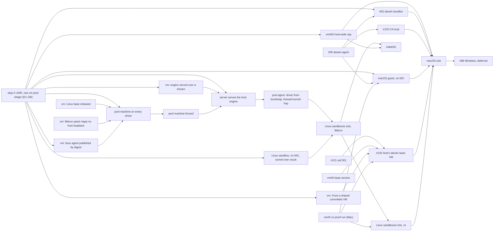

# Task — One vm pool shape on every driver: macOS and Linux sandboxes on a Mac (#42)

Re-plans #42 under the owner's direction of 2026-11-10. #42 is now this track
alone: the boxd track is done (#127, #129), and the docker driver (#341,
#487, #608) is not part of it.

Sequencing lives here, not in an ADR or any `DESIGN.md`. Delete this file
when #42 closes; the design docs carry the end state.

## Direction (owner, 2026-11-10)

> For the discovm driver we need to drop the idea of local vs remote. There
> is no such thing; they are just one driver type. The local was supposed to
> run the pool agent on the host, whereas now we always want to run a pool
> agent, and the pool agent is Linux platform.

What follows from that:

- **One pool shape.** Every `vm` pool runs the ordinary Linux pool agent in a
  machine its driver makes. This is what a boxd pool does today
  ([ADR 26-10-23-551](../adr/26-10-23-551-a-vm-pool-bootstraps-its-own-agent-from-a-bundle-and-provisions-its-machines.md)),
  and it applies on vz, libkrun, boxd, archil and later hcs alike.
- **No host-side pool agent, and no separate local-pool architecture.**
  `isLocal`, `hostAgent` and `localPool` go from the provider.
- **What this supersedes:**
  - [ADR 26-10-09-106](../adr/26-10-09-106-disco-vm-is-a-pool-runtime-and-the-server-runs-its-machines.md)'s
    local-driver half;
  - [ADR 26-10-31-206](../adr/26-10-31-206-a-local-vm-pool-runs-its-agent-in-a-linux-vm-the-server-runs-and-its-sandboxes-reach-it-only-over-vsock.md)'s
    split between a local and a remote pool;
  - what is left of [ADR 0144](../adr/0144-a-pool-of-host-vm-sandboxes-runs-its-agent-on-the-host.md).

  Step 0's ADR records which sections it supersedes.

## What "local" still means

"Local" means only **where a driver's machines run**: on the host the server
runs on (vz, libkrun, hcs), or in someone's cloud (boxd, archil). It changes
three things, all below the pool shape:

| | remote driver (boxd) | local driver (vz, libkrun) |
|---|---|---|
| The server reaches the pool agent | the machine's URL; the control-plane channel (ADR 26-10-30-875 §4) opened there | `Engine.Dial` of the pool machine's service port, through the shim's owner-only socket; the same channel opened there |
| The pool agent's engine reaches its driver | the provider's cloud API, with a key the provider delivers or issues (551 §4) | the host's disco-vm engine, which the server serves on the pool's control-plane channel (D6) |
| A sandbox reaches its pool | the pool's private URL, or the edge tunnel (ADR 26-10-29-481 §2) | the edge tunnel over a disco-vm peer forward to the pool machine's service port, in a sandbox with no network device (D6) |

The pool agent, its machine runtime, its provisioner, its snapshots
(ADR 26-11-03-986) and its control plane are the same code on every driver.
The pool's machine runtime picks a driver from its bootstrap, as it does
today.

## Tags

- **[Linux]** can be built and proven on a Linux host, or in CI. CI includes
  a macOS runner, which compiles and lints darwin but boots no VM.
  - On Linux, only **libkrun** (amd64 with KVM) proves anything that needs a
    real guest: a pool machine, the fence, a sandbox with no network device.
  - disco-vm's `fake` driver cannot. Its "guest" is a process on the test
    host, it holds no egress fence, and it attaches volumes vz and libkrun
    lack. So `fake` covers protocols, routing and unit tests only.
- **[Mac]** needs an Apple-silicon Mac booting vz guests.
- **[Linux → Mac]** is built and tested on Linux, and closes with one check
  on a Mac.

## Scope

- Every `vm` pool, on any driver, as one shape.
- **Two guest platforms for sandboxes.** A sandbox takes its pool's platform
  (26-11-01-122 §2), so a pool on vz is either `linux` (Linux sandbox VMs
  from disco-vm's Linux base) or `darwin` (macOS sandbox VMs). The pool agent
  is always Linux.
- **vz on a Mac** is the product. **libkrun on Linux** proves the same path
  without a Mac.
- Windows (hcs) stays deferred (#68).

## What moved since 206 (2026-10-31)

discobox pins disco-vm at `5682ac6`, which is disco-vm's `main`.

| # | disco-vm today | what it means here |
|---|---|---|
| V1 | Linux guests on vz (vm ADR 26-10-31-990, vm#27 closed by vm#29), each boot appending the guest agent from `$DISCO_VM_AGENT`: a static linux `disco-vm` of the embedded module's protocol. | The server's host engine boots Linux pool machines and Linux sandboxes, so it needs that agent (D5). No issue covers it. |
| V2 | The Linux base is **unpublished**. There is no `linux/v*` tag, and `linuximage.DefaultBase` is a tag, not a digest. It installs no `nftables`. | Every pool machine on vz or libkrun boots this base, and it must be pinned by digest. libkrun's DESIGN row is ⬜ until a release carries its kernel, so **every libkrun proof waits on step 1.1**. |
| V3 | No network device is `Egress{}`: on vz for macOS and Linux guests (990 §5), and on libkrun (vm ADR 26-11-03-530). It is in code, and ⬜ on a Mac. | A sandbox on a local driver is created with no network device. vm#5 is a Mac proof, not new code. |
| V4 | `Dial` reaches only the agent port (7300) and the service port (7302) (vm ADR 26-11-03-247), through the shim's **owner-only `shim.sock`**. A peer `Forward` reaches another VM's agent or service port and is carried by the shim. `Service.URL` is a loopback port any local process reaches (vm#45). | The server dials a pool machine by `Engine.Dial`, never by `Service.URL`. A sandbox reaches its pool by a peer forward to the pool machine's service port (D6). |
| V5 | **A shim outlives its caller by design** (990 §4). vm#8 is open and not built. | A local machine now outlives the server, as a boxd machine already does (D1). |
| V6 | **There are only VMs** (vm ADRs 26-11-03-606 and 868). A VM is made fresh from the driver's base, `From` a committed VM, or by `Install`. vz has no base for macOS. | The pool agent snapshots as 986 has it, on every driver. A darwin sandbox comes `From` a committed install (D4). |
| V7 | Scope is `Pool` (vm ADR 26-11-04-412). `MaxRunning` is counted per disco-vm pool; vm#63 makes it host-wide. | A pool's machines live in a disco-vm scope that the host engine confines its stream to (D6). With more than one scope on a host, vz's two macOS guests need vm#63. |
| V8 | vz and libkrun attach no data volume and have no `Upgrade`. | The machine runtime's no-volume path (as on boxd) applies. Nothing to build. |
| V9 | libkrun (vm ADR 26-11-03-530) is a local driver for Linux guests on linux/amd64. Its passt runs with defaults (`boot.go`), so a guest's gateway reaches the host's loopback. discobox's own `libkrun` provider turns that off (`krunvm`: `--map-host-loopback none --no-map-gw --tcp-ports none --udp-ports none`). | A pool machine keeps a network device, so step 1.3 is required before a libkrun pool runs. |

On discobox's side, nothing of 206's local shape has shipped:

- `hostAgent` still answers `errHostAgentNotStaged`;
- no seam or vsock hop exists;
- `poolMachine` already makes a boxd pool's machine, bootstraps the pool
  agent from the pool bundle, and opens the 875 channel to it.

These have also landed since 206:

- 26-11-01-122: a sandbox's platform is its pool's;
- 26-11-03-986: machine pools commit plan snapshots;
- `e06a0085`: a rebuild on a new root;
- `discobox apply` is removed (`8153c0b3`).

## Step 0 — The ADR (docs only, its own PR) [Linux]

**"One vm provider type: every pool runs a Linux pool agent in a machine its
driver makes."** It is proposed as its own docs-only PR by a `propose-adr`
job, Part of #42, and stays Proposed until the owner accepts it. Nothing in
steps 1–4 is implemented before then.

It supersedes:

- 106's local-driver half:
  - §1's local-hypervisor bullet;
  - §2's per-instance seam and "a local machine lives no longer than its
    server";
  - §3's `vz` bullet;
  - §5's local paragraphs;
  - its Deferred entry "Local machines that outlive their server" (D1).
- 206, except what it carries over:
  - §1's fence step, generalized to every pool machine;
  - §3's sandbox with no network device on a local driver;
  - §4 whole: proxy settings, the DNS stub as the resolver of a box with no
    network device, the macOS costs and the resolver proof;
  - its Deferred tun device or system proxy;
  - §5's Windows shape.
- 481 §1's "A driver whose `PrivateURL` is empty cannot carry a machine pool".
- What is left of 0144.

It narrows:

- 875 §§1, 4: the channel is opened to every `vm` pool, through the driver's
  `Dial` where the pool machine has no URL ("Local providers … are
  unchanged" keeps holding for the Docker-pool providers);
- 481 §2's table, adding the forward-tunnel row;
- 481 §4, 953 §2 and 767: every pool machine's network is fenced first
  (step 2.2);
- 345 §2 ("Only TCP is taken");
- 551 §§1, 3–4, for a driver whose engine the server serves.

It records these decisions:

- **D6, how a Linux pool agent in a vz VM gets machines made on the Mac host.**
  This is the main question, and it settles every other.
  - **(a) Recommended: the host's disco-vm engine, served on the pool's
    control-plane channel.**
    - The pool agent runs disco-vm's engine as on boxd, with a driver whose
      provider is the host engine the server already embeds, reached as a
      route on the pool's 875 channel and claimed by `PoolAuthenticator` for
      that pool (875 §3).
    - The protocol is disco-vm's own machine API, not discobox routes, so
      the machine runtime, provisioner and snapshots are unchanged.
    - The server's half confines the stream by an **allow-list**, refusing
      every operation and field it does not list:
      - **operations:** Create, Start, Stop, Remove, Get, List, the guest
        operations (exec, copy), Dial, and Commit. `Install`, `Boot`,
        `Upgrade`, a GUI window and `Shares` (host directories) are
        refused. `Upgrade` is no loss on vz and libkrun, which have none
        (V8).
      - **names:** every name a call carries is checked against the pool's
        scope: the target VM, Create's name, `From`, and a forward's target
        instance. The pool machine's own name is refused on every
        operation.
      - **forced fields:** every VM the pool creates has no network device,
        whatever it is for (a sandbox or a snapshot build; the server cannot
        tell them apart), and a size within the provider's bounds.
      - **forwards:** the only one allowed is a peer forward to the pool
        machine's service port. No `Socket` forward is allowed.
    - The cost 206 rejected this for: the pool machine holds guest
      operations (exec, copy) into its own sandboxes. A boxd pool already
      holds exactly that (551 §4), and one shape means one posture.
  - **(b) 206's coarse seam (#122):** discobox routes for create, provision
    and connect, with guest operations kept in the server. That makes a
    second machine source in the pool agent and a second posture, which is
    the split the owner's direction removes.
  - **Transport for both:** the pool's control-plane channel, so the answer
    to "the seam over the control-plane stream, or otherwise" is the stream,
    carrying disco-vm's engine.
  - **A sandbox reaches its pool** by a peer forward, fixed at create, to the
    pool machine's service port (990 §4, 247 §2). It speaks the edge tunnel
    (ADR 26-10-23-719, 481 §2) through it, with mTLS inside, over a vsock
    dialer in `pkg/wire`. The shim carries it, so a sandbox's way out does
    not depend on the server's process. This supersedes 206 §3's server
    relay, which 206 chose only because the server was the sandbox's maker.
  - **Scope.** A peer forward's target is looked up by name in the shim's own
    scope (`pkg/machine/local/shim.go`, `dialForward`), so **a pool machine
    is in the same disco-vm scope as its sandboxes**, and the served engine
    refuses the pool machine's name.
    - Recommended: **one disco-vm scope per `vm` pool, on every driver**, so
      no pool's stream names another pool's machines or snapshots.
    - boxd pools today share their provider instance's scope (`remotePool`),
      and so do their sandbox machines and committed snapshots
      (`pool-agent/machines.go`). The scope is derived from the provider at
      every placement, not stored. Those machines and snapshots are
      persisted state, so the ADR settles the upgrade:
      - **each pool's scope is persisted**, with a migration that records
        today's provider scope for every existing pool;
      - a pool keeps its recorded scope, and only a new pool gets a scope of
        its own;
      - an existing pool moves only once it has no sandboxes or snapshots in
        its old scope, or never.

      Without that, the first reconcile after the change would place an
      existing pool's agent in a new scope and strand its machines in the
      boxd account.
    - `localPool` goes, and with it the only reason vz's two macOS guests
      are counted host-wide (`runtime.go`). So **vm#63 is required**
      (step 1.6).
- **D1, the lifetime of a machine.** **Every vm pool's machines live as long
  as their driver keeps them, on every driver.** That is a boxd machine's
  life already, and on vz and libkrun the shim's by design (990 §4).
  - The server adopts nothing. It reopens the 875 channel to each pool
    machine on start, as it does for boxd, and the pool agent reconciles its
    sandboxes.
  - `server/providers/DESIGN.md`'s VM Lifetime rule and the REVIEW.md note
    "Do not reintroduce VM adoption" stay the rules of the Docker-pool
    providers (vz, wslc, libkrun). The ADR records that scope. Both docs are
    rewritten with step 2.1's code, not in the ADR's PR: today they describe
    the code as it is.
  - vm#8 closes.
  - disco-vm owes one thing: an engine of a newer version that meets an
    older running shim either works with it or stops it and boots the VM
    again on its disk (step 1.8).
- **D2, libkrun.** It is a vm driver like any other. Where it is linked
  (linux/amd64), a `vm` pool may name it once its passt maps no host loopback
  (step 1.3).
  - It does not replace `server/providers/libkrun`, which hosts a Docker
    pool, another pool type. vz has the same pairing today (`vz` and `vm` on
    vz).
  - Converging the Docker pools onto disco-vm is 106's Deferred entry ("The
    dockerworker pool VMs on disco-vm"), which #608 takes up under vm ADR
    26-11-04-412. It is not this track.
- **D3, snapshots.** **Unchanged from 986: the pool agent builds and commits
  them on its own engine,** on every driver that reports `Commit` (vz,
  libkrun, boxd).
  - No seam route is needed.
  - The server's half of D6 confines a snapshot's name to the pool's scope,
    so no pool can rebuild another's (review t10's concern, met by scope).
  - A snapshot build is a sandbox-shaped VM: no network device on a local
    driver, reaching the proxy through its forward.
- **D4, the darwin agent and base.**
  - The darwin agent is still copied in at every boot from the sandbox's
    pinned bundles (the owner's answer on #126). #63 becomes a darwin/arm64
    agent bundle and platform bundle with a launchd unit.
  - The **darwin base VM** is the host's, not a pool's. Installing macOS
    needs the host's network and a network device, which the server's half
    of D6 never gives a pool. So the server installs macOS once per host and
    macOS version, adds the account (#121), and commits it.
  - A darwin pool's sandboxes and snapshots are created `From` it. disco-vm
    must let a scope's create name a committed VM the embedder shares from
    another scope, read-only (step 1.7). Otherwise the server makes a copy
    per pool scope.
- **D5, the linux disco-vm agent.** The host engine boots Linux guests, pool
  machines included, with `$DISCO_VM_AGENT`. It is a guest artifact:
  - disco-vm publishes it per module version as a digest-pinned OCI
    artifact;
  - discobox pins it beside the vm module version and pulls it like
    `vm-image`, into an owner-only cache;
  - not shipped beside the server (106 §2's rule stands), and not a
    release-manifest asset.

  The pool agent embeds disco-vm as a Go library and needs no binary.

After acceptance, the issues written for 206's local shape are rewritten from
the ADR: #64, #122, #423, #424, #425, #67 and #128. They are not touched
before then.

## Step 1 — disco-vm, in parallel with step 2

1. **[Linux]** *new, vm*: **the Linux base is released and pinned.**
   - The first `linux/v*` release, and `DefaultBase` by digest.
   - `nftables` in the base.
   - libkrun's kernel config keeps nf_tables and what BuildKit needs.

   It blocks every pool machine on vz and libkrun.
2. **[Mac]** vm#5, rewritten as **the vz proof run**. It turns vz's ⬜ rows
   to ✅ on a Mac:
   - a Linux guest beside a macOS one;
   - no network device on both OSes;
   - `Dial` through `shim.sock`;
   - peer forwards;
   - fresh VMs from the base;
   - commit and `From` on both OSes;
   - `machinetest` and `internal/e2e` with `DISCO_VM_DRIVER=vz`.

   It blocks the Mac half of steps 2–3 and step 4's guest work. It blocks
   nothing on Linux.
3. **[Linux]** *new, vm*: libkrun's passt maps no host loopback and forwards
   no ports, with discobox's `krunvm` flags as the reference.
4. **[Linux → Mac]** *new, vm*: the linux agent published as a digest-pinned
   artifact per module version (D5).
5. **[Linux]** *new, vm*: **an engine served over a stream, and a driver that
   is its client** (D6(a)).
   - The served side takes a policy from its embedder that is an
     allow-list: operations, names checked against a scope, forced fields,
     allowed forwards. Everything it does not list is refused.
   - It carries guest operations and `Dial` as streams. `Install` is never
     served.
   - It is proven on `fake` and libkrun.
6. **[Linux → Mac]** vm#63: the host-wide `MaxRunning`. It is required,
   because D6's scope per pool gives a Mac one scope per darwin pool.
7. **[Linux → Mac]** *new, vm*: a create in one scope `From` a committed VM
   the embedder shares from another, read-only (D4).
8. **[Linux]** *new, vm*: an engine meets an older running shim. It works
   with it, or stops it and boots its VM again on its disk (D1). vm#8
   closes.
9. **[Mac]** vm#6, for the darwin pin (step 4.6 only).
10. vm#45: not a blocker (V4).

## Step 2 — One pool shape, on Linux

These issues are written from the accepted ADR; the numbers in brackets are
the issues rewritten for them.

1. **[Linux → Mac]** **The provider makes a pool machine on every driver.**
   (today #64)
   - `poolMachine` serves vz and libkrun too, so `isLocal`, `hostAgent` and
     `localPool` go.
   - These code paths assume a URL or TCP and change with it:
     - `poolMachine.placement`, which refuses a driver with no private URL
       (481 §1);
     - `agentListenURL`, TCP only;
     - `acquireAgentClient`, through `engine.URL`.
   - The server reaches the pool machine by `Engine.Dial` where the driver
     has no URL, and opens the 875 channel there.
   - `server/providers/DESIGN.md`'s VM Lifetime and its REVIEW.md adoption
     note are scoped to the Docker-pool providers in this change (D1).
   - The host engine sets `$DISCO_VM_AGENT` (1.4).
   - Proven on libkrun; on a Mac, on vz.
2. **[Linux → Mac]** **The pool machine's network is fenced first.** (today
   #423)
   - It is a step of `ProvisionBox` on every pool machine.
   - The rule set admits nothing inbound but the service port, and only
     where the driver reaches that port over a network (boxd). On vz and
     libkrun it admits nothing.
   - Proven on a libkrun pool machine.
3. **[Linux]** **The server serves the host engine on the pool's channel**,
   with D6's policy (the server half of 1.5). (today #122)
4. **[Linux]** **The pool agent's engine takes its driver from the
   bootstrap**, the served host engine included, and sandboxes ask for no
   network device and a peer forward to the pool machine. The hop gains the
   forward-tunnel row. (today #424)
5. **[Linux]** **A Linux sandbox with no network device** dials the edge
   tunnel over a vsock dialer in `pkg/wire`, listens where its bootstrap
   says, and makes the DNS stub `resolv.conf`'s resolver. (today #425,
   Linux half)

## Step 3 — Linux sandboxes, end to end

1. **[Linux → Mac]** *new*: **a `vm` pool of platform `linux` on a local
   driver runs Linux sandboxes end to end, snapshots included.** First on
   libkrun on Linux, which needs nothing from a Mac. Then on vz, after vm#5.
2. **[Linux → Mac]** **Capacity** is the driver's limits as the engine
   reports them, which is the host's less the pool machine on a local
   driver. On a Mac, `schedulable` closes at two macOS guests. (today #67)

## Step 4 — macOS sandboxes

1. **[Linux]** #121: the uid ADR (501 and up for darwin) and `sandboxuser`.
2. **[Linux, CI macOS runner; Mac for the guest half]** #59: the darwin
   agent. Only "starts in a disco-vm macOS guest" needs a Mac.
3. **[Linux, CI macOS runner]** #63, rewritten (D4): the darwin/arm64 agent
   bundle and platform bundle, signed and pinned.
4. **[Mac]** *new*: **a macOS guest with no network device** reaches its
   pool. `pkg/vsock` dials in a darwin guest, the edge tunnel runs over it,
   the DNS stub is the system resolver (aliased on `lo0`), and 206 §4's
   resolver proof is carried over. (today #425, macOS half)
5. **[Mac]** #125: the pool's CA in the guest's System keychain.
6. **[Mac]** #126, rewritten: **the host's darwin base VM** (D4, vm#6,
   step 1.7).
7. **[Mac]** **macOS sandboxes end to end** on a `vm` pool of platform
   `darwin` on vz. (today #128)

## Step 5 — Later

- #68 Windows (hcs): the same shape on hcs, deferred until step 4.7.

## Order at a glance

`LINL` is 3.1's Linux half (libkrun); `LINM` is its Mac half (vz).

Steps 1.1, 1.2, 1.3, 1.9, 4.1 and 4.2 decide nothing step 0 decides, and
can start at any time. Every other step implements a decision of step 0:
- 1.4 is D5;
- 1.5 is D6;
- 1.6 is D6's scope;
- 1.7 is D4;
- 1.8 is D1;
- 4.3 is D4;
- steps 2–4 are the rest.

All of them wait on its acceptance. Nothing on Linux waits on a Mac.

## Done when (#42)

- A `vm` pool of platform `linux` on vz makes a sandbox with no network
  device that you can attach to and run a harness in. Its only way out is its
  pool's proxy. It fetches the developer's new commits and pushes its work
  home with `git push`. The same holds on libkrun on Linux.
- The same holds on a Mac for a `vm` pool of platform `darwin`.
- The provider has one pool shape: no `isLocal`, `hostAgent` or `localPool`.
- Every affected `DESIGN.md` describes the new state.
- `server/providers/REVIEW.md` carries:
  - the rule that the served host engine refuses every operation and field it
    does not list, fixes every host-side value, and checks every name
    against the pool's scope;
  - the rule that a driver change must not undo a network restriction
    discobox set by hand (step 1.3).
