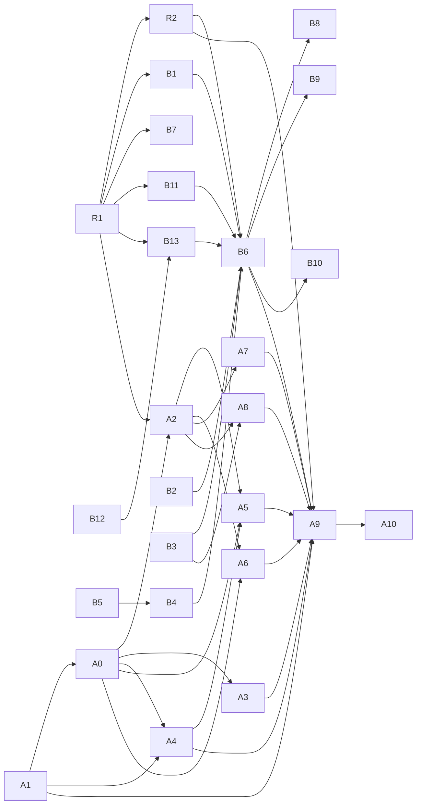

# Task — Remote drivers (boxd and archil) end to end

> Scope of #947 (v0.20), checked 2026-11-10 against `main` at `3f476537` and
> disco-vm at the version discobox pins, `5682ac6ab2a2` (2026-11-04). disco-vm's
> own `main` was not readable from the box that wrote this. Its first issue
> (R1) re-reads it.

Sequencing lives here, not in an ADR or any `DESIGN.md`. Delete this file once
the issues below are filed. The issues and their ADRs carry the work from then
on. In the same change, point `pool-agent/REVIEW.md`'s "A machine's public port"
at the issues filed for B11 and A0, in place of #947.

**End to end** means: create a pool, bring up its agent, start a sandbox,
attach, run a harness, and have egress only through the pool's proxy.

## Summary

- **boxd** is wired through every stage in code. It has run live, by hand, on
  2026-11-02 in the owner's boxes (pools `pool_qg14npnbegky129y` and
  `pool_dfqcve6ztdsmgbd6`), as far as a running sandbox. Those runs filed:
  - the bugs #455 (the control-plane channel is cut) and #456 (machine DNS);
  - the feature #775 (machine volumes and feature prefixes), with its
    ADR PR #784 and its fix PR #776.

  This scope adds one gap no run has probed: every boxd sandbox machine has a
  public URL the guest's root controls (B11). And boxd has added regions, which
  neither the driver nor a pool can name yet (B12, B13). What is missing is
  fixing those, a repeatable live run, and the account rules.
- **archil** is a disco-vm driver that passes disco-vm's conformance suite on
  Archil itself, but discobox does not link it. Even linked, discobox would
  refuse it in three places, all for the same reason: archil has no machine
  isolation, which ADR 26-10-23-551 §4 and ADR 26-10-29-481 §4 require. Its
  guests also have no systemd, which 551 §1 assumes, and Archil pauses them
  after 24 hours. archil needs an ADR that supersedes those sections (A0)
  before code.
- **Nothing on either track needs a Mac.** Every issue below builds and is
  tested on linux/amd64, against disco-vm's fake driver or boxd's fake API. Only
  a live run needs a provider account. The owner has granted a boxd key and an
  Archil key for this track, and the manager holds them.

## What exists

| Stage | boxd | archil |
|---|---|---|
| Driver in disco-vm | `pkg/machine/boxd`: real create, start, commit, exec, copy, TTY, isolation, egress fence. No data volume and no `Upgrade`. Proven against boxd's fake API (2026-11-03); not against boxd itself since disco-vm ADR 26-11-03-606 | `pkg/machine/archil`: real create, start, commit, `Upgrade`, data volume, egress fence. No isolation, no networks, no reboot. `TestConformance` passed on Archil itself (2026-11-03) |
| Linked in discobox | `server/providers/discovm/drivers.go:16` and `pool-agent/drivers.go:10` | Neither |
| Provider config | `vm` provider: `driver`, a sealed `apiKey`, and optional `controlPlaneUrl`, `deliverProviderKey` and `base` (`server/providers/discovm/provider.go:34-114`). `scripts/boxd-pool.sh` makes one. No region: boxd added regions recently, and the boxd driver takes none (B12) | Would be the same fields. Region is environment only (`ARCHIL_REGION`), until B12 moves it to the same driver field |
| Pool machine | `poolMachine.converge` (`poolmachine.go:227-362`) makes, re-adopts, repairs and removes the pool's machine on its own network | Refused at `poolmachine.go:241` (no `Isolation`; ADR 26-10-23-551 §4) |
| Provisioning key | `poolkey.go:118-190`: an issued key, else the provider's own with `deliverProviderKey`, else the pool is blocked. boxd issues keys only from a `boxd login` session, so in practice `deliverProviderKey` is required | `KeysNone`: the same opt-in would be required. An Archil key never expires and reaches the whole account |
| Pool agent up | `poolruntime/box.go:176-260` places the bundles and runs `provision apply --wait`. The pool's units are systemd units (ADR 26-10-23-551 §1, ADR 26-10-27-767) | No systemd in an Archil guest. PID 1 is Archil's init (disco-vm `docs/drivers/archil.md`) |
| Control plane ↔ pool | The server opens a WebSocket channel to the pool's public URL (`poolruntime/channel.go`, `pool-agent/cpchannel`). Live: cut every few minutes (#455) | Would be the same |
| Sandbox machine | `MachineSandboxRuntime`: one machine per sandbox, isolated on the pool's network, its fence set at create and read back (`pool-agent/sandboxruntime/machine.go:957-980`). Plan snapshots by commit (`machinesnapshot.go`) | Refused three times: `requireMachineFence` (`pool-agent/poolhop.go:94-107`), the runtime itself (`pool-agent/machines.go:86` always sets `Isolate`, which `NewMachineSandboxRuntime` refuses without `Isolation` and a network, `sandboxruntime/machine.go:131-137`), and every create (`createOptions` asks for isolation and networks, which `archil.go:191` refuses) |
| Sandbox → pool hop | Direct: `discobox-pool-proxy` resolves to the pool's `.boxd` name; the fence is `{}` plus `isolated` (`poolhop.go:65-71`) | Edge: a `wss://` tunnel through the pool's public host, mTLS inside, the fence that host alone (`poolhop.go:73-88`, ADR 26-10-23-719). Never run on a real driver |
| Pool → sandbox agent | The private URL `http://dvm-….boxd:7302`, TLS from the pool's CA (ADR 26-10-29-481 §3) | Edge form, as 481 §3 decided: plain HTTP through Archil's edge, which terminates TLS. The agent checks the pool's token on every request (`pool-agent/DESIGN.md`, The Agent's TLS) |
| Public URL of a sandbox machine | **Every boxd machine, isolated sandboxes included, gets `https://<machine>.<zone>` forwarding to 7302, with bot protection off** (disco-vm `pkg/machine/boxd/service.go`, `pinProxy`). The pool never uses it; it dials the private URL | 7302 is exposed at a public hostname; it is the only way the pool reaches the agent |
| Harness | A provisioning bundle, the same as any box. Live: `claude` fails `EACCES` on `/var/lib/claude-code`, since a machine with no data volume mounts none of its declared volumes (#775, #784) | Would be the same, but archil has a data volume at `/.discobox/data` |
| DNS in the sandbox | `resolv.conf` names boxd's resolver, not the DNS stub (#456) | Unknown |
| Tests on Linux, no account | `server/providers/discovm`: 29 tests on disco-vm's fake driver; `pool-agent/sandboxruntime/machine_test.go`; disco-vm's `TestConformanceFakeAPI` | disco-vm's `httptest` unit tests only. No fake API for the conformance suite |

Other facts that shape the list:

- **A machine's public port belongs to the guest's root, not to the agent.** The
  sandbox user has passwordless sudo (`sandbox-agent/REVIEW.md`), so the agent
  in a box can replace whatever listens on 7302. A public URL to that port is
  an inbound channel the egress fence and the proxy's audit never see. On boxd
  that channel exists today (B11). On archil it is the pool's only path (Q3,
  Q4).
- **A discobox-access placeholder cannot be the boxd `apiKey`.** disco-vm
  exchanges a `bxd_` key for a JWT in a POST body, and egress substitutes only
  in headers (`.agents/skills/verify-recipes/SKILL.md`, the boxd notes). A pool
  machine holding a `deliverProviderKey` key calls boxd from boxd, outside any
  egress proxy, so it needs the real key anyway. A live run is therefore made
  with the key itself, on the side that holds it (Q1), never in a worker's box.
- **boxd lets a machine reach the hosts of every secret in its scope, whatever
  its fence says.** That covers the org's secrets and the key owner's private
  ones (disco-vm `docs/drivers/boxd.md`, Egress). boxd also sets the fence
  about a second after create. So neither the org nor the key's owner may hold
  host-bound secrets.
- **The pool machine itself is not fenced** (ADR 26-10-29-481 §4, ADR
  26-10-27-767). That is accepted, and nothing here changes it.
- **Stale recipe text:** `verify-recipes` says `machineProject`; the field is
  `machinePool`. Its "cannot mark its own resource dirty" note describes #377,
  fixed in #514.

## Credentials

The owner has granted a boxd API key and an Archil API key for this track,
and **the manager holds them**. Neither key ever enters a worker's box, and
neither is ever in the manager agent's own context. The manager is itself an
agent that reads issue comments, worker reports and reviews, which anyone can
write. So a key stays in the manager's credential store, and only the live
run's tooling reads it from there into a file. A step marked **live** in the
list below is run with one of them by whoever holds it, under Q1's rules.
Those rules apply because the code that runs beside the key is written by
workers.

| Credential | Held | For | What it must be |
|---|---|---|---|
| **A boxd API key (`bxd_…`)** | by the manager (granted) | B1, B3, B6, B9, B11, B12, B13 | A key of an org dedicated to this track. Neither the org nor the key's owner may hold host-bound secrets, since a machine reaches those hosts whatever its fence says. A new org without a payment method may run 2 machines (a pool plus one sandbox), which B6 and B9 outgrow, so the org needs a payment method or a quota of at least 4 |
| **An Archil API key (`key-…`)** | by the manager (granted) | A1, A8, A9 | A key of an account that holds nothing else, since it never expires and reaches the whole account. Its region is set by `ARCHIL_REGION` (`aws-us-east-1` by default) today, and by the driver's region field once B12 lands |
| **A harness credential** (for Claude Code, an Anthropic key or subscription) | not covered by the grant: the owner provides it, or names one the manager already holds | B6, A9 (they run a harness) | A project secret on the run's server, so the sandbox sees only its sentinel through the pool's proxy. Revoked or rotated with the provider keys when the track ends |
| **A `boxd login` session** | not granted | B10 only, if Q2 pursues issued keys | An API key cannot issue keys. Only an interactive session can, and that path has never been run |

**After each live run**, whoever ran it:
- deletes every machine, snapshot, sandbox and disk the run made under its pool
  prefix (`dvm-<pool>--`);
- says in the run's report that nothing is left.

**When the track ends** (A9 done, or archil dropped):
- the owner revokes both keys;
- for boxd, the owner also revokes any binding the org made for it (the
  `verify-recipes` rule, and #775's done list).

A `deliverProviderKey` pool machine keeps a copy of the key after its pool is
gone (`provider.go:60-66`), so a run that leaves a machine leaves the key on
it. If either granted key does not meet its row's requirements, the first live
step that needs it (B1, A1) says so and stops.

## Issues to file, in order

Size: **S** is under a day, **M** a few days, **L** a week or more. Linux
column: **fake** means it is done and verified on a Linux box with no account;
**live** means a run with a key from [Credentials](#credentials) is part of
done. **None of these needs a Mac.** "Existing" names an issue or PR already
open; the work is to resume it, not to file it again.

### Shared

| # | Issue | Repo | Depends on | Size | Linux |
|---|---|---|---|---|---|
| R1 | Move disco-vm to its current `main` in `server` and `pool-agent`, and re-read its boxd and archil docs for anything that landed after `5682ac6` | discobox | — | S | fake |
| R2 | A live-run recipe: a Taskfile target, run with a held key under Q1's rules. It makes a provider and pool, starts a sandbox, attaches, runs a harness, and probes egress: the pool's proxy answers, while `1.1.1.1` and an unlisted name do not. It probes the sandbox machine's public URL from outside, which must not answer as anything the guest controls. It deletes everything it made, then reports, including that nothing is left. It takes the driver as a parameter, and fixes the stale `verify-recipes` text | discobox | R1 | M | fake (the script's dry run); its live run is B6 / A9 |

### boxd track (first)

| # | Issue | Repo | Depends on | Size | Linux |
|---|---|---|---|---|---|
| B12 | discobox-ai/vm#68: the boxd driver takes a region in its config, per driver instance, and archil moves from `ARCHIL_REGION` to the same field. Each driver maps a region to its endpoints through a fixed table, as archil's `controlPlanes` (`pkg/machine/archil/api.go`) does today, and refuses a region outside it before any request. It never builds a host from the region string, which would send the provider's key wherever a region names. An ADR in disco-vm first, if the seam change is not obvious. Starts first, independent of everything here | discobox-ai/vm (existing) | — | M | fake API; then **live** (boxd key, its hosts narrowed per Q1, for the region's endpoint) |
| B13 | #997 (v0.20, priority/high): a pool's configuration has an optional region, set at create and shown by get/list; empty means the provider's default, and an upgrade keeps existing pools on the default. Its parts: **the server side**: today the server opens one engine per provider (`server/providers/discovm/runtime.go:64-84`, `newRuntime`), and every pool machine of the provider goes through it, so it opens an engine per region (or per pool) for making, finding, repairing and removing a pool's machine and for the pool's keys, and the pool machine and its sandboxes always share the region, or their private network breaks; **the pool agent** opens its engine in the pool's region; **validation**: an unknown region is refused at create against the driver's fixed table (B12), with the list of known regions, before any request to the provider. This is stricter than #997's "otherwise at the first call", since a first call would already carry the key to the region's endpoint; **a region change** with machines in the pool is decided by its ADR first (Q8); **the CLI, TUI and the boxd setup docs** show and set it. Starts once B12 merges, moving disco-vm to that commit | discobox (existing) | B12, R1, its ADR (Q8) | L | fake API; its live check is part of B6 (boxd key, its hosts narrowed per Q1) |
| B1 | Run boxd's `TestConformance` against boxd itself again (it has not run there since disco-vm ADR 26-11-03-606), and give `internal/e2e` a `DISCO_VM_DRIVER=boxd` layout | discobox-ai/vm | R1 | M | fake, then **live** (boxd key) |
| B2 | #455 (status/blocked, waiting on its reporter; this unblocks it): the control-plane channel is cut minutes after it opens. First, #455's own "To find out": hold a WebSocket through a discobox's egress proxy to a host that is not boxd for 10+ minutes. A cut there is the proxy's, and needs no account. Then add a heartbeat below the idle timeout found, and make an in-flight create survive a redial | discobox (existing) | — | M | fake (through a discobox's egress proxy, and a cutting proxy); B6 confirms it only for a server outside a box |
| B3 | #456: a machine sandbox's `resolv.conf` names the provider's resolver. Needs its ADR first (extends ADR 0148 §2): the stub as the resolver, and the bridge resolving the pool's host against the recorded original | discobox (existing) | its ADR | M | fake for the bridge; **live** to find what on boxd rewrites the file |
| B4 | #775: every machine sandbox mounts its declared volumes from its own data and cache roots, and features install into prefixes discobox owns. Land ADR PR #784, then fix PR #776 (both paused for v0.20). Without this, Claude Code cannot start on boxd | discobox (existing PRs #784, #776) | B5 | M | fake (and disco-vm's docker driver) |
| B5 | Land ADR PR #785: a command discobox puts on `PATH` is linked in `/usr/local/bin`. #776's review raised the policy, and #776 waits on it | discobox (existing PR #785) | — | S | fake |
| B11 | A boxd sandbox machine has no public URL the guest controls. Its pool dials the private URL, so the public one (`pinProxy` on every create) serves nothing discobox needs. Two options: drop or disable the default proxy for an isolated machine, if boxd allows it; or else put a provider-side check in front of it. Whether boxd allows either is unknown | discobox-ai/vm, discobox | R1 | M | fake API, then **live** (boxd key) |
| B6 | A boxd pool end to end, live: R2's recipe on boxd. Done when a sandbox runs a harness, its secrets are sentinels, it fetches from its origin, egress goes only through the pool's proxy, nothing answers at its public URL, the channel holds for an hour from the run's server, and a pool created with a non-default region makes its machines there (#997's live check). What it finds is filed as bugs | discobox | R2, B1, B2, B3, B4, B11, B13 | S (the run) | **live** (boxd key) |
| B7 | A boxd provider's requirements are checked and documented. No host-bound secrets in the org or the key owner's scope: checked through boxd's API if it lists them, otherwise stated in `admin provider create`'s help and the docs. And the org's machine quota reported as the pool's capacity (`MaxRunning`) | discobox, discobox-ai/vm | R1 | S | fake |
| B8 | User docs: setting up a `vm` provider on boxd (`docs/public`), with the credential's blast radius stated (the provisioning key's bounds, ADR 26-10-23-551 §4) | discobox | B6 | S | — |
| B9 | Plan snapshots on boxd itself: `Commit` and create-from are proven on the fake API only. Check that a second sandbox of a plan starts from its snapshot | discobox | B6 | S | **live** (boxd key) |
| B10 | *(Later, only if Q2 says so)* issued keys on boxd from a `boxd login` session, replacing `deliverProviderKey` | discobox-ai/vm, discobox | B6, Q2 | M | **live** (`boxd login`) |

### archil track (after B6; A1 first)

| # | Issue | Repo | Depends on | Size | Linux |
|---|---|---|---|---|---|
| A0 | **ADR (Proposed): a machine pool on a driver with no isolation and no init system.** It supersedes or narrows ADR 26-10-23-551 §1 and §4, and ADR 26-10-29-481 §4, as Q3–Q6 below say. It also decides what the runtime's `Isolate` and `Network` mean, and what `MachineToken` (`poolkey.go:255`) keys off, on a driver with no networks. It is drafted once A1 has found out what Q3 turns on, so it is not accepted for a driver that cannot be carried | discobox | A1 | M | — |
| A1 | archil in disco-vm, in five parts. An `internal/e2e` layout for `DISCO_VM_DRIVER=archil`. Page the sandbox listing (`api.go:221-226` reads one page, against `REVIEW.md`). Reach a guest server through the 7302 URL. Add a TTY row to the proof table. Add a fake of Archil's API for the conformance suite. Q3 also needs it to find out, on Archil, whether an exposed port can be restricted at the edge by a credential the edge checks (a token, or mTLS at the edge), whether Archil's outbound address is any one sandbox's alone (an address allowlist counts only if it is), and whether Archil plants any credential, integration or account disk in a guest | discobox-ai/vm | — | M | fake, then **live** (Archil key) |
| A2 | Link archil in `server/providers/discovm/drivers.go` and `pool-agent/drivers.go`, and map its REST and WebSocket errors in `unreachable()` (`poolmachine.go:554`) | discobox | R1, A0 | S | fake |
| A3 | The pool agent and the sandbox agent run where PID 1 is not systemd, in A0's shape. Tested in a container whose PID 1 is not systemd | discobox | A0 | L | fake |
| A4 | The edge path from pool to sandbox agent meets A0's rule for public listeners (Q4) | discobox | A0, A1 | M | fake (an edge stand-in) |
| A5 | A0's rule replaces every isolation refusal: `poolmachine.go:241`, `requireMachineFence`, `machines.go:86` with `NewMachineSandboxRuntime`, and `createOptions`. archil is then accepted, and a driver that meets neither rule is still refused | discobox | A0, A2, A4 | M | fake |
| A6 | Archil's 24-hour pause: a paused pool machine or sandbox is resumed (by the server and the pool agent respectively), and a discobox sleep maps onto it, per A0 | discobox | A0, A2 | M | fake |
| A7 | #551 on archil: a machine with a data volume (every archil sandbox) is rebuilt from its plan's snapshot with `Upgrade`, and never destroyed with its volume | discobox (existing) | A2 | M | fake (and disco-vm's docker driver) |
| A8 | An archil pool's resolver, after B3's ADR: what an Archil guest's `resolv.conf` names, and whether B3's shape holds | discobox | B3, A2 | S | **live** (Archil key) |
| A9 | An archil pool end to end, live: R2's recipe on archil, including a sandbox that lives past 24 hours | discobox | R2, B6, A1, A3–A8 (A0 and A2 through A5) | S (the run) | **live** (Archil key) |
| A10 | User docs: a `vm` provider on archil | discobox | A9 | S | — |

Existing issues not on the critical path: #607 (disco-vm pool scopes and
internal URLs, which keeps today's routing until cutover) and #740 (a
preseeded base, Docker-only today).

The graph is the "Depends on" columns, edge for edge:

## Open questions for the owner

**Q1. Who runs the live steps, now that the manager holds the keys?**
Recommended: the manager, or the owner, runs R2's script and B1's suite with
the held key, under three rules:

- **Only reviewed code.** It runs a revision that has landed on `main` through
  human review, pinned by commit, never a worker's branch.
- **Narrow outbound traffic, by exact host.** It runs where traffic can reach
  only:
  - the provider's API hosts, as disco-vm dials them:
    - boxd: `boxd.sh:9443` (the API) and `app.boxd.sh` (the key's token
      exchange), from `pkg/machine/boxd/api.go`, plus the exact endpoint of
      the region the run's pool names, as B12 documents it;
    - Archil: the region's control host, such as
      `control.green.us-east-1.aws.prod.archil.com`, from
      `pkg/machine/archil/api.go`, and the host of the process WebSocket
      that every exec and copy dials. Archil returns that URL from
      `POST /api/sandboxes/<id>/connections` (`archil/api.go`, `process.go`).
      A1's live run finds out whether it is one fixed host. If it is a
      different host per sandbox under a shared domain, it is allowed host by
      host as each answer returns it, never as the domain;
  - the discobox server;
  - the public hostname of each machine of the run's pool:
    - the pool machine's, which the server's control-plane channel dials;
    - each sandbox machine's, which R2's probe dials.

    The pool agent creates sandbox machines from the pool machine, so no create
    on the run's host returns their hostnames. The run's tooling reads them
    from the provider's listing of the pool's prefix (`dvm-<pool>--`) and adds
    each as it appears.

  Never a provider's machine domain (`*.boxd.sh`, `*.archil.app`): anyone can
  make a machine under it in minutes and receive a key posted to it. Not the
  harness's API either: a harness's traffic leaves from the pool's proxy on
  the pool machine, not from the run's host. A POST there under someone
  else's account would carry the key out just the same.
- **The key from a file.** The key goes from the manager's credential store
  into a file, and from that file into the provider's config. It never goes on
  a command line, and never into an agent's context.

A worker writes the script, tests it against the fakes, and reads the
report.

No registry is on the list. The run's server reads the bundles it places
(the pool, agent, platform and harness bundles) from a cache filled before
the run, by digest, with no key present. A registry anyone can push to, such
as `ghcr.io`, would be a way out for the key, since a host list cannot tell a
pull from a push.

Rule 2 only narrows the exits. The provider's own API stays one: code holding
an attacker's own provider key could write the held key into the attacker's
account through it. **Rule 1 is what keeps the key in**, and rule 2 is never a
reason to relax it.

Without the first two rules, the key would stay out of the worker's box but
sit beside the worker's code with open egress. Hostile input that steered the
worker could then carry it out, for example an issue comment or a dependency
that R1 pulls in.

The alternatives:
- **Lend the key as a discobox-access placeholder.** This does not work. boxd's
  token exchange carries the key in a POST body, where egress does not
  substitute. A `deliverProviderKey` pool machine also calls the provider from
  the provider's own network, outside any egress proxy.
- **Give the real key to one dedicated box for the live runs.** This breaks
  the rule that a credential never reaches a worker, so it is the owner's call
  alone.

**Q2. Does v0.20 ship boxd with `deliverProviderKey` only?** Recommended: yes,
stated as such, as the explicit opt-in ADR 26-10-23-551 §4 allows. The pool
machine holds the org's API key, so the org must be dedicated to discobox.
Issued keys (B10) need a `boxd login` session the server does not have, and
that path is unproven on boxd. They come after v0.20, if ever.

**Q3. What replaces isolation for archil?** (A0, superseding ADR 26-10-23-551
§4 and ADR 26-10-29-481 §4.) Those sections make isolation on a pool network a
precondition, and 481 rejected an unisolated fence.

Archil has no private networks and no isolation flag. A sandbox reaches only
what its fence allows, and anything reaches it only at its public URL.

Recommended: a driver may carry a machine pool without isolation only if all
three hold:
- it has no peer network at all;
- it fences egress to the pool's public host;
- its public listener is restricted by the provider outside the guest, to the
  pool alone, by a credential the edge checks (a token, or mTLS at the edge).

An address allowlist counts only if A1 shows the address is the pool's alone.
Archil's outbound address is its NAT, and other Archil sandboxes behind the
same NAT would otherwise pass it.

A1 finds out whether Archil can restrict its listener. If it cannot, the agent
in the box has an inbound channel to the internet that neither the fence nor
the proxy's audit sees. That breaks "egress only through the pool's proxy", so
archil stays refused until it can.

disco-vm's `Isolation` also means the provider plants nothing of the account in
a guest, and A1 checks that too. The alternative, refusing archil now, ends the
archil track.

**Q4. Is ADR 26-10-29-481 §3's edge form enough for the pool to reach a sandbox
agent through Archil's edge?** In that form, the edge speaks plain HTTP to the
agent, and the agent checks the pool's token on every request.

Recommended: yes, keep it. Archil gives each sandbox its own hostname, so one
box cannot answer at a peer's. That is the property 481 needed, because a box
answering at a peer's address would be sent the peer's runtime-config
document, which carries the peer's client key. What 481 §3 does not cover is
Q3's public listener, and A4 carries Q3's rule for it.

The rejected alternative is the pool's calls riding back inside the sandbox's
own `wss` tunnel. It would supersede ADR 26-10-23-719 §2–§3: that tunnel carries
one stream at a time, is dialed by the sandbox on demand, and multiplexing and
pre-dialing were rejected there. It would also:
- have to bind each return channel to the sandbox named in the mTLS client
  certificate that opened it, never to anything the request claims;
- still have to deliver the first client key some other way, through the
  provider's exec (the place step).

**Q5. How do discobox's units run without systemd?** (A0, narrowing ADR
26-10-23-551 §1, where the pool's agent and proxy are systemd units laid by
`install`, and ADR 26-10-27-767's "a machine pool runs what every pool runs".)

Recommended: a spike first, with the Archil key. The candidates are, in order:

1. Exec, after every start, a small supervisor in the agent that runs the box's
   units itself.
2. Run systemd in a PID namespace started by exec (`unshare --pid --fork`), so
   the units are unchanged.
3. Run the guest as a container inside the Archil VM.

Choice 2 changes the least code if Archil's kernel allows it. Choice 3 is close
to the alternative 551 rejected for the pool machine: "the pool-agent image in
a container on the pool machine", which needs Docker on every base. So it
would have to answer that objection. The spike decides.

**Q6. Where does an archil pool's agent run?** (A0) Recommended: on an Archil
sandbox of its own, the same shape as boxd (ADR 26-10-23-551 §1), resumed by the
server after Archil's 24-hour pause. The alternative is running it on a boxd
machine or on the server's host. That mixes providers and moves the sandboxes'
hop off Archil, which their fence would then have to allow.

**Q7. Does archil ship in v0.20?** Recommended: boxd only. archil follows once
A0 is accepted, since A3 alone is a week or more and A0 may take more than one
round.

**Q8. Can a pool's region change once it has machines?** (B13, #997; its
ADR first, since the reason is not obvious.) A pool's machines, snapshots and
listing all live in its region. A pool whose region moved would no longer see
its own pool machine (`poolMachine.converge`), its orphan sweep and snapshot
reuse would miss what is left in the old region, and a machine sandbox's disk
is the only copy of its work. Recommended: the region is fixed once the pool
has made a machine. A change is refused with that reason, and moving region
means a new pool. The alternative, a change that applies only to new machines,
splits one pool across two regions, which the pool's private network between
its machine and its sandboxes cannot span.
