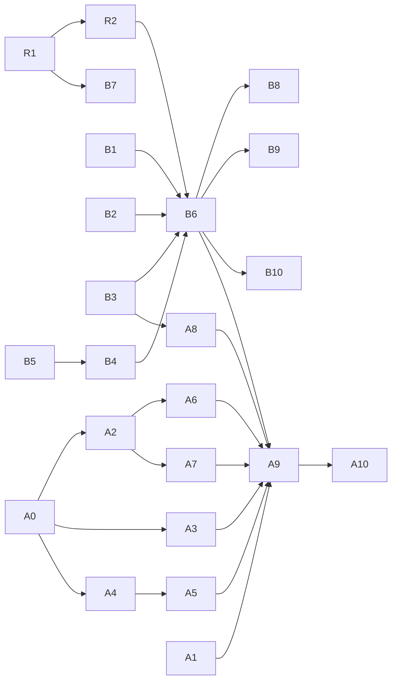

# Task — Remote drivers (boxd and archil) end to end

> Scope of #947 (v0.20), checked 2026-11-10 against `main` at `3f476537` and
> disco-vm at the version discobox pins, `5682ac6ab2a2` (2026-11-04). disco-vm's
> own `main` was not readable from the box that wrote this. Its first issue
> (R1) re-reads it.

Sequencing lives here, not in an ADR or any `DESIGN.md`. Delete this file once
the issues below are filed. The issues and their ADRs carry the work from then on.

**End to end** means: create a pool, bring up its agent, start a sandbox,
attach, run a harness, and have egress only through the pool's proxy.

## Summary

- **boxd** is wired through every stage in code. It has run live once, by hand
  on 2026-11-02 in the owner's box `sbx_yhg7pcs4by9bmsq5`. That run reached a
  running sandbox and found four bugs: #455, #456, #775 and #784. What is
  missing is fixing those, a repeatable live run, and the account rules.
- **archil** is a disco-vm driver that passes disco-vm's conformance suite on
  Archil itself, but discobox does not link it. Even linked, discobox would
  refuse it in two places, both for the same reason: archil has no machine
  isolation. Its guests also have no systemd and pause after 24 hours. archil
  needs a design (an ADR) before code.
- **Nothing on either track needs a Mac.** Every issue below builds and is
  tested on linux/amd64, against disco-vm's fake driver or boxd's fake API. Only
  a live run needs a provider account, and that account is the owner's.

## What exists

| Stage | boxd | archil |
|---|---|---|
| Driver in disco-vm | `pkg/machine/boxd`: real create, start, commit, exec, copy, TTY, isolation, egress fence. No data volume and no `Upgrade`. Proven against boxd's fake API (2026-11-03); not against boxd itself since disco-vm ADR 26-11-03-606 | `pkg/machine/archil`: real create, start, commit, `Upgrade`, data volume, egress fence. No isolation, no networks, no reboot. `TestConformance` passed on Archil itself (2026-11-03) |
| Linked in discobox | `server/providers/discovm/drivers.go:16` and `pool-agent/drivers.go:10` | Neither |
| Provider config | `vm` provider: `driver`, a sealed `apiKey`, and optional `controlPlaneUrl`, `deliverProviderKey` and `base` (`server/providers/discovm/provider.go:34-114`). `scripts/boxd-pool.sh` makes one | Would be the same fields. Region is environment only (`ARCHIL_REGION`) |
| Pool machine | `poolMachine.converge` (`poolmachine.go:227-362`) makes, re-adopts, repairs and removes the pool's machine on its own network | Refused at `poolmachine.go:241` (no `Isolation`) |
| Provisioning key | `poolkey.go:118-190`: an issued key, else the provider's own with `deliverProviderKey`, else the pool is blocked. boxd issues keys only from a `boxd login` session, so in practice `deliverProviderKey` is required | `KeysNone`: the same opt-in would be required. An Archil key never expires and reaches the whole account |
| Pool agent up | `poolruntime/box.go:176-260` places the bundles and runs `provision apply --wait`. The pool's units are systemd units | No systemd in an Archil guest. PID 1 is Archil's init (disco-vm `docs/drivers/archil.md`) |
| Control plane ↔ pool | The server opens a WebSocket channel to the pool's public URL (`poolruntime/channel.go`, `pool-agent/cpchannel`). Live: cut every few minutes (#455) | Would be the same |
| Sandbox machine | `MachineSandboxRuntime`: one machine per sandbox, isolated on the pool's network, its fence set at create and read back (`pool-agent/sandboxruntime/machine.go:957-980`). Plan snapshots by commit (`machinesnapshot.go`) | Refused by `requireMachineFence` (`pool-agent/poolhop.go:94-107`, no `Isolation`) |
| Sandbox → pool hop | Direct: `discobox-pool-proxy` resolves to the pool's `.boxd` name; the fence is `{}` plus `isolated` (`poolhop.go:65-71`) | Edge: a `wss://` tunnel through the pool's public host, mTLS inside, the fence that host alone (`poolhop.go:73-88`). Never run on a real driver |
| Pool → sandbox agent | The private URL `http://dvm-….boxd:7302`, TLS from the pool's CA | Edge form: plain HTTP through Archil's public edge (`pool-agent/DESIGN.md`, The Agent's TLS). The agent's port is on the internet |
| Harness | A provisioning bundle, the same as any box. Live: `claude` fails `EACCES` on `/var/lib/claude-code`, since a machine with no data volume mounts none of its declared volumes (#775, #784) | Would be the same, but archil has a data volume at `/.discobox/data` |
| DNS in the sandbox | `resolv.conf` names boxd's resolver, not the DNS stub (#456) | Unknown |
| Tests on Linux, no account | 24 fake-driver tests in `server/providers/discovm`; `pool-agent/sandboxruntime/machine_test.go`; disco-vm's `TestConformanceFakeAPI` | disco-vm's `httptest` unit tests only. No fake API for the conformance suite |

Other facts that shape the list:

- **A discobox-access placeholder cannot be the boxd `apiKey`.** disco-vm
  exchanges a `bxd_` key for a JWT in a POST body, and egress substitutes only
  in headers (`.agents/skills/verify-recipes/SKILL.md`, the boxd notes). A pool
  machine holding a `deliverProviderKey` key calls boxd from boxd, outside any
  egress proxy, so it needs the real key anyway. Live runs are therefore the
  owner's.
- **boxd admits the hosts of the org's host-bound secrets whatever the fence
  says**, and sets the fence about a second after create (disco-vm
  `docs/drivers/boxd.md`). A pool's org must hold no host-bound secrets.
- **The pool machine itself is not fenced** (ADR 26-10-29-481 §4, ADR
  26-10-27-767). That is accepted, and nothing here changes it.
- **Stale recipe text:** `verify-recipes` says `machineProject`; the field is
  `machinePool`. Its "cannot mark its own resource dirty" note describes #377,
  fixed in #514.

## Credentials the owner provides

None of these ever goes to a worker. A step marked **owner** in the list below is
run by the owner on their own server, from a script that a worker writes and
tests against the fakes. The owner revokes the key afterwards.

| Credential | For | Notes |
|---|---|---|
| **A boxd API key (`bxd_…`) of a dedicated, throwaway boxd org** | B1, B6, B9 | `scripts/boxd-pool.sh` mints it after `boxd login`. The org must hold no host-bound secrets. A new org without a payment method may run 2 machines (a pool plus one sandbox), so give it a payment method or a quota of at least 4 |
| **A `boxd login` session** | B10 only, if issued keys are pursued | An API key cannot issue keys. Only an interactive session can, and that path has never been run |
| **An Archil API key (`key-…`) of a dedicated account** | A1, A9 | It never expires and reaches the whole account, so use an account that holds nothing else. Choose a region (`aws-us-east-1` by default) |

## Issues to file, in order

Size: **S** is under a day, **M** a few days, **L** a week or more. Linux
column: **fake** means it is done and verified on a Linux box with no account;
**owner** means a live run with an account above is part of done. **None of
these needs a Mac.**

### Shared

| # | Issue | Repo | Depends on | Size | Linux |
|---|---|---|---|---|---|
| R1 | Move disco-vm to its current `main` in `server` and `pool-agent`, and re-read its boxd and archil docs for anything that landed after `5682ac6` | discobox | — | S | fake |
| R2 | A live-run recipe: a Taskfile target the owner runs against their own server that makes a provider and pool, starts a sandbox, attaches, runs a harness, probes egress (the pool's proxy answers; `1.1.1.1` and an unlisted name do not), reports, and deletes it all. Takes the driver as a parameter. Fixes the stale `verify-recipes` text | discobox | R1 | M | fake (the script's dry run); its live run is B6 / A9 |

### boxd track (first)

| # | Issue | Repo | Depends on | Size | Linux |
|---|---|---|---|---|---|
| B1 | Run boxd's `TestConformance` against boxd itself again (it has not run there since disco-vm ADR 26-11-03-606), and give `internal/e2e` a `DISCO_VM_DRIVER=boxd` layout | discobox-ai/vm | — | M | fake, then **owner** (boxd key) |
| B2 | #455: the control-plane channel is cut minutes after it opens. Reproduce through a proxy that cuts idle streams, add a heartbeat below any idle timeout on the path, and make an in-flight create survive a redial | discobox (existing) | — | M | fake (a cutting proxy); confirmed in B6 |
| B3 | #456: a machine sandbox's `resolv.conf` names the provider's resolver. Needs its ADR first (extends ADR 0148 §2): the stub as the resolver, and the bridge resolving the pool's host against the recorded original | discobox (existing) | ADR | M | fake for the bridge; **owner** to find what on boxd rewrites the file |
| B4 | #784 → #775 / #776: every machine sandbox mounts its declared volumes from its own data and cache roots, and features install into prefixes discobox owns. Resume both PRs (paused for v0.20). Without this, Claude Code cannot start on boxd | discobox (existing) | #784 accepted | M | fake (and disco-vm's docker driver) |
| B5 | #785: a command discobox puts on `PATH` is linked in `/usr/local/bin` (the policy #776's review raised) | discobox (existing) | — | S | fake |
| B6 | A boxd pool end to end, live: R2's recipe on boxd. Done when a sandbox runs a harness, its secrets are sentinels, it fetches from its origin, egress goes only through the pool's proxy, and the channel holds for an hour. What it finds is filed as bugs | discobox | R2, B2, B3, B4 | S (the run) | **owner** (boxd key) |
| B7 | A boxd provider's requirements are checked and documented: a dedicated org, no host-bound secrets (checked through boxd's API if it lists them, otherwise stated in `admin provider create`'s help and the docs), and the org's machine quota reported as the pool's capacity (`MaxRunning`) | discobox, discobox-ai/vm | R1 | S | fake |
| B8 | User docs: setting up a `vm` provider on boxd (`docs/public`), with the credential's blast radius stated (ADR 0126's rule for provider credentials) | discobox | B6 | S | — |
| B9 | Plan snapshots on boxd itself: `Commit` and create-from are proven on the fake API only. Check that a second sandbox of a plan starts from its snapshot | discobox | B6 | S | **owner** (boxd key) |
| B10 | *(Later, only if Q2 says so)* issued keys on boxd from a `boxd login` session, replacing `deliverProviderKey` | discobox-ai/vm, discobox | B6, Q2 | M | **owner** (`boxd login`) |

### archil track (after B6)

| # | Issue | Repo | Depends on | Size | Linux |
|---|---|---|---|---|---|
| A0 | **ADR (Proposed): a machine pool on a driver with no isolation and no init system.** Settles Q3–Q6 below | discobox | — | M | — |
| A1 | archil in disco-vm: an `internal/e2e` layout for `DISCO_VM_DRIVER=archil`; page the sandbox listing (`api.go:221-226` reads one page, against `REVIEW.md`); a guest server reached through the 7302 URL; a TTY row in the proof table; a fake of Archil's API for the conformance suite | discobox-ai/vm | — | M | fake, then **owner** (Archil key) |
| A2 | Link archil in `server/providers/discovm/drivers.go` and `pool-agent/drivers.go`, and map its REST and WebSocket errors in `unreachable()` (`poolmachine.go:554`) | discobox | R1, A0 | S | fake |
| A3 | The pool agent and the sandbox agent run where PID 1 is not systemd, in A0's shape. Tested in a container whose PID 1 is not systemd | discobox | A0 | L | fake |
| A4 | Pool → sandbox agent through an edge is mutually authenticated, in A0's shape; the agent answers nothing else on its public port | discobox | A0 | M | fake (an edge stand-in) |
| A5 | The isolation requirement in `poolmachine.go:241` and `requireMachineFence` becomes A0's rule, so archil is accepted and a driver that meets neither rule is still refused | discobox | A0, A4 | S | fake |
| A6 | Archil's 24-hour pause: a paused pool machine or sandbox is resumed (by the server and the pool agent respectively), and a discobox sleep maps onto it, per A0 | discobox | A0, A2 | M | fake |
| A7 | #551 on archil: a machine with a data volume (every archil sandbox) is rebuilt from its plan's snapshot with `Upgrade`, and never destroyed with its volume | discobox (existing) | A2 | M | fake (and disco-vm's docker driver) |
| A8 | An archil pool's resolver, after B3's ADR: what an Archil guest's `resolv.conf` names, and whether B3's shape holds | discobox | B3, A2 | S | **owner** (Archil key) |
| A9 | An archil pool end to end, live: R2's recipe on archil, including a sandbox that lives past 24 hours | discobox | R2, A1–A8 | S (the run) | **owner** (Archil key) |
| A10 | User docs: a `vm` provider on archil | discobox | A9 | S | — |

Existing issues not on the critical path: #607 (disco-vm pool scopes and
internal URLs, which keeps today's routing until cutover) and #740 (a
preseeded base, Docker-only today).

## Open questions for the owner

**Q1. Who runs the live steps?** Recommended: the owner, on their own server,
with R2's script, from a dedicated throwaway org or account, revoking the key
afterwards. A worker writes and tests the script against the fakes and reads
the report. The alternative is teaching egress to substitute a placeholder in
boxd's token-exchange body. That would let a worker's isolated server reach
boxd, but not the pool machine. The pool machine calls boxd from boxd, so it
needs the real key whatever egress does.

**Q2. Does v0.20 ship boxd with `deliverProviderKey` only?** Recommended: yes,
stated as such. The pool machine holds the org's API key, so the org must be
dedicated to discobox. Issued keys (B10) need a `boxd login` session the server
does not have, and that path is unproven on boxd. They come after v0.20, if
ever.

**Q3. What replaces isolation for archil?** (A0) Archil has no private networks
and no isolation flag. A sandbox reaches nothing but what its fence allows, and
peers reach it only at its public URL. Recommended: a driver may carry a machine
pool if it either isolates machines on a pool network (boxd), or has no peer
network at all and fences egress to the pool's public host. In the second case,
every agent port it exposes must be authenticated (Q4). The alternative,
refusing archil, ends the archil track.

**Q4. How does the pool reach a sandbox agent through an edge?** (A0, A4) Today
an edge-form pool talks plain HTTP to the agent's port, which Archil exposes to
the internet. Recommended: the pool's calls ride back inside the sandbox's own
`wss` tunnel to the pool (mTLS inside, ADR 26-10-23-719), so the agent's public
port serves only that tunnel's health. The alternatives:

- Authenticate each request at the agent with a pool-signed token. This leaves
  a public listener.
- Ask Archil for private networking. This is outside our control.

**Q5. How do discobox's units run without systemd?** (A0, A3) Recommended: a
spike first, with the Archil key. The candidates are, in order:

1. Exec, after every start, a small supervisor in the agent that runs the box's
   units itself.
2. Run systemd in a PID namespace started by exec (`unshare --pid --fork`), so
   the units are unchanged.
3. Run the guest as a container inside the Archil VM.

Choice 2 changes the least code if Archil's kernel allows it. The spike decides.

**Q6. Where does an archil pool's agent run?** (A0) Recommended: on an Archil
sandbox of its own, the same shape as boxd (ADR 26-10-23-551 §1), resumed by the
server after Archil's 24-hour pause. The alternative is running it on a boxd
machine or on the server's host. That mixes providers and moves the sandboxes'
hop off Archil, which their fence would then have to allow.

**Q7. Does archil ship in v0.20?** Recommended: boxd only. archil follows once
A0 is accepted, since A3 alone is a week or more and A0 may take more than one
round.
