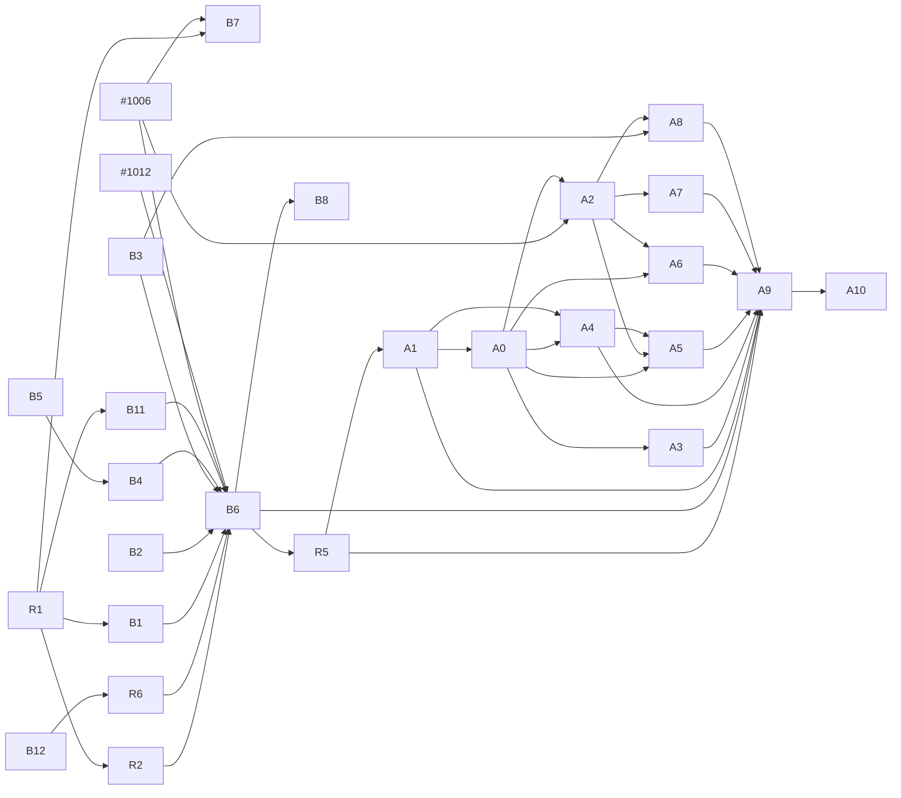

# Task — Remote drivers (boxd and archil) end to end

> Scope of #947 (v0.20). First checked 2026-11-10 against `main` at `3f476537`
> and disco-vm at the version discobox pins, `5682ac6ab2a2` (2026-11-04).
> Revised 2026-11-12 against `main` at `f196bd2a`, for the owner's answers to
> the plan's questions (recorded on #947) and for ADRs 26-11-11-963 and
> 26-11-11-080, which landed since. disco-vm's own `main` was not readable from
> the box that wrote this. Its first issue (R1) re-reads it.

Sequencing lives here, not in an ADR or any `DESIGN.md`. Delete this file once
the issues below are filed. The issues and their ADRs carry the work from then
on. In the same change, point `pool-agent/REVIEW.md`'s "A machine's public port"
at the issues filed for B11 and A0, in place of #947.

**End to end** means: create a pool, bring up its agent, start a sandbox,
attach, run a harness, and have egress only through the pool's proxy.

## Summary

- **boxd** is wired through every stage in code. It has run live, by hand, on
  2026-11-02 in the owner's boxes (pools `pool_qg14npnbegky129y` and
  `pool_dfqcve6ztdsmgbd6`), as far as a running sandbox. Those runs filed:
  - the bugs #455 (the control-plane channel is cut) and #456 (machine DNS);
  - the feature #775 (machine volumes and feature prefixes), with its
    ADR PR #784 and its fix PR #776.

  This scope adds one gap no run has probed: every boxd sandbox machine has a
  public URL the guest's root controls (B11). Since then:
  - **The key:** ADR 26-11-11-080 replaces the `vm` provider with a `boxd`
    provider type of its own, once #1006 implements it. It also removes
    `deliverProviderKey`: a pool machine will hold a sentinel, which the
    pool's proxy swaps in boxd's token-exchange body (#1012).
  - **Regions:** boxd's region becomes a field of its driver (B12, R6, then
    #1006).

  What is missing is fixing those, the one live run, and the account rules.
  **boxd is v0.20's only remote driver** (owner, Q7).
- **archil** is a disco-vm driver that passes disco-vm's conformance suite on
  Archil itself. discobox has no provider type for it until #1006, which links
  one whose pools are refused. Today they are refused in three places because
  archil has no machine isolation (ADR 26-10-23-551 §4, ADR 26-10-29-481 §4).
  Under ADR 26-11-11-963 §5 the rule becomes "isolate on a network shared only
  with the pool machine, or have no network device and the server's peer
  forward", and archil does neither. Its guests also have no systemd, which
  551 §1 assumes, and Archil pauses them after 24 hours.

  archil needs an ADR (A0) that adds a third way to 963 §5 before code. That ADR
  evaluates Archil's sandbox firewall as the provider-side control (Q3), and
  adds and starts systemd in the guest (Q5). **archil does not ship in v0.20**
  (Q7).
- **Nothing on either track needs a Mac.** Every issue below builds and is
  tested on linux/amd64, against disco-vm's fake driver or boxd's fake API. Only
  a live run needs a provider account. The owner has granted a boxd key and an
  Archil key for this track, and the manager holds them.

## Decided since the first draft

These landed on `main` or were answered by the owner after this plan was
first written. The plan now builds on them rather than proposing them.

Both ADRs were accepted by the merge of their PRs, as `docs/adr/README.md`
makes merging an ADR's PR its acceptance. Each status line still reads
Proposed until the work that implements it flips it: #1011 for 963, and
#1006's first commit for 080. #1006 is itself blocked on disco-vm changes
that 080's Consequences list (secret fields in a driver's definition, among
them). Everything below that depends on #1006 waits for those too.

- **One pool shape: ADR 26-11-11-963** (#1003, merged; #1011 flips its status
  line).
  - Every pool, on every driver, runs the ordinary Linux pool agent in a pool
    machine its driver makes. There is no host pool agent, and `isLocal`,
    `hostAgent` and `localPool` go.
  - A held driver's pool reaches the server's engine only on its own channel,
    through an allow-list (963 §3).
  - Its local-pool work is #1008 and #42's plan in #950, not this plan's.
  - This replaces the R3 and R4 the previous revision proposed.
- **A provider type per driver: ADR 26-11-11-080** (#1007, merged; #1006
  implements it and flips its status line).
  - `boxd` and `archil` are provider types of their own, configured by the
    driver's own fields, and the `vm` type goes (§§1–2).
  - A driver's secrets are its own declared fields, sealed, and `apiKey` goes.
  - Every driver field, `region` included, is immutable while the provider has
    pools (§5).
  - boxd's `region` is a driver field, with no pool-level region, so #997 is
    closed into #1006 (§7). That replaces the B13 the previous revision
    proposed.
  - `deliverProviderKey` goes: a pool machine holds a sentinel for its
    driver's key, swapped by the pool's own proxy in the token exchange's
    body (§9, #1012).
- **The owner's answers to Q1–Q8** (2026-11-12, recorded on #947):
  - **Q1.** The live run happens **once**, in a dedicated one-off box given the
    real key. It is not automated. Every live check of the boxd track is a step
    of that one session (B6). A lasting way to run live checks is a follow-up
    (R5), which archil's live steps wait for.
  - **Q2.** `deliverProviderKey` is dropped, and the key goes through the
    pool proxy's body swap (#1012). Issued boxd keys are no longer the path,
    and the previous B10 is gone.
  - **Q3.** Archil's sandbox firewall
    (https://docs.archil.com/compute/sandboxes/firewall) is evaluated in A0
    and A1 as the provider-side control. Does it fence egress, and can it
    limit the inbound public listener to the pool alone?
  - **Q4.** As recommended: keep ADR 26-10-29-481 §3's edge form.
  - **Q5.** Add and start **systemd** in the Archil guest, so the units are
    unchanged. No supervisor. A1's spike confirms how.
  - **Q6.** As recommended: an archil pool's agent runs on an Archil sandbox
    of its own, the same shape as boxd and as 963 §1.
  - **Q7.** No: archil does not ship in v0.20. boxd only.
  - **Q8.** No: a pool's region is fixed once it has machines. Under 080 the
    region is the provider's driver field, so this is 080 §5: no driver field
    changes while the provider has pools.

**Open questions for the owner: none.**

## What exists

As of `f196bd2a`, before #1006 and #1012 land.

| Stage | boxd | archil |
|---|---|---|
| Driver in disco-vm | `pkg/machine/boxd`: real create, start, commit, exec, copy, TTY, isolation, egress fence. No data volume and no `Upgrade`. Proven against boxd's fake API (2026-11-03); not against boxd itself since disco-vm ADR 26-11-03-606 | `pkg/machine/archil`: real create, start, commit, `Upgrade`, data volume, egress fence. No isolation, no networks, no reboot. `TestConformance` passed on Archil itself (2026-11-03) |
| Linked in discobox | `server/providers/discovm/drivers.go:16` and `pool-agent/drivers.go:10` | Neither, until #1006 |
| Provider config | `vm` provider: `driver`, a sealed `apiKey`, and optional `controlPlaneUrl`, `deliverProviderKey` and `base` (`server/providers/discovm/provider.go:34-114`). `scripts/boxd-pool.sh` makes one. No region: the boxd driver takes none (B12). #1006 replaces all of this with a `boxd` type (ADR 26-11-11-080) | Region is environment only (`ARCHIL_REGION`), until B12 moves it to a driver field |
| Pool machine | `poolMachine.converge` (`poolmachine.go:227-362`) makes, re-adopts, repairs and removes the pool's machine on its own network | Refused at `poolmachine.go:241` (no `Isolation`; ADR 26-10-23-551 §4) |
| Provisioning key | `poolkey.go:118-190`: an issued key, else the provider's own with `deliverProviderKey`, else the pool is blocked. boxd issues no key to an API key. ADR 26-11-11-080 §9 replaces the provider's own key with a sentinel the pool's proxy swaps (#1006, #1012) | `KeysNone`. An Archil key never expires and reaches the whole account |
| Pool agent up | `poolruntime/box.go:176-260` places the bundles and runs `provision apply --wait`. The pool's units are systemd units (ADR 26-10-23-551 §1, ADR 26-10-27-767) | No systemd in an Archil guest. PID 1 is Archil's init (disco-vm `docs/drivers/archil.md`). Q5: systemd is added and started |
| Control plane ↔ pool | The server opens a WebSocket channel to the pool's public URL (`poolruntime/channel.go`, `pool-agent/cpchannel`). Live: cut every few minutes (#455) | Would be the same |
| Sandbox machine | `MachineSandboxRuntime`: one machine per sandbox, isolated on the pool's network, its fence set at create and read back (`pool-agent/sandboxruntime/machine.go:957-980`). Plan snapshots by commit (`machinesnapshot.go`) | Refused three times: `requireMachineFence` (`pool-agent/poolhop.go:94-107`), the runtime itself (`pool-agent/machines.go:86` always sets `Isolate`, which `NewMachineSandboxRuntime` refuses without `Isolation` and a network, `sandboxruntime/machine.go:131-137`), and every create (`createOptions` asks for isolation and networks, which `archil.go:191` refuses) |
| Sandbox → pool hop | Direct: `discobox-pool-proxy` resolves to the pool's `.boxd` name; the fence is `{}` plus `isolated` (`poolhop.go:65-71`) | Edge: a `wss://` tunnel through the pool's public host, mTLS inside, the fence that host alone (`poolhop.go:73-88`, ADR 26-10-23-719). Never run on a real driver |
| Pool → sandbox agent | The private URL `http://dvm-….boxd:7302`, TLS from the pool's CA (ADR 26-10-29-481 §3) | Edge form, as 481 §3 decided and Q4 keeps: plain HTTP through Archil's edge, which terminates TLS. The agent checks the pool's token on every request (`pool-agent/DESIGN.md`, The Agent's TLS) |
| Public URL of a sandbox machine | **Every boxd machine, isolated sandboxes included, gets `https://<machine>.<zone>` forwarding to 7302, with bot protection off** (disco-vm `pkg/machine/boxd/service.go`, `pinProxy`). The pool never uses it; it dials the private URL | 7302 is exposed at a public hostname; it is the only way the pool reaches the agent |
| Harness | A provisioning bundle, the same as any box. Live: `claude` fails `EACCES` on `/var/lib/claude-code`, since a machine with no data volume mounts none of its declared volumes (#775, #784) | Would be the same, but archil has a data volume at `/.discobox/data` |
| DNS in the sandbox | `resolv.conf` names boxd's resolver, not the DNS stub (#456) | Unknown |
| Tests on Linux, no account | `server/providers/discovm`: 29 tests on disco-vm's fake driver; `pool-agent/sandboxruntime/machine_test.go`; disco-vm's `TestConformanceFakeAPI` | disco-vm's `httptest` unit tests only. No fake API for the conformance suite |

Other facts that shape the list:

- **A machine's public port belongs to the guest's root, not to the agent.** The
  sandbox user has passwordless sudo (`sandbox-agent/REVIEW.md`), so the agent
  in a box can replace whatever listens on 7302. A public URL to that port is
  an inbound channel the egress fence and the proxy's audit never see. On boxd
  that channel exists today (B11). On archil it is the pool's only path, which
  Archil's firewall may close (A0, A1).
- **boxd's key travels in a request body.** disco-vm exchanges a `bxd_` key for
  a JWT in the body of a POST, and the pool proxy substitutes only in headers
  and queries today. #1012 adds body places, and ADR 26-11-11-080 §9 uses them
  for the pool machine. Until both land, a boxd pool needs the real key on its
  pool machine, which the owner has ruled out (Q2).
- **boxd lets a machine reach the hosts of every secret in its scope, whatever
  its fence says.** That covers the org's secrets and the key owner's private
  ones (disco-vm `docs/drivers/boxd.md`, Egress). boxd also sets the fence
  about a second after create. So neither the org nor the key's owner may hold
  host-bound secrets.
- **The pool machine itself is not fenced** (ADR 26-10-29-481 §4, ADR
  26-10-27-767). That is accepted, and nothing here changes it.
- **Stale recipe text:** `verify-recipes` says `machineProject`; the field is
  `machinePool`. Its "cannot mark its own resource dirty" note describes #377,
  fixed in #514.

## Credentials

The owner has granted a boxd API key and an Archil API key for this track,
and **the manager holds them** in its credential store, never in its agent's
context. The manager is itself an agent that reads issue comments, worker
reports and reviews, which anyone can write.

A key leaves the store only for the one live run (Q1). That run happens in a
dedicated one-off box given the real key, and never in a worker's box. The box
keeps the key in only if all of these hold:

- **Only reviewed code.** It runs a revision that has landed on `main` through
  human review, pinned by commit, never a worker's branch.
- **No agent while the key is there.** The pinned script alone drives the run.
  No harness or agent session runs in the box while it holds the key, since an
  agent there has passwordless sudo and reads text anyone can write: an issue,
  a PR, a provider's response.
- **Set up first, key last, in this order:**
  1. Build the pinned revision, and fill the bundle cache by digest, so every
     bundle reference is pinned `@sha256:…` and no registry is needed.
  2. Narrow the box's egress to the exact hosts below. Its egress policy is a
     host allowlist, so it can hold them. What it cannot do is fetch build
     inputs (Go modules, GitHub) once narrowed, which is why step 1 comes
     first.
  3. Hand over the key, as a **raw binding** (ADR 26-10-27-840) routed to the
     provider's hosts alone. The box's proxy holds the value in memory, refuses
     it on any host its routes do not name, and redacts it from every audit
     row and stored body. boxd's token exchange carries the key in its body,
     so a plain file would leave it in the audit any project member reads. It
     goes from the binding's variable into the provider's config, never on a
     command line, and never into an agent's context.

  If the box's egress cannot be narrowed, rule 1 alone keeps the key in, and
  the run's report says so.

The exact hosts:
- the provider's API hosts as disco-vm dials them: boxd's `boxd.sh:9443`,
  `app.boxd.sh` and the configured region's endpoint, or Archil's region
  control host and the process WebSocket host each connection returns;
- the discobox server;
- the public hostname of each machine of the run's pool, read from the
  provider's listing of the pool's prefix (`dvm-<pool>--`).

Never a provider's machine domain (`*.boxd.sh`, `*.archil.app`), and no
registry.

| Credential | Held | For | What it must be |
|---|---|---|---|
| **A boxd API key (`bxd_…`)** | by the manager (granted) | B6 (the one session, which carries B1's, B3's, B11's and B12's live checks) | A key of an org dedicated to this track. Neither the org nor the key's owner may hold host-bound secrets, since a machine reaches those hosts whatever its fence says. A new org without a payment method may run 2 machines (a pool plus one sandbox), which B6 outgrows, so the org needs a payment method or a quota of at least 4 |
| **An Archil API key (`key-…`)** | by the manager (granted) | A1, A8, A9, by R5's means | A key of an account that holds nothing else, since it never expires and reaches the whole account. Its region is set by `ARCHIL_REGION` (`aws-us-east-1` by default) today, and by the driver's region field once B12 lands |
| **A harness credential** (for Claude Code, an Anthropic key or subscription) | not covered by the grant: the owner provides it, or names one the manager already holds | B6, A9 (they run a harness) | A project secret on the run's server, so the sandbox sees only its sentinel through the pool's proxy. Revoked or rotated with the provider keys when the track ends |

**After the live run**, whoever ran it, in this order:
- deletes the run's pools first, which withdraws each pool's grant of the key
  (ADR 26-11-11-080 §9);
- deletes every machine, snapshot, sandbox and disk left under the pool prefix
  (`dvm-<pool>--`);
- deletes the one-off box;
- says in the run's report that nothing is left.

**When the track ends:**
- the owner revokes both keys;
- for boxd, the owner also revokes any binding the org made for it (the
  `verify-recipes` rule, and #775's done list).

Under ADR 26-11-11-080 §9 a pool machine holds **no key at rest**: not on its
disk, in its environment, its key file or anything recorded. While its pool
exists, though, the key sits in the pool proxy's memory while cached, and
something escaping onto the machine could mint one-hour tokens through it.
That is why the pools go first. If either granted key does not meet its row's
requirements, the first live step that needs it (B1, A1) says so and stops.

## Issues to file, in order

Size: **S** is under a day, **M** a few days, **L** a week or more. Linux
column: **fake** means it is done and verified on a Linux box with no account;
**live** means a step of the one live session (B6, Q1), or for archil a run
by R5's means, with a key from [Credentials](#credentials). **None of these needs a Mac.** "Existing" names an issue or PR
already open; the work is to resume it, not to file it again. #1006 and #1012
are existing issues this plan depends on, owned outside it.

### Shared

| # | Issue | Repo | Depends on | Size | Linux |
|---|---|---|---|---|---|
| R1 | Move disco-vm to its current `main` in `server` and `pool-agent`, and re-read its boxd and archil docs for anything that landed after `5682ac6` | discobox | — | S | fake |
| R2 | The one live run's recipe (Q1): a Taskfile target, run once in the one-off box under the rules in [Credentials](#credentials). It makes a provider and pool, starts a sandbox, attaches, runs a harness, and probes egress: the pool's proxy answers, while `1.1.1.1` and an unlisted name do not. It probes the sandbox machine's public URL from outside, which must not answer as anything the guest controls. It deletes everything it made, then reports, including that nothing is left. It takes the driver as a parameter, and fixes the stale `verify-recipes` text | discobox | R1 | M | fake (the script's dry run); its live run is B6 |
| R5 | **Follow-up (Q1): a lasting way to run live provider checks.** It must run again after the first run without a person setting up a box and handing it a key, and keep the rules in [Credentials](#credentials). Filed now; designed after B6 shows what a live run needs | discobox | B6 | — | — |
| R6 | Move discobox's disco-vm pin past B12 (disco-vm PR 69). Until then boxd refuses every region, and so does a `boxd` provider's create (ADR 26-11-11-080 §7) | discobox | B12 | S | fake |

### boxd track (first; v0.20)

| # | Issue | Repo | Depends on | Size | Linux |
|---|---|---|---|---|---|
| B12 | discobox-ai/vm#68 (disco-vm PR 69): the boxd driver takes a region in its config, per driver instance, and archil moves from `ARCHIL_REGION` to the same field. Each driver maps a region to its endpoints through a fixed table, as archil's `controlPlanes` (`pkg/machine/archil/api.go`) does today, and refuses a region outside it before any request. It never builds a host from the region string, which would send the provider's key wherever a region names. An ADR in disco-vm first, if the seam change is not obvious. Starts first. Once R6 moves discobox's pin past it, #1006's `boxd` provider accepts a region (ADR 26-11-11-080 §7), which no driver field may change while the provider has pools (§5, Q8) | discobox-ai/vm (existing) | — | M | fake API; its live check is a step of B6 |
| B1 | Run boxd's `TestConformance` against boxd itself again (it has not run there since disco-vm ADR 26-11-03-606), and give `internal/e2e` a `DISCO_VM_DRIVER=boxd` layout | discobox-ai/vm | R1 | M | fake; the run against boxd itself is a step of B6 |
| B2 | #455 (status/blocked, waiting on its reporter; this unblocks it): the control-plane channel is cut minutes after it opens. First, #455's own "To find out": hold a WebSocket through a discobox's egress proxy to a host that is not boxd for 10+ minutes. A cut there is the proxy's, and needs no account. Then add a heartbeat below the idle timeout found, and make an in-flight create survive a redial | discobox (existing) | — | M | fake (through a discobox's egress proxy, and a cutting proxy); B6 confirms it from the one-off box |
| B3 | #456: a machine sandbox's `resolv.conf` names the provider's resolver. Needs its ADR first (extends ADR 0148 §2): the stub as the resolver, and the bridge resolving the pool's host against the recorded original. What on boxd rewrites the file is found in B6's session; a fix that does not hold there is filed for R5's next run | discobox (existing) | its ADR | M | fake; its live check is a step of B6 |
| B4 | #775: every machine sandbox mounts its declared volumes from its own data and cache roots, and features install into prefixes discobox owns. Land ADR PR #784, then fix PR #776 (both paused for v0.20). Without this, Claude Code cannot start on boxd | discobox (existing PRs #784, #776) | B5 | M | fake (and disco-vm's docker driver) |
| B5 | Land ADR PR #785: a command discobox puts on `PATH` is linked in `/usr/local/bin`. #776's review raised the policy, and #776 waits on it | discobox (existing PR #785) | — | S | fake |
| B11 | A boxd sandbox machine has no public URL the guest controls. Its pool dials the private URL, so the public one (`pinProxy` on every create) serves nothing discobox needs. Two options: drop or disable the default proxy for an isolated machine, if boxd allows it; or else put a provider-side check in front of it. Whether boxd allows either is read from boxd's API on the fake first, and confirmed in B6's session | discobox-ai/vm, discobox | R1 | M | fake API; its live check is a step of B6 |
| B6 | **The one live session** (Q1): R2's recipe on boxd, once, in the one-off box. Its steps: boxd's `TestConformance` against boxd itself (B1); what rewrites a machine's `resolv.conf`, and whether B3's fix holds; that nothing answers at a sandbox machine's public URL (B11); a provider created with a non-default region makes its machines there (B12); a second sandbox of a plan starts from its snapshot (the previous B9); and the pool end to end. End to end is done when a sandbox runs a harness, its secrets are sentinels, it fetches from its origin, and egress goes only through the pool's proxy. The pool machine holds only a sentinel, and its token exchange goes through the pool proxy's body swap (#1012). The channel holds for an hour from the one-off box. What it finds is filed as bugs, for R5's next run | discobox | R2, R6, B1, B2, B3, B4, B11, #1006, #1012 | M (the session) | **live** (boxd key) |
| B7 | A `boxd` provider's requirements are checked and documented. No host-bound secrets in the org or the key owner's scope: checked through boxd's API if it lists them, otherwise stated in `admin provider create`'s help and the docs. And the org's machine quota reported as the pool's capacity (`MaxRunning`) | discobox, discobox-ai/vm | R1, #1006 | S | fake |
| B8 | User docs: setting up a `boxd` provider (`docs/public`), with the credential's blast radius stated: the key is sealed in the provider, and a pool machine holds a sentinel (ADR 26-11-11-080 §9) | discobox | B6 | S | — |

### archil track (after v0.20, Q7; A1 first)

| # | Issue | Repo | Depends on | Size | Linux |
|---|---|---|---|---|---|
| A0 | **ADR (Proposed): a pool on a driver with no isolation and no init system.** It builds on ADR 26-11-11-963's one pool shape (Q6), adding no archil-specific kind of pool. It **narrows 963 §5** (superseding it in part, since 963's implementation will have shipped by the time A0 is written), whose rule (a driver carries a pool only if it isolates a sandbox on a network shared only with its pool machine, or makes it with no network device and the server's peer forward) archil meets neither way. It also narrows ADR 26-10-23-551 §1 and ADR 26-10-27-767, for how systemd starts. Its parts: **a third way in 963 §5**, with four conditions: no peer network; egress fenced to the pool's public host; the public listener restricted by the provider outside the guest, to the pool alone; and nothing of the provider account given to the guest (no credential, integration or account disk), or stripped by the driver at create, which is the other half of disco-vm's `Isolation`. A1 tests whether Archil's sandbox firewall is that provider-side control (Q3); an address rule counts only if the address is the pool's alone, and otherwise only a credential the edge checks. **The edge form kept** (Q4, 481 §3). **systemd added and started in the guest**, so the units are unchanged, with no supervisor (Q5). **The 24-hour pause.** It also decides what the runtime's `Isolate` and `Network` mean, and what `MachineToken` (`poolkey.go:255`) keys off, on a driver with no networks. It is drafted once A1 has its findings, so it is not accepted for a driver that cannot be carried | discobox | A1 | M | — |
| A1 | archil in disco-vm, and the spikes A0 rests on. An `internal/e2e` layout for `DISCO_VM_DRIVER=archil`. Page the sandbox listing (`api.go:221-226` reads one page, against `REVIEW.md`). Reach a guest server through the 7302 URL. Add a TTY row to the proof table, and a fake of Archil's API for the conformance suite. Its live findings: **Archil's sandbox firewall** (https://docs.archil.com/compute/sandboxes/firewall): does it fence egress as the driver's fence does, and can it limit the inbound public listener to the pool alone, by a credential or by an address that is the pool's alone (Q3)? **How systemd is added and started** in an Archil guest whose PID 1 is Archil's init (Q5). Whether Archil plants any credential, integration or account disk in a guest, which decides A0's fourth condition | discobox-ai/vm | R5 for its live part | M | fake, then **live** (Archil key, by R5's means) |
| A2 | Map archil's REST and WebSocket errors in `unreachable()` (`poolmachine.go:554`). #1006 links archil as a provider type of its own, with its pools refused (ADR 26-11-11-080 §1) | discobox | #1006, A0 | S | fake |
| A3 | systemd in the Archil guest, as A0 and A1 settle it (Q5): the pool agent and the sandbox agent then run as the same systemd units as on boxd. Tested in a container whose PID 1 is not systemd | discobox | A0 | M | fake |
| A4 | The edge path from pool to sandbox agent meets A0's rule for public listeners (Q4) | discobox | A0, A1 | M | fake (an edge stand-in) |
| A5 | A0's third way joins 963 §5's two at every place that refuses a pool's driver: where 963's implementation puts its rule, in place of today's `poolmachine.go:241`, `requireMachineFence`, `machines.go:86` with `NewMachineSandboxRuntime`, and `createOptions`. archil's pools are then accepted, and a driver that meets none of the three ways is still refused | discobox | A0, A2, A4 | M | fake |
| A6 | Archil's 24-hour pause: a paused pool machine or sandbox is resumed (by the server and the pool agent respectively), and a discobox sleep maps onto it, per A0 | discobox | A0, A2 | M | fake |
| A7 | #551 on archil: a machine with a data volume (every archil sandbox) is rebuilt from its plan's snapshot with `Upgrade`, and never destroyed with its volume | discobox (existing) | A2 | M | fake (and disco-vm's docker driver) |
| A8 | An archil pool's resolver, after B3's ADR: what an Archil guest's `resolv.conf` names, and whether B3's shape holds | discobox | B3, A2 | S | **live** (Archil key, by R5's means) |
| A9 | An archil pool end to end, live: R2's recipe on archil, including a sandbox that lives past 24 hours. Run by R5's means, since Q1's one live session is boxd's | discobox | R5, B6, A1, A3–A8 (A0 and A2 through A5) | S (the run) | **live** (Archil key) |
| A10 | User docs: an `archil` provider | discobox | A9 | S | — |

Existing issues not on the critical path: #607 (disco-vm pool scopes and
internal URLs, which keeps today's routing until cutover) and #740 (a
preseeded base, Docker-only today). #997 (a pool's region) is closed into
#1006 by ADR 26-11-11-080 §7.

The graph is the "Depends on" columns, edge for edge:

