# Live terminal screenshots

Captured on 2026-11-04 in **Kitty 0.41.1**, running the real Discobox CLI and
console against the development server, Docker pool and three disposable boxes.
Kitty rendered the live PTY, including terminal graphics, colors, hyperlinks
and keyboard protocol negotiation. The welcome's graphic logo is visible.

These PNGs are **unmodified X11 window screenshots from scrot**, taken from
Kitty on a dedicated Xvfb display with Mesa software OpenGL. They were not
created by replaying ANSI text, rendering HTML, or drawing a terminal grid.
They supersede the earlier cell reconstructions in the parent directory.

The CLI was rebuilt from `84e4800bf626` with `go tool task build:cli`. The
existing dev server reports `b70abf7ff4d3+dirty`: it has the unchanged product
source from the original walk before those changes were committed. Every
client call used `--server http://127.0.0.1:8080`.

Kitty used its default palette, DejaVu Sans Mono at 11 pt, and a window sized
for 150 columns and 48 rows, including its tab bar. The narrow approval window
was sized for 80 columns and 24 rows. Full help used 8 pt and a taller window.
[The manifest](manifest.json) records each original PNG's dimensions, time and
SHA-256 digest.

No external account login or real credential sharing was performed. The Claude
box started signed out; its settings candidate was a synthetic theme edit in
an isolated copy of the harness config. Owner UX sign-off remains outstanding.

## Discovery and onboarding

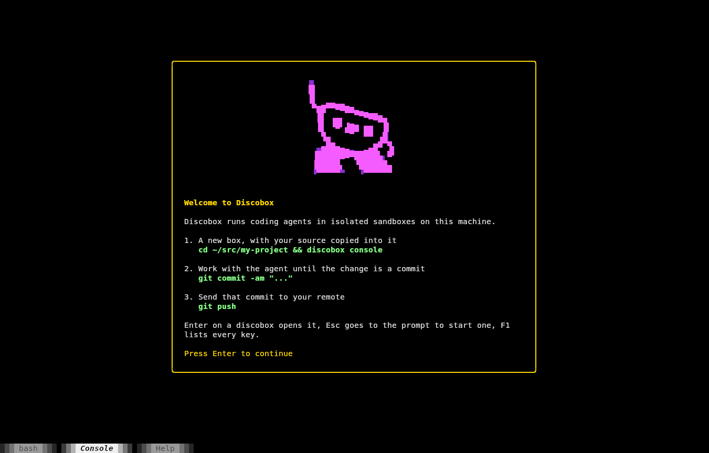

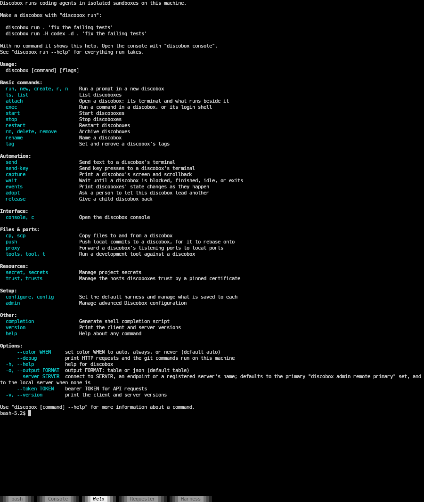

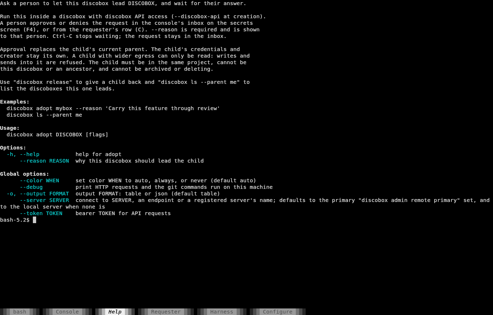

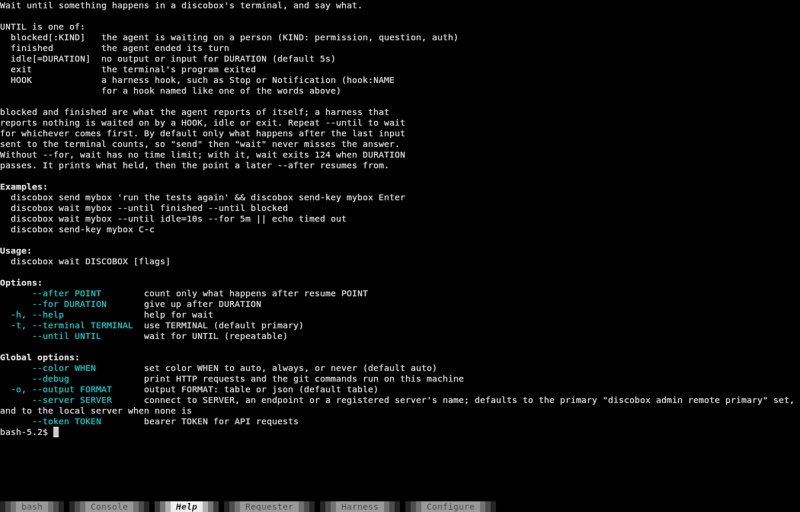

## Harness setup and saving

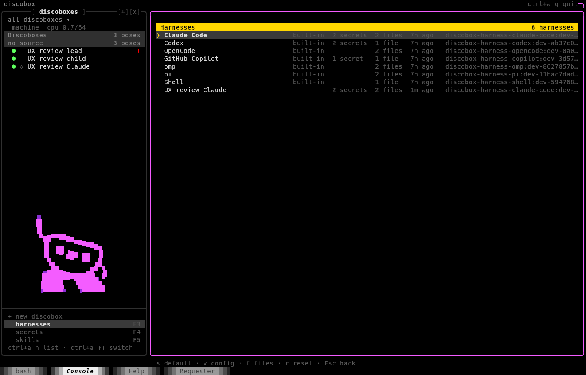

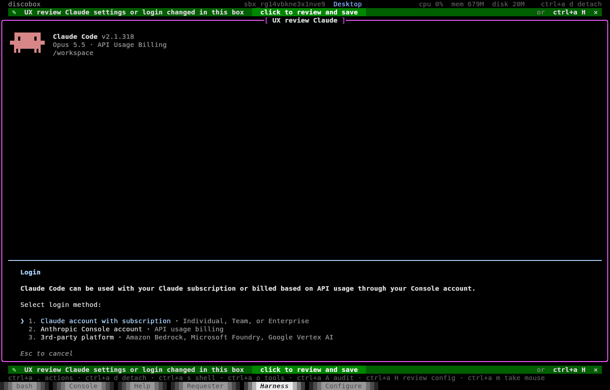

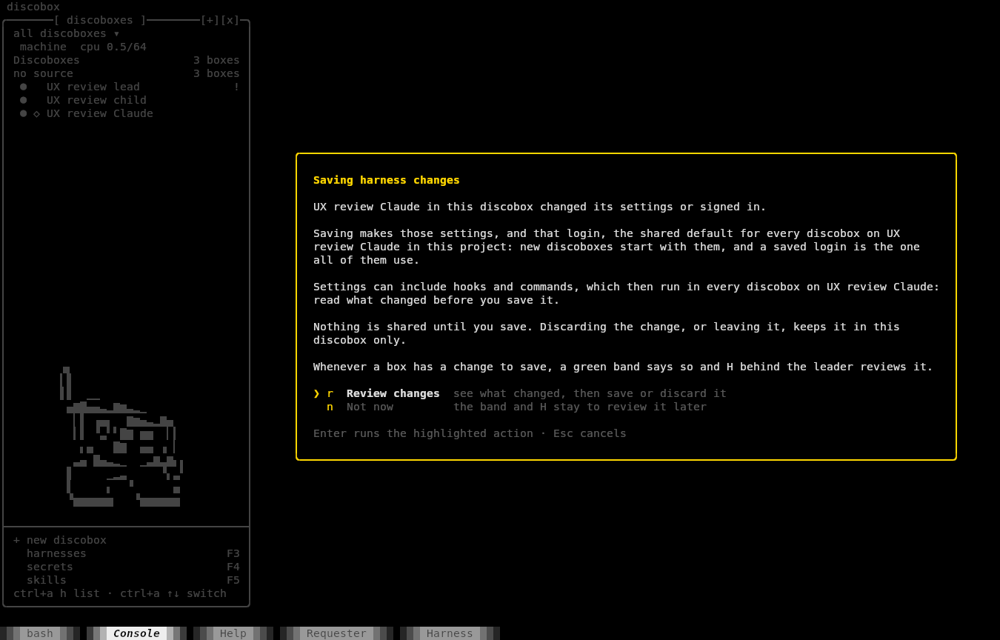

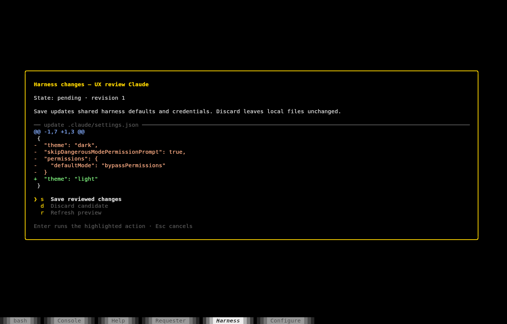

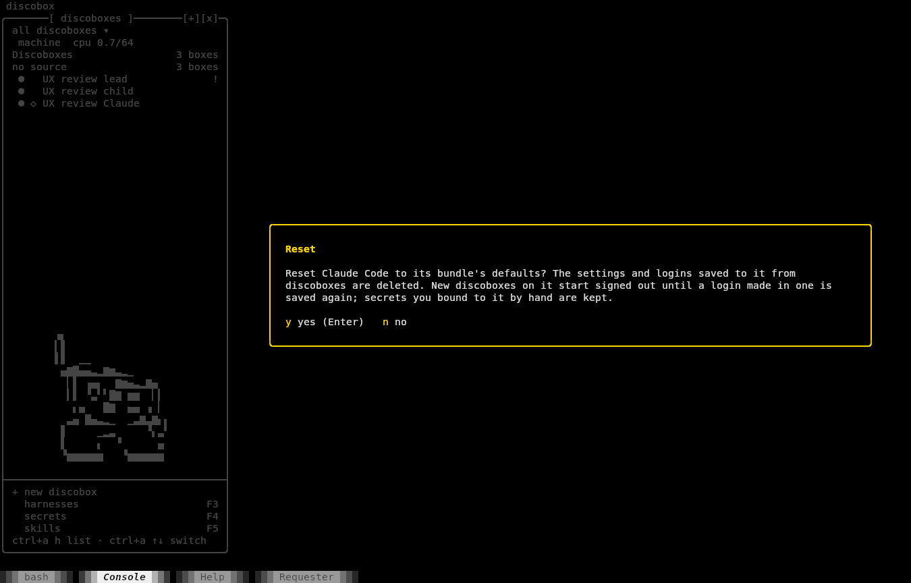

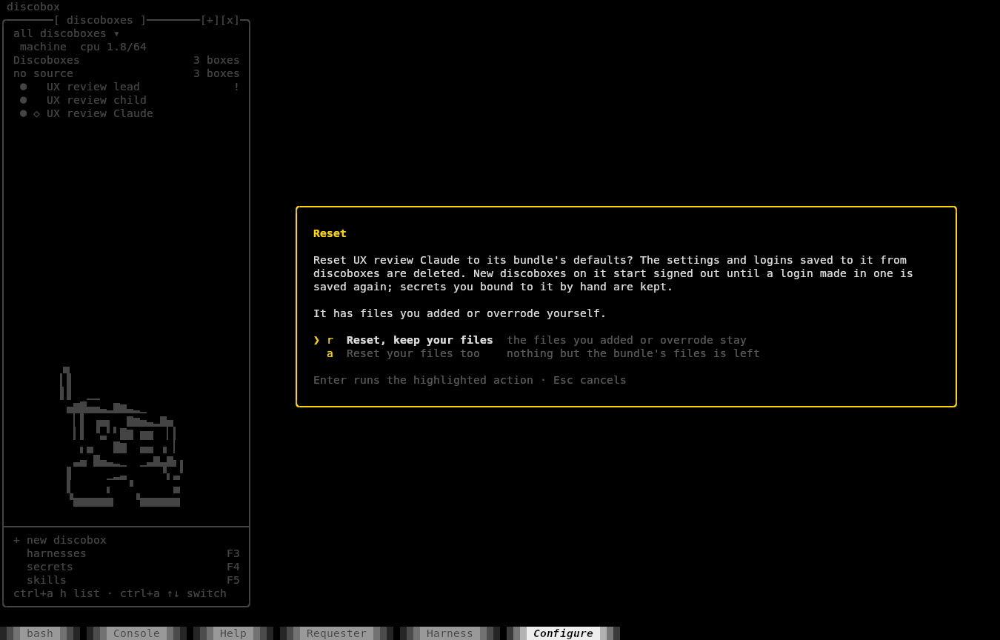

## Adoption

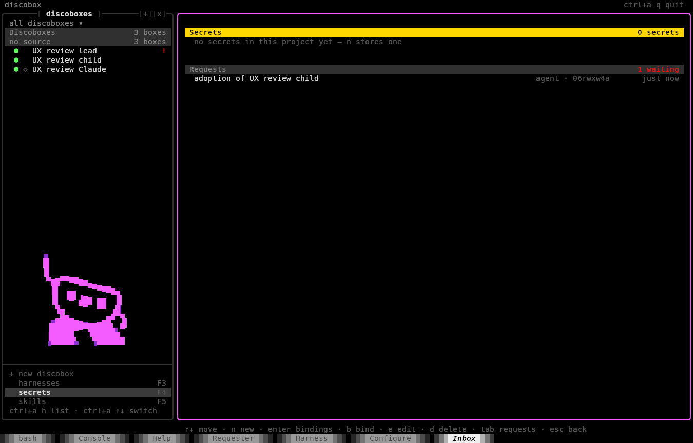

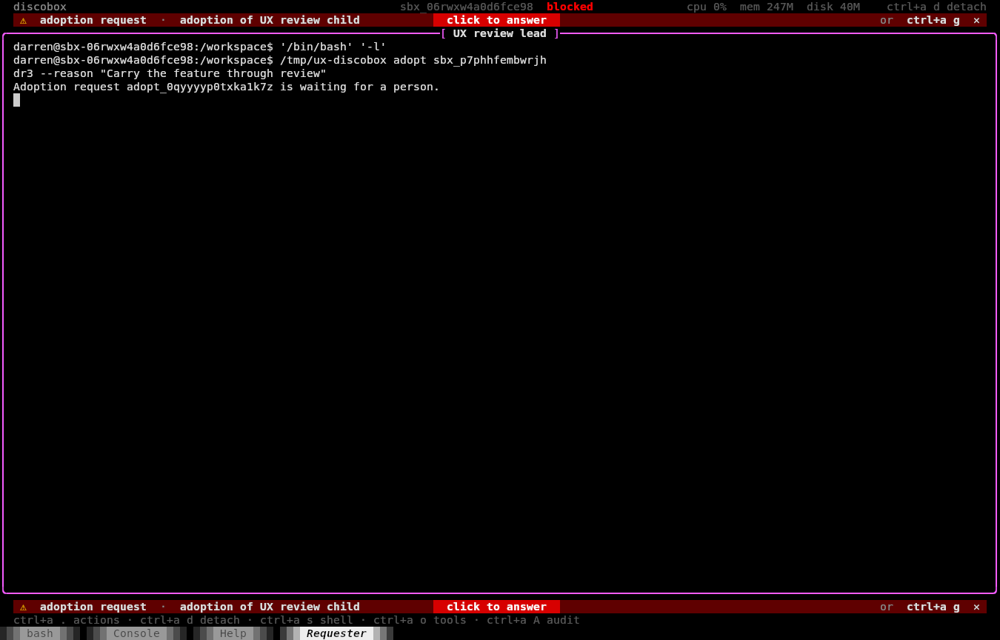

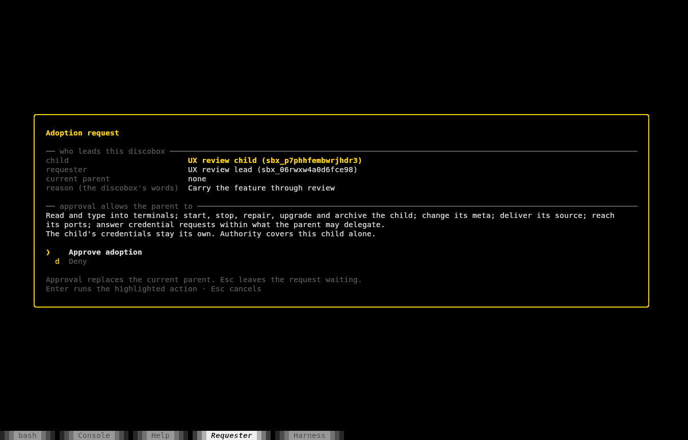

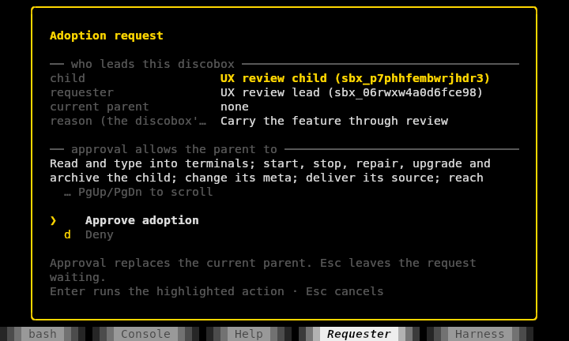

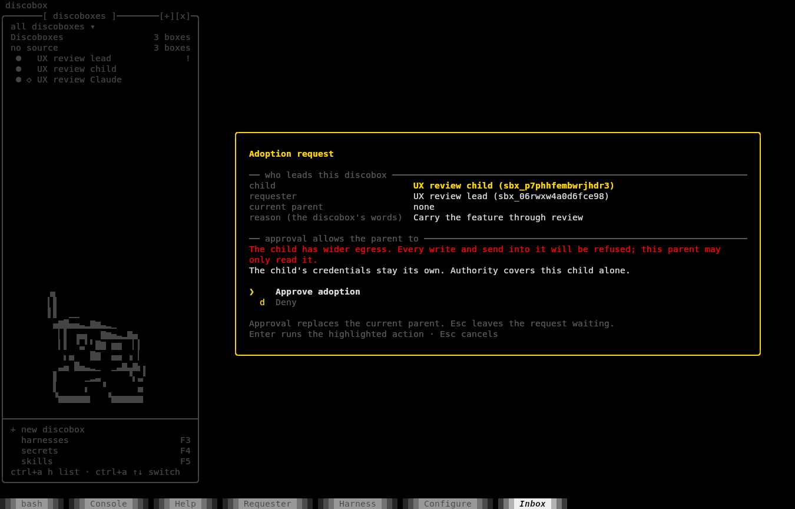

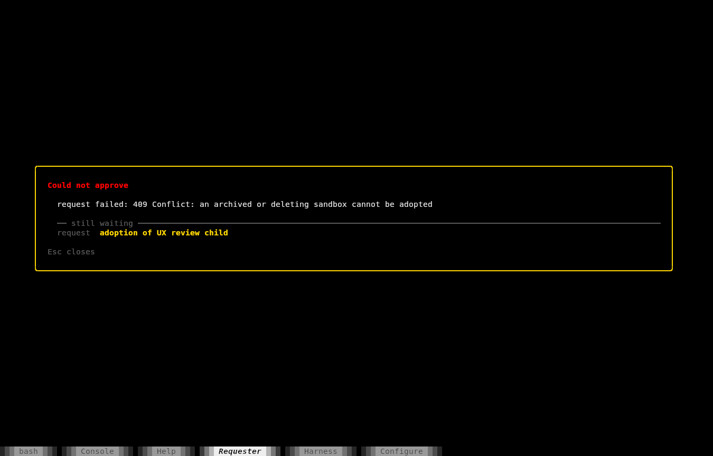
