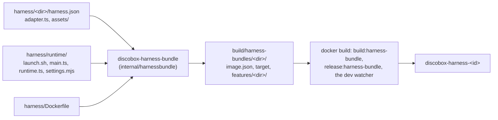

# Harness Design

This package owns the shared harness bundle contract (the manifest labels and
their layering, volume and env resolution) and the built-in harnesses: one
declaration and one vendor adapter each, the shared runtime their launchers and
save-back run on, and the generator their bundles are staged by.

A harness has no setup step (ADR 26-11-02-152). Every registered harness runs;
a box on one with no login saved starts it signed out, the person signs in
there, and that box's save-back offers the login and settings as a harness
change to save for every box on the harness config.

## Built-in harness shape

Every built-in harness is one declaration and one vendor adapter
([ADR 26-11-06-596](../docs/adr/26-11-06-596-built-in-harnesses-have-one-declaration-and-one-vendor-adapter.md)).
Its bundle is generated from them and stays the only published contract: a
third-party bundle still registers through its labels and `provision.yaml`
(ADR 26-10-16-423 §3) and never sees this format.

```text
harness/<directory>/
  harness.json   the declaration: every part below, or the part declared
                 absent with a reason ({"none": "..."} or strategy "none")
  adapter.ts     the vendor operations the declaration selects, typed by
                 runtime/types.ts (the shell's is empty)
  DESIGN.md      vendor semantics, evidence and supported limitations
  assets/        literal policy files and SDK hook entry points, each named by
                 the declaration
  testdata/, *_test.go
```



`harness.Declaration` is the schema (version 1), decoded strictly: an unknown
key, an unsupported schema, a missing or unreferenced asset, or two parts that
disagree fail `Validate`, and so the build, `go test ./harness/...` and
`discobox-harness-bundle check`. Each fact has one home, and every copy of it
is generated: the package and command are both the install step and
`agent.conf`; the launch is both the launcher and its drift check; a secret
and the capture provider spending the same credential must name the same
routes. Egress hosts, spending routes, rejection scopes and refresh endpoints
stay separate fields with separate meanings.

| Part | Declares | Generated as | Runs |
| --- | --- | --- | --- |
| Identity | `id` (harness ID and config slug), `bundle`, `name`, `description`, `platformAPIVersion` | label `harness.id`, `name`, `description`; the registry's `Definition` | at registration |
| Install | `requires`, `package`, `executable`, `osPackages`, `env` | the `cli` step (`npm-global` install and check), a `packages` step, `agent.conf`, label `env` | at provisioning, machine-scoped |
| Launch | `args`, `resume`, `prompt` (form, option, leading `@`), `home`, `retry` | `discobox-harness-run` and its `check-launcher.sh` | every conventional launch, as the sandbox user |
| Environment | `static`, `defaults`, `aliases` and their `profile`, `fromSettings`, `volumes` | label `env` and `volumes`; launcher calls; a `/etc/profile.d` script | static in the manifest; the rest at launch and in login shells |
| Settings | `files` (portable seeds), `policy` assets and their vendor `layer` | label `harness.files`; file steps | seeds by delivery; policy at provisioning |
| Local state | `trust` (`none`, `local-state`, `system-layer`), `memory` (`none`, `managed-setting`, `bind-mount`) | launcher calls; the system layer's baseline | at launch, before the CLI |
| Credentials | `secrets`, `egressHosts`, `store` (`none`, `file`, `native`) | label `secrets`, `egressHosts` | delivery by the agent; a native import at launch; export and handoff at capture |
| Hooks | `provider`; `command` (format, path, timeout, events), `extension` (asset, path, home file) or `plugin` (asset, path) | a command hook file, or the asset's file steps and the home file | wired at provisioning; published on the vendor's callback |
| Capture | the save-back definition, less its commands | label `saveBack`, naming `<id>-capture` | the agent's watch, export, reconsideration and handoff |

**What every coding harness shares is the runtime's**, `harness/runtime`,
which its feature installs at `/usr/local/libexec/discobox/harness-runtime/`:

- `launch.sh` is the launcher. A harness's generated `discobox-harness-run`
  is a short list of calls into it, in lifecycle order: environment defaults
  and aliases; source-scoped memory; system-layer trust, as root under its
  lock; the capture runtime's `prepare` under the capture lock (local-state
  trust, a native store's guarded import, environment from settings, whose
  `NAME=VALUE` lines it exports); then the prompt joined into one argument,
  encoded as declared or replaced by the resume arguments, and the CLI
  `exec`'d, or run under the declared retry. Argv is never evaluated by a
  shell: declared arguments are words validation keeps free of quoting and
  whitespace, and the prompt stays one quoted word. The platform's
  pre-harness source gate runs before it, unchanged.
- `runtime.ts` is the capture runtime, run by `main.ts`: the export, reconsideration and
  acknowledged-handoff transaction, the native-store guard, `prepare` and the
  system-layer `trust` writer, with safe file access, atomic writes,
  reference resolution and baseline projection. It never branches on a
  harness: the adapter the declaration selected supplies every vendor fact,
  and a harness whose adapter lacks an operation its declaration selects is
  refused when it is loaded (`operations`). The adapter is handed bounded
  helpers and the working directory, never the sandbox's configuration.

| Adapter operation | Selected by | Who |
| --- | --- | --- |
| `entries`, `files`, and `compose` unless it `retiresLogin` | a capture definition | every coding harness |
| `apply` (`handoffNative` instead, for a native store) | a credential store | every coding harness |
| `plan` (a provider store's secrets, the vendor `normalize`) | many logins in one store | opencode, omp, pi |
| `login` (a renewable single login's secret and entry) | one login the control plane renews | claude-code, codex |
| `exportNative`, `importNative`, `handoffNative` | `credentials.store: native` | opencode, omp |
| `prepareLocalState` | `localState.trust: local-state` | claude-code |
| `systemTrust` | `localState.trust: system-layer` | codex |
| `launchEnvironment` | `environment.fromSettings` | opencode |
| `material`, `settings`, `signedOut`, `unsupported`, `moreEntries`, `secondDocument`, `wanted`, `renewable`, `retiresLogin`, `singleCredential` | the vendor's document semantics, where they differ from the default | as each DESIGN.md says |

**The runtime and adapters are TypeScript**, typed against one contract,
`runtime/types.ts`, and run as ES modules on the box's own Node, which every
coding harness's feature requires (22.19 or newer). Nothing compiles on the
box and nothing builds in a Dockerfile: `discobox-harness-bundle` compiles each
file to the ES module of the same name with esbuild's Go API as it stages, one
file at a time with its types erased and nothing bundled, so what a box runs
is the source's own code. Types are checked, linted and formatted by
`go tool task check:ts` (tsc, oxlint type-aware and oxfmt, following
repostd's node toolchain), and tests run the sources under node's own runner.
The settings parsers are the one prebuilt module, `runtime/settings.mjs`,
bundled with their npm dependencies by `go tool task
generate:harness-settings`.

**The installed paths are the ones they were**: `/usr/local/bin/discobox-harness-run`,
`<id>-capture` (which a saved definition and a pinned bundle name),
`<id>-image.json`, `agent.conf`, every policy and hook path, and every home
path and credential document shape. New beside them are `<id>-harness.json`,
`<id>-adapter.mjs` and `harness-runtime/`. A box provisioned before stays
holding the files its earlier bundle installed that this one does not
(`harness-capture/`, `<id>-normalize.cjs`, `codex-trust.cjs`,
`opencode-credentials`): provisioning removes nothing a feature stops
installing, and nothing reads them any more. A bundle is staged
deterministically, so an unchanged harness's layer is the one a box holds.

**Adding a built-in** is the [`add-harness`](../.agents/skills/add-harness/SKILL.md)
checklist: fill `harness.json`, implement the operations it selects in
`adapter.ts`, add the assets it names, write its `DESIGN.md`, add its
directory to `builtinDirectories` (`builtin.go`), name its hook events in
`hookevent.go`, and test it with `internal/harnesstest` and
`runtime/runtime.test.ts`. No Dockerfile, Go driver, watcher entry, Taskfile
entry or shell script is written by hand.

## Saving local configuration

The six coding harnesses declare `harness.saveBack` (ADR 26-10-26-573): watched
home-relative paths, installed export/handoff commands, settings exclusions,
credential-file schemas, and authoritative provider metadata. Each built-in coding
harness bundle carries the shared runtime (`runtime/main.ts` and
`runtime/runtime.ts` compiled, `runtime/settings.mjs` and the parser licenses) beside its label, declaration
and adapter. The generic platform
ships none of these: export/handoff are arbitrary installed commands, not a Node
API. These six built-ins use Node through their own feature dependency. Save-back
is the only way a login or setting reaches a harness config from a box;
onboarding and workspace trust are each launcher's, never something a save
carries.

Export is noninteractive JSON over stdin/stdout. It preserves ordinary settings,
omits the harness-declared credential/local paths, and converts supported local
logins to secret values plus safe
credential documents. Unknown providers, credential commands, unsafe metadata,
and malformed inputs produce value-free diagnostics and protect local credential
files. Cleared Claude OAuth tokens represent sign-out and leave delivery
restorable; a
remaining refresh token or unsupported local login stays protected. Exporter
failures emit fixed diagnostic codes, which the agent alone allowlists into its
log; exception messages and stacks never leave the exporter. Omission never
revokes a login. `BaselineOnly` reads the delivered,
rendered baseline, not current disk settings. Current sentinels and privately supplied prior aliases become `keep`
bindings. An old delivered alias remains a reference while runtime reminting
converges; its exported document names the binding, so ordinary repair can install
the current sentinel. A sentinel belonging to another provider is never new
secret material.
Sentinels have vendor-compatible shapes, so only exact membership can identify
them; the server also rejects values matching its assignments.

Reconsideration is a pure projection of the immutable candidate and the current
server credential documents: only selected credentials replace entries, while other current
bindings remain. It never reads a newer local login. A shared credential document
is rebuilt together with its binding selection; portable file selection cannot
separately select an auth document.

Settings preserve unknown preferences, nested objects, arrays, hooks and custom
provider configuration rather than maintaining a second copy of each vendor's
preference schema. Each manifest names known credential-bearing paths to exclude
(including inline API keys and mixed environment/header maps), as well as local
state such as trust and recent-model history. Exclusion patterns match actual
object path segments, with `*` for one and `**` for any depth. This is known-shape
normalization, not a scanner for secrets embedded in arbitrary strings.
Parents emptied by exclusions are omitted; explicitly empty user objects remain.
Codex's first-run bookkeeping, its model-availability tooltip state and its
`tui.screen_reader_detection_done` flag, is local and is excluded from both
current settings and delivered baselines.
Credential files still use strict schemas and sentinel references; they are never
ordinary settings. Recognized exclusions do not themselves create diagnostics.
JSON/JSONC accepts comments and trailing commas where the CLI does. TOML and YAML
use the pinned `smol-toml` and `yaml` parsers, bundled into `settings.mjs` by
`go tool task generate:harness-settings`; its source is `settings.mts`.
The checked-in parser bundle and `settings-LICENSE.txt` ship with each coding
harness, so export
requires no package installation. Parse failures retain prior state. Older
settings allowlist definitions require a harness metadata refresh; they are not
silently treated as unrestricted documents.
Portable settings are literal files. Codex excludes parsed local-project tables
and records workspace trust in its sandbox-local system configuration before
launching the CLI, so direct starts see the same trust. Claude's initializer takes the capture lock while merging onboarding and trust
into local state, preserving other fields and serializing with credential handoff. Neither exports trust into shared settings.
Credential documents use exact JSON objects `{"$secret":"ENV_NAME"}` at registered
secret leaves. The installer substitutes current sentinels using JSON encoding;
there is no template language or access to arbitrary sandbox configuration.
Literal template-like text in preferences remains ordinary text.

Handoff runs only after durable acceptance. A digest of the exact captured entry
prevents overwriting a newer login; already-applied entries are idempotent. File
stores replace only acknowledged entries and retain other local accounts.
Copilot removes the acknowledged plaintext login while its environment sentinel
is delivered on restart. Pi's derived Copilot access token is not the GitHub
credential: an unchanged refresh sentinel means `keep`, even after an exchange.

OpenCode and omp read/write through their native auth export/import commands,
never SQL. OpenCode journals the acknowledged entry's digest and active choice
before retiring its native ID. The journal contains no credentials; it lets a
retry resume after logout succeeded but import failed. After import, the saved
account is switched active only when it was active at capture and the other
accounts have not changed. omp preserves account identity. Live database harness processes defer handoff
until they stop. Both launch import paths take the same
`~/.config/discobox/harness-capture.lock` as the agent, then check current exports
before importing: a new or unsupported local login blocks an older delivery.
The launcher guard also reads the agent's local `harness-sentinels.json` context
under that lock to recognize older DB aliases after reminting. This user-readable
context is never consulted by a server-bound capture export, which takes aliases
only from the private agent input. Malformed guard context fails closed.
The lock coordinates Discobox operations; it cannot serialize a vendor CLI's
OAuth refresh against the control plane, the accepted race in the ADR.

`runtime/runtime.test.ts` tests normalization, sentinel handling, generation
conflicts and native-command DB handoff. `TestBuiltInCaptureProtocol` also runs
all six actual exporter commands and validates their output using the server's
shared protocol validator.

## Image Contract

A built-in's bundle is built by `harness/Dockerfile` from the context staged
from its declaration ([Built-in harness shape](#built-in-harness-shape)), in
release, local and remote development builds alike; the watcher rebuilds it
when its declaration, its assets, the runtime or the generator changes.

- **A harness is a bundle** ([ADR 26-10-16-423](../docs/adr/26-10-16-423-a-harness-is-a-provisioning-bundle-and-the-agent-provisions-any-box.md)
  §2): a `FROM scratch` image of its features, `/features/<name>/`, applied
  and never run, whose labels carry its manifest. The platform is a bundle
  too, and a harness bundle never inherits it: the server composes the
  platform bundle's `10-platform` layer (`PlatformLayer`) under the harness
  bundle's own (`ComposeBundleLabels`). No harness is an image (§10): every
  box runs its provider's image — on the Docker driver, the sandbox base
  image — and the sandbox agent applies its platform and harness bundles at
  every start (§7, `agentlayer`).
- One bundle contains at most one harness. Its identity, seed files,
  secret declarations, save-back declaration, env defaults, declarative
  volumes, supplementary groups (`additionalGroups`), features, the
  destinations it needs to reach (`harness.egressHosts`, joining the harness's
  egress level and never restricting anything themselves, ADR 26-10-01-032 §3),
  and any command overrides are published in the bundle's OCI labels (`harness.ImageMetadata`) for
  server-side registration. A built-in's label is generated from its
  declaration. Save-back bundles also install that same document beside
  their capture command, which reads its provider definitions, so refresh
  clients and route policy have one source.
- **A configure declaration is refused** (ADR 26-11-02-152 §2): a `config`
  key under `harness` — the configure command, its reminder, its callback
  ports — fails to parse (`Image.UnmarshalJSON`), naming the retired key, so a
  bundle written for the removed flow is not registered without the setup
  step its author expected.
- **What a platform has is declared, and what it lacks is the declaration's
  absence** — never a probe at runtime or an optional interface (ADR 0145 §3).
  A bundle declares no `platform` and no `imageKind`, because its steps
  select the platform they run on and the kind of box is its pool's (ADR
  26-10-16-423 §2, ADR 26-11-01-122); a label naming either is refused at
  registration. `ValidateFor` keeps the rules 0145 §§3, 5 set for a
  non-Linux manifest — its one `account` by name alone and the absolute
  `shell` its terminals type into, and no Linux container mechanism — as the
  contract a non-Linux bundle would be judged by. No such bundle is
  registered today: every manifest is a bundle's, judged as Linux, which names
  neither, because both come from the account the sandbox resolves from its
  own passwd database (ADR 0025). `features` says what the filesystem ships
  beyond running commands — `desktop`, `docker` (nested Docker and its runc
  wrapper) — and the platform layer declares both. A feature merges like a
  group: any layer adds one, none removes one. `ImageMetadata.ValidateFor`
  judges the merged manifest by its platform's OS: a non-Linux one with
  volumes, `additionalGroups`, a desktop or nested Docker is refused, each a
  Linux container mechanism its VM has nothing to do with. An image built on a
  base layer from before `features` existed declares none though it ships
  both; nothing reads `features` yet, and the first thing that does has to
  read such a Linux image as the base it is.
- **`egressHosts` is what the agent needs to run, not every host it can use.**
  claude-code declares the four hosts its network documentation lists for the
  API, sign-in, token refresh, and claude.ai connectors. Plugins, the
  changelog, artifacts, and Chrome are optional and left to a level a person
  sets. codex and opencode declare none until their hosts are established from
  their own documentation (ADR 26-10-01-032 §3), so a restricted project lists
  them itself.
- **claude-code sends no telemetry.** Its env layer sets `DISABLE_TELEMETRY`,
  `DISABLE_ERROR_REPORTING` and `DISABLE_FEEDBACK_COMMAND` for every discobox
  on it, restricted or not: telemetry, error reports, and `/feedback` (`/bug`)
  are off, from an unrestricted discobox too. Its other background calls are
  not held back (pull request status through `gh`, quota probes, plugin and
  MCP directory lookups); a restricted discobox's proxy refuses those its
  egress does not allow. Not `CLAUDE_CODE_DISABLE_NONESSENTIAL_TRAFFIC`, which
  holds those back as well: it also stops Claude Code titling the session, and
  that title is what names a box while its agent is idle (ADR 26-10-31-618).
- **A manifest is a stack of layers** (ADR 0086 §2). A bundle's effective
  manifest is `harness.ComposeBundleLabels`: the platform's `10-platform`
  layer, then every `io.discobox.image.v1.<NN>-<name>` label the bundle
  carries in ascending order of that suffix, then its own
  `io.discobox.image.v1` label last (`ResolveImageLabels` resolves the
  bundle's part). Docker inherits a parent's labels and a `LABEL` replaces
  only the key it names, so a third party's bundle built `FROM` a harness's
  carries the layers that one contributed. Layers merge by identity — `env` per key, `volumes`/`files` by path,
  `secrets` by name, groups and egress hosts by union; a harness's scalar fields, commands, and
  `config` go to the last layer that sets them — and none of them may unset.
  A layer is a fragment: only the merged result is validated, at registration.
  A layer that names an `apiVersion` names `discobox.ai/image/v1`
  (`ImageAPIVersion`), which every manifest Discobox ships declares, or
  `discobox.dev/image/v1` (`LegacyImageAPIVersion`), the namespace it was
  first published in, which bundles already in registries carry; any other is
  refused. A legacy layer is read as it stands, never rewritten, so a config
  snapshotted from such a bundle keeps its manifest digest.
  `00`–`49` is reserved for layers Discobox ships (`LayerNumberReserved`).
  The same inheritance carries `ReclaimLabel` onto every image built `FROM`
  the sandbox base image, as one Discobox may reclaim (ADR 0040); no bundle
  carries it, and registration refuses a "bundle" that does.
- A declared volume says which primary volume backs it (`data` or `cache`),
  and `path` may use `%HOME%` and `uid`/`gid` `%UID%`/`%GID%`; `ResolveVolumes`
  expands them against the sandbox user and judges the path by the sandbox's
  platform (`sandboxpath`), never by the host's. Declared volumes are a Linux
  container mechanism: on any other platform there is nothing to bind, and
  `ResolveVolumes` refuses a declaration rather than ignoring it — which is
  also what keeps `%UID%`/`%GID%`, tokens only a volume carries, to the
  platform where they mean something (ADR 0145 §6). Boot chowns only the
  mountpoint as declared, never what is under it or what the image shipped
  around it, so what an image ships under home keeps the image's ownership. A
  path under `%HOME%` the user must write is a declared volume with
  `%UID%`/`%GID%`; a tree the image ships is handed to a group (setgid and
  `additionalGroups`, [ADR 0107](../docs/adr/0107-homebrew-is-image-content-on-an-overlay-handed-to-a-group.md)); a per-user file is a `harness.files` entry
  ([sandbox-agent REVIEW](../sandbox-agent/REVIEW.md), "Boot cost"). A cache path is per sandbox user unless it declares
  `scope: shared`, which is refused on a `data` path (`ValidateVolumeScope`,
  [ADR 0094](../docs/adr/0094-the-pool-cache-is-partitioned-by-the-sandbox-users-uid.md)).
  An env value's `%HOME%` is expanded by `ExpandEnvHomeTokens`, and left in
  place when the home is not yet known.
- A `data` volume may declare `excludeFromExport`: its backing directory, and
  every declared path beneath it, stays out of an export
  ([ADR 0129](../docs/adr/0129-the-sandbox-agent-reads-the-tree-an-export-carries.md) §2).
  The rule for setting it is that an export carries the discobox's work, not
  what was installed into it — a nested daemon's store or a package manager's
  prefix is excluded, the user's home and the agent's own state are not. It is
  refused on a `cache` path, which never travels (`ValidateVolume`, which also
  judges kind and scope, and which both registration and `ResolveVolumes`
  call). Absent means the path travels.
- A volume's `mode` is a POSIX mode word, and `ResolveVolumes` converts it to
  `os.FileMode` rather than casting: the two agree only on the low nine bits,
  and setuid/setgid/sticky sit far higher up in Go's encoding than in POSIX's.
  A cast loses them silently — nothing errors, and the path is simply created
  without the bit. That matters because setgid on a directory is the only way an
  image can hand a tree to a *group*, which is what it must do whenever the uid
  that will use the tree is not known until the sandbox boots
  ([ADR 0107](../docs/adr/0107-homebrew-is-image-content-on-an-overlay-handed-to-a-group.md) §2).
- **A harness extends a harness, never the platform** (§2). A bundle
  carrying a `10-platform` or `10-sandbox-base` layer of its own was built
  `FROM` the platform, or a release from before bundles' sandbox agent
  image, which would pin the agent
  it was built with, and is refused. It names instead the
  `platformAPIVersion` it needs (`PlatformAPIVersion`), which must be the one
  the platform's layer provides. A bundle carrying a whiteout is refused: its
  layers add feature directories side by side and delete nothing.
- **The harness command is a convention.** The image installs its agent as
  `/usr/local/bin/discobox-harness-run` (`harness.RunCommand`) and the runtime
  types `discobox-harness-run [--resume] '<prompt>'`. `runCommand` and
  `relaunchCommand` in a manifest are *overrides*, and nothing Discobox ships
  sets one. The convention is resolved at registration
  (`harnessconfigs.conventionCommands`), which is where the reserved `shell`
  slug is known — the sandbox knows its harness by the config's generated id
  and cannot tell a login shell from an image that declared nothing.
  The platform's core feature ships `discobox-harness-run` as a shim that
  execs nothing, so a harness installing no agent lands the user at a prompt
  rather than at a `command not found`; a harness bundle's feature overwrites
  it. See ADR 0086 §3 and ADR 26-10-16-423 §4.
- **A primary source can gate launch on Linux.** The terminal layer's
  platform-owned `discobox-primary-run` runs the source's
  `.discobox/scripts/pre-harness` before the resolved command, including
  overrides and resume commands. Failure leaves the login shell for recovery;
  auxiliary terminals bypass it. Harness bundles keep their existing launcher
  contract. See [the sandbox launch gate](../sandbox-agent/DESIGN.md#primary-source-launch-gate)
  and ADR 26-11-05-719.
- **A wrapper joins its prompt words back into one prompt.** The command is
  *typed* (ADR 0027), so the login shell splits it before the wrapper runs:
  `discobox run . fix the failing tests` reaches `discobox-harness-run` as four
  arguments, not one. A prompt given as one argument — `discobox run . 'fix the
  failing tests'`, and everything the console creates — arrives as one, which
  the same joining leaves alone. Every wrapper joins everything after the flags with
  single spaces and hands its agent that single string — an agent CLI takes its
  prompt as one positional, so a wrapper that forwards `"$@"` unchanged asks it
  to "fix". This is the wrapper's half of the convention and part of what a
  third-party harness bundle signs up for; the runtime types the words as the
  user's shell split them and does not rejoin them, because what is on screen
  is an editable command line the user may extend. Each built-in's generated
  launcher is tested by installing its staged feature and running it under a
  POSIX shell with a stubbed agent (`internal/harnesstest`).
- **The prompt trails every launch**, relaunch included (ADR 0086 §4). A
  wrapper resuming a session ignores it — every included launcher replaces it
  with its declared resume arguments — but because the command is *typed* (ADR 0027),
  a sandbox whose first launch failed still shows what it was asked to do, as
  an editable command line.
- The resolved manifest is snapshotted onto the harness config at registration
  and re-snapshotted later — by `SeedBuiltIns` whenever a built-in's bundle
  reference, its digest or the manifest composed from it on the platform's
  layer (`ManifestDigest`) has moved, and by `RefreshHarnessConfigImage` when
  an owner re-inspects a user-registered bundle. A snapshot is a cache of a
  mutable tag's current contents, not a permanent record (ADR 0016).
- Runtime commands are never supplied by the server or pool-agent: the
  harness's feature installs its CLI when a box provisions it, as the next
  point says.
- A built-in's feature
  ([ADR 26-10-16-423](../docs/adr/26-10-16-423-a-harness-is-a-provisioning-bundle-and-the-agent-provisions-any-box.md)
  §4) is generated: its `provision.yaml` installs the CLI (`install-cli.sh`)
  and places each file where the harness reads it, requiring the platform
  features it runs on (`node`, and `bun` for omp). An npm CLI is installed by the node
  feature's `npm-global`: with the npm the node feature chose (adopted or
  its own), into Discobox's prefix `/usr/local/lib/discobox/npm`, its
  commands linked into `/usr/local/bin` — never `npm install -g`, whose npm
  and prefix are whatever the box's PATH finds, on boxd one user's nvm. The
  `cli` step's `check-cli.sh` (`npm-global check`) puts it back when it
  left the prefix or was shadowed. Launchers and capture commands
  run `node` by name: the node feature links the chosen one into
  `/usr/local/bin`. See
  [`provision`](../sandbox-agent/provision/DESIGN.md#where-a-feature-installs).
- **`harness/Dockerfile` builds one artifact per harness, its bundle** (§2):
  `FROM scratch`, its `label` stage carrying the manifest and its `bundle`
  stage adding the staged feature's files under `/features/<directory>/`,
  published as `discobox-harness-<id>`, the name a box applies and a third
  party builds `FROM`. The staged context's `target` names the stage: the
  shell's bundle is its `label` stage, with no feature and so no layer. A
  published harness bundle is one `linux/amd64` manifest with no attestations
  — its content is the same on every architecture, and its steps select
  theirs when they run — where the platform bundle is a multi-architecture
  index.
- **A manifest argument is required, not optional.** `LABEL key=${ARG}` with no
  argument passed labels the image with the empty string, which is a build
  mistake that produces a working image nothing can register — so the platform
  stage of `sandbox-agent/Dockerfile` and every harness bundle stage refuse the
  build through `${ARG:?}` when their argument is missing, rather than leaving
  it for a server to report at seed time. Any build path publishing these
  (`build:*`, `release:images`, the development watcher) passes it.
- **The platform layer** (`10-platform`) is `sandbox-agent/image.json`, beside the Dockerfile that
  labels it. It carries what is true of every box the platform provisions rather than of
  any harness:
  - `DISPLAY=:0`, because the base ships the socket-activated desktop (Xorg
    dummy on `:0`, Xfce, x11vnc, websockify — see
    [`sandbox-agent/DESIGN.md`](../sandbox-agent/DESIGN.md)) unconditionally.
    Without it nothing in a sandbox can open a window: `DISPLAY` reaches an exec
    only through `sandbox.json`'s env, which is where the image layer lands. It
    is safe to declare always because nothing runs until something connects —
    `xvfb.service` is `static`, pulled up on demand by the proxy service
    `x11-display.socket` activates — so
    an unused `DISPLAY` starts no X server.
  - The four `/nix` volumes: `/nix` on `cache` with `scope: shared`, with
    `/nix/var/nix/profiles`, `/nix/var/nix/gcroots` and
    `/nix/var/nix/daemon-socket` carved back onto `data`. The store is
    pool-shared, so a closure one sandbox realizes is free for the next; the
    per-user profile state is not, because both are keyed by username and every
    sandbox in a pool runs the same user. The base image ships its own store
    aside and leaves `/nix` empty precisely so this cache bind hides nothing — a
    cache path is always a plain bind. See ADR 0075. `daemon-socket` is
    per-sandbox for a different reason: it holds the address each sandbox's
    own `nix-daemon.socket` listens on, and a socket path on a shared
    directory names one listener for the whole pool. Nothing else the image
    listens on lives under `/nix` (ADR 26-10-14-129; the wiring is in
    [`sandbox-agent/DESIGN.md`](../sandbox-agent/DESIGN.md)). All three
    carve-outs are `excludeFromExport`: `profiles` and `gcroots` point into
    `/nix`, which never travels, and a socket file is nothing to carry.
    `nix-seed`'s per-sandbox stamp lives inside `profiles`
    (`.discobox-seeded`), so a restore that left the profiles behind re-seeds
    them rather than trusting a stamp that travelled without them.
  - The Homebrew prefix, `/home/linuxbrew/.linuxbrew`, as a `data` volume:
    the image ships content there, so boot wires it as an overlay and a
    sandbox's own installs persist. The tree is handed to the `brew` group
    rather than to a uid
    ([ADR 0107](../docs/adr/0107-homebrew-is-image-content-on-an-overlay-handed-to-a-group.md)).
    It is `excludeFromExport`: `brew install`'s results are the same kind of
    thing as `apt-get install`'s, and the image's own Homebrew is still the
    overlay's lower layer after a restore.
  - The **agent version store**, `%HOME%/.local/share/discobox/agents` on
    `cache`, and npm's download cache `%HOME%/.npm` beside it
    ([ADR 0114](../docs/adr/0114-a-sandbox-pins-its-agent-version-from-a-pool-cached-store.md)).
    The store holds one directory per agent version, so a sandbox can be
    pinned to one while the pool moves on; `~/.npm-global` is deliberately
    *not* cached, because npm's global tree is unversioned and is ahead of
    `/usr/local/bin`'s shims on PATH.
  - `/var/lib/docker` and `/var/lib/containerd` on `data`, `excludeFromExport`:
    the nested daemon's images, containers and volumes are rebuildable, and
    its snapshot store cannot be carried faithfully by a plain tar.
    `/var/lib/discobox` travels — it is the sandbox agent's own state.
  - `features`: `desktop` and `docker`, because the base image's filesystem
    ships both, and a manifest that leaves a feature out has not got it.
  - The rest of the persistent and cached paths, the `brew`, `docker`, and
    `kvm` supplementary groups, the `NIX_*`/`HOMEBREW_*`/`PATH`/
    `NPM_CONFIG_PREFIX` env, and the pnpm `storeDir` seed file.
- **The agent version a sandbox runs comes from that store, not from the
  image** ([ADR 0114](../docs/adr/0114-a-sandbox-pins-its-agent-version-from-a-pool-cached-store.md)).
  A harness bundle's feature records what it installed in
  `/usr/local/libexec/discobox/agent.conf`, generated from its declared
  `install.package` and `install.executable` (`AGENT_PACKAGE`, `AGENT_BIN`, and
  optionally `AGENT_IMAGE_DIRS`, where its own copy is read from when not
  Discobox's npm prefix), and the platform does the rest from
  `/etc/profile.d/sandbox-agent-store.sh`: `discobox-agent-store pin` points
  `~/.local/bin/<bin>` at the newest version in the store, once per sandbox and
  never again (a pin for another package of the same command, left by an
  earlier image, is replaced), and a detached `refresh` advances the store at most twice a day
  per pool user. Launchers are untouched by this — the pin is ahead of
  `/usr/bin` on PATH, so the launcher still just runs its agent — and an image
  with no `agent.conf` (the `shell` harness) is unaffected. Because the store is
  the version source, each image also turns its agent's own updater off:
  `DISABLE_AUTOUPDATER` in claude-code's env layer, `check_for_update_on_startup`
  in codex's system config, `OPENCODE_DISABLE_AUTOUPDATE` in opencode's env
  layer, `COPILOT_AUTO_UPDATE=false` in copilot's, `startup.checkUpdate: false`
  in omp's settings overlay (omp only ever announces an update),
  `PI_SKIP_VERSION_CHECK=1` in pi's env layer (pi too only announces one). `discobox-harness-upgrade` is the by-hand "newest, now".
- An image says what the discobox terminal can do when its agent will not
  infer it. An exec the console opens is given `TERM=xterm-256color` and
  nothing that says its terminal takes OSC 8 hyperlinks, which Claude Code
  asks for before it writes one, so claude-code's env layer sets `FORCE_HYPERLINK=1`
  and its markdown links are written as links, which `termpane` draws. The env
  layer reaches every exec in a claude-code discobox, and what `claude` runs
  from them: anything else following the `supports-hyperlinks` convention reads
  the variable too, ahead of asking whether it writes to a terminal, and may
  put OSC 8 into a pipe. That cost is kept to the one image whose agent needs
  the hint, rather than made every exec's default.
- **A sign-in's callback port needs no declaration.** A browser sign-in ends
  at a callback server on the CLI's own localhost, at a port the identity
  provider registered or one picked each run. The console's workspace forward
  binds each port a box listens on at its own number when that number is free
  on the user's machine, which is where the redirect sends the browser; when
  it is taken, the CLI's device-code or paste-back sign-in is the way. The
  configure flow's declared, exactly-bound ports are retired with it
  (ADR 26-11-02-152 §2, superseding ADR 26-10-09-867).

## Identity and registry

- A built-in's identity is four names, each declared once and none derived
  from another: its **directory** (`codex-cli`), its **ID**, which is its
  harness ID and its built-in config's slug (`codex`), its **hook provider**
  (`hooks.provider`, `codex-cli`, ADR 0146), and its **bundle**
  (`discobox-harness-codex`, held to `discobox-harness-<id>` by validation).
  Renaming any is a migration, never a refactor.
- `harness.Builtins` reads every built-in's declaration, embedded in this
  package (`builtin.go`), in the inventory's order, `builtinDirectories`: the
  one list of built-ins, which the registry, the bundle build and the
  development watcher all read. The shell is last because nobody picks it for
  an agent. `registry.Definitions` derives each built-in's `Definition` from
  its declaration, for the control plane to seed built-in harness configs; it
  is a manifest, not a dispatch table, and there is no Go package per harness.
  Seeding reads only a definition's `ID` (the slug), `Name` and `Bundle`
  (`harnessdefs.Seeds`); runtime metadata comes from the bundle's labels,
  composed on the platform layer, which is what keeps a third-party harness a
  pure registration story.
- A `Definition` names its bundle through `harness.BundleRef`, never as a
  literal, as `PlatformBundleRef` names the platform bundle. One
  `BundleRegistry`/`BundleTag` pair backs every one, unset and `local` by
  default and overwritten at link time by a release (`Taskfile.yml`'s
  `release:binary`), so the built-in harnesses a binary seeds are the bundles
  that shipped with it. One pair rather than a reference per bundle: a release
  publishes them together, and independent references could disagree about
  which release a sandbox is running.
- A harness's **platform** is not a definition's to declare (ADR 0145 §1). A
  bundle names none: one artifact for every architecture, whose steps select
  the platform they run on, so a pool of any platform runs it, and the
  control plane records no harness platform: a sandbox's is its pool's (ADR
  26-11-01-122). See
  [`resources/harnessconfigs/DESIGN.md`](../server/internal/resources/harnessconfigs/DESIGN.md).
- A harness has no setup command. Every included coding harness starts
  signed out in a box with nothing saved, and declares `capture` so a sign-in
  there can be saved for the harness config — see
  [Credentials per harness](#credentials-per-harness).
- The built-ins, each with its own `DESIGN.md`:
  [`claude-code`](claude-code/DESIGN.md), [`codex-cli`](codex-cli/DESIGN.md),
  [`opencode`](opencode/DESIGN.md) (opencode 2, [ADR 26-10-15-848](../docs/adr/26-10-15-848-the-opencode-harness-runs-opencode-2.md)),
  [`copilot`](copilot/DESIGN.md), [`omp`](omp/DESIGN.md), [`pi`](pi/DESIGN.md)
  and [`shell`](shell/DESIGN.md), the login shell and the end of the
  resolution chain, an ordinary harness in every mechanism that touches it
  (ADR 0043, ADR 0086 §3) that declares every part absent.

## Managed Layers

Prefer managed or system-owned configuration layers so hook capture is not
subject to repo trust prompts or user/project override. Where each vendor's
lives, and why, is that harness's `DESIGN.md` ("Hooks and policy layer"):

- Claude Code: `/etc/claude-code/managed-settings.json`, command hooks
  generated from the declared events ([claude-code](claude-code/DESIGN.md)).
- Codex: `/etc/codex/hooks.json` beside its `/etc/codex/config.toml` system
  layer, generated likewise ([codex-cli](codex-cli/DESIGN.md)).
- opencode: a plugin directory named by its managed layer,
  `/etc/opencode/opencode.json`; it has no command hook
  ([ADR 0147](../docs/adr/0147-opencode-publishes-its-lifecycle-through-an-image-owned-plugin.md),
  [opencode](opencode/DESIGN.md)).
- Copilot: `/etc/github-copilot/policy.d/discobox.json`, policy hooks beside
  the user's own, generated likewise ([copilot](copilot/DESIGN.md)).
- omp and pi: no system layer for hooks; an extension the bundle installs,
  loaded from a home file the manifest delivers ([omp](omp/DESIGN.md),
  [pi](pi/DESIGN.md)).

Every hook runs `discobox-hook-publish --provider <harness> --event <name>`,
the sandbox agent's generic publisher. The generator writes a command
transport's hook file from the declared events, and nothing writes or merges a
harness's settings at runtime.

The plugin publishes an **allowlist** of nine bus events plus the tool
domain's `execute.before` / `.after` hooks, published as `tool.execute.before`
/ `.after`, which carry the call's input. opencode's bus carries per-token
events — `session.text.delta` fires for every delta of every message — and a denylist
would publish each event opencode ships next by default. That makes opencode's
trail coarser than Claude Code's on purpose: it records a turn's shape and not
its content. A test in `harness/opencode` reads the allowlist out of the plugin
and fails if an event is published with no canonical name and no entry saying
it has none.

## Canonical hook event names

A harness names its lifecycle events as it likes, and a caller waiting for one
should not have to know which harness a terminal runs. `CanonicalHookEvent`
(`hookevent.go`) answers Claude Code's name for another harness's event, or the
empty string when Claude Code has no name for it
([ADR 0146](../docs/adr/0146-a-hook-keeps-the-name-its-harness-used-and-gains-a-canonical-one.md)).
The sandbox agent's store calls it as it records each hook — one owner, so no
writer can store a row whose two names disagree — and keeps both names; a wait
or an audit filter then matches either.

- **Claude Code's vocabulary is the canonical one**, so `claude-code` is absent
  from the table and passes through — including events added after the table
  was written, which is the case a table would get wrong.
- **An agreement on spelling is recorded, not assumed.** Codex adopted Claude
  Code's hook vocabulary wholesale, and each of the 11 events it shares is an
  entry mapping a name to itself: two harnesses spelling an event the same way
  is a fact about how they were built, not a contract.
- **An event with no Claude Code counterpart gets no canonical name**, never a
  copy of its own. Codex's `Interrupt` is one; omp's `before_subagent_spawn`,
  `auto_retry_start` and `credential_disabled`, and pi's
  `session_compact_failed`, are others. Copying it in
  would squat a name Claude Code has not chosen, so that when Claude Code does
  choose one, stored hooks already claim it.
- **`Stop`, `StopFailure`, `SessionStart` and `PostCompact` on opencode depend
  on a filter, not only on a name.** opencode publishes
  `session.execution.succeeded`, `session.execution.failed`, `session.created`
  and `session.compaction.ended` per *session*, and its subagent tool runs
  child sessions, so a child's success is indistinguishable by name from the
  user's turn ending. `session.execution.failed` is `StopFailure` because a
  retried model error is `session.retry.scheduled` and the execution fails
  once, after the last retry. The image's plugin
  publishes all four for the root session only, learning that a session is a
  child from the `parentID` on its `session.created` and treating an unknown
  session as the root. If that filter goes, all four entries must go with it;
  a test in `harness/opencode` runs the plugin against the filtered set it
  declares and
  fails if the two drift apart.
- **omp's session events are the main session's** for the same reason: omp
  rebinds every extension into each subagent session, so the extension
  publishes `session_start`, `session_shutdown`, `before_agent_start`, the two
  compaction events and `session_stop` only when `ctx.agent.kind` is not
  `sub`. Tool events are published for every session. `tool_result` is
  `PostToolUse` for a failed tool too, with `isError` in the payload.
- **pi's `Stop` is `agent_settled`**, not `agent_end`: `agent_end` closes one
  agent loop, and a retry, an overflow compaction or a queued message
  continues after it. pi has no subagents, so nothing is filtered by session.
- Each image's hook config and this table are kept together by a test in that
  harness's package: publishing an event without deciding what it is called
  across harnesses fails the build.

## Source-scoped memory

The runtime exposes opaque durable data for the primary source at
`/.discobox/data-per-source/primary` in every sandbox — shared by source key,
or private to the sandbox when there is no key to share it under (see
[`pool-agent/DESIGN.md`](../pool-agent/DESIGN.md)); only harnesses
interpret anything beneath it. Claude Code and Codex keep their memory there in
separate namespaces; opencode has no memory feature to point at it,
Copilot's has no setting or variable that names where it keeps memories,
omp's memory backends are off by default and are not pointed there, and pi
has no memory feature:

- **Memories are keyed by the sandbox user's uid**, as the pool cache is (ADR
  0094): each harness stores them under `.../users/<uid>/harnesses/<name>/`.
  Every sandbox on a source mounts the same tree whatever uid it runs as, so
  sandboxes that agree on a uid share memories and ones that do not neither
  share nor collide. Pool-agent chowns the mount root to the latest creator,
  so the launcher makes `users` (root-owned) and its own `users/<uid>` (0700)
  through the sandbox user's sudo grant rather than relying on who owns the
  parent. Memories written before the partition, at `.../harnesses/<name>/`,
  are copied into it once, and only for the uid that owns them. A launcher
  that cannot make the partition leaves the CLI on its local default.
- Both are the shared launcher's memory strategies (`localState.memory`):
  `managed-setting` and `bind-mount`.
- Claude Code's `autoMemoryDirectory` is
  `.../users/<uid>/harnesses/claude-code/memories`. A path naming the uid
  cannot be baked into the image's `/etc/claude-code/managed-settings.json`,
  so the launcher records it as the managed drop-in
  `/etc/claude-code/managed-settings.d/discobox-memory.json` before starting
  `claude`. That makes it the sandbox's environment rather than a launch flag:
  the harness terminal launches at sandbox start, and a `claude` typed into
  any shell afterwards finds the same memory. The policy layer also keeps it
  out of `.claude/settings.json`, which a saved harness change replaces with
  the user's own settings, and outranks anything that file says. Claude Code's temp tree — session scratchpads among it — is
  environmental too: the image's env sets
  `CLAUDE_CODE_TMPDIR=/var/lib/claude-code` and declares that path a `data`
  volume owned by the sandbox user, so scratchpads survive an upgrade and
  travel with an export. Claude Code adds `claude-<uid>` beneath it and
  refuses a directory another uid owns.
- Codex enables its `memories` feature in the system config and bind-mounts
  `.../users/<uid>/harnesses/codex/memories` onto `$CODEX_HOME/memories`.
  Codex rejects a symlinked memory root, so the launcher creates a real
  target directory and uses the sandbox user's passwordless mount grant. The same system layer
  enables both generation and use for new chats and sets the generation rate-
  limit threshold to zero; a sandbox is short-lived enough that silently
  skipping its only background consolidation window would otherwise defeat
  source-scoped persistence. Its auth, user
  config, sessions, and SQLite databases remain in the sandbox's ordinary
  per-sandbox home; sharing `CODEX_HOME` would cross credential and session
  ownership boundaries. A pre-existing real memories directory is preserved
  and reported rather than overwritten.

Pool-agent and sandbox-agent know only the generic source-data mount and never
a harness memory format.

The same preference decides where a harness's *policy* baseline goes when
the CLI has a system layer for it. The codex feature lays
`/etc/codex/config.toml` (`codex-cli/assets/system-config.toml`) with
`approval_policy = "never"` and `sandbox_mode = "danger-full-access"` — the
sandbox is the isolation boundary, so Codex's own approval prompts and inner
sandbox would only guard a machine that exists to be written to. It is the
*system* layer and not the harness's `.codex/config.toml` file precisely because
that file is the user's: save-back exports whatever the user left in it, and
a baseline living there would be replaced by the first saved change. The same layer selects Codex's `activity` and `thread-title`
terminal-title items. Codex 0.150 gives an unnamed thread a provisional title
from its first prompt, replaces it asynchronously with a generated title, and
preserves manual `/rename` values. Codex emits that thread title as OSC 0; the
sandbox agent observes it and Discobox uses it as the sandbox display name.

## Credentials per harness

A harness has no setup command (ADR 26-11-02-152). A box on a harness config
with no login saved starts its CLI signed out; the person signs in there with
the CLI's own sign-in, and the box's save-back exports what the CLI wrote as a
harness change. Saving it stores each credential as a secret bound to the
harness config and its settings in the config's overlay, and every later box
on the config receives them: credentials as sentinels in the document the CLI
reads, settings as literal files. This section is what each CLI writes, what
the export makes of it, and how it is delivered.

**A credential never reaches another sandbox.** Delivery is a sentinel the
proxy swaps for the real value on an outbound request, only while a binding
covers it. The box that signed in holds the real credential until the save's
handoff replaces it with the accepted sentinel (ADR 26-10-26-573 §4).

**A secret may declare routes** (`Secret.Routes`,
[ADR 26-10-02-924](../docs/adr/26-10-02-924-a-secret-may-carry-routes-and-every-request-it-is-sent-in-must-fall-on-one.md)):
where the harness itself sends the credential, the image's alone. Each route
is a `secretroute.Route` (ADR 26-10-27-880 §4) — host patterns (a host covers
itself alone; `*.h` the hosts beneath it), and optionally methods, path globs
and a GraphQL or MCP block — and whether it is blocked; one declared in the
shape before host patterns reads as it was meant (`harnesscapture.Route`,
through `secretroute.FromLegacy`) until its image is rebuilt. A save writes
the routes onto the secret it creates. Policy changes append independently
enforced restrictions for owned secrets (ADR 26-11-04-772). An image declaring different ones
re-syncs them, while a secret a person bound is theirs to route. Every
request carrying the secret's sentinel must fall on one, and the most specific
decides: a blocked one refuses, and anything no route covers is refused. Name
the harness's own endpoints, and block the paths beneath them that reach what
the account owns rather than what the harness needs. A route a judge used to
read is a blocked one (ADR 26-10-27-880).

A browser sign-in's callback reaches a box through the console's workspace
forward, at its own number when that is free (see [Image Contract](#image-contract));
every built-in also offers a device-code, paste-back or key sign-in for when
it is not.

What each CLI writes, what its export makes of it, and how it is delivered is
that harness's own: [Claude Code](claude-code/DESIGN.md#credentials-and-settings),
[Codex](codex-cli/DESIGN.md#credentials-and-settings),
[OpenCode](opencode/DESIGN.md#credentials-and-settings),
[GitHub Copilot](copilot/DESIGN.md#credentials-and-settings),
[omp](omp/DESIGN.md#credentials-and-settings) and
[pi](pi/DESIGN.md#credentials-and-settings).

Literal settings and explicit credential references follow [ADR 26-10-30-457](../docs/adr/26-10-30-457-harness-settings-are-literal-and-credentials-use-json-bindings.md).

## Credential destination policy

Built-in static secrets and captured providers declare destination policy in their
manifests (ADR 26-11-04-772). Per-type `typeRoutes` overrides common `routes`;
`manualRoutes` refuses automatic capture of account-specific endpoints, with a
fixed diagnostic and local-file protection. See [the inventory and evidence](credential-destinations.md).
Shell collects no credentials. Server-side refresh endpoints are separate from
sandbox access-token spending.
