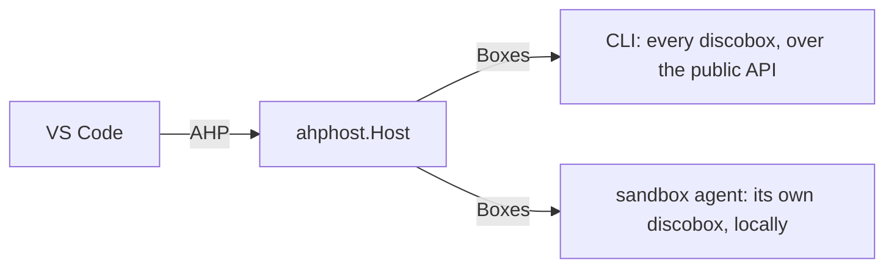

# ahphost — design

An [Agent Host Protocol](https://github.com/microsoft/agent-host-protocol) host
for discoboxes: VS Code's Agents window is its client. A discobox is a session,
each of its harness terminals a chat whose screen is the live terminal, and
each terminal a client opens a shell in it (ADR 26-10-17-354).

What it knows of Discobox comes through `Boxes`, in its own types (`Box`,
`Exec`, `Stream`), because two programs run it:

- `discobox admin ahp` serves every discobox the CLI can reach, over the
  console's data source ([cli/DESIGN.md](../../cli/DESIGN.md#agent-host-protocol-discobox-admin-ahp-adr-26-10-17-354)).
- A discobox serves itself, started by VS Code over SSH, so Open in Editor
  opens it (ADR 26-10-22-853).

- **State changes only through the protocol's reducers.** Every channel's state
  is the SDK's (`ahptypes`), changed by `ahp.ApplyActionTo*` on the action
  that is also broadcast, so a snapshot is what a client folding the same
  actions holds. Only protocol version 1.0.0 is spoken.
- **A discobox is a session**, `ahp-session:/<id>`, or the URI a client chose
  when it created one. Its status bits come from the primary terminal's OSC 7501
  report; read state is the host's memory, since Discobox has none. Its working
  directory is `file://<id><source>`: VS Code opens a terminal for the active
  session there, and the authority is how `createTerminal` knows which
  discobox's shell to open. A host in the discobox (one given a `Workspace`)
  has one session, and its folder is the plain local path of the working
  tree, which is what Open in Editor opens over Remote-SSH.
- **A harness terminal is a chat.** Its running turn holds one terminal tool
  call whose result is the screen, an `ahp-terminal:` channel over the exec's
  attach. VS Code makes a terminal live only for a turn it watches running, and
  queues a message sent meanwhile, so a queued message ends the turn and starts
  the next one under that message, typed into the terminal through the exec
  input route (a paste when the program asked for one).
- **A session a client created has no discobox until its first message**, which
  is the prompt it is created with. Until then it is a draft: VS Code creates a
  session for every new-session view it opens, so a draft is neither listed nor
  announced (`session.listed`), and one nobody has open is forgotten when the
  client that created it goes — never when another does.
- **Observing never wakes.** A screen is attached by the exec's own ID while
  someone watches it and the discobox runs, and let go when nobody does.
  Sending a message or typing into a stopped discobox starts it.
- **A shell is a terminal a client created**; the root's terminal catalog
  lists those, not the discoboxes' other execs.
- **Work that outlives a request runs under the host's context**
  (`Host.ctx`, ended when `Run` returns): an attach lives as long as the
  context it was opened with, so only the open is bounded (`openContext`).
- **A client's disconnect cleans up only that client's own** drafts and exited
  shells (`owner`).
- **Files are every host's, through `Boxes`, as the discobox's default
  user** (ADR 26-10-22-499): the CLI over the files API, the in-box host with
  the same operations in its own process. A `file:` URI names its discobox as
  the session's folder does — by its authority from the CLI, not at all in a
  discobox — and a discobox that is not running is refused, not started.
  `Boxes` writes a file whole, so an append, an insert or a truncate past the
  start is read, spliced and written back only if the file is still at the
  version read.
- **Watches and changesets are a host in the discobox's alone**, through
  `Config.Workspace` — inotify and git, which the sandbox agent implements
  (`sandbox-agent/ahplocal`) and the CLI's host has none of
  (`createResourceWatch` is unserved there, ADR 26-10-22-499 Deferred). This
  package speaks the protocol: watch channels released when their last
  subscriber goes, and two changesets — the branch against `Box.DiffBase` and
  the uncommitted changes — recomputed each poll while watched, whose before
  side reads `discobox-git:///<path>?rev=`. Such a host creates no
  discoboxes: `createSession` is refused.
