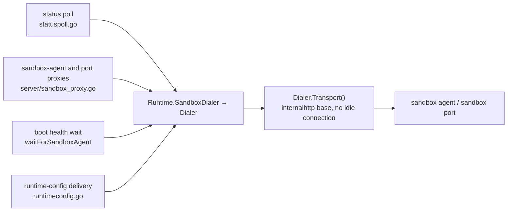
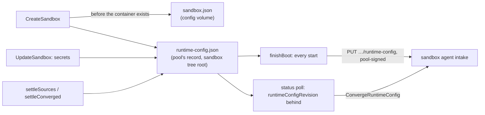
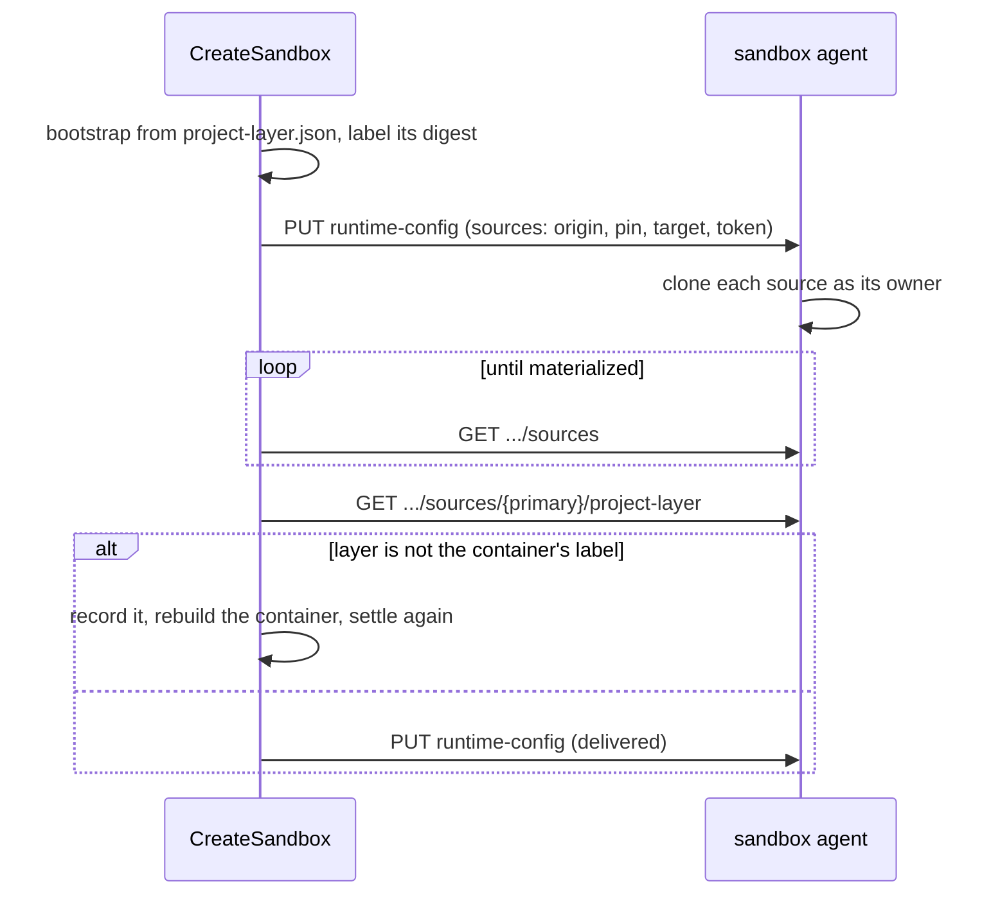
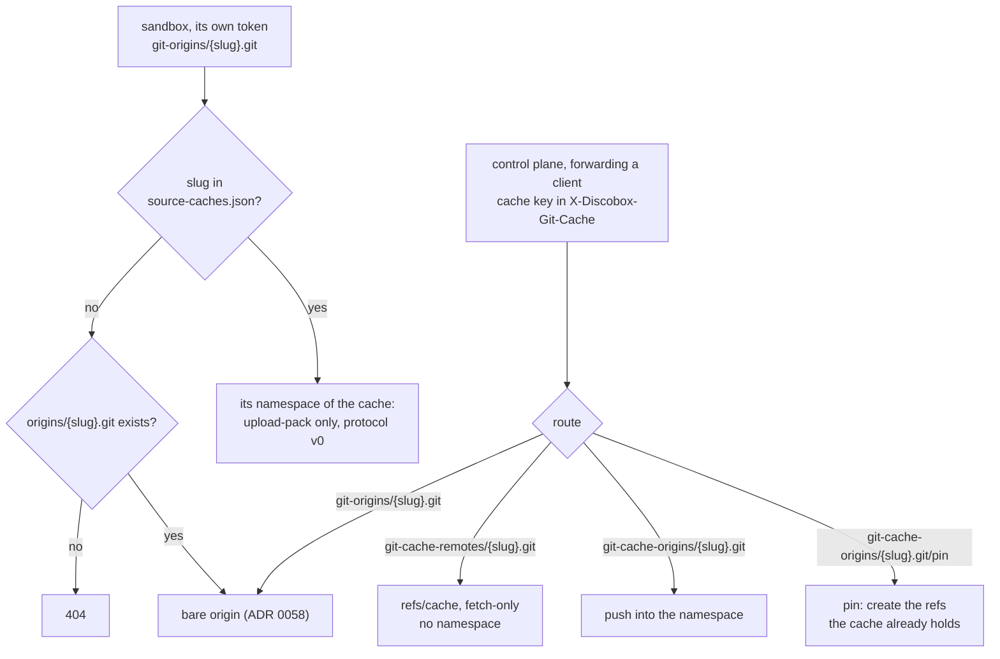
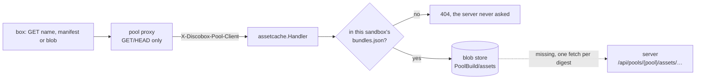
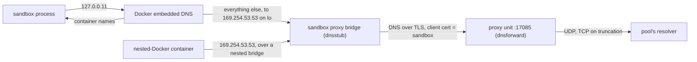
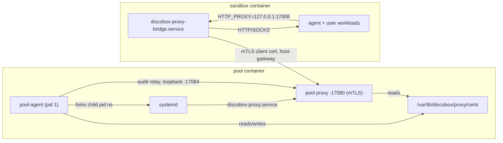
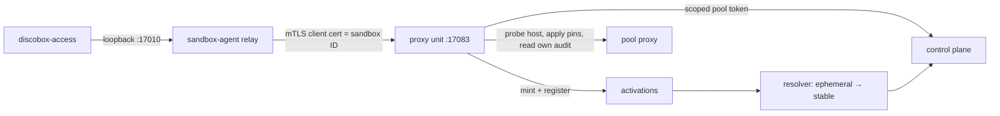
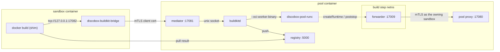

# Pool Agent Design

This module owns the in-guest pool agent process.

The pool agent owns and reads pool bootstrap metadata, authenticates to the
control plane, reports pool health/capacity, and runs the local pool runtime
plumbing needed by provider backends. It also owns the pool-local sandbox
operations HTTP server for sandboxes hosted on that pool. That API is distinct
from the in-sandbox `sandbox-agent` API.

## Package Map

| Package/path | Ownership |
| --- | --- |
| `api/openapi` | Pool-agent-owned OpenAPI contracts, including the canonical pool-local sandbox operations API. |
| `api/gen` | Generated pool-local sandbox operations client/server scaffold. |
| `api/model` | Stable aliases for pool-local sandbox operation schema types (generated by `api/internal/genmodelaliases`), plus hand-written wire constants both sides import, such as the `ErrorTypeSandboxArchived` problem `type`. See [`api/model/DESIGN.md`](api/model/DESIGN.md). |
| `cmd/discobox-pool-agent` | Pool agent binary entrypoint. The same binary runs the `proxy` and `buildkit-mediator` systemd units as subcommands. |
| `cmd/discobox-vsock-guest` | Local-VM guest services, built into the VM image: VSOCK-to-Docker byte splice and orderly shutdown endpoint. |
| `cmd/discobox-cp-relay` | wslc guest half of the control-plane channel: multiplexes the guest's stdio with `cpmux` and serves the Unix socket the agent reaches the control plane through. |
| `.` | Root `poolagent` Go package: boot contract, registration flow, control-plane HTTP client (`http.go`), status reporting, the standing sandbox-agent status poller (`statuspoll.go`, ADR 0030), resource accounting (`resourcereport.go`, `storagescan.go`, `cgroup.go`), and high-level command orchestration. |
| `server` | Pool-local HTTP server, health/metadata endpoints, generated sandbox API route/auth adapter, the sandbox HTTP/sandbox-agent/Git proxy routes, the Git cache routes the control plane forwards clients' deliveries to (`sandbox_git_cache.go`), on-demand start (`autostart.go`), the loopback origin listener the pool proxy forwards sandboxes' origin fetches to (`NewOriginRouter`; see [Git origins](#git-origins)), and the socket it forwards their bundle fetches to (`Config.AssetListener`; see [Bundle Assets](#bundle-assets)). |
| `assetcache` | The pool's pull-through cache of bundles (ADR 26-10-16-423 §13): each sandbox's record of the bundles it is pinned to (`bundles.json`), the blob store under `layout.PoolBuild`, filled through the agent's control-plane client (`HTTPClient.FetchAsset`), the `assets.discobox.internal` handler scoped to one sandbox's record, and the sweep. See [Bundle Assets](#bundle-assets). |
| `cpmux` | Symmetric yamux session over one duplex byte stream, for guests that can only be dialed inward (wslc). |
| `poolauth` | Pool-to-control-plane assertions: PASETO v4.public signed with the pool's Ed25519 key. |
| `sandboxtoken` | Tokens the pool issues its own sandboxes, signed with the same key under their own audience (`discobox-pool-sandbox`); `origin:fetch` is accepted on the `git-origins` route alone. |
| `internalhttp` | The transport for the pool's own HTTP, which never honors `HTTP_PROXY`: the control-plane client's, and the base of every transport a sandbox `Dialer` builds. |
| `githttp` | Serves a source's origin through the shared [`gitbackend`](../pkg/gitbackend) CGI bridge, run as the repository's owner: a bare repository made for one sandbox, or a Git namespace of a cache. A sandbox's own fetch is served fetch-only, on protocol v0, confined to what its namespace advertises; see [Git origins](#git-origins). The `git-repositories` route is not served here; see [The worktree route](#the-worktree-route). |
| `gitcache` | The pool's cache of Git ([ADR 26-10-10-545](../docs/adr/26-10-10-545-git-reaches-a-pool-only-from-a-client-and-is-cached-there-per-remote.md)): one bare repository per cache key under `layout.Root.PoolGitCache`, a namespace `refs/namespaces/<sandboxID>-<slug>/` per sandbox source, and the remote's own branches and tags under `refs/cache/`. Owns the pin, the configuration a push is received under, the pre-receive check a sandbox's push is held to (the agent binary run as `git-cache-pre-receive`), namespace export and import, and the sweep that removes namespaces, drops unused caches and collects the rest. It never fetches. See [Git origins](#git-origins). |
| `execidentity` | The `SysProcAttr` that runs a subprocess as a given uid/gid. |
| `image` | Files baked into the pool image: the systemd units (proxy, buildkitd, mediator, registry) and `registry.yml`. |
| `sandboxruntime` | The `Runtime` interface and its implementations (`DockerSandboxRuntime`; `MemorySandboxRuntime` for tests). `Runtime` is everything the agent needs from a runtime — sandbox CRUD and power, the durable tree, origin paths, how the pool reaches a sandbox ([Reaching a Sandbox](#reaching-a-sandbox)), the state channel, and the tree and proxy-material reclaim loops — so `Serve` holds no concrete type and a second runtime is a drop-in (ADR 0144 §2). What only a Docker pool has, such as image reclamation (`WatchImages`), stays on the Docker type and is started by the Docker pool's composition in `RunAgent`. The Docker runtime implements the durable-tree export and restore a transfer moves (ADR 0123; `tree.go`). An export does not walk the sandbox's `data` or `sources` here: it runs the sandbox's pinned image as a one-shot container in the sandbox agent's export mode — the trees and config mounted read-only, no network, no capability but `DAC_READ_SEARCH`, a read-only root — refuses an image without `harness.TreeExportLabel`, verifies the stream it gets back (`sandboxtree.Copy`), and appends the `origins` this pool owns (ADR 0129) — a bare repository made for the sandbox, or its namespaces of the Git cache written out as repositories for the length of the export. Only the sandbox can resolve which declared paths stay behind and where they live; and the reads happen in the sandbox's namespace rather than as root on this host. Closing the stream waits for the export container to be removed. Restore stays here, confined by `os.Root`. Provisions the five primary volumes (`/.discobox/{data,cache,config,sources,secrets}`) and mounts them into every sandbox; `cache` is the pool-local directory shared across the pool's sandboxes. It also mounts each source's opaque, durable pool-local data at `/.discobox/data-per-source/<slug>` (a private one for a primary with no key), records which Git cache each cache-delivered source's namespace is in (`origin.go`, `source-caches.json`), holds the pool's `gitcache.Store` (`Runtime.GitCache`), and sweeps it from `WatchSandboxVolumes`; it binds no origin into a sandbox and runs no git in its checkout — the sandbox clones its own sources, and the runtime settles them (`sources.go`; see [Sources](#sources)). In-sandbox path wiring for the primary volumes is delegated to the sandbox agent's `discobox-wire.service` (ADR 0007, ADR 26-10-10-767); the per-source data mount already lands at its final runtime-owned path. |
| `dnsforward` | The pool's DNS-over-TLS server for its sandboxes: each framed query answered by the pool container's own resolver, connections capped per sandbox by client-certificate identity. Run by the proxy unit. See [Sandbox DNS](#sandbox-dns). |
| `proxyagent` | Pool-scoped proxy wiring: certificate bundle preparation, the `proxy` subcommand entrypoint, per-sandbox client material for the runtime-config document and the pool endpoints the bootstrap names, the sentinel resolver, the sandbox-facing agent credentials endpoint with its ephemeral-sentinel activation registry (ADR 0031) and a sandbox's read of its own egress audit (ADR 26-10-02-678), the origins and assets hosts the proxy forwards to the agent (`origins.go`, ADR 26-10-08-561; `assets.go`, ADR 26-10-16-423 §13), and host trust: probing a host for a trust ask and keeping the proxy's pins in step with the control plane (ADR 0149). |
| `buildkitagent` | The pool-shared BuildKit builder, its output registry, the mediator that binds a build to the sandbox that asked for it, and the per-build egress forwarder. See [Pool-Shared Builds](#pool-shared-builds). |
| `cmd/discobox-pool-runc` | The pool's runc wrapper, installed as `runc` ahead of BuildKit's own. Injects MITM trust and the per-build egress hooks into each build step's OCI spec. |
| `systemd` | Linux/systemd child pid namespace startup and shutdown, with non-Linux stubs. |
| `childproc` | This process's children: every subprocess start in the agent, and the reaper for the ones nothing is waiting for. See [Child Processes](#child-processes). |
| `imagereap` | Rules for reclaiming unused Discobox images from a Docker daemon (ADR 0040). Shared with the server, which applies them to the daemon pool containers run on; see [Image Reclamation](#image-reclamation). |

## Startup Flow

1. The pool provider starts the pool container with the `poolagent.Bootstrap`
   contract rendered as `DISCOBOX_*` environment variables, which `FromEnv`
   reads back. The control plane and the agent's listener are one URL each, and
   the scheme alone picks the transport ([`wire`](../pkg/wire), in the root
   module).
2. Before systemd boots, the agent writes the proxy unit's environment and
   prepares the proxy CA bundle and the BuildKit/registry configuration, then
   starts the child systemd namespace and the `childproc` reaper.
3. The agent loads its Ed25519 identity key from durable pool storage
   (`layout.PoolIdentityKey`), generating and storing one on first boot.
4. A newly generated key is registered at `/api/pools/register` with project
   ID, pool ID, the single-use bootstrap token, and the public key; the control
   plane redeems the token against that pool and stores the key. A key loaded
   from disk skips registration and spends no token
   ([ADR 0063](../docs/adr/0063-a-pool-agent-keeps-its-identity-key-and-registers-once.md)).
5. Every later control-plane call carries a pool assertion the agent signs
   itself (`poolauth`: PASETO v4.public, audience `discobox-control-plane`,
   5-minute TTL). The control plane issues no runtime token.
6. The first status report is synchronous, so a pool that cannot mark itself
   ready fails its boot. When it is rejected under a stored key, the agent
   registers that same key again (`ForceRegister`) and retries.
7. The agent starts the proxy unit's resolve-token refresher, builds its
   Docker sandbox runtime and starts that runtime's image reclaim loop.
8. `Serve`, handed the runtime as `sandboxruntime.Runtime`, starts the state,
   progress, tree-reaper, status-poll and resource loops and the proxy-material
   reclaim loop, and finally the pool-local HTTP server.

### State Root

Every path the agent, the proxy and the builder read or write is resolved
against one `layout.Root`, handed down from the entrypoint — never a package
global, and never `layout.ContainerRoot` spelled out. Every entrypoint here is
the container shape and chooses `layout.Container()`, so its paths are
`/var/lib/discobox/...`. `layout` also offers `Host()`, the per-OS root
[ADR 0144](../docs/adr/0144-a-pool-of-host-vm-sandboxes-runs-its-agent-on-the-host.md)
§1 calls for, and a host root has no pool container: `Root.System` (the
agent's `/etc/discobox`, `/run/discobox`), `MountRoots` and `HostMapping` panic
on one.

Tests use `layout.ContainerAt(dir)`, the container's whole filesystem relocated
under a temporary directory. With no `HostStateRoot`, `daemonPath` hands the
daemon the paths the agent itself uses, so a fake daemon sharing the test's
filesystem finds the files where the test wrote them; with one, only paths
under the root are translated.

After registration, the pool host reports scheduling status every 30s
(`/api/pools/{poolId}/status`). It sets `ready`, `schedulable`, and `degraded`
booleans for control-plane scheduling, with available CPU, memory, and storage
measured per report. Registration and every report also declare the one
platform the pool hosts (`hostedPlatform`, ADR 0145 §1): a pool's sandboxes are
containers on the agent's own kernel and architecture, so it is the agent's
own. Repeating it on every report is how the control plane learns what a
pool from before platforms hosts, since an agent whose key survives a restart
does not register again. Beside it they declare the kind of image the pool
runs (`hostedImageKind`, ADR 26-10-09-106 §4): `oci`, since this agent's
sandboxes are containers. The same platform is the runtime's
(`DockerSandboxRuntimeConfig.Platform`), and every path the runtime names inside
a sandbox — a source's target, the user's home, the working directory, the
working root it writes into the manifest — is judged by its `sandboxpath`
rules (ADR 0145 §6), never as a host path. Richer pressure/condition details can be sent as an opaque
JSON blob for display. Repeating the report is what restores readiness the
control plane cleared after a failed reconcile.

## Child Processes

The agent is PID 1 in its container, so it is both an init — orphans re-parent
to it — and an ordinary process running `git` (in its own origin repositories,
never a sandbox's checkout), `chown` and `git http-backend` through `os/exec`. Those are one kernel resource, and `childproc` owns it
(ADR 0087).

- **Every subprocess starts through `childproc`** (`Run`, `CombinedOutput`, or
  `Start`/`Wait`), which records its pid as owned across the fork itself. An
  `exec.Cmd` started directly is a child the reaper cannot tell from an orphan.
- **The reaper peeks before it claims.** `waitid(P_ALL, WNOWAIT)` names an
  exited child without collecting it; an owned pid is left for its owner and the
  round stops, anything else is collected with `wait4(pid)` and logged. A
  reaper calling `wait4(-1)` instead takes children `os/exec` is waiting for,
  and their owners are told the command has no exit status at all — output
  intact, `waitid: no child processes` returned — which is a silent corruption
  of every subprocess result in the process.
- **A caller must never read a fact about the world out of a command's
  failure.** Ask for the value (`git config --get-all`, whose exit 1 is the
  answer "there is none") and write with `--replace-all`, which creates and
  corrects in one step. Check-then-act (`git remote get-url`, else `git remote
  add`) wedges a sandbox for good the first time a status goes missing.
- The systemd namespace child is deliberately *not* registered: it is stopped
  with a signal and never waited for, so the reaper collecting it is the point.
  `systemd.ManagedChildProcesses` names it so the log says which it is.

## Resource Accounting

The agent answers "what is using this pool" on its own channel
(`/api/pools/{poolId}/resources`, every 30s), because the question needs three
things only this component holds together: the pool's own totals, every
sandbox's counters, and the disk under all of them
([ADR 0071](../docs/adr/0071-resource-accounting-is-a-pool-agent-differenced-report.md)).

**Counters travel, rates are computed here.** Sandbox-agent reports
`cpu.stat`'s cumulative `usage_usec` and never a rate. This agent polls every
sandbox in the pool on one tick, so it differences all of them over the same
window and the resulting vCPU-equivalents are comparable between sandboxes and
additive across them — a column that sorts into "who is eating the pool" and
sums to pool load. Rates each sandbox computed for itself would each cover a
slightly different window, and a ranking built from those is not comparing like
with like.

The window is taken from each sample's own `observedAt`, never the tick's wall
clock, so poll skew inside a tick cannot distort a rate. A missing previous
sample reports *no* rate rather than zero: "not measured yet" and "idle" are
different claims.

**The status relay stays opaque.** Two fields are read out of the polled
payload — `observedAt` and `resources` — and the payload itself is still
forwarded as received, never re-serialized from a parsed structure, so a field
this agent does not model still reaches the control plane. The computed figures
travel in this agent's own report, never merged into the sandbox-agent's.

**Both loops share one poll.** The resource reporter reads the counters the
status poller already collected (`sandboxAgentStatusPoller.ResourceSamples`)
rather than polling each sandbox a second time for the same two numbers.

**Attribution reaches processes.** Each sandbox offers a candidate list — the
union of the busiest by cumulative CPU and the largest by RSS — and this agent
differences them per `(pid, startTicks)` and keeps the top few by *rate*. The
start time is in the key because PIDs are reused; without it a recycled PID
differences into a spike that never happened. Ranking by the cumulative counter
would put a day-old language server above a test run that has just started
eating the box.

**Disk is two measurements on two schedules.** `statfs` on `/var/lib/discobox`
is one syscall and rides every report — it is the figure that answers "is this
pool about to fill up". Per-tree attribution is one pass over every inode the
pool owns and runs on `storageScanner`'s own adaptive schedule; the report
carries the last completed sweep with its `observedAt`, `durationMillis`,
`intervalSeconds` and `nextScanAt`. Sizes are allocated blocks, not apparent
size, so they are comparable with the filesystem's own used figure.

The sweep interval is a **duty cycle**: after a sweep costing `d`, the next is
due in `clamp(d / 0.02, 1min, 1h)`, so the agent spends about 2% of wall-clock
time walking whatever the pool's size. That needs no per-pool tuning and, more
importantly, it is what keeps the loop correct — a fixed schedule on a pool
whose trees take longer to walk than the interval either overlaps sweeps or
falls permanently behind. When the cap binds the budget is being blown anyway,
and the agent says so in a warning.

Sweeps are staggered by a hash of the pool ID, because one Docker daemon hosts
every local pool (ADR 0003) and a host reboot would otherwise start them all in
lockstep. A hash rather than a random jitter keeps each pool's schedule
reproducible. A canceled sweep is discarded rather than reported partially:
half a walk reports every unvisited tree as empty.

The sweep also sums the per-sandbox trees into `dataBytes`, so a reader has the
three buckets — data, cache, free — without joining across the sandbox rows,
where one can be refreshed and another not. The sum is real disk rather than one
tree counted N times: each sandbox's tree holds its own home, sources and nested
container store, which are its own copies rather than links into anything shared.

Cache gets exactly one figure, at the pool. It is one shared tree keyed by the
target path a harness declared — with the sandbox user's uid above it for every
path that did not declare itself shared — rather than by which sandbox wrote it
(ADR 0007, ADR 0050,
[ADR 0094](../docs/adr/0094-the-pool-cache-is-partitioned-by-the-sandbox-users-uid.md)),
so a per-sandbox cache size has no on-disk answer — and repeating the shared
total per sandbox would leave the column summing to N times the truth. The figure
covers `layout.PoolCache` whole, every user's partition included.

**Stopped and archived sandboxes still count.** Unlike the status poll, the
report covers the union of the containers (`ListSandboxes`) and the durable
trees (`StoredSandboxIDs`). A stopped sandbox uses no CPU but still holds its
disk; an archived one has no container at all — archiving keeps the tree by
intent (ADR 0022 §6) — and is exactly the sandbox whose disk somebody deciding
whether to purge it needs to see.

**A sandbox's /dev/shm is half what the pool can use**
(`sandboxSharedMemoryBytes` → `DockerSandboxRuntimeConfig.SharedMemoryBytes` →
`HostConfig.ShmSize`): the pool container's cgroup `memory.max` when set, the
host's `MemTotal` otherwise. That is the kernel's default tmpfs size, so
`/dev/shm` in a sandbox is what it is on an ordinary Linux machine rather than
Docker's 64 MiB, which kills Chromium and Electron renderers on the desktop's
display. It is a cap, not a reservation, so every sandbox gets the same size. A
container created before this keeps 64 MiB until it is recreated.

**Pool services are measured, not derived.** The pool container's own cgroup
covers this agent, buildkitd, the registry, the proxy and the mediator — and
*not* the sandboxes, which run under a nested container runtime whose cgroups
are not children of it. So the pool's load is `services + Σ sandbox vcpus`, two
disjoint measurements added. Services are never derived by subtracting the
sandboxes from a supposed pool total: that "total" can be smaller than the
sandboxes it is meant to contain, and the difference goes negative
(ADR 0071 §6).

## Reaching a Sandbox

The pool never addresses a sandbox. `Runtime.SandboxDialer(sandboxID, port)`
hands it a `Dialer` for a port inside the sandbox — the sandbox agent on
`SandboxAgentPort`, or anything the sandbox listens on — and every pool→sandbox
request rides a connection it opened ([ADR 0126](../docs/adr/0126-a-sandbox-does-not-share-a-host-or-a-filesystem-with-its-pool.md) §5).
How it connects is the runtime's: the Docker runtime dials the container's
address on the pool network; a host-VM runtime would dial a guest socket, and a
provider-hosted one a stream on a session the sandbox opened outward.



- Resolving the dialer is where a sandbox that cannot be reached at all is
  refused (no container, no address — mapped to a status before the proxy sends
  anything); a failed dial after that is a 502.
- A request's URL names no address: `HTTPURL(port, path)` is
  `http://localhost:<port>/…`, which is only the `Host` the sandbox's server
  reads — and the name a dev server checking `Host` accepts.
- The transport is built per use and keeps no idle connections, so none
  outlives the sandbox it reached. It closes each one once its response is
  read rather than disabling keep-alives: a request sent `Connection: close`
  gets no drain of an unread body from the sandbox's net/http, so a refusal
  answered before the body was read (the sandbox agent's auth) can arrive as a
  reset instead of its status (#106). The sandbox drains only 256 KiB that way,
  so the runtime-config delivery also sends `Expect: 100-continue`, and waits
  for the agent's answer as long as the call may take: a refusal is answered
  before any of the document is sent, whatever its size. Upgrades
  (exec attach, tunnels) carry on over the dialed connection.
- The connection is never an authority. The sandbox agent validates its own
  token on every request — the status poll's `status:read` and `inventory:read` token (ADR 0030),
  the proxy's downstream `Authorization`, the pool-signed runtime-config
  token — and a lost connection is not a
  power-state signal: power state comes from the runtime's own channel below.

## Sandbox Runtime Config

What the pool tells a sandbox comes in two halves
([ADR 26-10-08-127](../docs/adr/26-10-08-127-a-sandboxs-bootstrap-is-static-and-the-intake-carries-the-rest.md)).
The **bootstrap**, `sandbox.json`, is static: placed in the config volume by
the create, before the container exists, and never rewritten. The
**runtime-config document** is everything that can change while the sandbox
exists, delivered to the sandbox agent's intake
([ADR 0126](../docs/adr/0126-a-sandbox-does-not-share-a-host-or-a-filesystem-with-its-pool.md)
§3). After create the pool writes nothing into a sandbox's volumes.



- **Bootstrap** (`writeSandboxHarnessConfig`): the create-time config, the
  control plane's and the pool's public keys (`provider.publicKeys`), and where
  the pool serves the sandbox (`provider.pool`, `proxyagent.PoolEndpoints`). No
  private key, no secret, no idle timeout. It also removes a readiness marker
  left from an earlier container, so a new one's gate waits for its own agent.
  The config and secrets binds are writable inside the sandbox, because its
  agent is now what writes them.
- **The record** (`runtimeconfig.go`): the document the pool has decided, in the
  sandbox's tree root beside — never inside — the volumes, so it survives an
  archive and leaves with a delete. `decideRuntimeConfig` applies a change
  (secrets from create or update, sources and their delivery) and refreshes what
  the pool owns outright (the idle timeout, whether the control plane holds the
  sandbox's power, the proxy material, its sources' origin tokens); only a
  different document is a new revision. `agent.controlPlanePower` is set only
  for a sandbox whose last status advertised `autostop.controlPlanePower`
  (`handsOverPower`), because an agent that predates the field refuses the
  whole document over it; before the poll has reached a sandbox since this
  agent started, the recorded value stands ([ADR 26-10-16-337](../docs/adr/26-10-16-337-a-discobox-asks-to-sleep-and-names-when-to-wake.md) §8). The record never
  holds the client key; delivery adds it from the proxy material.
  `project-layer.json` beside it is the project layer the pool decided for the
  bootstrap and the slug it is read from — never `_provenance` read back from a
  file the sandbox can write.
- **Delivery**: a `PUT` through the sandbox's `Dialer`, with a token the pool
  signs with its identity key — audience `sandbox-agent`, exactly the
  `runtime-config` scope, this sandbox and pool — which the sandbox verifies
  against the key in its bootstrap. It happens at the end of every boot, when a
  running sandbox's secrets change, and when a sandbox's sources settle.
- **Convergence**: the status poll reads `runtimeConfigRevision` and calls
  `Runtime.ConvergeRuntimeConfig`, which decides again and delivers whenever
  the sandbox's revision is not the record's — behind, or ahead of a record that
  fell behind it — one delivery per sandbox at a time, and none while
  anything holds the sandbox's power lock (a create, start, archive or delete
  ends in its own delivery or in no sandbox at all). The pool converges on what
  the sandbox says it applied, never on having sent it, so a transient failure
  is logged and repaired at the next poll rather than failing anything. While
  the record names a source not yet delivered, the same call settles it
  (`settleConverged`; see [Sources](#sources)).
- **Certificate renewal** is a decision like any other: deciding refreshes the
  proxy material, and `EnsureSandboxMaterial` reissues a client certificate
  within 30 days of its expiry, so the next poll's convergence delivers it as a
  new revision to a sandbox that is already running. The sandbox's bridges take
  it from their next connection without restarting
  ([proxy: Renewal while a sandbox runs](../proxy/DESIGN.md#renewal-while-a-sandbox-runs)).
- Deciding issues material and writes the record, so it is refused for a
  sandbox whose tree is gone or archived: a late poll or secret update cannot
  put back what a delete took away. A secret update holds the power lock, and
  leaves a sandbox with no container to the create that gives it one, which
  sends its whole secret set.
- A sandbox that holds a newer revision than the record (the record lost, or the
  sandbox moved here), or that answers a conflict, moves the record past its
  revision and is delivered again, once.
- An agent with no intake answers 404, and one that refuses the delivery
  outright — the pool's token not accepted, the document refused (400, 401,
  403, 422) — cannot be fixed by a retry: the boot fails with
  `ErrRuntimeConfigUnsupported` or `ErrRuntimeConfigRefused` rather than the
  pool staging files around it, and the container is stopped, so the next
  request meets the refusal again instead of a running sandbox that looks
  healthy.
- A container built before its bootstrap named the pool's key carries no
  `discobox.runtime_config` label and takes no deliveries: while it runs, it
  runs on what was staged for it then, and a change decided for it is recorded
  and logged. Its next start retires it instead
  (`retireContainerWithoutRuntimeConfig`): the container is removed — its
  durable tree is in the pool-host binds — a complete state sync goes at once,
  and the control plane's "your container is gone" ensure recreates it from the
  spec it holds, on the bootstrap that can. The start that retired it answers
  that the sandbox has no container, like any other, and the control plane
  waits for the rebuild. Any create that reaches such a container also counts
  it drifted.

## Sources

A sandbox materializes its own sources
([ADR 0126](../docs/adr/0126-a-sandbox-does-not-share-a-host-or-a-filesystem-with-its-pool.md)
§4): the pool says where each origin is, and the sandbox agent clones it as the
checkout's owner, in its own namespace. The pool runs no git in a sandbox's
checkout, chowns nothing in it, and binds no origin into it. What it keeps is
settling ([ADR 0055](../docs/adr/0055-a-delivered-source-settles-before-its-sandbox-runs.md)):
a source is marked delivered — which opens the sandbox's readiness gate — only
once the primary source's project layer has been read and the spec is final.



- **The document's sources** (`sources.go`, `runtimeSources`): each source's
  in-sandbox target, its pin, and its origin — this pool's git-origins route at
  the origins host for every source a client delivers
  ([Git origins](#git-origins)), and the remote itself for a remote-URL source
  of a sandbox created before pools cached Git, which cloned it directly.
  A pool-served origin carries a token (`sandboxtoken`, `origin:fetch`), issued
  for a day and renewed by deciding the document once it has less than half
  left. Delivery carries over by slug: a source is delivered once.
- **Each source's directory** is created empty under `sources/<slug>` at create
  and never touched again; boot binds it onto the target and gives it to the
  sandbox user, who clones into it.
- **Settling a create** (`settleSources`): a create that started its container
  waits for the sandbox to report every source materialized
  (`GET .../sources`, pool-signed, `runtime-config` scope), reads the primary
  source's project layer from it (`GET .../sources/{slug}/project-layer`), and
  compares it with the digest of the layer the container was built from
  (`discobox.project_layer` label). The same layer marks every source delivered;
  a different one is recorded in `project-layer.json` and the container is
  rebuilt against a bootstrap carrying it, once per create. A source the
  sandbox fails to clone `sourceFailureLimit` times, or has not begun after
  `sourceWaitingTimeout`, fails the create with what the sandbox said; the
  agent keeps retrying regardless. An agent that cannot report its sources at
  all (404 or 503: an image from before the route) fails the create at once
  with `ErrSourceStatesUnsupported`.
- **A pushed source parks.** Until the client's push lands in its bare origin
  there is nothing to clone and nothing settles. A source that names its
  branch has its origin's HEAD there from `initGitOrigin` on; one that names
  none has HEAD pointed at what arrived (`headOriginAtWhatArrived`, git in the
  pool's own repository) by whichever settles it first. The sandbox's agent may
  clone the moment the push lands; the resume create delivers the document
  again — a delivery wakes an agent backing off — and settles as above, and the
  agent fills in an `origin/HEAD` its early clone could not resolve.
- **Settling a start** (`settleConverged`): a sandbox started rather than
  created — unarchived or imported, whose create did not start it — has nobody
  waiting on it, so the status poll's convergence settles it once the sandbox
  reports every source materialized. With no create request in hand it cannot
  rebuild, so a layer that needs one removes the container
  (`removeForRebuild`) for the control plane to recreate from the recorded
  layer. It takes the primary's slug from `project-layer.json`, and settles
  nothing for a record from before that named one: only a create can say.
- **Upgrade.** A checkout a pool cloned before this keeps the empty marker it
  wrote, which the agent reads as materialized; one from before the marker —
  a commit checked out and an `origin` that is a filesystem path — is adopted
  by the agent at what it has checked out. A container built before
  carries no project-layer label, which reads as built with none — what such a
  container was built with whenever a source was still to be settled.

## Sandbox State Channel

The agent is the only component that can see whether a sandbox is running, so it
says so on its own schedule rather than in reply to anything (ADR 0017 §10). The
control plane holds no opinion about power state and never asks for one.

The channel is part of `sandboxruntime.Runtime`: `Serve` subscribes with
`WatchSandboxStates` and holds the progress sink with `WatchSandboxProgress`,
and stamps every batch with its boot ID and sequence. Where an observation comes
from is the runtime's — Docker events and container listings below, a
hypervisor for a host-VM runtime — and nothing above the interface knows.

Provisioning **progress** rides the same channel in its own `progress` array
(ADR 0039): work underway that has no state transition to announce it. It is
reported by whoever is doing the work rather than derived from the Docker event
stream, so it is a sink to hold rather than a stream to watch. It is always a
delta and is unaffected by `complete`, which describes `states` only — a progress
report is not a sync claiming this pool hosts one sandbox.

Every report carries a **phase**, and `CreateSandbox` publishes one at each
boundary it already has: pulling the image, preparing volumes, creating the
container, starting it, waiting for the sandbox agent, and waiting for the
sandbox to materialize its sources. A phase is never a state — nothing branches on one, and the phase a
sandbox finished in means nothing once it is up — which is why these ride the
progress array rather than the state one (ADR 0060). A report with no phase is
dropped rather than sent.

Pull progress refines the one phase that can say how far in it is, aggregated
for a status line (bytes against bytes, layers against layers) and throttled,
because the daemon emits per layer per transition; the download phase alone
supplies the byte counts, since `Extracting` re-reports the same layer and
counting both would nearly double the total. Both totals grow while the manifest
is walked, so the pair is a ratio at a moment and never progress toward a fixed
target.

Clone progress refines materializing a source. The sandbox clones its own
sources, so the counts are its agent's (`GET .../sources`), and the settle wait
(`awaitSourcesMaterialized`) restates the phase on every read of them — twice a
second, moved or not — naming the first source not yet materialized (a
remote by host and path, a client's checkout by its directory) with git's
stage, object counts and bytes. Restating is what keeps the phase current: a
full clone of a large remote is minutes, and one report as the wait began
would age out of what a client counts as current long before it ends (#138).
The wait ends, however it ends, on the bare phase: the record is never cleared,
and a CLI that predates clone progress cannot decode one carrying it (ADR 0118).

Waiting for the sandbox agent is the last phase this agent can see. What happens
after it is the sandbox agent's own boot, which reports on no channel this one
owns; a client names that stage by inference instead (ADR 0060).

The Docker runtime makes three deliveries, all load-bearing:

- **Deltas**, from the Docker event stream — `start`, `die`, `stop`, `destroy`,
  and `pause`/`unpause` for a suspended sandbox (`suspended`, then `running`).
  `destroy` alone is not enough: a container that stops and stays put emits
  nothing else, and would go on being reported as running.
- **A complete sync**, on agent start and every 60s, listing every sandbox
  this agent hosts. A dropped delta heals at the next sync, where a delta-only
  channel drifts permanently the first time a post fails. A sandbox the control
  plane believes is here and that the sync omits has no container.
- **The end of every create**, which is the case the event stream cannot cover:
  a create that was not asked to start anything produces no container
  transition, so an unarchive or a rebuild after the container was lost would
  otherwise go unreported until the next sync (ADR 0034 §4). `CreateSandbox`
  reads the container back and publishes what it sees before returning.

Batches carry the agent's boot ID and a per-boot sequence, so a delayed delta
cannot overwrite a newer sync. The interval's arrival doubles as pool liveness.

`starting` and `stopping` are published by the power operations themselves
(`sandboxruntime/power.go`): by the time a Docker event arrives the transition
is over, and a state nobody can report is a state that does not exist. The
channel deliberately has no `failed` — an exited container looks the same
whether it was stopped on purpose or died, so failure is a judgement about an
operation rather than something the runtime can observe. For the same reason a
report carries no error message: what this channel feeds is the control plane's
runtime state field, and the field that records why something failed belongs to
the reconciler (ADR 0034 §7). `suspended` is the one state beyond the four: a
paused container, which Docker itself calls running.

The sandbox-agent proxy names every path it forwards
(`server/sandbox_proxy.go`), rather than forwarding a prefix, so that the scope
each one needs is decided here and an unknown path is refused rather than
tunnelled. The cost is that a route reaching the sandbox is three registrations,
not one — control plane, here, and the sandbox-agent's own generated router —
and a route added at the ends but not the middle 404s with nothing to say why.
Adding one means adding it in all three.

Power operations (`start`, `stop`, `restart`, `suspend`) answer with acceptance only, and
serialise per sandbox on one mutex (the ones that can start a container also
pass the pool's start gate first; see [Clearing the Pool's Caches](#clearing-the-pools-caches)). That is also what makes on-demand start safe:
ten concurrent requests produce one start.

`power-down` is the fourth, and the one that is conditional
([ADR 26-10-16-337](../docs/adr/26-10-16-337-a-discobox-asks-to-sleep-and-names-when-to-wake.md)
§5): the control plane sends it when a sandbox reported itself idle or asked
to sleep, and under the same mutex the runtime asks the sandbox to confirm the
reason, fresh — `POST .../autostop/confirm`, with a token the pool signs for the
pool-only `autostop-confirm` scope alone (the scope that also signs the thaw's
`autostop/resumed`, below). A sandbox that is not running, or
does not confirm, is refused with a typed 409 (`sandbox-power-down-refused`)
and nothing changes; a confirmed idle is stopped, a confirmed sleep is frozen
(stopped if the freeze fails), and the answer carries the wake the sandbox's
confirmation named.

**Suspended is a frozen container**
([ADR 26-10-16-420](../docs/adr/26-10-16-420-a-docker-pool-freezes-a-sleeping-sandbox-and-a-person-can-suspend-one.md)).
`suspend`, and a confirmed sleep, `docker pause` the container: memory and every
process kept, nothing in it running. Docker calls a paused container running;
this runtime calls it `StatusSuspended` and reports `suspended` (from `Paused`,
and the `pause`/`unpause` events), so nothing that reaches into a running
sandbox — the status poll, runtime-config delivery, `requireRunning`, an
export — reaches into one that cannot answer. A `suspend` never stops instead:
a pause that fails is an error, and a sandbox not running a typed 409
(`sandbox-not-running`). Every start thaws it — `startLocked` unpauses rather
than boots, so an explicit start, the scheduled wake's, and every on-use
`EnsureSandboxRunning` alike — then delivers the runtime-config document and
calls the sandbox agent's pool-only `POST .../autostop/resumed`, which sets
aside the wakes now due. Stop, restart, archive, delete and a cache clear act
on a suspended sandbox as on a running one; Docker delivers the stop signal as
it thaws.

**The control plane decides what starts a sandbox, and this agent carries it
out** (ADR 26-10-12-711 §2). Every sandbox-directed route — the HTTP proxy, the
sandbox-agent proxy, the Git proxy, and the SSH ingress's TCP tunnel route
(ADR 0024 §7) — is wrapped in `onUse` (`server/autostart.go`), which reads the
`use` claim the control plane put on the request's token:

| `use` | Before proxying |
| --- | --- |
| `action`, `read` | start the sandbox unless it is running, and wait out a boot under way |
| `inspect` | never start it; wait out a boot something else began, then refuse with 409 unless it is running |
| `observe` | never start it; refuse with 409 unless it is running, a boot under way included |
| none | start nothing: a route that reaches into the sandbox is served as an observe, and an origin is served from the pool |

There is no table of routes here. Which route is an action, a read, an inspect
or an observe is the control plane's to say, so a route cannot be classified one way
there and another here. The one token with no mark a current control plane
leads to is a sandbox's own, fetching its own origin, and that sandbox is
running. A control plane from before the mark marks nothing, so a server rolled
back under its pools finds stopped sandboxes refused until they are started
explicitly, for as long as it takes to replace those pools' agents with its
own version.

`POST .../sandboxes/{id}/ensure-running` is the same start, asked for before
anything is forwarded: the control plane calls it for an action, so that "no
container" is learned while the request is still the caller's and a repair can
run under it. It answers once the sandbox agent does. It is not the start
instruction, which answers for a container Docker calls running and always
waits on the start gate.

Control operations never start a sandbox. A failed start refuses the routes
that reach into the sandbox with its error and names
`discobox admin box repair` for when it persists, so a runtime failure such as a
missing bind mount is not hidden behind a missing sandbox IP address. The
worktree's Git route is one of those routes: the repository is the sandbox's
own (ADR 0126 §4), so the work in a sandbox that cannot start cannot be fetched
until it is repaired, and the refusal's plain-text body is what `git` — and so
`discobox apply` — prints. The origin route still serves, from the pool's own
files.

Every start — explicit, restart, or on use — ends by delivering the
sandbox's runtime-config document once its agent answers (`finishBoot`; see
[Sandbox Runtime Config](#sandbox-runtime-config)), so each boot is given the
pool's idle timeout as it is now (ADR 0108 §3), and a provider's changed timeout
reaches a running sandbox at the next status poll.

**A sandbox with a tree and no container is answered at once**, on every
route: `ErrNoContainer`, a 409 that says it is being rebuilt or needs repair.
A rebuild — repair, or a recreate after runtime loss — leaves a window where
the sandbox's tree is here and its container is between removal and
recreation, and this tier cannot tell that from a container that is simply
gone. The control plane can, and is the tier that waits for it or repairs it
(ADR 26-10-12-711 §§3, 6); waiting here held every call to a `failed` sandbox
for the whole budget before saying so. An id whose tree is not here is not
late, it is wrong, and is a 404.

**Explicit power instructions answer the same way** (`powerTarget`). A
`start`, `stop`, or `restart` of a sandbox with no container is `ErrArchived`
when its tree is marked archived, `ErrNoContainer` when the tree is here, and
`ErrNotFound` (404) only when it is not. The handlers map these like every other runtime
error, and the no-container 409 carries `ErrorTypeSandboxNoContainer` so the
control plane can tell it from "already exists" (see [Pool Agent API
Model](api/model/DESIGN.md)).

**An inspect or an observe never starts a sandbox** (`requireRunning`). The harness-hooks and
exec-events reads are what the sandbox recorded about itself (ADR 0130), and
starting a stopped sandbox to read them would undo the stop they may be read to
explain — ADR 0108's idle stop above all. The same holds for a terminal's
screen and a wait on it (ADR 0137), and for listing execs, services or tools
and reading one exec or service ([ADR 26-10-11-657](../docs/adr/26-10-11-657-a-stopped-discobox-is-read-from-what-it-last-posted.md) §4). A sandbox that is not running answers
409 saying so, with the state it was found in in
`X-Discobox-Sandbox-Not-Running` (`model.SandboxNotRunningHeader`): that
header is how the control plane knows to answer the screen and the lists from
the sandbox's last inventory. One still booting is refused the same way by
an observe — the audit reads, the screen and the wait, which an orchestrator
polls; an inspect — the lists — waits the boot out (`waitOutBoot`), which
starts nothing, because a client that has just created or started a sandbox
lists it next. One the runtime does not know passes through to the proxy. The
reads the control plane still marks as starting a sandbox are the unbounded
ones, which have no last value to answer with: exec and service logs, exec
events, and exec resource samples.

Archived sandboxes are exempt from that latch and fail those routes with 409.
`archive` and `delete` take the same per-sandbox mutex, and both answer only once
the work is done rather than accepting it: each is a destructive act on state
only this agent can see, and for `delete` the control plane removes its row on
the strength of the response (ADR 0022 §§3, 5-6).

- `archive` removes the container and the sandbox's proxy material, keeps
  `data/config/secrets/sources`, and writes a `.discobox-archived` marker.
- `delete` removes all of it, including the durable tree, and confirms.
- `create` clears the marker, which is the whole of what unarchiving needs here:
  the reuse-the-existing-tree path already restores the sandbox.

The marker is what makes an archived tree legible as archived here: on disk an
archived sandbox and one whose container was lost are the same shape, and only
the archived one refuses an on-demand start. It is not what keeps the tree —
both are sandboxes the control plane holds, and the volume reaper keeps every
tree the control plane holds (below).

### The durable tree travels

`GET`/`PUT .../sandboxes/{id}/tree` (`sandboxruntime/tree.go`) are the two halves
of moving a discobox to another server (ADR 0123). They deal only in the tree:
neither touches a container, and neither is wrapped in the `onUse` latch the
git routes use — everything about both assumes nothing is running.

What travels is `data`, `sources`, and `origins`, and the list is the decision.
`config` holds the bootstrap the create that follows a restore places
(`writeSandboxHarnessConfig`), and `secrets` what that create's start delivers
in the runtime-config document; what they hold is this pool's: sentinels minted
here, a bootstrap naming this pool's key and proxy.

- Both directions are `tarsums` archives: the tree ends with a `SHA256SUMS`
  written only by a walk that finished, and a restore refuses a tree whose sums
  are missing or wrong (ADR 0123 §8). That is what tells a whole tree from one
  cut short between two files, which a plain tar reader cannot.
- `export` refuses a running sandbox before a byte is written, so "it is running"
  is a status rather than a truncated archive. It walks while the caller reads,
  so a failure part way through cannot be a status: the handler aborts the
  connection, and the archive never gets its `SHA256SUMS`. A file whose length changed between the walk that sized it
  and the read that sends it is one of those failures: the entry's header is
  written by then, so the body cannot change length, and ending the archive is
  better than shipping a git pack with a zero tail that is discovered from
  inside the destination sandbox. A file that *vanished* is padded instead —
  cache files come and go, and failing an export over one would be absurd.
- `import` refuses a tree this pool already holds, and removes what it wrote if
  the restore fails — including a restore whose `SHA256SUMS`, checked at the
  end, did not match. Half a tree would be adopted by a create as readily as a
  whole one, and the sandbox would come up missing files nobody can name.
- Every write in a restore goes through an `os.Root` opened on the sandbox tree,
  which resolves each path component beneath it and refuses one that leaves.
  That is the containment, and a check on the entry's name cannot be: the entry
  that escapes is a symlink an earlier entry in the same archive created, so its
  name is entirely inside the tree while the file it names is not. A symlink is
  still written verbatim, target and all — it is resolved inside the sandbox,
  where the tree is mounted elsewhere — and is safe to write because nothing
  here follows it.
- An entry naming anything outside those three subtrees is refused as well, for
  a different job: keeping an archive from carrying a `config/sandbox.json` or a
  `.discobox-archived` over what the create is about to write.
- Sockets, fifos and device nodes are skipped: a sandbox's home routinely holds
  the first two and none of them survive the process that made them. Hard links
  are stored once and referenced afterwards, because a pnpm store linked into
  several `node_modules` would otherwise multiply an export by its link factor.

Restoring leaves exactly the shape an archived sandbox has, so the ordinary
create adopts it the way an unarchive does.

The runtime rebuilds any container whose recorded spec fingerprint no longer
matches the one the control plane sent, which covers image upgrades and every
other spec change through one comparison (ADR 0017 §5). A container carrying no
fingerprint label predates that label; it is compared against the pinned image
digest instead, so a missing label never reads as "converged". The old
container is removed only once the new image is on the host, so a re-pin whose
image cannot be obtained leaves the sandbox the container it had.

Separately, persisted per-sandbox proxy material supplies a periodic
level-triggered sweep that reclaims the proxy record of sandboxes that no longer
have a container here: the material, and with it the sandbox's entries in the
proxy's secrets file — sentinels, routes, egress and gateways. Sandbox loss
travels on the state channel, not here. A replacement leaves its sandbox with no
container between removing the old one and creating the new, after the create
has registered its record, and the material record is as old as the sandbox: so
a candidate is reaped only under the sandbox's power lock, which every create
holds, and only when a look taken under it still finds no container
(`reapSandboxMaterial`). A held lock is skipped until the next pass, never
waited on. Every push that writes the record (`UpdateSandbox`) takes the same
lock and writes nothing for a sandbox with no container, so no entry outlives
the material that lets the sweep find it. A record lost anyway is delivered
again by the control plane each time the sandbox comes up
([sandboxes](../server/internal/resources/sandboxes/DESIGN.md#proxy-policy)).

Sandbox durable trees (`pools/{pool_id}/sandboxes/{sandbox_id}`) are reaped
against the control plane's answer, never against containers
(`WatchSandboxVolumes`, ADR 26-10-01-876). The agent is not the authority on
which sandboxes exist: a missing container is what a failed rebuild, a settled
failure awaiting repair, and an archive all look like. Every ten minutes it
lists its trees, then asks the control plane which sandboxes it holds on this
pool (`GET /api/pools/{pool_id}/sandboxes`) — every row in any state, archived,
failed and mid-delete included. A tree outside that set gets a
`.discobox-unheld-at` marker, is reaped once that is 24h old, and has the
marker cleared if it comes back into the set; a held tree is kept indefinitely.
No answer reaps nothing, and an agent with no channel to the control plane runs
no reaper. Deletion does not wait for this: `delete` removes the tree itself and
confirms (ADR 0022 §3), so the reaper only collects trees with no row at all —
an import that died before its row was written, a row removed without its
delete reaching this pool. The 24h window is the margin against a wrong answer,
and covers an import's tree restored before its row exists (ADR 0123 §3).

All per-sandbox state is project- and pool-scoped by path — sandbox
volume trees live under `projects/{project_id}/pools/{pool_id}/` and proxy
material under `proxy/projects/{project_id}/pools/{pool_id}/` — so agents
sharing a host daemon never reap each other's data. Both trees carry the same
scoping because a reaper's scan must not be wider than the authority it is
given (see `pool-sync` below), and the held set is one pool wide for the same
reason; the shared per-host CA material and client
certificates stay outside them, keyed by globally unique sandbox ID.

A standing poller (`startSandboxAgentStatusPoller`, `statuspoll.go`) checks
every currently-running hosted sandbox's sandbox-agent status endpoint (git
status, terminal sessions, active connections) on a 15s interval and
pushes a batch of what it collected to the control plane
(`/api/pools/{pool_id}/sandbox-agent-status`). Sandboxes created in configure
mode are polled every second besides, so a sign-in's callback port reaches the
CLI before the user's browser does (ADR 26-10-09-867); the runtime finds them
with `RunningSandboxIDsInMode`, one filtered list against the
`discobox.harness_mode` label set at create, rather than `ListSandboxes`'s
inspect of every container. The standing poll leaves those sandboxes to the
fast one, so each sandbox is reported by one loop, in the order it was
observed, and a slow standing tick never holds the fast one up. One unreachable or erroring
sandbox is skipped, never blocking or failing the rest of the tick, and a poll
or push failure never affects sandbox lifecycle. The bearer token for each
sandbox-agent call is a short-lived, `status:read`-only token the control
plane mints on request (`/api/pools/{pool_id}/sandbox-agent-status-tokens`)
and the poller caches per sandbox, refreshing before expiry — pool-agent holds
no key sandbox-agent trusts on its own, so this indirection is what lets the
poll loop reach sandbox-agent's authenticated status route without discobox-
server ever originating a request into a sandbox itself. See
[ADR 0030](../docs/adr/0030-pool-agent-polls-and-pushes-sandbox-agent-status.md).

The standing tick also reads each sandbox's **inventory** (`inventorypoll.go`,
[ADR 26-10-11-657](../docs/adr/26-10-11-657-a-stopped-discobox-is-read-from-what-it-last-posted.md) §2) — what its exec, service and tool lists and its terminals' screens
answer — with the same token, which carries `inventory:read` beside
`status:read`, and posts what it read to
`/api/pools/{pool_id}/sandbox-inventories`. An inventory is sent in full only
when it changed: the sandbox agent is asked with the digest the control plane
last took (`?known=`) and answers "unchanged" to it, and the entry then
carries the digest alone, which moves the stored inventory's observation time
forward. A digest counts as taken only once the control plane's answer does
not name the sandbox as wanted, so an inventory it does not hold is sent in
full on the next tick. A report carries at most 8 MiB of inventories
(`inventoryReportBatches`), so a large pool's first tick is several reports
rather than one the size of the pool. Configure sandboxes are not asked, an
inventory over 4 MiB is not posted, and a sandbox agent without the route — or a token
without the scope, from a control plane older than this — is skipped quietly.

`pool-sync` (scope `pool:sync`) is how a shared host daemon reclaims *whole*
orphaned pools, which no single pool agent can do alone (it dies with its pool).
The control plane POSTs the authoritative set of known pool IDs; the agent reaps
the agent-created footprint — sandbox containers and the
`projects/{project_id}/pools/{X}` / `proxy/projects/{project_id}/pools/{X}`
subtrees — of any other pool it observes. It is a no-op where each pool has its
own isolated daemon.

The known set is every pool in the project, across provider instances, because
it is the authority for a reaper that scans project-scoped trees: a set narrower
than the tree reports live pools as orphans, and a tree wider than the set (a
host-global one) puts other projects' live pools in reach. Keeping the two in
step is also what makes the reaper's "no data subtree means this proxy material
is a regenerable leftover, delete it now" shortcut sound — that inference only
holds while both trees cover the same set of pools.

## Clearing the Pool's Caches

`cache/clear` (scope `pool:cache-clear`, `sandboxruntime/clearcache.go`) is the
agent's own operation from end to end: stop every running sandbox, empty every
cache the pool holds, answer with the sandboxes it stopped. The control plane
forwards the request and waits; it records no state and orchestrates nothing.

- **Stop first.** The pool cache is bound whole into every sandbox, and the
  other caches serve what sandboxes ask of them. Stops run in parallel, each
  under the sandbox's power lock and re-checked there, and nothing is cleared
  if any of them fails.
- **Nothing starts during a clear.** Every operation that can start a
  container — create, start, restart, on-demand start — enters the pool's
  start gate, before the sandbox's power lock, for its whole duration. A clear
  closes the gate and waits for what is already inside, so the sandbox list it
  then reads is final. Arrivals wait for the gate to reopen rather than fail:
  a start that lands during a clear is late, not wrong.
- **Only on-demand starts wait.** `EnsureSandboxRunning` returns before the
  gate for a sandbox that is already running, so traffic to running sandboxes
  does not stall behind a clear that is still draining. It does wait for a
  sandbox that is still booting: Docker calls a container running before its
  sandbox agent answers.
- **Nothing starts after.** A stopped sandbox comes back on its next use
  (ADR 0017 §12); the agent does not remember what was running.
- **The work outlives the request once it has begun.** Concurrent requests
  share one clear. While it is still draining the gate it has done nothing, so
  if every waiting request gives up it reopens the gate and ends — the drain
  can be as long as a create's image pull. Once drained it commits and
  finishes regardless, rather than leaving a pool with its sandboxes stopped
  and half its caches gone.

Each cache is cleared the way its owner survives while it keeps serving, and
one failing does not stop the others. The steps that wait on another process
(the prune, the image pass) are bounded, because the start gate stays closed
until they return:

| Cache | How |
| --- | --- |
| `layout.PoolCache` | Contents removed, root kept: it is the bind source every sandbox container was created with, and only a create makes it. |
| BuildKit state | `buildkitagent.PruneBuildCache`: a prune-all through buildkitd, which holds its store open. |
| Proxy response cache | Contents removed under the running proxy, which reads an entry whose file is gone as a miss and forgets its size ([proxy/DESIGN.md](../proxy/DESIGN.md#response-cache)). |
| Pool registry | Contents removed under the running registry, which is configured with no blob descriptor cache that could go on vouching for a deleted blob. |
| Unused images | `imagereap` with a one-hour retention (`clearImageFloor`) instead of a day's. Stopped sandboxes still use theirs, and the newest image of each repository stays. The floor protects a create between its pull and its container, which the start gate covers for this pool but not for another pool on the shared local Docker daemon. |

An agent that predates the route answers with its router's plain-text 404,
which the control plane reports as an agent too old for the operation rather
than as something not found (`server/providers/DESIGN.md`).

## Reading the Proxy's Audit

`audit/http` and `audit/dns` (scope `audit:read`, `server/audit_handlers.go`)
relay the pool proxy's HTTP audit and the DNS queries the pool answered to the
control plane
([ADR 0130](../docs/adr/0130-an-audit-record-is-read-where-it-was-written-and-names-its-attestor.md)
§4). The control plane never reaches the proxy: this agent does, over the
proxy's loopback control API, with a token it signs itself.

- **The key stays on the pool.** `proxyagent.PrepareControlKey` creates the
  control keypair beside the MITM CA key in `layout.ProxyCerts`, which is never
  mounted into a sandbox. The agent calls it at startup, before systemd starts
  the proxy unit, and is its only writer; the proxy unit and the relay call
  `ReadControlKey`. A new key is synced before it is linked into place, and one
  that is present but unusable (empty, not base64, the wrong length) is replaced
  rather than refused: the key lives in the host tree, so a refusal would
  survive recreating the container and leave the pool without its proxy.
- **The audit read cannot cost the pool its egress.** A proxy unit that cannot
  read the key runs with no control API (`proxyControlConfig`), a control
  listener that fails is logged rather than stopping the proxy, and an agent
  that cannot build its audit client answers the relay with 503 instead of
  failing to start.
- **Loopback, and both halves together.** The proxy serves the control API on
  `proxyagent.ControlListenAddress` (`127.0.0.1:17084`), which a sandbox cannot
  reach. `controlConfig` sets the listener and the trust key from one key, so a
  listener serving unauthenticated cannot be configured.
- **The token's sandbox wins.** A control-plane token naming a sandbox reads
  only that sandbox: an omitted `sandboxId` is filled from it, and a different
  one is refused with 403 rather than answered with the token's own. The
  sandbox is then carried into the proxy token, where the proxy narrows again.
- **One exchange, in full.** `audit/http/{exchangeId}` relays every field the
  recorder wrote, which is what a list leaves out: headers (already redacted
  where the recorder wrote them), the gateway that applied and where it sent the request, cache state,
  body formats and errors, upgrade byte counts, and the recorder's own
  `enqueuedAt`/`writtenAt`. It deliberately does not carry the spool file names:
  those are paths on the pool's disk, and what a caller can do with a body is
  read it through the artifact route, which the `recorded` flags advertise.
- **A follower reads by record id.** `afterId` is relayed to the proxy's
  `after_id`, and it is what the control plane's follow uses per pool: reading
  by time would re-walk a window of rows on every poll to catch the ones the
  proxy's queue wrote late, and would still lose the ones that landed outside
  it (`proxy/DESIGN.md#reading-the-proxys-audit`, ADR 0130 §5).
- **Recordings stream, beside the contract.** `audit/http/{id}/{artifact}` is
  hand-wired (`registerAuditRoutes`) because a request body, response body or
  upgraded stream is unbounded bytes the generated server would buffer. It is
  authorized and narrowed exactly as the list is, and names the spool format
  on `X-Discobox-Audit-Format`. Its refusals are `application/problem+json`
  like every other error here, and that is load-bearing rather than tidiness:
  the router's own 404 for an agent too old to have the route is `text/plain`,
  so the content type is what lets the control plane tell "this pool recorded
  no such body" from "this agent cannot serve one" and name the pool as
  unreadable instead (ADR 0130).

## Worker-Local HTTP Server

After registration, the pool agent runs an HTTP server for provider runtime
operations against sandboxes hosted on that pool. The logical route shape is:

```text
/api/project/{project_id}/pool/{pool_id}/...
```

Providers reach this server through a driver-provided HTTP client lease
(`AcquirePoolAgentClient`) that carries both the transport and the base URL, so
callers never dial the agent themselves. The agent serves plain HTTP on the
listener `wire.Listen` opens from `DISCOBOX_AGENT_LISTEN_URL`: a TCP port by
default, AF_VSOCK for the libkrun and vz microVMs, which therefore open no TCP
listener. Outbound calls — registration, status, state and resource reports,
proxy secret resolution — use `wire.HTTPClient` on the control-plane URL, which
dials TCP, host CID 2 over VSOCK, or the Unix socket `discobox-cp-relay` serves
in a wslc guest. HTTP routes and authentication are identical across
transports.

The pool agent must reject requests whose `{project_id}` or `{pool_id}` do
not match its bootstrap identity. It must also reject sandbox operation requests
without a short-lived PASETO v4.public bearer token signed by the control-plane
key supplied in bootstrap metadata. Tokens are audience-bound to `pool-agent`,
carry `project_id`, `pool_id`, optional `sandbox_id`, and scopes, and generated
API operations must authorize against those scopes. The `git-origins` route
alone also accepts a token this pool issued to the sandbox it names
(`sandboxtoken`, scope `origin:fetch`; see [Git origins](#git-origins)); no
other route does, since several require no scope at all. Sandbox operation handlers
under this route own only local runtime work; control-plane persistence, user
authorization, and desired-state orchestration remain outside this module.

`.../sandboxes/{sandbox_id}/tcp/attach` (scope `tcp:connect`) is the pool-agent
side of ADR 0024's SSH `direct-tcpip` tunnel: it reuses the generic
sandbox-agent proxy handler and `onUse` wrapper unchanged, forwarding to
the sandbox-agent's own `/tcp/attach` (`sandbox-agent/DESIGN.md`), which is
where the actual `host:port` dial happens — inside the sandbox's own network
namespace, not this one, so `localhost` in a forwarded connection means what
the user meant. `.../udp/attach` (scope `udp:connect`) is registered the same
way for the datagram tunnel
([ADR 0109](../docs/adr/0109-a-bound-udp-port-is-listed-and-forwarded-as-datagrams.md)).

### The worktree route

`.../sandboxes/{sandbox_id}/git-repositories/{slug}.git` is the sandbox's own
checkout — what `discobox apply` fetches and a client clones, fetches and
pushes. The sandbox agent serves it
([ADR 0126 §4](../docs/adr/0126-a-sandbox-does-not-share-a-host-or-a-filesystem-with-its-pool.md));
the pool checks its own token's scope (`sandbox:read`, or `sandbox:write` for
receive-pack), starts the sandbox on demand, and forwards the request over
`SandboxDialer` with the sandbox-agent token the control plane sent
(`server/sandbox_git.go`). The agent checks that token again. The pool runs no
git against a checkout for this route, and `Runtime` has no worktree path.
A sandbox pinned to an image whose agent predates the route — its image lacks
`harness.WorktreeGitLabel` (`SandboxServesWorktree`) — is answered 409 naming
`discobox admin box upgrade <id>`, not forwarded: its agent would answer its
router's bare 404, which git reports as no such repository.

### Git origins

A source's origin is a namespace of this pool's Git cache
([ADR 26-10-10-545](../docs/adr/26-10-10-545-git-reaches-a-pool-only-from-a-client-and-is-cached-there-per-remote.md)).
The pool keeps one bare repository per cache key — the source's remote,
normalized, so every sandbox of a remote shares one object store
(`sourcecache`, `gitcache`) — and each source of each sandbox has
`refs/namespaces/<sandboxID>-<slug>/` in one of them. Everything in a cache
arrived in a client's push: the pool never fetches and holds no credential for
a remote. A sandbox created before that has a bare repository of its own per
client-delivered source instead (`origins/{slug}.git`,
[ADR 0058](../docs/adr/0058-a-push-delivered-source-has-a-pool-side-origin.md)),
served and pushed into as before.

Two callers reach an origin, on different routes:



- **How a sandbox reaches it**
  ([ADR 26-10-08-561](../docs/adr/26-10-08-561-a-sandbox-reaches-its-origins-at-a-host-its-pool-proxy-answers.md)).
  The origin URL a sandbox is given names `git.discobox.internal`
  (`proxyagent.OriginsHost`), beside the gate host. Its git sends it through
  its egress proxy like anything else, over the bridge that presents its client
  certificate; the pool proxy intercepts the host whatever its allowlist says
  and forwards the path and query to the agent's loopback origin listener
  (`proxyagent.OriginsListenAddress`), naming the certificate's sandbox in
  `proxy.PoolClientHeader`. That listener (`NewOriginRouter`) serves the
  `git-origins` route alone, to the pool's sandbox token alone, and only when
  the token's sandbox, the path's and the proxy's are one.
- **The record.** Every create that builds volumes rewrites
  `sandboxes/{sandbox}/source-caches.json`: each cache-delivered source's
  cache key, by slug, from the create request (`writeSourceCaches`). It is
  pool-private, beside the volumes rather than in one. `GitOriginPath` reads
  it to serve the sandbox, and an export reads it to find the namespaces.
- **What a sandbox is served** (`githttp.ServeBackend`, `FetchOnly`). Project
  members are trusted with what a pool holds; a sandbox is not, and its
  namespace shares an object store with every other sandbox of that remote.
  Three restrictions hold only together: only the two smart upload-pack
  requests (no receive-pack, no dumb protocol, `http.getanyfile=false`);
  protocol v0 whatever the client asks for, because a v2 upload-pack serves
  any object asked for by id whatever namespace it is in; and the
  `uploadpack.allow*SHA1InWant` and `allowRefInWant` switches forced off on
  the command line, where a cache's own configuration cannot loosen them. A
  sandbox never writes its namespace.
- **A delivery needs no sandbox** (`sandbox_git_cache.go`). The cache routes
  are behind the control plane's token only, are not auto-started, and read
  nothing about the sandbox: the path names the namespace and
  `X-Discobox-Git-Cache` the cache, which is made on first use. So a client
  delivers while the image is pulled.
- **Pin** (`gitcache.Store.Pin`, `POST …/{slug}.git/pin`). The client names
  every ref of a delivery and the object each points at; each ref whose
  object the cache holds, reachable from a ref, is created, and the rest are
  reported missing for the client to push. Branches are created only when
  nothing is missing: a sandbox clones as soon as its namespace has a branch,
  so one never appears ahead of the refs that belong with it. A branch that
  already reaches the commit is left alone, and one holding something else is
  a push's to move.
- **Push.** Every push is received under `gitcache.ReceiveConfig`: never
  shallow (`receive.shallowUpdate=false` — a repository's `shallow` file is
  not a namespace's), deletes refused, non-fast-forwards allowed, no
  collection. After a pin or a push the namespace's `HEAD` is pointed at a
  branch it holds, and for a project member's delivery the namespace's
  `refs/remotes/origin/*` and tags are copied to `refs/cache/heads/` and
  `refs/cache/tags/` (`Delivered`).
- **A sandbox delivering to a discobox in its project**
  ([ADR 26-09-24-630](../docs/adr/26-09-24-630-a-discobox-delivers-the-source-of-the-discoboxes-it-creates.md),
  [ADR 26-10-14-320](../docs/adr/26-10-14-320-a-discobox-acts-on-any-discobox-in-its-project-and-the-judge-decides-which.md))
  is named by the control plane in `X-Discobox-Git-Cache-Caller` and held to
  what it sends and what its own namespaces reach (§7). Its pin holds an
  object only where a namespace recorded as its own reaches it. Its push is
  advertised only those namespaces' tips and the one it pushes into
  (`receive.hideRefs` by full name), is kept as the pack it sent
  (`receive.unpackLimit=1`), and passes a pre-receive hook — this binary,
  `git-cache-pre-receive` — that refuses a ref reaching an object that
  neither arrived in the push's quarantine nor is reachable from its own
  namespaces. Git alone accepts a ref at any object the store holds. Its
  delivery does not move `refs/cache`, and it cannot fetch the remote view.
- **The remote view** (`git-cache-remotes`) serves `refs/cache/*` with every
  namespace hidden, fetch-only: what a client fetches before it fetches the
  remote itself.
- **Sweep** (`gitcache.Store.SweepIfDue`, from `WatchSandboxVolumes`): due
  24h after the last one began, by a record in the store's root, so a pool
  agent that restarts often still sweeps and never sweeps at each start.
  The cache's record of its remote (`refs/cache/heads`) is replaced by each
  member delivery that names the remote's branches, so a branch the remote
  dropped or replaced goes with it.
  A namespace whose sandbox the control plane no longer holds is removed
  after the sandbox tree retention (24h from the first answer that omits
  it); a cache with no namespace is removed 30 days after its last delivery,
  or at once when it was made for one sandbox's source; every other cache is
  collected with `git gc --prune=now`. Each cache is held exclusively while
  it is swept (`Store.Use` holds it shared for every pin, push and fetch),
  because a pin or a delta push creates refs at objects that may be old, and
  a prune must not overlap one. With no answer from the control plane nothing
  is removed.
- **Export and import** (ADR 0123, §9). An export writes each namespace out
  as `origins/{slug}.git` for the length of the export
  (`exportCachedOrigins`), so the archive keeps its shape. A create that
  finds such a repository for a cache-delivered source reads it into the
  namespace and removes it (`adoptImportedOrigins`) — unless the namespace
  already holds a branch, which is never overwritten.
- **Tokens.** The `git-origins` route accepts the control plane's tokens as
  every route does (`sandbox:read` to fetch, `sandbox:write` to push into a
  bare origin) and, alone among routes, a token this pool issued to the
  sandbox it names (`sandboxtoken`), which fetches and never pushes:
  `origin:fetch` is the only scope one may carry, refused otherwise on issue
  and on verify, and its sandbox is checked against the escaped path the
  router serves, not the decoded one an escaped slash can make name another
  sandbox. The cache routes take `sandbox:write` for a pin or a push and
  `sandbox:read` otherwise.

## Bundle Assets

A box fetches the bundles it is pinned to — the platform's and its harness's
([ADR 26-10-16-423](../docs/adr/26-10-16-423-a-harness-is-a-provisioning-bundle-and-the-agent-provisions-any-box.md)
§§7, 13) — from `assets.discobox.internal` (`proxyagent.AssetsHost`). The pool
proxy forwards it, read-only, to the agent's asset socket
(`layout.ProxyAssetsSocket`) as the sandbox the client certificate names
(`proxy.PoolClientHeader`), and `assetcache` answers from its own store,
fetching what it lacks from the server's pool asset routes once
(`HTTPClient.FetchAsset`, as the pool).

- **A socket, not a loopback port.** The listener's only word on who is asking
  is that header. The proxy sends a sandbox's ordinary egress from this
  network namespace, so a loopback port is one a box can reach through its
  proxy with a header of its own; a socket path, root's alone, is one it
  cannot name. The origins listener is on loopback because it also takes the
  pool's sandbox token.



- **The record** (`assetcache.WriteRecord`) is `sandboxes/{sandbox}/bundles.json`,
  beside `source-caches.json` and as pool-private: the create request's
  `bundles`, rewritten on every create — before the runtime decides whether to
  build — and removed when it names none. It is the whole of a sandbox's scope;
  nothing the box reports reaches it.
- **Scope.** A manifest is answered when it is a pin of the sandbox under that
  name, or one a pinned index lists; a blob when a manifest so reached names
  it as config or layer; `/{name}` answers the sandbox's own pin of that name.
  Anything else is a 404, never asked of the server, so one sandbox cannot use
  the pool to learn or fetch another's bundles.
- **The store** is an `imagecache.Layout` under `layout.PoolBuild` (ADR 0050),
  never bound into a box. It is filled the server's way, reading manifests and
  walking a pin's reach with the same `imagecache` helpers: `PutBlob` renames only
  bytes that are the digest's, every body is re-hashed as it is served, a
  damaged blob is removed and its response aborted, and concurrent reads of a
  digest share one fetch, detached from the first reader and bounded.
- **Removal is by reference** (`Sweep`, hourly): a blob goes once no sandbox's
  record reaches it and it is older than an hour.

## Sandbox DNS

A sandbox is on its pool's internal network only, where Docker's embedded
resolver answers container names but forwards nothing else, so without help
no external name resolves
([ADR 0148](../docs/adr/0148-a-sandbox-resolves-names-through-its-pool-over-mtls.md)).

Plain DNS on that network would be answerable by any sandbox that claimed the
pool's address — every sandbox is root in a privileged container on the same
segment — so it travels the way the proxy and the credentials endpoint do:
over TLS, authenticated both ways by the pool's certificates.



- `sandboxruntime` creates each sandbox container with the DNS server
  `proxyagent.SandboxDNSAddress` (`169.254.53.53`). It is the sandbox's own:
  the stub claims it on the sandbox's loopback, so Docker's resolver, which
  forwards from inside the sandbox's network namespace, delivers locally and
  nothing crosses the network in the clear. It drops anything for that address
  arriving on the pool's network (`eth+`, or a machine's `en+`), which a
  neighbor could otherwise route there. The sandbox's `nameserver` stays `127.0.0.11`, so container
  names resolve as before. The sandbox's nested Docker names the same address
  for its own containers ([ADR 26-10-15-760](../docs/adr/26-10-15-760-nested-docker-containers-resolve-through-the-sandboxs-stub.md)).
- The stub's two settings are in `bridge.json` beside the credentials endpoint,
  since all three reach the pool with the same keypair: `dnsListenAddress` (that
  address, port 53 — the sandbox's own, `sandboxconfig.SandboxDNSListenAddress`)
  and `dnsServer` (`discobox-pool-proxy:17085`, from the bootstrap's pool
  endpoints). The sandbox's intake renders the file.
- The proxy unit serves `dnsforward` on `0.0.0.0:17085` with the server
  configuration it shares with the credentials endpoint (`sandboxTLSConfig`),
  and answers from the first `nameserver` in the pool container's
  `resolv.conf` — Docker's embedded resolver, which forwards because the pool
  is also on a network with a route out. Its failing is logged and does not
  stop the proxy. Connections are capped in total and per source address at
  accept, before any handshake, since the process also carries every
  sandbox's egress; and per sandbox after it, by certificate name.
- The upstream is the pool's own resolver, so a sandbox can resolve the names
  of containers on the pool's egress network too. It cannot reach them.
- The server relays messages and decides nothing: DNS is not subject to the
  proxy's allowlist. It does decode each exchange — the name and type asked,
  the rcode, the answers' addresses and targets, or why there was no answer —
  and records it through the proxy's `RecordDNS` under the sandbox its
  certificate names, into the same trail, queue and retention as its HTTP.
  `audit/dns` relays it like `audit/http`, narrowed the same way.

## Worker Proxy Integration

The pool host runs the pool host-scoped proxy (root `proxy` package) so all sandbox
egress is intercepted, recorded, and policy-controlled.



- `proxyagent` prepares the CA bundle and pool server certificate before
  systemd boots, so the `discobox-proxy.service` unit and per-sandbox client
  certificates share one CA without a first-generation race. Both processes see
  the same `/var/lib/discobox/proxy` files because the child systemd namespace
  shares the container filesystem content.
- The proxy binds `0.0.0.0:17080`; sandboxes reach it through a
  `discobox-pool-proxy:host-gateway` entry so the mTLS `ServerName` check stays
  valid regardless of the runtime gateway IP.
- `sandboxruntime.CreateSandbox` issues a per-sandbox client certificate
  (client ID = sandbox ID, the proxy tenant boundary) and injects the
  `HTTP(S)_PROXY`/CA environment into both the container and the sandbox
  manifest so `sandbox-agent`-spawned terminals and execs are proxied. The
  public CAs, that keypair and the registry namespace are not staged into the
  sandbox: they travel in its runtime-config document, and the sandbox's intake
  writes them under `/etc/discobox/proxy`, renders its bridge configs from them,
  the pool endpoints in its bootstrap and its own listen addresses, and starts
  the units that read them ([Sandbox Runtime Config](#sandbox-runtime-config)).
  `proxyagent`'s per-sandbox directory is now only this pool's record of which
  sandboxes it issued material for, which the orphan reaper reads.
- The pool host provisions five host-backed primary volumes and mounts them at
  `/.discobox/{data,cache,config,sources,secrets}`; it does not decide
  in-sandbox paths (home, `/var/lib/docker`, source targets). `data`, `config`,
  `sources`, and `secrets` are per-sandbox; `cache` is shared across the pool's
  sandboxes in this project — the whole tree is bound in, and the sandbox agent
  partitions it by the uid it resolved, except for the paths an image declares
  shared
  ([ADR 0094](../docs/adr/0094-the-pool-cache-is-partitioned-by-the-sandbox-users-uid.md));
  this side cannot make that split because the uid may exist only in the image
  (ADR 0025 §4). The durable host layout is
  `/var/lib/discobox/projects/{project}/pools/{pool}/sandboxes/{sandbox}/{data,config,sources,secrets}`;
  disposable shared cache lives independently at
  `/var/lib/discobox/cache/projects/{project}/pools/{pool}/cache`.
  The sandbox-agent wires everything else from the image's declarative volume
  list and the manifest source list. See ADR 0007.
- A source's slug is assigned by the control plane and sent on the create
  request, because it is shared addressing: the directory the source is
  materialized in (`sources/<slug>`), its origin (its namespace of the pool's
  Git cache, or `origins/<slug>.git`), its per-source data mount, and the
  `git-repositories`/`git-origins` routes a client fetches and pushes through
  all name it. The pool derives one from the
  source's key only when none is sent, and `adoptSourcePaths` renames a source
  materialized under such a derived name once the real slug arrives, so a
  sandbox provisioned before the slug was sent keeps the work committed in it.
- Source-scoped durable data is a separate pool-owned lifecycle boundary:
  `/var/lib/discobox/projects/{project}/pools/{pool}/data-per-source/{source-key}`.
  The control plane resolves the opaque source key; pool-agent validates it,
  provisions only the mountpoint, and binds it read-write at
  `/.discobox/data-per-source/<slug>`. The slug is sandbox-local addressing,
  while the key is backing identity, so separate sandboxes can use the same
  source under different local layouts without losing sharing. Contents are
  opaque to both runtime agents. A sandbox archive or delete cannot remove this
  sibling of `sandboxes/`; deleting the pool removes it with the pool's durable
  tree.
- Every sandbox has primary source data, always at
  `/.discobox/data-per-source/primary` (`sandboxconfig.PrimarySourceSlug`)
  whatever the primary's own slug, because that fixed path is what harness
  images read; the control plane never gives that name to a reference. When
  the primary source has no key — the sandbox has no primary source, or no
  origin to derive one from — the pool binds a private directory in its place:
  no source is a private source. It lives inside the sandbox's own `data` tree
  (`layout.SandboxSourceData`, `data/.discobox/data-per-source/primary`), so
  it is this sandbox's alone and is kept, deleted, and exported exactly as the
  rest of that tree is. A sandbox created before the name was reserved may have
  a reference holding it; `sourceDataPlan` leaves that layout as it was.
- Every source a client delivers has its origin served over Git HTTP
  ([Git origins](#git-origins)) and bound into nothing. The sandbox's agent
  asserts the route's URL on the remote the checkout reaches its pool under,
  on every pass. What answers the route, and what that remote is called,
  follow the source's recorded delivery:
  - **`cache`**: the source's namespace of this pool's Git cache. The
    checkout knows the pool as `discobox` (`sourcePoolRemote`), its `origin`
    is the source's own remote, and the diff-stat base follows
    `refs/remotes/discobox/<branch>` (`sourceUpstreamRef`). Nothing of it is
    under the sandbox's tree.
  - **`push`**, and a local source recorded as `clone`
    (`gitSourceHasOwnOrigin`): a bare repository at
    `.../sandboxes/{sandbox}/origins/{slug}.git`, created by `initGitOrigin`
    and owned by the sandbox user, which a client pushes into. The checkout's
    `origin` is the pool. It is under the sandbox's own tree, so archive,
    purge and the volume reaper cover it; it is deliberately not under
    `sources/`, which the sandbox can write. The `clone` case is a source an
    earlier pool served live from the developer's Git directory: its
    repository is made by the next create, or the first time its origin is
    asked for (`originLocation`, for a source the runtime-config document
    points at this pool), is empty until a client next pushes, and its
    checkout is untouched. See ADR 0058.
  A remote-URL source recorded as `clone` has that remote as its origin; its
  sandbox cloned it through its proxy and the pool serves nothing for it.
- Normalize provider-owned source destination defaults before both mounting
  sources and writing the public sandbox manifest so manifest consumers observe
  the paths actually used by the runtime.
- How each source is cloned, checked out, restored and given its `upstream`
  remote, and why it is materialized exactly once, is the sandbox agent's
  ([sandbox-agent/DESIGN.md](../sandbox-agent/DESIGN.md)); how the pool settles
  on it is [Sources](#sources).
- Forward the sandbox user; never complete it. The pool host cannot resolve a
  sandbox's account or group — both live in the image, and `boot` may still have
  to create them — so it publishes exactly what `config.user` gave and leaves the
  rest unset. No `gid = uid`, no `uid = 1000` for a bare name, no `/home/<name>`
  for a bare name, and no root when the request named nobody: an omitted user
  means the image's own account
  ([ADR 0025](../docs/adr/0025-the-sandbox-user-is-one-contract-resolved-inside-the-sandbox.md)
  §§4–5). This is structural rather than a rule to remember: `resolveSandboxUser`
  calls [`sandboxuser.Merge`](../pkg/sandboxuser/DESIGN.md), which performs no
  lookups, and this module cannot import the resolver at all
  ([ADR 0033](../docs/adr/0033-user-resolution-is-one-layered-resolver-with-declared-gaps.md) §4).
- Absent is absent, all the way onto the wire. `DISCOBOX_USER_*` is stamped only
  for what is known, so `boot` can tell "unset" from "uid 0", and
  `sandbox.json`'s source ownership is optional for the same reason — when the
  request gave no ids there is nothing to publish, and `boot` chowns with the
  identity it resolved instead. Plain ints could not say so: absent would
  arrive as `0` and chown the primary source tree to root, in the case where
  the sandbox is least likely to be running as root. `-1` survives
  only as an argument to `chown(2)`, whose own vocabulary it is (ADR 0033 §3).
- Defer what cannot be resolved rather than approximating it. `%HOME%` in
  image-declared env is expanded here only when the request stated a home
  outright; otherwise the token travels into `sandbox.json` and the sandbox
  expands it — the same treatment `%LOCAL_SUBNETS%` gets, for the same reason.
  Expanding against a blank would turn `%HOME%/.config` into `/.config`: a real
  path, pointing at the wrong place, indistinguishable downstream from one
  somebody meant. The home directory volume is wired by the sandbox-agent
  against the `%HOME%`/`%UID%`/`%GID%` tokens, which resolve inside the sandbox.
- Keep harness behavior opaque. The pool host transports only selected harness
  identity, `harnessMode`, and the non-secret project file overlay. Commands and
  the project harness catalog are image-owned and never interpreted here.
- The injected `NO_PROXY` carries `sandboxconfig.LocalSubnetsToken` in place of
  the sandbox's own directly-connected networks: pool-agent cannot know them
  (Docker allocates them, and the nested-Docker bridge does not exist until the
  sandbox's own dockerd first starts). sandbox-agent resolves it — `execs` and
  `terminal` per exec, `runcca` per nested container OCI spec. `docker.service`,
  `nix-daemon.service` and the Xfce desktop session are a separate case: all are
  started by systemd rather than spawned by sandbox-agent, so they inherit none
  of the above and can't be reached by any per-container injection. The daemons
  fetch on their own account (image pulls; the substitutions and builds the
  `nix` client hands to the daemon), and the session is what everything
  launched from the desktop inherits, so a proxied user shell covers none of
  them. They get their env from a file sandbox-agent renders at boot from
  `sandbox.json` itself (`proxyenv` package, `discobox-render-proxy-env.service`)
  — pool-agent does not write it.
- MITM CA trust is split by how tools find roots: the sandbox
  `discobox-trust-ca.service` runs `update-ca-certificates` early in boot so the
  system bundle (curl, git, wget, OpenSSL, and the `SSL_CERT_FILE` /
  `REQUESTS_CA_BUNDLE` env for Python) trusts the MITM CA alongside real roots;
  Node.js and Claude Code use `NODE_EXTRA_CA_CERTS` pointed at the mounted MITM
  CA because they ship their own root store. Node's built-in `fetch` also
  ignores `HTTPS_PROXY` unless `NODE_USE_ENV_PROXY=1`, which the same env sets.
- The in-sandbox forwarder is the dependency-light `proxy/bridge` package, run by
  the `sandbox-agent proxy-bridge` subcommand as `discobox-proxy-bridge.service`.
  It forwards local plaintext proxy traffic to the pool host proxy over mTLS.
- The proxy unit resolves sentinels through `proxyagent.secretResolver`, which
  calls the control plane with the scoped token the agent process writes to this
  pool's resolve-context file. It hands the proxy the secret the answer names
  with the value, which the proxy records on every request it swaps the value
  into
  ([ADR 26-10-01-240](../docs/adr/26-10-01-240-a-swapped-request-records-the-secrets-it-spent.md)).
- The same resolver reports back what an upstream made of a credential it
  handed over: a `401` the proxy's retry could not save, and the clearance when
  one starts working again
  ([ADR 0132](../docs/adr/0132-a-credential-rejected-after-its-retry-is-recorded-against-its-secret.md)).
  A rejection is translated the way a resolve is — the stable sentinel, plus the
  use ID an ephemeral one was minted for — and goes to
  `POST /api/pools/{pool}/sandbox-secret-rejections` under the same
  `secret:resolve` scope. A *lapsed* activation is still translated here, where
  a resolve would refuse it: the use window is an authorization, and a rejection
  is a fact about the credential behind it that the window's ending does not
  change. A resolve answer's `reportScope` is handed to the proxy unread: which
  requests answer for a credential is the control plane's to say and the
  proxy's to apply
  ([ADR 26-10-13-595](../docs/adr/26-10-13-595-a-harness-names-the-requests-whose-refusal-means-its-login-is-dead.md)).
- The same resolver is the proxy's gate (`Gate`, `gate.go`) for the discobox
  API's host, `api.discobox.internal`, which it names to the proxy as
  `Secrets.GateHost`
  ([ADR 0140](../docs/adr/0140-a-discobox-reaches-the-discobox-api-through-its-pool-with-a-fixed-role.md) §2).
  It admits a call carrying the sentinel of a live activation of
  `ai.discobox.sandbox` minted for the calling sandbox for exactly that host,
  that the judge allows; removes the sentinel and any identity the sandbox
  claimed; and forwards the call to the control plane with this pool's
  assertion — which carries `poolauth.ScopeSandboxForward` — and the sandbox's
  ID, which is what the control plane takes as the caller. Every sandbox is
  given `DISCOBOX_API_URL` and `DISCOBOX_SERVER` for that host with its proxy
  environment, so the `discobox` CLI in the image calls it.
- The same resolver authorizes the proxy's requests (`Authorize`): asked, per
  request and before anything in it is resolved, whether the request may carry
  what its sentinels stand for
  (see [`proxy/DESIGN.md`](../proxy/DESIGN.md#sentinel-secret-swapping)). It
  binds each sentinel the proxy matched to a live activation of the sending
  sandbox — the same binding `Resolve` makes — and answers with the uses those
  activations name, so a refusal is recorded against the use it was about. A
  sentinel with no live activation and no routes is spending no approved use
  and keeps the policy it already has: an injected static sentinel is held to
  its grant and host by the control plane at resolve time, while one this process minted
  whose activation has lapsed — or whose host the use does not cover — never
  reaches the control plane at all, because `Resolve` refuses it here.
- **A secret may carry routes** (ADR 26-10-02-924): where every swap of it
  may go. For an injected sentinel, the control plane sends them with the
  sentinel set (`sentinelRoutes`, kept in SecretsFile) on every create and
  update; a route change reaches a sandbox as an update. The watcher stages the new routes beside
  those of any sentinel leaving before it moves the sentinel set, so no
  sentinel is ever swappable without its routes. For an agent-requested
  credential, the listing carries them (`secretRoutes`) and the activation
  records them. `uses` matches the request's host and every reading of its
  path (`secretroute.RequestPaths`: decoded, and with an encoded `/` kept in
  its segment) with `secretroute.Match`, and the most specific routes win.
  - A route there with no use allows the request unjudged.
  - Otherwise the routes' uses are one group, and any one allowing is enough.
  - If no route covers the request, `authorize` refuses it without asking the
    judge.
  - A grant's or trust's use is a group of one, and every group must pass.
- **A use-scoped request is put to the project's judge** (`judge.go`), one ask
  per approved use it spends, and every one of them has to allow before
  anything is substituted. The ask is synchronous on the proxy's request path:
  the discobox's request waits for a model to answer, which is why only a
  request spending an approved use is asked about: a grant's, or a judged
  route's, and an injected sentinel off every judged route never is. The pool
  sends which discobox and which use, never what the use allows; the control
  plane reads that from the live grant, or from the secret's route. Only an
  explicit allow allows. This also covers a sandbox's own calls to the discobox
  API, which the gate admits through the same contract — and whose operation is
  usually in the body.
- **A request is recognized before it is judged** (`recognize.go`; ADR
  26-09-26-240 §1): its protocol (`protocols`: a git push) from its method,
  path and media type, and its endpoint (`endpoints`: GitHub's fork, the
  discobox API's create through the gate, and the calls `discobox new` makes
  after it to finish the discobox — the poll, the source push into its
  origin, and the report that the push is done) from its host, method and
  path. Both are built-in, ordered registries — a new protocol
  or API is one entry and its tests — and the names go to the control plane,
  which adds the guidance the judge package keeps for them; a pool never sends
  guidance of its own.
- **A body is always shown in one shape** (`judgebody.go`; ADR 26-09-26-240
  §2–3). A `bodyParser` is chosen by the protocol, or else by media type
  (JSON, form, multipart, text), and says what it found in the same terms. The
  first ask carries the parser's metadata — a push's ref updates, read the way
  git's `receive-pack` reads them (`gitpush.go`), a JSON object's keys and
  what its endpoint lifts out of it (`endpoints.go`: where a fork lands; the
  grants and their count (said when none, so a clipped prompt is not read as
  hidden grants), assigned secrets, set variable names, prompt start and
  sources of a discobox create, whose grants sit last behind a prompt of
  kilobytes), a
  form's field names, a multipart body's parts —
  redacted and held to `judge.MaxMetadataBytes`: every string clipped and every
  list capped first, so a body shaped to be expensive costs a fixed amount,
  then the longest list cut (`boundMetadata`). A body its parser cannot read —
  not what it claims, not arrived, an encoding the proxy does not decode — has
  `ParseError` saying so rather than nothing said. An endpoint names the parser
  its API reads the body with (a fork's JSON), which outranks the media type
  the sandbox labeled it. A parser with nothing to
  say ahead of being asked (text) spares the first ask a read. When the judge
  asks, the next round shows the body the way its parser renders it — JSON
  written back compacted from the token stream so a key said twice is shown
  twice, anything else as sent — cut to the judge's budget, with `Missing`
  saying what was cut or why nothing could be shown: not text, an encoding
  other than gzip, too large, or not arrived within `bodyArrivalWait`. A judge
  still asking on round `judge.MaxRounds`, or asking again for what
  `Body.Answers` says it was already shown, has decided nothing, and that
  refuses. The rounds for one use share one deadline, `judgeHTTPTimeout`, and
  each ask carries what is left of it (`timeoutMillis`), which the control
  plane bounds that ask by — so a slow later round is refused with a sentence,
  not cut off here as a silence.
- **A refused request is told no in its own protocol when it has a way**
  (`Verdict.Refuse`; ADR 26-09-26-240 §5). A git push is answered as a git
  server rejects one — report-status `ng` for every ref, the sentence on the
  progress band — so `git push` prints the reason where a 403 it prints as
  `HTTP 403` and nothing else.
- **What the judge is shown is not what was sent.** Every sentinel is taken out
  through the proxy's own scan (`proxy.RedactSentinels`), so the base64 form
  goes too. Headers are an allowlist: the ones that say what an operation is
  keep their values, and every other header is reported by name with its value
  replaced — a denylist would only ever cover the credential headers somebody
  thought of. The query string cannot be treated that way, since it is half of
  what identifies an operation, so its credential-ish names are a denylist
  (`credentialName`: folded, so `access_token` and `accessToken` are one name;
  anything ending in `token`, `secret`, `password` and the like; and a bracketed
  `user[password]` when any part of it is one) and the rest is shown. A
  form-encoded body is redacted the same way, a multipart body part by part (a
  part named as a credential in its disposition, whatever the disposition, has
  its content replaced; every other part is redacted as its own media type — a
  JSON or form part loses what that body would — or, if it is not text,
  described by its length; multipart is shown two bodies deep,
  `maxMultipartDepth`, and described past that; and part headers other than the
  ones that say what a part is are reduced to their names), and a JSON body
  loses every value under those names in either form: which redaction applies is
  decided by the body, never by the form the judge asked for. Shown as text,
  JSON keeps its spacing and is followed only as far as it is JSON — nothing
  past that point is shown, since nothing there says which part is a value. The
  first ask describes the body only when the request declared a length: the
  contract counts bytes and cannot say "unknown", so a chunked upload is not
  described at all rather than described as empty. Every sentinel is taken out
  of a shown body before it is cut, so no cut can leave part of one behind.
- **A server that does not judge requests is not a refusal.** Request
  judging is a server's opt-in (`judgeCredentials`). It says so with a problem
  type a program can recognize, and the pool remembers that for a few minutes
  and allows in the meantime, so an opted-out server does not put a
  control-plane call in front of every credential its discoboxes spend. That
  one answer is the only thing that claims judging is off; a status on its own
  claims nothing, because most of the ones a pool sees are written by something
  between it and the handler.
- **Only this server's own refusal refuses.** A 4xx carrying a problem document
  from the control plane is it declining the ask, and the request goes nowhere.
  A 4xx from an ingress, a gateway's 502, a proxy's plain-text 404: nobody has
  said whether this server judges, so those fall to the rule below rather than
  refusing every discobox on a server that never turned judging on.
- **An ask that gets no answer refuses only once this pool knows the server
  judges.** The two look identical at the moment of asking — a server that does
  not judge and one that does and cannot be reached — and they call for
  opposite behavior. A pool that has never had an answer has no reason to
  believe judging is on, so it allows and waits a moment before asking again;
  a server that never turned judging on cannot break its discoboxes through a
  feature it is not using. The first answer from a server that judges flips
  that for good, and from then on no answer means no credential. The gap is a
  pool that restarts while its control plane is unreachable, which allows until
  its first answered ask.

## Agent Credentials

The proxy unit also serves the agent credentials protocol to its sandboxes on
`0.0.0.0:17083`, presenting the same server certificate as the proxy and
verifying the same per-sandbox client certificates. The client certificate is
the identity — its common name is the sandbox ID — so a sandbox holds no
control-plane credential and names no sandbox but itself. See
[ADR 0031](../docs/adr/0031-agent-credentials-are-a-portable-protocol-with-ephemeral-sentinels.md)
and [`docs/agent-credentials-protocol.md`](../docs/agent-credentials-protocol.md).

That certificate is renewed while the sandbox runs, through the runtime-config
document ([Sandbox Runtime Config](#sandbox-runtime-config)). The relay
rebuilds its client when the material changes, so its next call opens a new
connection presenting the renewed certificate. The broker needs nothing for
it: any certificate the mTLS CA signed, with the sandbox's ID as its common
name, is that sandbox. An expired one is refused in the sandbox before it is
sent ([proxy: Renewal while a sandbox runs](../proxy/DESIGN.md#renewal-while-a-sandbox-runs)).



It lives in the proxy unit rather than the agent process because minting an
ephemeral sentinel, registering it in the proxy's match set, and translating it
back at swap time are one act. Splitting them across processes would put a file
and a race between the moment a sandbox is handed a sentinel and the moment the
proxy would recognize it.

- `list` and `request` are relayed to the control plane unchanged. `get` puts
  the declared command — argv, stdin evidence and what the sandbox reported
  about where it runs — to the project's judge
  (`POST /api/pools/{poolId}/judge-commands`,
  [ADR 26-09-22-838](../docs/adr/26-09-22-838-a-dedicated-pool-harness-judges-commands-and-credential-bearing-requests.md) §3)
  and mints only on an explicit allow. The control plane records the verdict
  before it answers, so nothing is minted without one on record
  ([ADR 0091](../docs/adr/0091-a-credential-is-not-issued-without-a-verdict-on-record.md)).
  Unlike a request, a command fails closed on every non-answer: a refusal, an
  unreachable judge, an unreadable answer. The one exception is the server's
  own judging-disabled problem (`judgeCommands: false`,
  [ADR 26-10-02-054](../docs/adr/26-10-02-054-commands-are-judged-by-default-and-requests-by-opt-in.md)),
  which mints with no verdict. A use waits up to `credentialUseTimeout`, the
  judge's whole deadline plus the calls around it.
- **Activations** (`activations.go`) are in-memory and pool-local: ephemeral
  sentinel → `{stable sentinel, useId, hosts, declared command, expiry}`. They are
  disposable by design — a restart costs a dead sentinel and one fresh `get`,
  which fails closed. `activationTTL` is the *use* clock; the grant's expiry on
  the control plane is the *consent* clock, and a value dies at whichever comes
  first.
- **The resolver checks activations first.** A sentinel it minted is refused
  unless the activation is live, belongs to the calling sandbox, and the
  destination is covered by one of the hosts its use was approved for
  ([ADR 26-10-02-393](../docs/adr/26-10-02-393-a-credential-request-and-its-grant-may-name-several-hosts.md)).
  An activation with no host covers nothing rather than everything; only then
  is it
  translated to the stable sentinel and resolved normally. The control plane
  never learns ephemeral sentinels exist.
- **`policyPublisher` owns the proxy's per-client policy**, merging the stable
  sentinels, the restricted sandboxes' egress allow lists, and each sandbox's
  gateways from SecretsFile,
  live ephemeral sentinels, and the pool's host trusts.
  They have to be applied together because `ApplyConfig` replaces the whole of
  it, and each publish is one read-and-apply so two that race cannot land an
  older reading over a newer one.
- **A sandbox's egress policy is recorded from create and update**
  ([ADR 26-10-01-032](../docs/adr/26-10-01-032-a-sandboxs-egress-is-denied-when-any-of-its-levels-says-so.md) §5).
  The control plane merges it and sends it on `PoolSandboxCreateRequest.egress`,
  which `CreateSandbox` writes to SecretsFile (`SetSandboxEgress`) beside the
  sentinels, before the container is built, so a new container is restricted
  from its first request. A
  change arrives on `PoolSandboxUpdateRequest.egress`, which `UpdateSandbox`
  records under the sandbox's lock, and only while its container exists: a
  sandbox with no container is answered not found, since its create carries
  the policy, and a push that raced a delete cannot leave an entry behind. An unrestricted policy removes the
  entry; archive and delete remove it with the sentinels
  (`RemoveSandboxPolicy`).
- **A sandbox's gateways are recorded the same way**
  ([ADR 26-10-16-470](../docs/adr/26-10-16-470-a-project-may-route-a-providers-api-through-a-gateway.md) §5):
  `gateways` on the create and update requests, written by
  `SetSandboxGateways` beside the egress policy, under the same lock and the
  same rule for a sandbox with no container. A header taken from the server's
  environment is recorded by its variable's name; the proxy asks the control
  plane for the value through `secretResolver.ResolveGatewayHeaders`
  (`/api/pools/{poolId}/resolve-gateway-headers`), with the resolve token, so
  no value is ever on the pool's disk.
- **Host trust** (`trusts.go`, [ADR 0149](../docs/adr/0149-a-host-certificate-is-trusted-for-one-sandbox-when-a-person-pins-it.md))
  is the protocol's trust verb. `RequestTrust` probes the host through the
  proxy (`proxy.Server.ProbeTLS`), so the chain a person pins from is the one
  the proxy meets; answers `unneeded` itself for a chain that already
  verifies — naming the upstream proxy when the probe went through one, since
  a pool nested in a discobox sees that proxy's certificate and the host can
  only be trusted at the outermost proxy; checks a supplied CA against the observed chain; and only then
  records the ask with that chain on the control plane. `hostTrusts` keeps the
  proxy's pins in step with the pool's live trusts
  (`GET /api/pools/{poolId}/sandbox-host-trusts`): at start, every 30 seconds,
  on every `trusts` list, and — before it answers — on a poll that reads
  `granted`, so the agent's next request finds the pin in force. A trust the
  proxy would refuse is reported and skipped, never allowed to fail the rest.
- **The audit verb** (`audit.go`,
  [ADR 26-10-02-678](../docs/adr/26-10-02-678-a-sandbox-reads-its-own-egress-audit-through-the-access-protocol.md))
  reads the caller's own HTTP exchanges from the proxy's trail in process
  (`proxy.Server.ClientHTTPAudit`), narrowed to the certificate's sandbox — not
  through the loopback control API, which is the agent process's and needs a
  token. It returns a summary (status, block and reason, the uses carried),
  never headers or bodies. The URL is recorded before any swap, so the
  sandbox's live ephemeral sentinels are redacted from it and the reason
  (ADR 0092: no value leaves except to the command it was minted for). Each
  text field is cut to 2 KiB, and the page stops, newest first, before it
  outgrows `agentcreds.MaxResponseBytes`.
- **The facts verb** (`credentials.go`, ADR 26-10-20-782 §4) relays the
  control plane's record of the certificate's sandbox
  (`GET /api/pools/{poolId}/sandbox-policy-facts`) as it is answered: the
  control plane resolves the variables, and the pool adds and resolves
  nothing, so the values an agent writes a policy against are the ones its
  approval records.
- The token in the resolve-context file carries `secret:resolve` and
  `credential:broker`. They stay separate scopes so splitting these roles across
  processes later is a change of who holds which token, not of what one means.

## Pool-Shared Builds

`docker build` in any sandbox runs on one BuildKit daemon here, so the pool's
sandboxes share a solver cache
([ADR 0044](../docs/adr/0044-builds-run-on-a-pool-shared-buildkit.md)).
`docker run` stays in the sandbox: a nested run's bind mounts name sandbox
paths that do not exist out here.



Each boundary does one job:

- **The mediator is the identity boundary.** buildkitd listens on a Unix socket
  only; sandboxes cannot reach it. The mediator terminates mTLS, takes the
  sandbox ID from the client certificate's CN, and rewrites the solve request.
  It is a raw-codec gRPC proxy — it decodes only the two solve methods and
  passes every other frame through untouched, so it does not have to track
  BuildKit's protocol surface.
- **Build state lives outside the sandbox-visible cache.** buildkitd's store and
  the registry's blobs are under `layout.PoolBuild`, a sibling of
  `layout.PoolCache` rather than a child. `PoolCache` is bind-mounted whole into
  every sandbox at `/.discobox/cache`, and the sandbox user holds sudo, so mode
  bits inside that mount are not a boundary. Everything under `PoolCache` is a
  harness-declared target path mirrored onto the host; no pool-agent component
  writes there. See [ADR 0050](../docs/adr/0050-pool-build-state-is-not-sandbox-visible.md).
- **A build container is told where its trust lives.** The runc wrapper mounts
  the pool's MITM CA into every build step, which covers curl, git and apt — but
  Node, Python's `ssl`, requests/certifi and pip each bundle a root store and
  ignore the system one. The wrapper names the bundle it installed in
  `SSL_CERT_FILE`/`NODE_EXTRA_CA_CERTS`/`REQUESTS_CA_BUNDLE`/`PIP_CERT`. It has
  to come from the mount rather than from `sandbox.json`, which is what a
  sandbox's own containers use: a pool-side build container has no manifest.
  Without it a build fails on `npm install` with "unable to verify the first
  certificate" while curl in the same `RUN` step succeeds.
- **A purge takes the sandbox's published images with it.** `DeleteSandbox`
  removes the sandbox's registry namespace and every repository under it, before
  removing the durable tree — because the tree is what names them. The namespace
  is unguessable and kept nowhere else, so a purge that skipped this would leave
  repositories nothing could ever name, and therefore nothing could ever clean
  up. There is no repository-delete in the distribution API, so the names go by
  removing the directory registry:2 keeps them in; the blobs are reclaimed by
  the registry's own garbage collection, a pass over shared content that is not
  one sandbox's purge to run.
- **The namespace lives in the durable tree, not the issued material.** The
  material is disposable — archiving deletes it and creation issues it again —
  but the repositories the namespace names are not. An unarchive that minted a
  fresh one would orphan everything published under the old one. The durable
  tree has the lifetime wanted: it survives archive, and purge removes it.
- **Each sandbox gets a registry namespace of its own.** The pool registry has
  no authentication, so a repository path is a capability: build output is
  protected only by `discobox-build/<random hex>` being unguessable. A sandbox's
  namespace for publishing its local base images is therefore an unguessable
  token, minted once per sandbox and delivered with the rest of its proxy
  material in its runtime-config document, which the sandbox writes as
  `/etc/discobox/proxy/registry-namespace` — not the sandbox ID, which a peer
  can derive. It is
  world-readable inside the sandbox, whose own user is the tenant it belongs to.
  See ADR 0047.
- **A stop drains the builds it is carrying.** A build is one long-lived stream
  through the mediator, so stopping the server closes it and the client sees
  `Unavailable: error reading from server: EOF` with nothing to resume from.
  Shutdown therefore uses gRPC's `GracefulStop`, bounded by
  `buildkitagent.BuildDrain` (10 minutes) before falling back to the hard stop,
  so a stuck build cannot hold a restart open. buildkitd is a separate unit and
  keeps both the build and its cache either way — what a drain saves is the
  wait, not the work. The unit's `TimeoutStopSec` must stay above the drain, or
  systemd kills it partway and the bound means nothing. A crash is not drained:
  `Restart=on-failure` brings the mediator back with the streams already gone.
- **Egress is bound per build, in the build's own network namespace.** The
  mediator injects `HTTP_PROXY=http://<sandboxID>@127.0.0.1:17009` as a
  build-arg; the runc wrapper reads the sandbox back out of it, installs
  `createRuntime`/`poststop` hooks, and strips the identity from every proxy
  spelling before the container sees it. The forwarder holds that sandbox's
  client certificate, so a `RUN` step's traffic is attributed and policed
  exactly as the sandbox's own is. The port is the same for every build because
  each build has its own namespace: the address is private to it, which is what
  identifies it — the same argument ADR 0020 makes for a sandbox's loopback
  forwarder. Build-args are **set**, not merged: buildx forwards the client's
  proxy environment, and a sandbox's `HTTP_PROXY` names a loopback that, inside
  a pool-side build container, is that container's own.

  The forwarder enters the build's namespace only long enough to bind, then
  returns to the pool's. A namespace belongs to the process, not to one socket:
  one that stayed inside could accept the build's connections but could no
  longer reach the pool proxy. A listening socket keeps the namespace it was
  created in and accepted connections inherit it, so going back costs nothing.
  The thread stays pinned across the whole sequence, because `setns` acts on the
  calling thread and Go moves goroutines between threads freely.
- **CA trust stays a plain spec edit**, shared with the sandbox through the root
  `runcca` package. It needs no identity — there is one pool-wide MITM CA — so
  it needs none of the above.
- **Results travel by registry, not `--load`.** buildkitd pushes to a pool-local
  `registry:2`; the sandbox's shim pulls the result back and applies the user's
  tags. Both ends of a registry are content-addressed, so a cached rebuild moves
  only what is missing, where `--load` reships the whole image every time.

buildkitd and the registry both reach upstreams through the same pool proxy as
everything else: base-image pulls happen in buildkitd itself, before any build
container exists, so nothing injected into a spec could cover them. The proxy's
blob cache is what makes those pulls cheap across the pool — see
[proxy/DESIGN.md](../proxy/DESIGN.md).

The pool registry is the one exception, and both units carry it in `NO_PROXY`.
It is a pool-internal hop with no route off-box, and proxying it means the MITM
proxy answering a plaintext registry's port over TLS: every push then fails on
an `EOF` from a URL nothing spelled as `https`, which reads as a broken registry
rather than a routing mistake. Declaring the registry plaintext in
`buildkitd.toml` does not help, because a proxied request never arrives as
plaintext whatever the client believes.

`buildkitd`'s state root is wiped of its `net` directory on every start
(`ExecStartPre`). Netns files are nsfs bind mounts; after a container restart
the mount is gone but the file remains, and BuildKit reuses it and fails with
`unknown FS magic ef53` — which surfaces as builds that silently lose their
network rather than as a startup error.

## Sandbox Image Identity

`sandboxruntime` resolves and pulls sandbox images, so it is where a sandbox's
image pin is enforced (ADR 0016). The create request carries `image` (what to
pull) and `imageDigest` (the config digest it must resolve to).

The pool agent runs what the control plane tells it and invents nothing.
`validateCreateRequest` refuses a create that names no image, and one that
carries no resolved harness config — every sandbox has one (ADR 0025), so its
absence is a control plane that failed to resolve it, not a sandbox asking for
a bare shell. There is no default image: any stand-in that cannot host a
sandbox agent would turn a malformed request into a container that never
answers, instead of a failure naming what was wrong. Validation runs before any
container work, so a malformed request costs nothing.

- `resolveSandboxImage` returns the **image ID to launch**, preferring a pinned
  image already on the host over whatever the tag names now. Launching the
  reference instead would let a rebuilt tag change a sandbox underneath its
  user. If the pin is absent and the reference now resolves to something else,
  it fails naming both digests rather than starting the wrong image.
- `containerImageDrifted` replaces an existing container built from a different
  image. Only a pinned request can drift: the control plane changes the digest
  only when it has decided to upgrade, so this rule needs no policy flag.
- `imageMatchesPin` is the single comparison behind both, so they cannot
  disagree about what the pinned image is. An empty pin matches anything.
- An image the pool cannot obtain is `ErrImageUnavailable`: the pin is absent
  and its reference names another image, or the daemon refuses the pull as
  not found before any progress. An unauthorized or forbidden pull is not:
  that is the pool's credentials, which an upgrade would meet again. It is an answer
  about the pin rather than a failed attempt, so it travels as a 422 typed
  `ErrorTypeSandboxImageUnavailable` and the control plane records it as the
  reason the sandbox failed. A client offers the upgrade that re-pins it. Any
  other pull failure stays an ordinary error.

A replacement preserves the power state it found (ADR 0021 §3). `CreateSandbox`
takes the sandbox's power lock, records whether the container it is about to
replace was running, stops it the way a stop would, and starts the replacement
only if that container was running or the request asked for a first-create
start. `Start` in a create request is first-create intent, never a desired power
state for a sandbox that already exists, so the two inputs can only add a start.
An upgrade therefore restarts a running sandbox into its new image and never
powers a stopped one on.

A create is sent again when the agent it went to was replaced before answering
(`server/providers` DESIGN.md), so a create that finds an undrifted container
can be finishing one the lost request began. Asked explicitly to start and
finding a container that was built and never started, it rebuilds and starts
it rather than answering with a container that never booted. A container that
has run and is stopped is left stopped: a parked sandbox is asked to start on
every reconcile until its source is pushed, and a stop is not undone by that.
Neither is a lost replace's power state recorded: one cut after stopping a
running container is finished stopped. Both are started by the next action
(ADR 26-10-12-711).

Replacing a container makes the old one vanish, and its `destroy` reaches the
control plane as an ordinary `stopped` delta on the state channel, followed by
the new container's `start` and the end-of-create read-back, all ordered by boot
ID and sequence. This module therefore needs no suppression and no in-flight
bookkeeping of its own — it reports what it saw.

Policy lives in the control plane; this module only enforces the identity it is
handed.

## Image Reclamation

The agent reclaims unused Discobox images from its own Docker daemon on a
standing loop (`WatchImages`). It owns that daemon, images land on it by sync and
by pull, and they outlive the pool container in the pool's `/var/lib/docker`
volume — so nothing else is positioned to clean them up, least of all a control
plane that may be unreachable.

The loop is the Docker runtime's, not part of `sandboxruntime.Runtime`, and
`RunAgent` starts it beside the runtime it builds: a runtime that boots no OCI
image has nothing to reclaim.

`imagereap` holds the rules and is shared with the server, which reaps the
daemon pool containers run *on* the same way. An image goes when it carries
`harness.ReclaimLabel`, no container refers to it, and it arrived here longer
ago than the retention window. Arrival is the daemon's `LastTagTime`, not
`Created`, which is when whoever published the image built it; see ADR 0040.
An arrival no later than `Created` is a build clamped to `SOURCE_DATE_EPOCH`,
not an arrival, and is kept as an unknown age; see ADR 0143.

The window arrives as `DISCOBOX_IMAGE_RETENTION` in the container environment,
defaulting to 24h to match `sandboxVolumeRetention`. The loop's own interval is
derived from it (`imagereap.ReclaimInterval`) rather than fixed, because that is
the only thing that tells a development pool it is one: the control plane hands
this agent a retention, never a mode, so a short window is what makes the sweep
keep pace with a rebuild loop that supersedes an image every few minutes.

Usage counts stopped containers, so a stopped sandbox keeps its image. This
pool needs no keep set of its own: everything it still needs has a container,
and an image synced or pulled but not yet run is covered by retention, by the
rule that the newest image of a repository is never reclaimed (ADR 0040 §5), and
by simply being re-fetched if it does age out.

## Boundary Rules

- Keep pool boot metadata in the root `poolagent` package; providers should
  consume that contract instead of defining provider-local boot metadata.
- Generate pool-local sandbox operation client/server code from the canonical
  `pool-agent/api/openapi/pool.yaml` contract into
  `pool-agent/api/gen`, with schema aliases in `pool-agent/api/model`. Do
  not generate these pool-local routes from the root `api/openapi/sandbox.yaml`;
  that YAML is itself generated from `api/openapi/server.yaml` for the
  in-sandbox agent API.
- Build the pool-agent image from the repository root with
  `docker build -f pool-agent/Dockerfile ... .` so the Dockerfile can copy
  root support packages without vendoring them.
- Never write pool-agent state under `layout.PoolCache`. It is mounted into
  every sandbox; pool-scoped state belongs under `layout.PoolBuild`.
- Address state through the `layout.Root` the entrypoint chose (see
  [State Root](#state-root)); a component that needs state takes the root as
  a parameter rather than assuming the container's.
- Do not import server internals or provider implementation packages.
- Keep in-sandbox agent API implementation code in the `sandbox-agent`
  module; pool-local provider operation routes and their generated server
  adapter belong under `server`.
