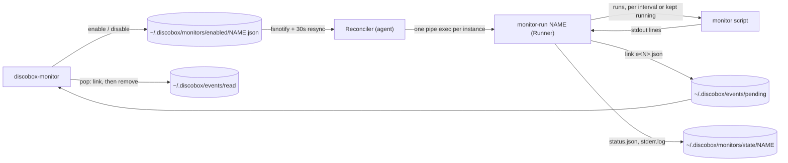

# Monitors Design

An agent enables a **monitor** (a declared script) as an **instance**. The
instance's **runner** runs the script and queues each line it prints as an
**event**, and the agent pops events when it chooses
([ADR 26-10-31-073](../../docs/adr/26-10-31-073-a-box-runs-the-monitors-its-agent-enables-and-queues-their-events-until-it-pops-them.md)).

## Ownership

- **Files are the interface.** Each piece has one writer:
  - Enabled files: the CLI writes them. The runner removes one only when its
    instance ends itself.
  - Status and logs: the runner writes them.
  - Events: the runner queues them, and so does `emit`.
  - Moving events into `read/`: `pop`.

  The agent never reads a monitor's output or the queue. Everything lives
  under the run user's home, so instances and events outlive a stop and
  start (§5).
- **The runner reads the pipe itself, and the agent does not.** Exec output
  reaches the agent only as batched transcript rows (ADR 0028), with no
  position to resume from. The runner is an exec, so it survives an agent
  restart, and its reading survives with it.
- **The reconciler is level-triggered.** Its whole state is the enabled
  directory and the exec list:
  - It starts or relaunches the runner of each enabled instance. A relaunch
    keeps the exec id (ADR 0038).
  - An instance is its `ID`, new on every enable, not its name: an exec
    tagged with another ID — the name disabled and enabled again before a
    sync saw the gap — is replaced, and a runner exits once the file's ID is
    not its own.
  - The runner is named by the agent's stable path — `agentlayer.AgentPath`
    where the box runs it from the bundle store — never the layer
    `os.Executable()` resolves to: a relaunch re-runs the recorded command
    after a reboot, when an old agent layer may be gone. An exec recorded with another command is
    replaced rather than relaunched.
  - It starts once the sources are delivered and the whole provisioning run
    is over, async features included, as a default service waits: the
    image's monitors and their `gh` and `jq` are the async `cli` feature's.
  - It deletes the exec of each instance that is no longer enabled.
  - An instance that ended itself has already removed its own file, so its
    exec is simply removed.
- **Runner execs are pipes, not PTYs, and write nothing to their own
  output.** Monitor stderr goes to the instance's log, not to the exec. With
  no screen, an instance never counts as activity to `autostop` (§8).

## Rules

- **Only the runner's discovery reads a declaration's fields.**
  - `Enable` records the declaration's path and workdir.
  - Before each run, the runner reloads the declaration from that path
    (`Load`), so an edit takes effect without enabling again.
  - A declaration that is gone or broken leaves the instance `failed`. The
    runner checks it again every 30s and does not exit, so the reconciler
    never sees a crash loop.
- **Options are a list of one-line flow mappings.** `frontmatter` strips the
  indentation from comment lines, so a nested block can't be written in a
  script. An `options:` key with nothing under it is a Problem, never "no
  options".
- **A pop claims an event by hard-linking it into `read/`**, then removes
  its pending name. The link fails when the name is there, so of two pops
  one wins on every platform; a rename would not do, since on Windows it
  replaces the name it moves onto and both pops would take the event. A
  keyed event replacing a pending one that a pop has already claimed does
  not count it.
- **Ids come from the queue's own files, with no lock.**
  - An event is written under a dot name, then hard-linked to `e<N>.json`.
    The link fails if the name exists, and the writer moves on to `N+1`.
  - `.seq` keeps an id from being reused after its event is pruned. The
    directories are the authority and `.seq` is only a floor.
- **A keyed event replaces the pending event with the same instance and
  key.**
  - Its `Count` adds up what it replaced.
  - If a pop has already taken the older event, nothing is replaced and
    nothing is counted, because that event was delivered.
  - A recovery shares the failure's key, so an unpopped failure is
    replaced by its own recovery.
- **The pending cap is per instance.** Past `PendingCap`, the oldest events
  are dropped and one keyed `monitor.dropped` event reports how many.
- **A new instance starts with empty state.** `Enable` clears the state
  directory a previous instance with that name left, and the monitor's own
  directory is keyed by the instance's ID as well, so a runner of the old
  instance finishing its run cannot leave a baseline the new one reads: its
  first run is a baseline (§3).
- **Every monitor runs in the repository root**, the image's included, or
  the home directory in a box with none. The CLI finds that root through
  `config.Load`, the derivation the agent's own discovery uses.
- **Printed text is escaped.** Event fields and stderr are a third party's
  words; the CLI shows their control characters as escapes in its plain
  output (`--json` is escaped by encoding).
- **Linux and macOS only.** A runner runs a monitor by its path, a `#!`
  script; on Windows `discobox-monitor` refuses and the agent starts no
  reconciler (`Supported`), so a Windows sandbox has no monitors rather than
  ones failing on every run. The queue's file operations go through
  `sharedfile.Retry` all the same, which waits out a Windows handle holding
  a file, as the exec runtime records' do.
- **Each run is its own process group, ended as a group.** A final event, a
  disable or an agent stop must not wait on a `sleep` or a `tail` the script
  started.
- **Ending is the runner's decision.**
  - A final event, or a streaming monitor exiting zero, sets `done` and
    removes the enabled file.
  - The state directory stays, so `status` still shows how the instance
    ended, until `disable` clears it.
