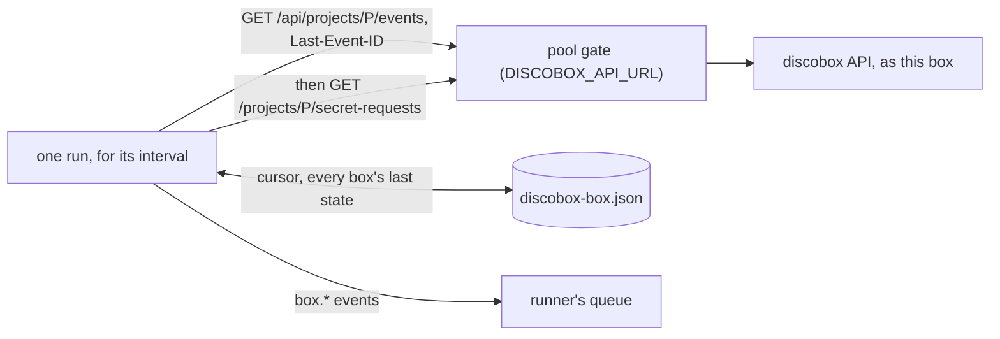

# discobox-box Design

The image's `discobox-box` monitor
([ADR 26-11-01-560](../../../docs/adr/26-11-01-560-discobox-box-watches-other-boxes-through-the-sandbox-event-stream.md)),
a [built-in written in Go](../DESIGN.md#built-ins-written-in-go) watching
other discoboxes. One run follows the project's sandbox event stream
([ADR 26-10-29-316](../../../docs/adr/26-10-29-316-sandbox-state-changes-are-a-resumable-event-stream.md))
from the cursor in `discobox-box.json` for its interval, reports what each
event changes for the boxes it watches, and, when requests are watched, then
lists the secret requests this box may read.

## Rules

- **The API is reached as the box's `discobox` CLI reaches it.** The base is
  `DISCOBOX_API_URL` (else `DISCOBOX_SERVER`), the project
  `DISCOBOX_PROJECT` (else `default`, the box's own). The gate adds the
  pool's credential; the box sends none. A refusal — no `discoboxApi`, a
  pool not yet connected — is the run's failure, with the server's text.
- **A run is a polling run that holds the stream.** It reads for
  `Env.Interval` (the runner's, so the instance's `interval`), and the runner
  starts the next at once. A stream that ends sooner ends the run without
  failing it. Failure and recovery stay the runner's (ADR 26-11-01-477's
  reason against a built-in that streams forever).
- **The stream is project-wide; selection is here.** The route has no filter
  (ADR 26-11-01-560 §1). Every box's last state is held, watched or not, so
  a tag added later or options changed in place select from what is held. A
  box is watched when named by `id`, or when it matches every `tag` selector
  (`sandboxmeta`'s) and `created-by`, those given. `created-by=me` is this
  box's ID from its sandbox config.
- **Events are read through a local struct**, never `api/gen`'s types:
  runtime code does not use the public API's DTOs (the root `REVIEW.md`).
  Each field mirrors `SandboxEventData` in `server.yaml`. A box is called by
  its configured name, the event's; its state is the display state its
  existence and power give, by the server's rule.
- **One event per change, keyed per box.** A box's state, its terminal and
  each request have their own key, so an unpopped event is replaced by the
  next of its kind. A terminal is reported only while its box runs.
- **First sight is a baseline, for what was already there.** The first run's
  replay reports nothing. A box first seen in a `sandbox.created` recorded
  after the baseline is `New`, and is reported created when it is first
  watched, however late its tag comes. Any other box newly watched is
  recorded quietly.
- **The cursor is saved only where it is safe to resume from.** After each
  event, except while a `reset` is pending: then it stays where the reset
  found it until a run has followed the stream for its whole hold, the
  replay is known whole, and the boxes it left out are taken as deleted. A
  run cut short before that is reset again. State is written with each
  event emitted, and at the run's end.
- **A request is news when it was made after the baseline**, whichever box
  made it and however late that box came to be watched: it waits on
  someone. One made before the baseline is where things stood. The server
  lists only the requests of the boxes this box created.
- **A watched box deleted is gone.** A named one is recorded gone whatever
  `watch` says, and an instance watching only ids ends
  (`discobox.finished`, final) once every one is gone. A named id never seen
  by the end of a whole run is the run's failure.
- **The box's clock** sets the baseline; an event's `at` and a request's
  `createdAt` are the server's. They are compared directly.
