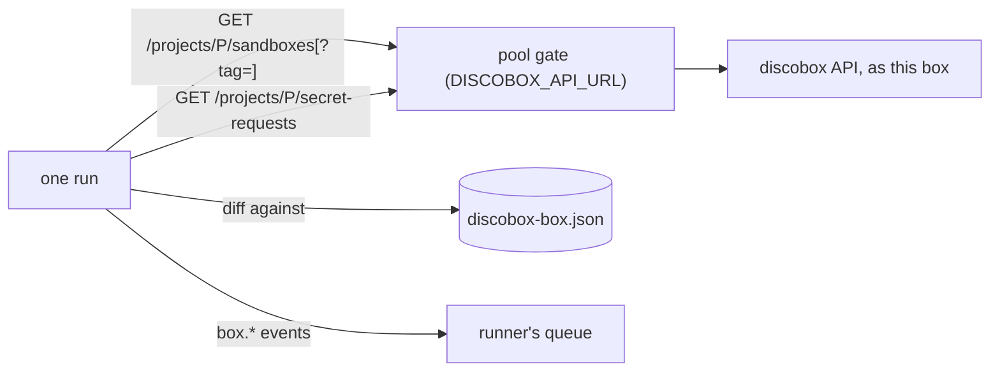

# discobox-box Design

The image's `discobox-box` monitor
([ADR 26-11-01-560](../../../docs/adr/26-11-01-560-discobox-box-watches-other-boxes-by-polling-the-discobox-api-through-the-gate.md)),
a [built-in written in Go](../DESIGN.md#built-ins-written-in-go) watching
other discoboxes. One run is one poll: it lists the project's boxes and, when
requests are watched, the secret requests this box may read, compares them
with `discobox-box.json` in the instance's state directory, and reports what
differs.

## Rules

- **The API is reached as the box's `discobox` CLI reaches it.** The base is
  `DISCOBOX_API_URL` (else `DISCOBOX_SERVER`), the project
  `DISCOBOX_PROJECT` (else `default`, the box's own). The gate adds the
  pool's credential; the box sends none. A refusal — no `discoboxApi`, a
  pool not yet connected — is the run's failure, with the server's text.
- **Responses are read through local structs**, never `api/gen`'s types:
  runtime code does not use the public API's DTOs (the root `REVIEW.md`),
  and a field a newer server adds breaks nothing. Each field mirrors
  `server.yaml`'s type, a route an object, not a string. A terminal's status
  is `programstatus.PrimaryPosted` of `runtime.agentStatus.sessions`, as
  `discobox ls` reads it; a box is called what every client calls it,
  `sandboxmeta.Title` without the msg.
- **Boxes are named (`id`) or selected (`tag`).** Tags alone are the list's
  filter. With ids, the list is the project's and both are matched here
  with `sandboxmeta`'s selectors. Selectors are space-separated: a comma
  followed by `key=` starts another `-o` option.
- **One event per change, keyed per box.** A box's state, its terminal and
  each request have their own key, so an unpopped event is replaced by the
  next of its kind. A terminal is reported only while its box runs.
- **First sight is a baseline, for what was already there.** The first run
  reports nothing. A box that existed at the baseline and is selected later
  (a tag, or options changed in place) is recorded quietly. A box created
  after the baseline is news whenever it is first seen (`box.created`): a
  worker tags itself once it runs, often after its first request.
- **A request is news when it was made after the baseline**, whichever box
  made it and however late that box came to be watched: it waits on
  someone. One made before the baseline is where things stood.
- **Requests are the requester's to see.** The server lists only the
  requests of the boxes this box created; another box's never appear.
- **A box named by id that leaves the list is gone**, recorded whatever
  `watch` says and reported once when `state` is watched; a box
  only selected that leaves it is let go quietly, since it may have lost its
  tag. An instance watching only ids ends (`discobox.finished`, final) once
  every one is gone. A named id never seen is the run's failure.
- **The box's clock** sets the baseline; a box's and a request's
  `createdAt` are the server's. They are compared directly.
