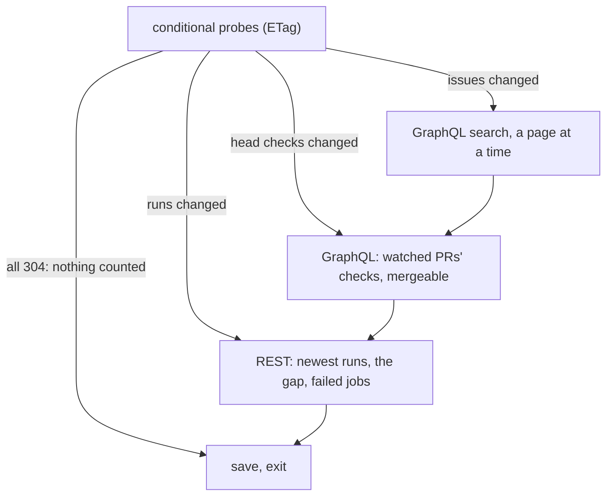

# github-repo Design

The image's `github-repo` monitor
([ADR 26-10-31-073](../../../docs/adr/26-10-31-073-a-box-runs-the-monitors-its-agent-enables-and-queues-their-events-until-it-pops-them.md)
§9, amended by
[ADR 26-11-01-477](../../../docs/adr/26-11-01-477-github-repo-is-a-go-built-in-that-probes-before-it-reads-and-an-instance-may-choose-its-interval.md)),
a [built-in written in Go](../DESIGN.md#built-ins-written-in-go) polling one
repository. One run is
one poll. It probes what may have changed, reads only what did, and saves
`github-repo.json` in the instance's state directory.

## Rules

- **Probes are conditional GETs, and a 304 costs no rate limit.** Each probe
  is sent with the last answer's ETag. A probe's new ETag is saved only once
  the work its change calls for is done, so a run cut short sees the change
  again.
  - `issues?sort=updated&per_page=1` changes when any issue or PR does.
  - `actions/runs?per_page=100[&branch=]` changes when a recent run moves
    on, a re-run included. A larger page costs no more calls.
  - Each open watched PR's `commits/{sha}/check-runs` and
    `commits/{sha}/status`, because a check or status finishing does not
    update its PR.
  - Each run named by id, and each one still followed after it has left the
    newest page.
- **Activity is one GraphQL search per page, oldest first.** It reads
  `updated:>=` the last pass, with each item's timeline (`since`) and recent
  reviews nested, so there is no call per PR.
  - Each page is saved as it is done (`walk`). A pass cut short resumes at
    the page it reached, and `Since` moves only when the pass completes.
  - The search index lags behind the probe. The search reaches back
    `overlap` past the last pass, and passes go on until one that began
    `overlap` after the probe's last change (`LastChange`) has completed,
    however far apart the runs are, so a change the index was late for is
    still found. `Reported` holds the ids already
    reported in that window, so the overlap repeats nothing, and nothing
    before `Baseline` is reported.
  - A PR's latest reviews are read in the search, without their inline
    comments, and paged back while the oldest is still new; a reply in a
    review thread is a review. The inline comments are read for only the
    reviews a page reports, in one query.
  - The search's 1000-result cap never applies. Each page is a new search
    from the last item's update, and a cursor is used only for a page whose
    items all share one second.
- **Watched PRs are named (`pr`) or selected (`head` glob, `author`).** One
  aliased query reads their state, head, `statusCheckRollup` and
  `mergeable`. It runs on a change, or while a `mergeable` is `UNKNOWN`
  (GitHub computes it lazily) for up to `maxRecheck` runs. `UNKNOWN` is
  never a change.
  - `pr.checks` is reported once per head and conclusion. The conclusion is
    read from the checks themselves, every page of them: pending while any
    runs, though the rollup already says `FAILURE` once one has failed.
  - `pr.conflict` is reported on entering `CONFLICTING` and on leaving it.
  - A PR already there when it began to be watched, at the baseline or named
    since by options changed in place, is `Quiet`: its first known state is
    recorded, not reported.
  - Selected PRs come from the open PRs at the baseline and from PRs the
    activity pass finds after it. A closed one is let go.
- **Repository-wide, a PR's CI is still its Actions runs.** `pr.checks` for
  every open PR would repeat each `run.completed`, and probing every PR's
  head would be a request per PR per poll. `head` and `author` are how a
  lead follows PRs it cannot name yet.
- **Rate limits are waited out, not failed.** The client reads
  `X-RateLimit-*`, `Retry-After`, secondary limits and GraphQL's
  `RATE_LIMITED`. It stops `reserve` short of a limit to leave the agent's
  own `gh` its share. It records `NotBefore` in the box's clock, and runs
  before then call nothing. `X-Poll-Interval` sets `NotBefore` too.
- **A baseline is done only at its end.** `Since` is set last, so a
  baseline cut short is taken again whole, never read as a pass from the
  epoch. Actions watched without a pass over runs yet (`RunsSince` zero) is
  a baseline for runs.
- **`since: true`: a test's first run may start in the past**
  ([ADR 26-11-01-375](../../../docs/adr/26-11-01-375-a-monitor-is-enabled-by-its-path-an-instance-changes-its-options-in-place-and-test-starts-in-the-past.md)
  §3). Given `Env.Since`, a first run takes no baseline: it is a pass as
  though the last had ended then (`startFrom`), `Since`, `Baseline` and
  `RunsSince` all set to it, so the search, its cutoff and the runs' gap
  reach back that far. Named PRs start `Quiet` as they would at a baseline,
  and the open PRs `head` and `author` select are found as a baseline finds
  them. A run with state already ignores it. Its markers are set before the
  work they mark, so it saves nothing until it has finished: cut short, it
  leaves only a rate limit's wait, and the next run is a baseline.
- **A followed run that is gone (404) is let go**; a named one that does not
  exist is the instance's failure, naming the option.
- **GitHub's clock, not the box's.** A pass's bounds come from the probes'
  `Date`.
- **The credential** is `GH_TOKEN` or `GITHUB_TOKEN`, else `gh auth token`.
  Without one, the failure names `discobox-access`.
- **Kept from the script it replaced:** its options, event kinds, keys and
  titles; a first run that is a baseline; and an instance watching only ids
  that ends (`github.finished`, final) once each is closed, merged or
  complete. Tests run against a fake GitHub serving trimmed recordings
  (`fake_test.go`).
