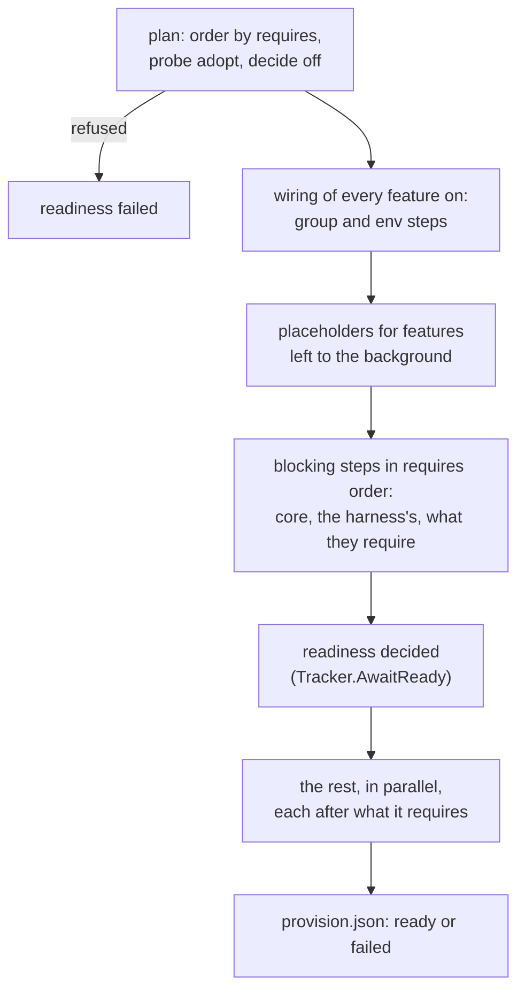

# Provision Design

How a box is provisioned from its features
([ADR 26-10-16-423](../../docs/adr/26-10-16-423-a-harness-is-a-provisioning-bundle-and-the-agent-provisions-any-box.md)
§§3–6). What a feature's `provision.yaml` may say, and the `provision.json`
document, are the root [`provisionspec`](../../provisionspec) contract; this
package is what is done with them.

## Steps

A feature's steps are the runner's typed kinds: `file` (with `merge: json`, an
RFC 7396 merge patch over the file the box already has, which is refused
rather than replaced when it is not a JSON object, so a provider's
`daemon.json` keeps what ours does not set), `systemd` (enable, mask, drop-in,
through `systemctl`), `group` (asked of `runuser`, then `groupadd`), `env` (a
`/etc/profile.d/zz-discobox-<feature>--<step>.sh` script, named to sort after
the box's own profile scripts so one that sets PATH outright does not drop it,
which also puts its `path` ahead of `/usr/local/bin`'s shims; it reaches login
shells only, never an exec that gets the manifest's env; a feature's scripts
no step selecting the box still writes are removed with their records),
`download` (fetched through the environment's proxy, given up after a minute
without a byte, and moved into place only once its sha256 matches; with
`unpack`, a gzipped tar or a zip, told apart by its first bytes, unpacked
beside its directory and swapped in whole, refusing an entry or link that would
land outside it, and a zip whose entries carry no Unix modes), `packages`
(`apt-get`, keeping a configuration file already in a package's way rather
than asking; a list per distribution, the box's own os-release `ID`'s, else the
first `ID_LIKE`'s that has one, and a box no list names fails the step), and `run` (whose `inputs` name the files and directories its script reads
beside itself, so the digest covers them), each selected by `os`, `arch` and os-release
`ID`/`ID_LIKE`. Each step is keyed by a digest of its definition and every
file it names, recorded under `/opt/discobox/provision/steps/` on the root
filesystem, never a declared volume; a step whose record matches is skipped
unless its `check` exits non-zero (drift), so a second run changes nothing. A
box that is not Linux of the Debian family is refused by name before any step
runs, unless it has no features to provision.

## Who runs it

| Caller | Entry | Runs |
|---|---|---|
| The agent, every boot | `Boot(…, wireOnly=false)` → `Runner.Provision` | Everything, with `Background`: the server answers meanwhile |
| `boot.Wire` / `boot.Provision` | `Boot(…, wireOnly=true)` → `Runner.Wire` | Wiring alone, before the account exists |
| `discobox-image-provision TREE...` | `Trees` → `Runner.Provision`, no options | Every step blocking, nothing off: the platform image's build, one feature per layer |
| `discobox-sandbox-agent provision TREE...` | `Trees` → `Runner.Provision`, no options | The same: a harness image's build, its tree onto the platform's |

The images build their trees in place: the platform's features
(`sandbox-agent/features`) and a harness's own (`harness/<id>`, whose
directory is its feature) are copied to where boot looks for them and
applied, and the trees and the records stay in the image, so its boxes find
every step applied and provision only what drifted or changed. A step that
lays a binary the build made links it from the tree rather than copying it,
so a new build is a new file and no step applied again.

At boot the trees are `/opt/discobox/bundles/platform` and
`/opt/discobox/bundles/harness`, each when present (`BootPlan`); the harness
tree's features are the harness's. A box with neither has no features:
`provision.json` lists none, and its tools are its image's. Opt-outs are the
bootstrap's `features` (`sandbox.json`), which the client read from the
repository's `.discobox/settings.json`.

## A run

- **Outcome.** A feature turned off, and required by nothing, is `off`: no
  step runs and its env scripts go, but nothing is uninstalled. One requiring
  an `off` feature is off too. A feature core or the harness requires is
  refused when turned off, naming both — unless its `adopt` check passes.
  Core (`provisionspec.Core`) is never off: the server refuses it in a
  create's `features`, and a run refuses it outright.
- **Adopted.** `adopt` is checked by the agent, not a script: each command on
  `SystemPath`, run by every user, never in a home directory, never the
  agent's own personality or a placeholder; the version floor; the writable
  paths. Adopted skips the `install: true` steps and applies the rest. A
  feature with a record of an install step is ours and is never adopted.
- **How.** Ready is `adopted`, `installed` when this run applied a step, else
  `snapshot`.
- **Blocking.** Core, unless it is `async`, and *whole*: everything core or
  the harness requires, and the harness's own features, every step, their
  `async` marks overridden — a blocking feature needs all of what it
  requires. In core a step marked `async` defers itself and every step after
  it, so steps still run in the order written. Without `Background` every
  step blocks.
- **Failure.** A failed step is not recorded, fails its feature and those
  requiring it, and nothing else. A failure before readiness fails it, and
  its error names each failed feature's log.
- **Locks.** `packages` steps and `run` steps marked `apt` take one lock; a
  `file` step with `merge: json` takes another across its read and its write,
  so features merging into one file in parallel keep each other's keys.

## Its state

`Tracker` holds the document, replaces `provision.json` whole on each change,
and is what the agent's readiness gates (`terminal`'s `AwaitProvision`, the
declared services) and status report read. Each feature's steps write to
`/var/log/discobox/provision/<feature>.log`.

## Placeholders

A feature left to the background has each of its `commands` written to
`PlaceholderDir`, last on every PATH (the image's PATH, and a profile script
the run writes when it writes one). A placeholder execs `discobox-provision
run FEATURE COMMAND`, which says on stderr that it waits, waits on
`provision.json`, then finds the real command past the placeholders and execs
it. A feature's placeholders go when it is ready, and every boot replaces the
set. `discobox-provision wait FEATURE...` is the same wait for anything else.
