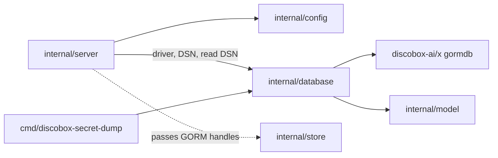

# Database Design

`internal/database` owns physical database connections and migrations. It should
not contain resource persistence logic; keep CRUD and resource transactions in
`internal/store`.

## Boundaries

- Use `gormdb` for opening write/read GORM pools.
- Use `model.AllModels()` from `internal/model` as the migration model list.
- Keep one application database/schema per server process.

## Database Connections

`New(Config)` passes the configured driver, DSN, read DSN, and logger through to
`gormdb.Open` unchanged and returns a `DB` whose exported `Write`/`Read` GORM
handles are backed by pools it owns; `Close` releases them and is nil-safe.
Driver-specific setup belongs to `gormdb`, not here: for SQLite that means
WAL/foreign-key pragmas, a single-connection write pool, and a read-only read
pool (in-memory databases share the write pool); Postgres gets a separate read
pool only when a read DSN is set. The server passes the opened handles to
`internal/store`. `cmd/discobox-secret-dump` opens the same database the same
way, for reading.

## Migration Scope

`DB.Migrate(ctx)` is the only migration entry point and migrates every
application model in one schema; there are no split global/resource or
database-routing migrations. It runs on every startup, so each step is guarded
by what it is looking for and is idempotent:

1. Pre-`AutoMigrate` repairs, for changes `AutoMigrate` would fail on or get
   wrong: deduplicate sandbox names within a project, clear `NULL`
   `sandboxes.runtime_state`, drop an index whose column set changed, and rename
   a column rather than let `AutoMigrate` add a new one beside it.
2. `AutoMigrate(model.AllModels()...)`.
3. Post-`AutoMigrate` data migrations, which need the new columns/constraints:
   index widening, value rewrites (secret types and hosts, provider types, the trust stanza in
   a codex harness's captured `config.toml`),
   moving a secret request's and grant's one `host` into its `hosts` list and
   dropping the column (`moveSecretHostsToLists`, ADR 26-10-02-393 §6),
   retiring grants for bindings (`retireSecretGrants`, ADR 26-10-27-880 §8 with
   ADR 26-10-27-939 §3), which widens nothing: a secret's host becomes its
   route — a route above it is narrowed to it unless that would let it outrank
   a blocked route it lost to before, when it is dropped; one beside it is
   dropped — and one with neither host nor routes gets `*`; a harness config's
   binding live grants covered becomes a use binding on it, and its
   sandboxes' sentinels point at it; one no grant covered is dropped, as ADR
   26-10-27-939 §3 records, its sentinels kept only where the sandbox's own
   grant covered them; a sandbox's own sentinel live grants covered becomes a
   use binding on it, one no grant covered a pending request from it. A
   binding made from grants takes every covering grant's hosts as routes (`*`
   when one had none) and the earliest expiry, logged when there were several.
   A delegation grant becomes a delegate binding and what was handed on under
   it its child; refresh requests move to `secret_refresh_requests`, the
   proxy's own requests are deleted, an agent's keep their hosts as routes;
   each binding is recorded as created by the system for the `upgrade`, takes
   the ID of the row it replaces so a re-run finds it, and arms the expiry
   sweep when it has an expiry; every sandbox holding a sentinel is marked
   `sandboxSentinels` so its pool is sent route lists; then the grant and
   harness binding tables and the retired columns go. Duplicate secret
   names in a project get a numbered suffix first (`deduplicateSecretNames`),
   and the limit column is renamed (`renameSecretBindingTTLColumn`),
   retiring the credential judge (`retireCredentialJudge`,
   [ADR 26-10-27-880](../../../docs/adr/26-10-27-880-access-to-a-secret-is-a-binding-held-to-static-routes-and-no-judge-decides-it.md)
   §8), which widens nothing: a secret's or a harness config's route whose use
   a judge read becomes blocked — a blocked carve-out of the route model, ADR
   26-10-27-880 §4 — in the same transaction that marks every holder's
   `sandboxSentinels` dirty, so running sandboxes take the narrower routes;
   every grant that carried uses or a policy, delegations included, is taken
   back in one transaction per grant — one held by a sandbox that still exists
   becomes a pending request from it, naming the secret, variable, hosts and
   purpose it had, and any other is deleted — with its agent binding; a live
   host trust that carried uses is deleted, since only the judge read them; a
   judge discobox gets the `run` harness mode, is marked for deletion and its
   `sandbox` reconcile marked dirty, so no response names the retired `judge`
   mode whether or not its pool is online; the discobox API's gate secret goes
   with its grants and bindings, and no sandbox is given the `discobox_api`
   flag that replaces it; the remaining agent bindings go, and the
   `agent_requested` column with the variable's uniqueness index, which is made
   again over the sandbox and variable alone; then the `judge` and
   `ruleRequest` reconcile marks, the `credential_verdicts` and
   `approval_rules` tables, and the columns only the judge read are dropped.
   Each step is logged per row and finds nothing once done,
   dropping retired tables and columns (including the pool prepull condition and
   its `poolImages` dirty rows, and the pool bootstrap token table,
   `dropPoolBootstrapTokens`, ADR 26-10-24-953 §4), moving pending `sandboxEgress` reconcile
   marks to `sandboxProxyPolicy`, the reconcile that now pushes egress and
   gateways together (`renameSandboxEgressReconcile`, ADR 26-10-16-470 §5), the
   sandbox state split (ADR 0034), denying the open requests of a sandbox that
   no longer exists (`denyOrphanedSecretRequests`), and re-keying every sandbox
   origin to where its source came from (`rekeySandboxOrigins`, ADR 0111 §4).

The platform columns (ADR 0145 §1) are added by `AutoMigrate` and deliberately
not backfilled: a guess is wrong for a pool of another architecture, and a
sandbox's platform is never corrected once written. A harness config's
platforms are read when its image is inspected — every built-in at the next
seed — a pool's are declared by its agent's next report, and a sandbox takes
its pool's when it is next placed. Until then an empty value rules nothing out.

The image kind columns (ADR 26-10-09-106 §4) are backfilled where there is
nothing to guess: every pool and every image harness from before kinds is OCI.
A harness config's column defaults to `oci`, so `AutoMigrate`'s added column
fills every row; a `file://` manifest-file harness is no OCI image and named no
driver, so `unsetManifestFileImageKinds` takes that back, leaving it no kind —
which places it on no pool until its file declares one and its image is
refreshed. A pool's column defaults to empty — a pool created since is not
known to run OCI images until its agent says — so `backfillPoolImageKinds`
writes OCI into the pools that existed, only on the start that adds the
column, which `addsImageKindColumn` reads before `AutoMigrate`. The
manifest-file repair runs on every start instead, since nothing else would
correct a row a dead start left OCI, and it is idempotent: a manifest file
registered since kinds always has a VM kind.

A VM kind was spelled `discovm/<driver>` until ADR 26-10-15-629 respelled it
`vm/<driver>`, and only the new spelling is read, so a stored old one would
fail every scan of its row. `respellDiscoVMImageKinds` rewrites them on pools
and harness configs on every start, before anything reads a kind; after the
first it matches nothing.

`AutoMigrate` creates tables, adds and widens columns, and creates missing
indexes, but never drops any of them, never alters an index that already exists
under the same name, and cannot tell a rename from an addition. Retiring a column from a model needs an explicit
migration or existing databases keep it — and a retired `NOT NULL` column fails
every write to its table from the moment the model stops populating it. Drop
retired columns with `dropRetiredColumn`, which issues
`ALTER TABLE ... DROP COLUMN` rather than `Migrator().DropColumn`: on SQLite the
latter rebuilds the table from its stored DDL text and quietly drops nothing
unless the identifier is quoted the way GORM writes it. On SQLite it first drops
any index covering the column and runs with `foreign_keys` off on one pinned
connection, because SQLite refuses to drop an indexed column and implements the
drop as a table rebuild.

Tenant-era databases are not migrated in place. The supported replacement path
for an installation that still has `tenant_id` columns, tenant-scoped primary
keys, or tenant indexes is:

1. Back up or export the data with a build that still understands the tenant-era
   schema.
2. Start the current server against a fresh database and let `DB.Migrate` create
   the current single-database schema.
3. Recreate or import the needed resources through current APIs or purpose-built
   one-off tooling that writes the current schema.

Do not add broad compatibility cleanup to `DB.Migrate` for obsolete tenant
schemas. GORM `AutoMigrate` is responsible only for creating/updating the
current schema; it is not a data-preserving tenant-schema converter.

## ID Generation

Generated database row IDs are `<prefix>_<random>`: a short per-resource-type
prefix, an underscore, and 16 random lowercase Crockford base32 characters. The
prefix makes an ID's type recognizable on sight; ordering comes from `CreatedAt`
columns, not the ID. Mint IDs with `id.New(id.Prefix<Type>)` from
`github.com/discobox-ai/x/id` (models do this in their `BeforeCreate` hooks) and
register new prefixes in that package's `id.go`, in the `discobox-ai/x`
repository. Composite keys and fixed well-known rows (e.g. `user_default`) may
use non-generated IDs when that is part of the table design.

Harness switching adds nullable proposal JSON, empty-default fence/refusal
columns and an indexed pending-target foreign key to existing sandboxes.
`SourceHarnessConfigID` defaults to empty on existing secret assignments. Their
original ownership cannot be recovered reliably: even a matching harness binding
may have been overridden explicitly. Migration preserves them as sandbox-owned
instead of inferring provenance and later deleting an explicit binding. Only
newly materialized harness bindings carry provenance and are replaced on a switch.
Legacy assignments therefore keep sandbox-override precedence until explicitly
changed, including when their env name matches the newly selected harness.
