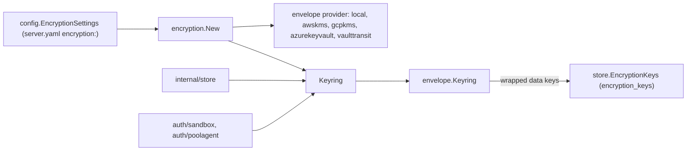

# Encryption Design

`internal/encryption` seals what the server stores encrypted (ADR
26-11-02-902). It is discobox's use of `github.com/discobox-ai/envelope`:
each project's values are sealed with the project's own data key, and data
keys are stored only wrapped by the configured provider.

- A `Field` names where a value lives: its scope (a project ID, or
  `ServerScope`), purpose, and resource ID. The scope picks the data key; the
  purpose and resource ID are the associated data, so a value's bytes do not
  open anywhere else. The constructors (`SecretValue`, ...) are the complete
  list of sealed fields; add one here when a column is sealed, and to
  `store.sealedColumns` so startup re-seals it.
- A nil `Keyring` is a server with no provider: values are stored unsealed,
  and a sealed one is an error rather than bytes passed through.
- `Open` reads every form a stored value has: `envelope:v1:`, `discobox:v1:`
  (sealed by a release before data keys with `encryptionKey`, opened with the
  local key or a retired one), and unsealed. `SealForWrite` stores any of
  them in the current format, verifying a sealed one against its field.
- `New` builds every provider from the SDK's own credential chain; Vault and
  OpenBao log in from the configuration. A Kubernetes login is renewed and
  repeated, and a `file:` token read again every 30s, until `Close`. A provider whose key cannot be reached fails
  `New`, so the server never starts on a misconfigured one.
- `encryption.local.key` opens what an earlier release sealed whichever
  provider is configured, so a server can move from `encryptionKey`
  straight to a KMS.
- `previous` adds an unwrap-only provider. The local provider's retired keys
  are unwrap-only too. Startup (`store.PrepareEncryption`) rewraps what
  either wrapped.

## Rules

- A scope's first key is made outside any transaction (`Ensure`): a key
  stored by a transaction that rolls back stays cached and seals values
  nothing can open later.
- Cloud credentials never come from the configuration file.
