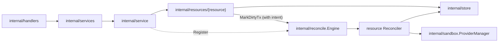

# Resources Design

`internal/resources` contains resource-owned behavior. Each child package owns
the API-facing service for one resource area and, where that resource has a
lifecycle, the lifecycle intent and the reconciler that converges it.

## Packages

| Package | Owns | Reconcile type |
| --- | --- | --- |
| [assets](assets/DESIGN.md) | The asset API: bundles served to a pool by blob, from one blob store, scoped to what the pool's project pins (ADR 26-10-16-423 §13) | none |
| [harnessconfigs](harnessconfigs/DESIGN.md) | Project-scoped harness configs and the configure flow | `harnessConfig` |
| [jobs](jobs/DESIGN.md) | Jobs API, a projection of the reconcile engine's dirty set | none |
| `peers` | Enrolled peers: machines permitted to connect to this server | none |
| [pools](pools/DESIGN.md) | `Pool` API (`Service`) and trusted pool intent (`ControlPlane`, the `sandbox.PoolManager` handed to drivers) | `pool` |
| [projects](projects/DESIGN.md) | Projects and the default-project flag | none |
| [providers](providers/DESIGN.md) | Provider-instance API and startup reconciliation | none |
| [sandboxes](sandboxes/DESIGN.md) | Sandbox API, lifecycle intent, and reconciliation | `sandbox` |
| [secrets](secrets/DESIGN.md) | Credentials, their approval lifecycle, and sandbox delivery | none |
| `skillssources` | A project's skills repositories, which the creating client copies into every create (ADR 26-10-14-894) | none |
| `sshkeys` | Project-scoped SSH keys authorizing SSH to a project's sandboxes | none |
| `gateways` | A project's gateways (ADR 26-10-16-470), and the server environment values their headers take, which only a pool asks for | none |

`peers`, `skillssources` and `sshkeys` are plain store-backed CRUD services with no design doc of
their own.

`gateways` is store-backed CRUD too, with two things the others lack. A put or
delete marks the proxy policy push of every discobox in the project in its own
transaction (`MarkProxyPolicyChangedTx`), which is how a change reaches running
ones. And `ResolveGatewayHeaders` answers a pool's proxy
(`/api/pools/{poolId}/resolve-gateway-headers`, the `secret:resolve` scope)
with the values of `DISCOBOX_GATEWAY_*` variables of the server's environment:
only for a sandbox on that pool, only for a gateway the configuration file
keeps, and only the variables the sandbox's project's gateway names as it now
stands. Nothing else of the environment is reachable,
and the values are never stored.

The server configuration file names gateways too (ADR 26-10-17-271), and
`ApplyConfiguredGatewaysTx` keeps them, in its caller's transaction: the
`default` entry and each project ID resolve to a project — one naming none is
skipped with a warning, and `default` is skipped for a project the file also
names by ID — and that project's config-managed gateways become exactly the
file's, taking over the API's of the same name and deleting the API's with the
same match; a project no entry names any more loses the ones it kept. It is
idempotent, run at startup (`InitializeDefaults`) and in the transaction that
moves the default project, so what `default` names is read where it is
written, and marks a project's discoboxes only when something changed. The API
reads a config-managed gateway and refuses to put or delete it, or to put
another with its match (`409`); the store decides both under the project's row
lock, so a put and an apply take turns. Only a config-managed gateway takes a
header from the server's environment: a put with `valueFrom` is refused,
`ResolveGatewayHeaders` answers for no other gateway, and an apply deletes an
API-made one that names a variable, from before that rule, with a warning.

No resource judges credential use (ADR 26-10-27-880): what a credential may
do is its grant's hosts and its secret's routes, checked statically by the
pool. A judge discobox an older server made is marked for deletion by the
upgrade (`database.retireCredentialJudge`), and its reconcile removes it.

## Boundaries

- Resource packages call stores for simple CRUD. Sandbox and pool lifecycle
  intent (generation bump plus `MarkDirtyTx`) commits in one store
  transaction. Whatever the intent hands back is read inside that
  transaction, never re-read after it: the mark wakes the engine on commit,
  and a delete it converges first leaves an accepted intent reading as not
  found.
- Each reconcile type is a `reconcile.Reconciler` registered on
  `internal/reconcile.Engine` by `internal/service` at startup:
  `sandboxes.Service.RegisterJobs`, `pools.ControlPlane.RegisterJobs`, and the
  `harnessconfigs.Service` itself. The engine's semantics are in
  [../reconcile/DESIGN.md](../reconcile/DESIGN.md).
- A reconciler reads the latest persisted state by resource id and owns the
  generation-guarded writes for its resource area. A write lost to newer
  intent is `reconcile.Superseded`, which the reconciler's `Reconcile` maps to
  a zero `Result` so the run settles instead of backing off.
- Provider runtime side effects go through `internal/sandbox.ProviderManager`
  (harnessconfigs reaches sandboxes through its `SandboxRuntime` seam instead);
  resource packages never import `server/providers`.
- Keep HTTP transport adaptation in `internal/handlers`, service contracts and
  DTOs in `internal/services`, and persistence in `internal/store`.
  `internal/handlers` never imports a resource package
  (`handlers/boundary_test.go`); what a handler needs from one is reached
  through `internal/services`, as `services.AgentCredentialRequestStatus` is.

## Not-Found Mapping

`apperrors.NotFound(err, message)` is the single way a resource package turns a
store not-found into the 404 the API serves. It keeps the sentinel as the status
error's `Cause`, so a server-side caller — a reconciler reaping something that
is already gone, most of all — can still match it with
`errors.Is(err, store.ErrNotFound)`. Never build that 404 with
`apperrors.NewStatusError`: the sentinel is lost, and every in-process caller
that tolerates a missing resource starts failing instead.
