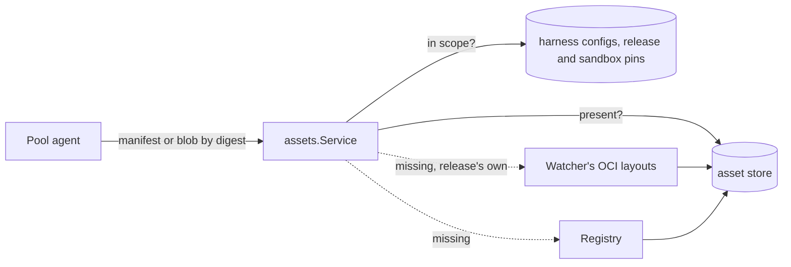

# Assets Design

`resources/assets` is the asset API
([ADR 26-10-16-423](../../../../docs/adr/26-10-16-423-a-harness-is-a-provisioning-bundle-and-the-agent-provisions-any-box.md)
§13): the server serves bundles to pools by blob, so neither a pool nor a box
pulls a bundle from a registry, and registry credentials stay with the server.
Only a pool reaches it.

## Routes

Pool routes, addressed as OCI distribution addresses content, under the pool
prefix so `PoolAuthenticator` binds the signed pool to the route's. The
allow-list's `assets` action takes up to three trailing segments
([`auth/DESIGN.md`](../../auth/DESIGN.md#authentication)).

| Route | Answers |
|---|---|
| `GET /api/pools/{poolId}/assets/{name}` | The manifest a name in scope is pinned to now (`ResolveAssetName`). 404 for no such pin, 409 when two pins in scope share the name |
| `GET /api/pools/{poolId}/assets/{name}/manifests/{digest}` | A pinned manifest, or one a pinned index lists, under its pin's name |
| `GET /api/pools/{poolId}/assets/blobs/{digest}` | A config or layer some manifest in scope references |

- **A name** is the last component of a reference's repository:
  `ghcr.io/discobox-ai/discobox-platform:v1` and a development build's
  `discobox-platform:dev-<digest>` are both `discobox-platform`.
- **A manifest goes out byte for byte**, as its own media type, with
  `Docker-Content-Digest` and `Content-Length`. `api/gen/ogen.yml` aliases the
  four manifest media types to raw bytes, so the generated encoder never
  re-encodes one as JSON.
- **Out of scope is a 404**, never a 403, so the answer discloses nothing of
  what another project pins.

## Scope

A pool is answered the pins of the project it serves (`scope`), and nothing
else — never a tag's answer that no pin records:

- **the platform and agent bundles the release pins**, each as every digest
  its reference has resolved to while this server runs (`releasePins`). The release pins it by
  reference and nothing records the digest a box was handed, so an answered
  digest is never dropped when the tag moves: a pool part way through a fetch
  is not cut off. The reference is asked again after a minute, after ten
  seconds once it failed, and on every name resolution of it. While it has
  never resolved, a read nothing else in scope answers is a 502, not a 404.
- **each harness config's** `Bundle`/`BundleDigest`. Its name resolves to the
  recorded digest: a moved tag is followed only once the config is re-pinned
  (ADR 0016).

- **each sandbox's** bundle pins, in whichever form it is pinned
  (`SandboxManifest.BundlePins`), and its agent's (ADR 26-10-16-423 §7, ADR
  26-10-24-953 §§1–2). A sandbox
  keeps its pins after its config is re-pinned and after the release moves
  on, until it is re-pinned itself, so a pool is answered what its boxes were
  handed. Sandbox pins are digest scope only: a name resolves through the
  first two.

A pin whose digest is no `sha256:` digest (a build-mode development image, its
own reference until a pool builds it) has no content and is left out. A blob
is in scope when a pin's manifest — or, under an index, any manifest it lists
that can be read — names it as config or layer; what the store holds is
looked at before a listed manifest is fetched.

## The release's pins

The service is also where the bundles the release pins every delivered
sandbox to come from: the platform and the agent (ADR 26-10-16-423 §7, ADR
26-10-24-953 §2), each resolved by its own `releasePins` (`CurrentRelease`,
and `LatestRelease` for a read that must not wait). It tells the sandbox
service when either reference resolves to a digest other than the one before
(`OnReleaseMoved`), first on every start (`ResolveRelease`), so stopped
sandboxes follow the release. Both are in every pool's scope, as the
release's, and a sandbox's pins in either form, its agent's included, are in
its project's pools' scope and keep their blobs.

## Blob store

One `imagecache.Layout` at `assetDir` (`<cacheDir>/assets`), holding blobs no
index entry names. It is cache: every byte is fetched again by digest. It is
not the CLI's staged layout, whose staging prunes blobs no entry names, and
that layout is no source: it holds no bundle, since the release's staging list
names none (`releasemanifest.Images.References`).

- **Filled lazily**, the first time a read wants a digest, from the first
  source holding it: on a development server the image watcher's layouts,
  then the registry.
- **The layouts serve the release's references alone.** The watcher exports
  each bundle as an OCI image layout tar (`devimage.Bundle`), never into a
  Docker daemon, and the server's release references are those bundles'
  dev tags. What this host built is not a project's to read, so a reference
  a project supplied is never looked up there, even one naming a dev tag. A
  pin's content is its whole layout, put in at once, and only while the
  layout's index still lists the pin's digest (`devimage.Bundle.Check`). A
  layout is named by its digest, so a rebuild writes another and the one a
  published manifest names is never rewritten; the watcher removes it only
  once a manifest naming its successor's successor is published. Nothing is
  remembered between reads, so a blob pruned or found damaged is put back
  from the layout — for the bundles of the manifest the server started with,
  the only ones it holds as the release's. A sandbox still pinned to an
  earlier development bundle is answered from what the store holds of it and
  nothing else: its dev tag is no release reference, and no registry has it.
- **Credentials**: the server's keychain pulls only the references the release
  names — the platform and agent bundles, the built-in harnesses' bundles, and
  the pool-agent bundle, the pool agent for a pool machine booted from a driver
  base (ADR 26-10-23-551 §2). A
  project-supplied reference is pulled anonymously: a project configures no
  registry credentials, and the server's are not the project's to use.
- **The store is shared across projects**, and a digest fetched for one pin is
  answered for any pin whose manifest lists it. What it holds is public
  content pulled anonymously, or the release's, which every pool is answered:
  nothing in it is any one project's to keep from another.
- **One fetch per digest**, shared by every read wanting it (singleflight),
  detached from the first reader's cancellation and bounded by
  `fetchTimeout`.
- **Removal is by reference** (`Prune`, hourly): a blob goes once no pin
  reaches it — any project's harness config or sandbox, or a release
  bundle's digest this server answered — and it is older than an hour, so one
  fetched for a pin made since the sweep read the pins stays. Reach is read
  from the store alone. While a release bundle cannot be resolved nothing
  goes.

## Digests

- **In:** `PutBlob` writes to a temporary and renames only bytes that are the
  digest's, so a name in the store is a claim about its content. A source
  handing in other bytes fails the read with 502 and stores nothing.
- **Out:** every body is re-hashed as it is served. A blob or manifest whose
  bytes on disk are not its digest's is removed — a blob when the read that
  would end it fails, a manifest when it is read, and then fetched again — so
  the next read fetches it rather than failing the same way. The handler
  aborts the response (`http.ErrAbortHandler`) rather than letting the
  encoder's error be written into a body already begun, so the client sees a
  response cut short of its `Content-Length`, never a complete one that is not
  the blob.
