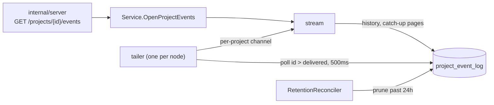

# Events Design

`events` serves a project's event stream
([ADR 26-10-30-868](../../../../docs/adr/26-10-30-868-a-projects-events-are-a-retained-log-streamed-over-sse-and-sandbox-changes-are-the-first.md)):
the project's slice of the retained log the store writes, read from where a
client left off and then followed live. It owns no writes but retention's.
What an event is and when it is written is the store's
([../../store/DESIGN.md](../../store/DESIGN.md#project-event-log)); the SSE
framing is the hand-wired route's in `internal/server`.

## A stream

- **Position first.** A Last-Event-ID the log holds (`pruned_through ≤ id ≤
  head`) is the cursor. Otherwise the stream starts at the head, with the
  project's last History events before it, and `Reset` says why when an ID was
  given (`expired` below the pruned ID, `unknown` above the head or not a
  number). `Position` is that starting cursor, which the route's first frame
  carries.
- **Subscribe before reading.** The stream takes its tailer subscription
  before it reads the log. An event is then either in what it reads or
  delivered to it after, because IDs commit in order; what it reads and what it
  is delivered may overlap, and it passes each ID once (`cursor`).
- **Catch up, then follow.** It pages the log after its cursor until a page
  comes back short, then takes the tailer's delivery. After each page it
  rereads `pruned_through`: retention past the cursor means the page started
  past a gap, so the stream ends and the client's resume gets the reset.
- **Idle position.** `Through` is, for a stream with nothing waiting, the
  greater of its cursor and the tailer's delivered-through ID. The route's
  keepalive carries it, so a quiet project's client resumes from where the
  log is, not from where it connected.

## The tailer

One per node, so the log is polled once however many streams are open. It
runs only while a stream is subscribed, starting from the head it reads in
`subscribe` under its lock, and hands each event to the subscriptions of its
project. A subscription that cannot take an event is closed, never thinned:
its stream ends with `ErrProjectEventStreamBehind` and its client resumes
losslessly. A loop that has been stopped delivers nothing, so it cannot hand a
stale event to the subscriptions of the loop that replaced it.

## Retention

`RetentionReconciler` (`projectEventRetention`, one ID) prunes events older
than 24 hours and arms itself, with `RequeueAt`, for the oldest left. Its scan
finds it when the log holds an overdue event and nothing armed it, as the
binding expiry sweep does.
