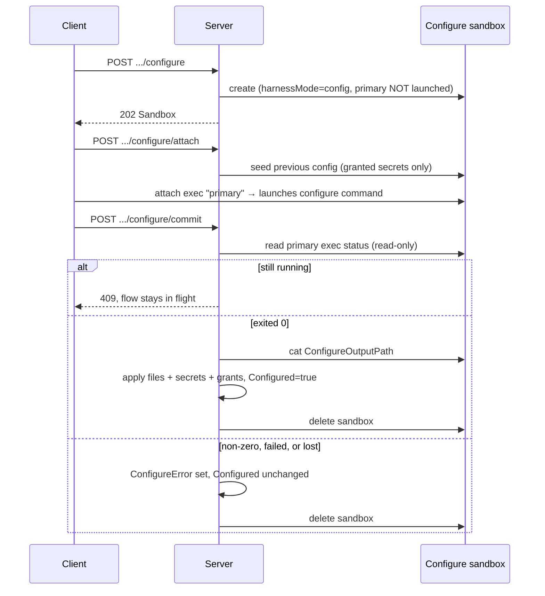

# Harness Configs Design

`internal/resources/harnessconfigs` owns project-scoped harness config behavior.

A harness config is the **only** harness concept — there is no separate
definition. Every harness in the registry is seeded as a built-in config
(`SeedBuiltIns`); everything else is a user-registered bundle.

`shell` is one of those registry harnesses, not a different kind of thing
(ADR 0043): `harness/shell`, a bundle like its siblings, inspected and seeded
by the same code path with no branch of its own. What is
true of it, and true *by rule* rather than by slug:

- Its slug is reserved so nothing else can claim it (ADR 0032 §3). It is not a
  fallback: create resolves an explicit harness or the project default and
  refuses when it has neither (ADR 0048). `shell` is reached by being named or
  by being the default, like any other harness. The one path that ends at it is
  the upgrade of a legacy sandbox that carries no harness config, which adopts
  it (`resources/sandboxes.fallbackHarnessConfig`).
- It carries **no run or relaunch command**, which is a declaration and not a
  gap: the sandbox resolves the run user's login shell, the only place that
  knows whether that is bash, zsh, or fish. `sandbox-agent`'s terminal layer
  treats a declared harness with no command as that shell, keeping the declared
  harness identity.
- It is born `Configured` — because it declares no secrets, which is the rule
  for every built-in. A harness with no credentials to collect is ready when
  seeded, and a fresh project has to be usable before anyone configures
  anything.
- `configure` refuses it — stated as "it declares no configure command"
  rather than by slug, since that is true of any such harness. Deleting it is
  already refused by the built-in rule.

## Registration and bundle metadata

- A harness is registered as its **bundle** (ADR 26-10-16-423 §2), the
  `FROM scratch` image of its features whose labels are its manifest, which
  every box on the harness applies: no harness is an image (§10), so every box
  runs its provider's image — on the Docker driver, the sandbox base image —
  and its agent applies its platform and harness bundles at every start (§7).
  A config records it with its digest (`Bundle`/`BundleDigest`). A `file://`
  manifest file is the one other registration: the whole manifest of a
  template with no image, recorded as `Image`/`ImageDigest`, and a bundle
  beside one is refused. `Image` names nothing else; a reference that is not a
  manifest file is refused, saying no harness is an image.
- The bundle's manifest **labels** are authoritative. `resolveHarness`
  inspects the bundle **once** (local Docker daemon first, registry fallback;
  a development bundle from its OCI image layout, which no daemon holds) and
  composes its labels on the platform bundle's through
  `harness.ComposeBundleLabels` — the platform's `10-platform` layer, then
  every `io.discobox.image.v1.<NN>-<name>` layer the bundle carries, then its
  own `io.discobox.image.v1` — before validating the merged result and
  snapshotting the run/relaunch/configure argv, configure reminder and ports,
  files, secret declarations, env, volumes, additional groups, and declared
  egress hosts onto the config (`snapshotImageMetadata`). Nothing re-reads the
  labels afterward. Configure ports (`harness.ConfigPort`) are validated as a
  port number each, declared once, or as the single numberless ephemeral
  entry; the forward they ask for is the CLI's, not this service's — see
  `cli/internal/cli` → `forwardConfigurePorts`.
- The **platform bundle** is the one the server's release pins
  (`harnessdefs.References.PlatformBundle`, which server configuration
  resolves: the release manifest's `Bundles.Platform`, `platformBundle` in
  `server.yaml`, or the compiled-in `harness.PlatformBundleRef`; none
  configured is an error), inspected once per registration or seeding pass
  (`platformBundle`). A harness bundle carrying a `10-platform`
  or `10-sandbox-base` layer of its own was built `FROM` the platform, and is
  refused: a harness extends a harness, never the platform. A harness names
  the `platformAPIVersion` it needs, which must be the one the platform's
  layer provides.
- **A bundle carrying a whiteout is refused**, read from its layers
  (`refuseWhiteouts`): from the registry, the layers of its manifest (the
  platform bundle's for this machine's platform, of its index); from the local
  daemon, what it saves, for its own platform where the daemon can be asked;
  from a development bundle's layout, the layers its manifest lists.
  A bundle's tree is its layers side by side, so a deletion has nothing to
  mean. The verdict is its digest's, so each digest's layers are read once
  per process (`verifiedBundles`): the platform bundle's are the agent's
  binaries, and seeding runs on every project and every start. The layers
  are read only once the labels admit the bundle (`InspectBundle`'s
  `admit`): a harness bundle once its manifest composes, the platform once it
  carries its layer — and, first, either one only if it carries no
  `ReclaimLabel`, which every image built `FROM` `discobox-sandbox-base`
  inherits and no `FROM scratch` bundle has. So an image of several GB named
  as either bundle — the pool agent's, a snapshot, a release from before
  bundles' runnable harness image — is refused for its labels and never
  saved.
- **The composed manifest has a digest of its own**, `ManifestDigest`: of
  what the config snapshots from the composition, so it moves when the
  harness bundle's labels or the platform's layer do and with nothing else —
  not with the agent, which a box's pool places from its agent pin at its
  next start. It is what a sandbox's container is built with — its env,
  files and volumes reach a container only when it is created — so a sandbox
  pins it beside the bundle and its rebuild keys on it (`sandboxes/DESIGN.md`):
  a platform-layer edit moves no bundle digest, and without it would reach no
  existing sandbox. Seeding compares it, and `applyResolvedPins` fans it out.
- The harness's egress level is two fields: `ImageEgressHosts`, the hosts the
  bundle declares, replaced by every re-snapshot, and `Egress`, what a person
  set, which a re-snapshot never touches (ADR 26-10-01-032 §3) and only
  `store.SetHarnessConfigEgress` writes. A change to either marks the proxy policy
  push of the config's discoboxes in the transaction that saves it
  (`updateHarnessConfig`), through `SandboxRuntime.MarkProxyPolicyChangedTx`.
- The recorded digest is the one its registry serves the bundle under, fetched
  with one `remote.Get` — an index digest for the multi-platform platform
  bundle; from the local daemon, the `RepoDigests` entry, or the image ID for
  a never-pushed local build; for a development bundle, the manifest its
  layout's index lists (`devimage.Bundle`).
- A bundle names no **platform**: its steps select the platform they run on,
  so a config on one records none (ADR 0145 §1), which rules no pool out. Its
  **image kind** is `oci` (`platform.ImageKind`, ADR 26-10-09-106 §4): a label
  cannot say otherwise — one declaring `imageKind` is refused — and it is the
  kind of box it is applied to, the Docker driver's sandbox base image. A
  manifest file records the one platform and the `vm/<driver>` kind it
  must declare. Seeding compares both. The kind column defaults to `oci`; a
  manifest-file config from before kinds is left with none, and runs on no
  pool until its file declares one and it is refreshed (`internal/database`).
  A sandbox on the config is placed only on a pool that runs its kind
  (`resources/sandboxes`).
- A **`file://` reference** names a manifest file instead of an image: the
  template with no image a non-Linux sandbox runs, whose overlay ships the same
  layers as a file (ADR 0145 §3). `inspectManifestFile` reads it from this
  server's disk ahead of any daemon or registry — `file://` is no image
  reference either would answer — and only from the overlay directory
  (`overlayDir`, under the cache by default), through an `os.Root` that
  neither `..` nor a symlink leaves: any project member registers a harness,
  and a path read from anywhere would answer them with what the server's own
  files hold. It resolves the file through the same
  `harness.ResolveImageLabels` (`harness.ReadManifestFile` turns the file into
  that label set). Its digest is the file's sha256, so a changed overlay moves
  the pin as a rebuilt tag does, its platforms are the one platform the
  file declares, which it must, and its image kind is the VM kind it
  must declare as well: a manifest file is no OCI image. It requires the
  overlay's `10-sandbox-base` layer, its proof of lineage (ADR 0086 §1). Both
  sources judge the merged result by its platform
  (`harness.ImageMetadata.ValidateFor`): a bundle is a Linux box's, and a
  label naming a platform, an image kind, an account or a shell is refused —
  its steps select the platform they run on, and its kind is the provider's,
  `oci` for the Docker driver's sandbox base image it is applied to. A manifest file may be
  Linux's — a boxd sandbox's template — because its kind, not its platform,
  keeps it off a Docker pool of that platform. The account, shell and features are validated
  here and not snapshotted: nothing reads them from a config yet, and the
  change that does adds them to the snapshot with its migration.
- In dev, `devImageInspector` answers first, from the development bundles
  (`SetDevelopmentBundles`, `server/internal/devbundles`): a layout the image
  watcher exported, or in build-mode one the server saved once a pool's daemon
  built it. A build-mode bundle no pool has built yet is only its build
  description, so its label is rebuilt from the dev manifest's build args — a
  harness bundle's (`bundle` target) own label from `HARNESS_METADATA`, the
  platform's (`platform` target) `10-platform` layer from
  `IMAGE_LAYER_METADATA` — and the reference itself stands in for its digest.
  No box can be pinned to that: create refuses it (`resources/sandboxes`), and
  the save re-seeds the built-ins onto the built bundle's digest.
- **A harness registered before bundles** keeps the manifest its image's
  labels gave it, and neither a bundle nor an image: the image it ran as was
  cleared (`internal/database`), since no harness is an image. It runs nowhere
  — create and configure refuse it, saying so — until `UpdateHarnessConfig`
  with a `bundle` registers one, read before anything is saved. A refresh has
  nothing to read it again from and is refused, saying so. A built-in is
  given its bundle by its next seed.
- The rest of the manifest is **optional**. A bundle that declares only its
  `platformAPIVersion` registers under the caller's `--name`/`--slug`,
  inherits its env and volumes from the platform layer, and takes the
  harness-run convention for its commands.
- `runCommand` is **optional**, and omitting it means "type
  `discobox-harness-run`" (ADR 0086 §3); an omitted `relaunchCommand` means
  `discobox-harness-run --resume`. `conventionCommands` resolves both
  here, at registration, because this is where the reserved `shell` slug is
  known, and `shell` is the one harness that must get no command at all. A
  *blank* command is still rejected: declaring nothing and declaring an empty
  string are different.
- Built-in configs **track** their bundle: `SeedBuiltIns` clobbers `Bundle`,
  clears any image left from before bundles, and re-snapshots the labels
  whenever the resolved reference, its digest or the composed manifest's
  changes, which is how a dev rebuild (`DISCOBOX_HARNESS_<SLUG>_BUNDLE` →
  `.env` → server restart, or a build-mode save) reaches a running server.
  `NewService` receives the resolved `harnessdefs.References` from server
  configuration; an explicitly selected release manifest replaces the
  environment overrides. Seeding never changes `Configured`. A seed whose slug
  belongs to a user-created config fails visibly before inspection or
  mutation.
- Seeding is **not** how a test gets a harness config. It reads metadata off a
  bundle's label, so it needs a daemon, layout or registry holding bundles a
  checkout may never have built. Tests that need a
  selectable harness write the config to the store directly, which is what
  ADR 0066 §7 named as the end state; CI builds no stand-in images.
- With an explicit release manifest, failed inspection of a bundle fails
  seeding; startup must not silently keep harnesses from a
  different release.
- Otherwise, seeding is best-effort per harness: an uninspectable bundle is logged
  and skipped so it cannot block startup. **Skipping all of them is not**.
  `EnsureHarnessAvailable` reports a project with no harness config at all —
  any config counts, not only a built-in — and the server process refuses to
  serve when the default project has none, because sandbox create resolves a
  harness or refuses (ADR 0048) and the causes are all outside the product: a
  bundle published without its manifest labels, a daemon that is not running, a
  registry out of reach. It re-inspects each built-in to say why, since it only
  runs on a server that is about to fail anyway.

## A resolved digest reaches the sandboxes running it

`applyResolvedPins` is the one place a newly resolved bundle reaches the
sandboxes on that config (ADR 0082, ADR 26-10-16-423 §7). The rule is stated
on the fields rather than on a list of callers: **wherever `BundleDigest`,
`ManifestDigest`, or a manifest file's `ImageDigest` is written to a value
different from the one it replaced**, the config's eligible stopped sandboxes
are re-pinned onto it through `SandboxRuntime.UpgradeHarnessConfigSandboxes`,
which does nothing when the project's automatic-upgrade policy is off (ADR
0082 §3).

Both writers funnel through it, and they are the same event to a sandbox:
`SeedBuiltIns` carries a dev rebuild of a stable tag, and
`RefreshHarnessConfigImage` (`POST .../refresh-image`) is the only trigger a
user-registered bundle has at all. `CreateHarnessConfig` also writes a digest
and is deliberately exempt — the config is new, so nothing references it. A
future writer inherits the behavior by calling this helper rather than by
being remembered.

An unchanged digest does nothing, because the fan-out costs a query per config
and seeding runs on every project ensure. Failure is logged, not returned: the
digest is already persisted, so what is lost is the upgrade rather than the
refresh, and the sandboxes it missed keep reporting an available upgrade until
this config's bundle next resolves.

## Configured lifecycle

`Configured` is the enable flag — **only configured harnesses can be selected to
run** (enforced in `resources/sandboxes` at sandbox create; `harnessMode=config`
is exempt, being the configure flow itself).

- **Every agent call happens inside a user request**, using the caller's
  credentials (`AcquireSandboxHTTPClient`). The control plane never contacts a
  sandbox on its own authority.
- The client says *when* to commit but never *what happened*: the exit status is
  read from the sandbox, so a caller cannot mark a harness configured without
  having run the flow.
- Commit must resolve the primary **read-only** — resolving the virtual `"primary"`
  id relaunches a lost primary, which here would restart the configure command
  instead of observing that it never finished. (A configure primary that exited
  or failed is not relaunched by anything: it runs once.)
- In config mode the sandbox-agent defers the primary until attach, so seeding
  always precedes the configure command.
- Re-configuring is allowed and clobbers any in-flight attempt, so an abandoned
  run cannot wedge a harness. The reconciler (resource type `harnessConfig`) is
  a **janitor only**: it reaps a configure sandbox once the config has gone
  `configureTTL` (1h) since its last update without a commit, records that as
  `ConfigureError`, and touches no agent.
- The configure sandbox runs as `harness.ConfigureUserName`/`ConfigureUserUID`
  (`discobox`, 10000), **not root**. A run sandbox mirrors the caller's own user
  (ADR 0025 §5); this one has no source and no caller identity to mirror, so the
  flow names the account and boot creates it (ADR 0025 §4). A harness CLI is
  entitled to refuse to run as root — Claude Code refuses `bypassPermissions`
  there — so configuring as root would verify a credential under an identity no
  run sandbox ever uses.
- Because of that, both `ConfigureOutputPath` and `ConfigurePreviousConfigPath`
  live under `harness.ConfigureDir` (`/run/discobox/configure`), which
  sandbox-agent creates in config mode owned by that user, mode 0700.
  `/run/discobox` itself stays root-owned — it holds the resolved secrets file,
  the proxy CA bundles and trust env, and the control-plane and buildkit
  sockets — so the seed write and the command's own output go into the one
  subdirectory the sandbox user owns rather than widening all of it.
- To exercise or troubleshoot this whole flow without a real credential, use the
  stub harness fixture: `test/harness-stub/README.md`.

### Seeding the previous configuration

`configure/attach` writes the previous configuration to
`harness.ConfigurePreviousConfigPath` in the **same shape** the configure command
writes its output, so the command can parse its own prior output rather than
re-prompt from nothing. Only what this flow created is replayed —
`ConfiguredFiles`, and bindings whose secret is in `ConfiguredSecretIDs`. A
secret the user bound by hand is theirs, not the flow's to replay.

**The seed carries no secret values.** It is metadata: env name, name, type,
host, `usePrevious`. Values reach the configure sandbox the same way every other
sandbox secret does — as sentinels in its environment, minted by
`resources/sandboxes.applyPreviousConfigureSecrets` under
`harness.ConfigurePreviousEnvPrefix`. Nothing on this path calls
`OpenSecretValue`; no credential is ever serialized into the sandbox.

That is also why there is **no grant check here**. The sentinel resolves through
`ResolveSandboxSecret`, which requires a live grant covering the configure
sandbox's harness config — one enforcement point, at use, instead of a second
copy of the rule that could drift from it.

A secret that no longer exists produces no `PREV_` variable at all: deleting it
cascades its binding, and the seed walks bindings. The narrow case is a secret
that still exists whose grant was explicitly revoked (`discobox secret grant
rm`); configure-created grants set no expiry, so they do not lapse on their
own. Then the sentinel does not resolve, the configure command's verification
fails, and a pending `SecretRequest` is raised like any other unresolved
sentinel.

Applying output mints the grant for a newly collected secret — a binding alone is
not a grant, so without it the secret would not be usable at run time. A secret
returned with `usePrevious` (or as its own sentinel) keeps its existing row,
binding, and grant, and stays out of the replacement sweep. A new value for an
env name a configure-created secret already binds updates that secret in place,
so its ID and every sentinel keyed on it stay stable; a changed host moves the
config-scoped grant's host with it. Any other previously configured secret is
deleted, and `RebindHarnessConfigSecrets` then repoints existing sandboxes. See
`harness/DESIGN.md` for the command-side contract.

## OAuth (rotating) secrets

A configure command may return a secret of type `oauth` (the claude-code
subscription login does). Its value carries the current access token in
`SecretValue.Token` — so the proxy swap is byte-identical to a `bearer` — plus
the refresh material (`refreshToken`, `tokenUrl`, `clientId`,
`accessTokenExpiresAt`) that **never leaves the control plane**: the resolve
handler emits `Token` alone.

It may also carry `scopes` and `subscriptionType`. These are **not** credentials
— they describe what the grant is allowed to do — and they are recorded because
a client may gate features on the scopes it finds recorded next to the token:
Claude Code refuses Remote Control unless the credential it reads carries
`user:profile`, so a sandbox handed a bare token is limited to inference no
matter what the token is actually good for.

They are **captured at login, never assumed.** Which scopes a login yields
depends on the account and the flow, and claiming one the token does not have
trades a clear client-side refusal for an opaque upstream 401. `/login` is the
only moment they are visible — the authorization server returns them alongside
the token and they appear nowhere else — so the configure command copies them
out of the credentials file it just read. A rotation carries them forward
untouched: a refresh mints a new token for the *same* grant, not a new grant.

Refresh happens lazily inside `ResolveSandboxSecret` (`resources/secrets`), the
one place that decrypts and hands out a value:

- When the access token is within `oauthRefreshSkew` of expiry, the server
  POSTs `grant_type=refresh_token` to `tokenUrl` — as JSON, or form-encoded when
  the secret records `tokenRequestEncoding: form` — and re-encrypts the rotated
  pair before returning. The refresh token rotates on every use, so the server
  is the **single writer**: a per-secret `singleflight` collapses concurrent
  resolves onto one upstream refresh, and the persisted write is guarded by the
  row's `updated_at` (`UpdateSecretValueIfUnchanged`) so a refresh in another
  process cannot be clobbered.
- The rotated token's expiry comes from the response's `expires_in`, and from
  the access token's own `exp` claim when the endpoint omits it (JWT access
  tokens state it; OpenAI's are, Anthropic's are not). Recording "unknown"
  instead is not a neutral fallback: an unknown expiry means "refresh now" on
  every later resolve, and each refresh spends a refresh token that rotates on
  use. A token that states no expiry still records none — guessing one would
  defer the refresh past the point the token dies.
- The resolution's `ExpiresAt` is capped at `min(grant expiry, token expiry)`,
  so the proxy's per-`(client, sentinel, host)` cache lapses at token expiry and
  re-resolves — which is what triggers the next refresh. The **grant stays
  persistent**: consent is "the harness is configured", not the 8-hour token
  TTL, so tokens rotate silently without re-approval.
- A failed refresh is not fatal while a token is still on hand: it is served and
  a use-time `401` from upstream is left as the authority on liveness.

This is why the OAuth path uses `/login` rather than `claude setup-token`: only
`/login` yields a rotating refresh token; `setup-token` mints a single
long-lived token with nothing to refresh.

## Delivering configured files to a sandbox

`ConfiguredFiles` and `ConfiguredSecretIDs` record what the configure flow
produced, deliberately kept **separate** from the bundle-declared `Files`/`Secrets`
baseline. This package only stores that split; a later sandbox create resolves
it back into one effective set by path, mirroring ADR 0012's `Files` overlay
rule (image and runtime entries merge by path, a matching path replaces):

- `reconciler.createOptionsFromSandbox` reads both `cfg.Files` and
  `cfg.ConfiguredFiles` off the stored `HarnessConfig` onto
  `sandbox.ResolvedHarnessConfig`'s two matching fields.
- `poolruntime.agent_client` forwards both across the server→pool-agent
  boundary as two fields on the wire (`pool-agent/api/openapi/pool.yaml`'s
  `ResolvedHarnessConfig` schema), since that boundary is an independently
  generated OpenAPI contract, not a shared Go type.
- `pool-agent/sandboxruntime.buildSandboxDocument` assigns the bundle baseline to
  `sandboxconfig.Document.Image.Files` and the configured overlay to
  `Document.Runtime.Files` — **not** the same field — so `sandboxconfig.Effective`'s
  existing `mergeFiles(image, runtime, project)` does the actual overlay-by-path,
  the same function that already merges a project's `.discobox/settings.json`
  `filesAdd` in (`pkg/sandboxconfig/effective.go`). No merge logic lives in this
  package; it only owns getting the two inputs to the one function that merges
  them.

## Routes on configured secrets

A bundle may declare routes on a secret (ADR 26-10-02-924 §2; see
[`harness/DESIGN.md`](../../../../harness/DESIGN.md)). They are snapshotted
with the secret declarations and written onto the secrets in
`ConfiguredSecretIDs` only; a secret a person bound to the config keeps the
routes that person gave it.

- A secret configure mints is created with its routes, so the rebind that
  follows hands running sandboxes a sentinel already held to them.
- `syncConfiguredSecretRoutes` rewrites the routes of the secrets configure
  updated in place or kept, and of every configured secret when the bundle is
  re-read (`RefreshHarnessConfigImage`, `SeedBuiltIns`). It runs in one
  transaction with the config's snapshot and marks the sentinel delivery of
  the sandboxes holding a changed secret (`MarkSecretHoldersDirtyTx`), so the
  routes, the snapshot and their delivery commit together; see
  [`sandboxes/DESIGN.md`](../sandboxes/DESIGN.md).

## Deconfigure

Deconfigure deletes the secrets the configure flow created (cascading their
bindings and grants), removes every remaining secret binding on the config — a
hand-bound secret survives, its binding does not — clears `ConfiguredFiles` and
`ConfigureError`, and sets `Configured=false`, leaving the bundle baseline intact
so the harness can simply be configured again.
`UpdateHarnessConfig` can replace either file set (`files`, `configuredFiles`),
which is how the CLI's file editing (`harness edit`, and `f` on the console's
harnesses screen) applies hand edits without a reconfigure; edited configured
files remain owned by the configure lifecycle and are still cleared on
deconfigure.

Deconfigure is also **refused for a harness with nothing to configure** (409):
configure is what would undo it, and configure refuses that harness too, so
turning one off would be a door that only opens one way — the create path
rejects an unconfigured harness, a built-in cannot be deleted, and seeding never
revisits `Configured`. The reserved `shell` built-in is what lands there, born
configured because it declares no secrets. For the same reason the refusal to
delete a built-in only points at `deconfigure` where that would do something.

Deconfigure is **refused for the project default** (409): the default must always
point at a configured harness, or `run` with no explicit harness would resolve to
an unconfigured one and be rejected at sandbox create. The client releases the
default first — `UnsetDefaultHarnessConfig` (`DELETE .../default`) clears it, and
the CLI's harnesses screen does this automatically when disabling the default.
Deleting a default harness is fine: `store.DeleteHarnessConfig` clears the
pointer in the same transaction, and a project with no default refuses a create
that names no harness (ADR 0048) rather than resolving to one nobody chose.
Delete is refused (409) while any sandbox still references the config.

## Boundaries

- Project bindings remain control-plane state. Image metadata declares only
  secret requirements, never secret values.
- Service methods validate project scope and config input before writing through
  `internal/store`.
- Keep transport DTO conversion in `internal/handlers`; this package may use
  generated DTO aliases from `internal/services`.
- Harness config files are literal by default. Files marked `template` are
  rendered inside the sandbox against the public `SandboxConfig` JSON shape plus
  the two keys the installer resolves — `secrets` (env name -> sentinel) and
  `workingDir` (the directory this sandbox's terminals start in); configs must
  not invent a parallel set of runtime variables beyond those.
- A harness that gates work on directory trust renders `workingDir`, never the
  primary source's `target` out of `sources`. A sandbox created with no source
  has no primary target, and such a template renders no trust at all — which is
  a harness that opens on its own trust prompt for the directory it was just
  launched in. See `sandbox-agent/DESIGN.md`.
- `SandboxRuntime` is this package's whole seam onto sandboxes, and it carries
  two unrelated duties: the configure flow's sandbox lifecycle and agent access
  (`CreateSandbox`, `DeleteSandbox`, `AcquireSandboxHTTPClient`), and the two
  fan-outs that follow a config change — `RebindHarnessConfigSecrets` when a
  binding moves, `UpgradeHarnessConfigSandboxes` when the bundle does.
- The configure flow reaches the sandbox agent through `SandboxRuntime`
  (`AcquireSandboxHTTPClient`), which authorizes the caller's scopes — so it only
  works from inside a user request, which is the point.
- That lease addresses the **pool host**, not the sandbox: the pool agent passes
  exec and files routes through to the agent under `/api/project/{p}/pool/{p}/sandboxes/{s}/…`,
  and requests carry two tokens — the pool's on `Authorization`, the agent's on
  `X-Discobox-Sandbox-Agent-Authorization` for the pool agent to forward inward.
  `sandboxagentclient` builds that route and carries both tokens; the
  generated sandbox client cannot express the route shape, so `agentClient`
  makes those calls directly through it. The previous configuration is seeded, and the
  configure output read back, through the files API (ADR 26-10-22-499), as the
  sandbox's default user — not through execs of `sh` and `cat` — so the lease
  asks for `exec:read` (the primary's status) and `files:read`/`files:write`.
