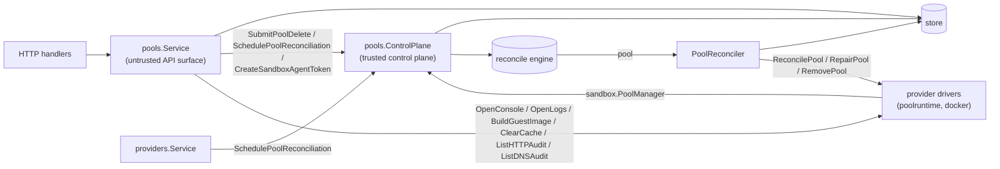

# Pools Design

`internal/resources/pools` owns the `Pool` resource: the user-visible sharing
boundary sandboxes are scheduled into (ADR-0003), and its own runtime host
(ADR-0006). A pool binds to one provider instance at create time, immutably;
the provider instance is backend identity only, while capacity, cache, and the
runtime lifecycle live on the pool.

Pools are the one resource with **two front doors**, because they have two
very different kinds of caller:

## Responsibilities

- `service.go` — pool CRUD, the project default pool, and intent submission; a create on a
  disabled provider instance is refused (409), the one place disabled is
  checked.
  Create validates the backing provider instance and schedules the first
  reconcile; update never touches `ProviderInstanceID` (immutable) and
  re-schedules the reconcile so size changes converge. Both refuse a non-zero
  size field the pool's provider does not declare in
  `ProviderDefinition.PoolSizeFields` (`size.go`). A pool reaches its
  sandboxes' agents over TLS unless it sets `disableAgentEndpointTls`, at
  create or later (ADR 26-10-29-481 §3); it is in the manifest, so the
  reconcile places the pool's host again with it, and each sandbox takes it
  when its box is next made. `profiling` is the same kind of setting, off
  unless set: the placed bootstrap carries it, so the pool's agent and proxy restart
  with it, and its BuildKit mediator takes it at its next start
  ([ADR 26-11-24-418](../../../../docs/adr/26-11-24-418-a-pool-serves-pprof-on-its-loopback-and-an-admin-fetches-it-through-its-agent.md)
  §2). `OpenPoolPprof` refuses a pool with it off, and otherwise fetches a
  profile through the pool's runtime without reconciling the pool.
  `SetDefaultPool`/`UnsetDefaultPool` point the project's `DefaultPoolID` at a
  pool or clear it (unset rejects a pool that is not the default). Delete
  requires the pool to be empty of sandboxes (assignment is immutable, so
  there is nothing to drain to), refuses the project's default pool, and
  submits delete intent; the reconciler removes the runtime, then deletes the
  row. The seeded pool is not otherwise special — it is seeded once, at first
  install, and is an ordinary pool afterwards.
  `ResolveDriverKey` answers a pool's proxy
  (`/pool-agent/{poolId}/resolve-driver-key`, the `secret:resolve` scope)
  with the pool's provider's key in place of the sentinel its host holds
  for it (ADR 26-11-11-080 §9): the pool is the asking pool's assertion's,
  the provider the one it is bound to, refused (403) while it is being
  deleted, and the rest — its recorded sentinel, a host the driver sends its
  key to — is its runtime's to answer (`sandbox.ErrDriverKeyRefused`). It
  lives here, not in `secrets`, because the key is the provider's sealed
  field, which only the resolved provider runtime holds; the method, path
  and place a sentinel may go are the grant the pool agent writes from the
  same declaration (`proxyagent.DriverKeySends`), as a sandbox's routes are
  checked by its pool.
  `OpenPoolConsole`, `OpenPoolLogs`, and `BuildPoolGuestImage` also live here
  and check nothing beyond the pool and its provider-instance rows existing:
  they resolve the provider's `sandbox.PoolRuntime` directly, without
  requiring the pool to be ready, registered, or its provider instance
  enabled, because they are asked for when the pool is broken
  (`server/providers/DESIGN.md`). A backend with no pool runtime, no host
  console (`ErrPoolConsoleUnsupported`), no host log
  (`ErrPoolLogsUnsupported`), or no guest image
  (`ErrGuestImageBuildUnsupported`) answers 501.
  `ClearPoolCache` resolves the pool's runtime the same way and calls
  `PoolRuntime.ClearCache`, which reaches the pool agent and waits for it to
  stop the pool's running sandboxes and empty the pool's caches. The agent owns
  the whole operation (`pool-agent/DESIGN.md`); nothing here persists or
  tracks it, and no pool status field records it. An agent too old to have the
  operation (`sandbox.ErrPoolAgentUnsupported`) answers 409 saying so, rather
  than the 404 that reads as a missing pool.
  `ListHTTPAudit` reads the pool proxies' HTTP audit for the whole project and
  merges it newest first, or oldest first from `Since` for a follower reading
  forward (ADR 0130 §§1, 4). Status, blocked and order filters are passed to
  every pool. `After` is per pool, keyed by pool ID, because a row id is only
  ordered within the pool that issued it: each pool is read from its own cursor,
  and a pool the caller has no cursor for is read from the shared time bound,
  which is how a pool whose rows have not been seen yet joins a follow already
  running. It asks the pool `poolId` names;
  otherwise the pool a still-existing sandbox runs on; otherwise every pool in
  the project, because a purged sandbox's requests stay on its pool with no row
  left saying which. The pools' pages are merged by taking heads rather than by
  sorting everything and slicing: a pool reading from its cursor answers in
  write order, so a cut made by time can drop a record the caller's cursor is
  about to move past, and that record is never offered again
  (`mergeAuditPages`). Pools are asked in parallel, each for the whole limit,
  since the newest N can all come from one pool, and each under
  `auditPoolReadTimeout`, so one unreachable host cannot hold the answer. A pool
  being deleted, or whose agent never registered, is reported without being
  asked. The provider reaches the agent without `agentClientForPool`'s
  reconcile-and-wait recovery: a read must not restart the pools it reads. A pool that cannot be read is
  not an error: it is returned in `UnavailablePools` with why, beside what the
  others answered, because a trail silently short a pool reads as complete.
  `ListDNSAudit` reads the DNS queries the pools answered (ADR 0148) through
  the same fan-out and merge — `readAuditPools` and `mergeAuditPages` are
  generic over the trail's row, so the two cannot drift apart — with only a
  name filter of its own.
  `GetHTTPAudit` reads one exchange in full from the one pool named, and
  `OpenHTTPAuditArtifact` streams one recorded body from it,
  under the same no-recovery rule; with a single pool there is no partial
  answer, so a pool that cannot be read is a 503 and a recording that is not
  there is a 404.
- `agent_service.go` — the pool agent surface: heartbeats
  (`UpdatePoolStatus`; the first registers the pool), sandbox-state and sandbox provisioning-progress
  reports (`ReportPoolSandboxStates`, ADR 0017 §10, relayed to the sandbox
  control plane through `SandboxStateReporter`, which owns sandbox rows),
  resource accounting (`ReportPoolResources`, ADR 0071), and (ADR 0030)
  `MintSandboxAgentStatusTokens`/`ReportSandboxAgentStatus` for the pool's
  standing sandbox-agent status poller, and `ListPoolHeldSandboxes`, the set
  the pool agent's volume reaper may not collect the trees of (ADR
  26-10-01-876): every sandbox row on the pool in any state, one pool wide.
  Every call
  verifies the authenticated **pool principal** for that pool, and any
  sandbox ID named is acted on only if that pool hosts it (skipped here, or
  by the store for state/progress batches).
  `ReportSandboxInventories` ([ADR 26-10-11-657](../../../../docs/adr/26-10-11-657-a-stopped-discobox-is-read-from-what-it-last-posted.md) §2) stores an inventory sent in
  full in `sandbox_inventories`, moves a held one's observation time forward
  when it is sent by digest alone, and answers with the sandboxes whose
  digest it does not hold. The router refuses a report body over 16 MiB
  before the generated server buffers it (`boundInventoryReports`).
  `MintSandboxAgentStatusTokens` always mints the hardcoded `status:read`
  and `inventory:read` scopes via `ControlPlane.CreateSandboxAgentToken`,
  never a caller-supplied one, so this endpoint can never be used to obtain a broader sandbox-agent
  token. `ReportSandboxAgentStatus` and `ReportPoolResources` write their
  sandbox columns through narrow column updates
  (`store.UpdateSandboxAgentStatus`, `store.UpdateSandboxResources`), not
  `UpdateSandbox`/`WithGeneration` — this telemetry is outside the
  desired/observed generation contract and a whole-row save would risk
  clobbering concurrent desired-state writes. Agent status also moves a
  sandbox's `LastActiveAt` forward from the reported session access, and
  records the reported `meta` through `store.UpdateSandboxMeta` (ADR 0136); a
  report without it leaves the recorded copy alone.
  `ReportPoolResources` stores the pool-wide half on the pool row and each
  sandbox's half on that sandbox's row; the pool's snapshots ride the
  pool-wide half, stored as reported and read by nothing on the server
  ([ADR 26-11-17-316](../../../../docs/adr/26-11-17-316-a-pool-reports-its-snapshots-and-each-box-what-it-started-from.md) §4).
  A state observation's `startedFrom` (§5) is stored in the client-facing
  `SandboxStartedFrom` shape, and one that omits it hands on nothing, so
  the recorded value stands. `ReconcilePool` (a manual reconcile
  request from the API) also lives here.
- `controlplane.go` — trusted operations implementing `sandbox.PoolManager`:
  reads for drivers, enrollment (`EnrollPool`: the key a pool's maker read
  from its box, ADR 26-10-24-953 §4), the provider's record of the pool's
  host saved mid-pass (`RecordPoolHost`: what its agent asks for by it, an
  engine key in a sentinel's place, is answered from the row before the pass
  settles), what a pool's box is placed with
  (`PoolBox`, through `PoolBoxes`, the assets service), agent token minting,
  the schedulable-pool
  placement gate, drift marks (`SchedulePoolReconciliation`, via
  `MarkDirtyDrift`, so it never shortens a failure backoff), intent
  (`SubmitPoolDelete`, and `SchedulePoolRepair`: generation bump + mark, so
  schedulers can tell a pending retry from a settled failure), and
  display-only driver provisioning progress (`ReportPoolProvisionProgress`,
  ADR 0060). There is deliberately no timer form of the pool mark: a
  reconciler's own re-check belongs in its `reconcile.Result`
  (`reconcile.ErrSelfMark`). It also registers the pool reconciler
  (`RegisterJobs`).
- `reconciler.go` — `PoolReconciler` (resource type `pool`, dirty ID
  `projectID/poolID`): converges the pool's single runtime host
  (container/VM/pod) toward its desired state through the provider's
  `PoolRuntime`. A missing provider instance, one whose type this server
  cannot build (`ProviderManager.Buildable`: `unsupported`, a migrated `vm`
  row, a `vz` or `wslc` row on another OS), or one with no pool runtime,
  converges trivially, and a delete of its pool drops the row alone. A
  disabled instance converges like an enabled one, and its pool's delete
  calls `RemovePool` (ADR 26-11-22-507); a buildable type whose build fails
  is a failure that retries, never a row-only delete. A `ReconcilePool` that reports
  `sandbox.ErrPoolNotReachable` — a host that is up but not yet taking traffic,
  such as a container whose healthcheck has not passed — is not a failure at
  all: the pass writes nothing and asks again (`poolHostComingUpRequeue`),
  because repairing it would remove and recreate the container and restart the
  healthcheck something is waiting on. A run whose generation-guarded write
  loses to newer intent (`reconcile.ErrSuperseded`), including `begin`'s
  inside the provider call, settles cleanly without a repair; that intent's
  mark re-runs the pool. Any other failed `ReconcilePool` on a
  pool with assigned sandboxes is repaired in place (`RepairPool`); a runtime
  whose
  agent never registers within `poolRegistrationTimeout` (2m, armed with
  `RequeueAt` only while waiting) is repaired for legacy rows. Initial attempts
  with durable evidence instead end, and the next pass starts a new attempt
  with a repair ("Initial bootstrap waits" below);
  delete refuses while sandboxes are assigned, removes the runtime, and then
  the row. Failure latching follows `EverCreated` (`RegisteredAt` set):
  never-registered pools show `failed` and are retried with a new attempt; a created pool keeps its state and records the failure as
  `ErrorMessage` — its runtime keeps serving what it already hosts, so a
  failed convergence is not a phase. It names no sandbox image to the
  provider: every sandbox container is the provider's sandbox base image with
  its bundles applied, and no harness is an image (ADR 26-10-16-423 §10). A
  Docker pool's own container runs that image too (ADR 26-10-24-953 §2), so
  the engine loads it from the local cache as the pool's image
  (`loading_pool_image`), and a sandbox finds it there.
  The provider calls the reconciler's `begin` callback before replacing a runtime,
  which records `registering` and closes placement even if old heartbeats still
  report ready. There is no background image reconciler or staging condition.

## Health is independent of runtime reconciliation

The API's `health` is derived by `model.Pool.Health` at the point of use:
`unknown` until a status report arrives in the current server run, `ready` or
`not_ready` from a fresh report, and `offline` after 90s without one. Startup
stamps `HealthCheckStartedAt` on every pool before workers start, preserving
registration, identity, lifecycle, and the previous observations. The startup
stamp gives a pool 90s to report before unknown becomes offline. New pools use
their creation time for that deadline.

Only `UpdatePoolStatus` stamps `StatusReportedAt`; enrollment, image builds,
and other telemetry cannot establish or renew health. `LastSeenAt` retains its
existing heartbeat diagnostic meaning. The nullable timestamp
columns migrate additively; an old row without a status timestamp is unknown
until its agent reports. No backfill should certify an old report as fresh.

`services.PoolToAPI` exposes health and masks stale `Ready`/`Schedulable` flags,
including pools nested in sandbox responses. For a sandbox principal it sends
only a fixed list of fields, what placing a create needs, and none of the
provider, key, credential, proxy, egress or agent-reported detail
([ADR 26-11-23-743](../../../../docs/adr/26-11-23-743-a-discobox-reads-its-projects-pools-without-their-secrets.md)
§2); a field added to `Pool` reaches a discobox only once that list names it. Clients accept an omitted health
field from older servers as `unknown`. Placement and sandbox traffic use the same `Pool.IsReady` gate. Fresh health permits placement
even if a blocked runtime reconcile still carries an older `offline` state.
API health does not wait for runtime reconciliation. Placement additionally
keeps pending/registering runtimes gated until the pool's box is made. The reconciler's existing `State`/`ErrorMessage` remains its lifecycle
verdict; it may record offline on its own later pass. Startup grants the first
heartbeat the same 90s grace before that pass may derive another offline error.
`ReconciledAt` records when a runtime attempt settles. Waiters ignore saved
failures older than `HealthCheckStartedAt`, including legacy rows without this
nullable timestamp; current runtime failures still terminate the wait. Telemetry
cannot refresh a runtime verdict.

## The server waits for its pools to upgrade

`UpgradeWatch` (`upgrade.go`, ADR 26-11-14-624) is what the server's health
reports `upgrading_pools` from; `ControlPlane` owns it, so the reconciler can
tell it how a pass settled. At startup, after `BeginPoolHealthChecks`, it
fixes the pools to wait on: every present pool already registered, each
pending until a pass reads it. Startup then marks every pool for a reconcile.
A watched pool is upgraded once `ReconciledAt` is at or after its
`HealthCheckStartedAt`, with no `ErrorMessage` and its generation observed;
its provider did not keep the previous box in that pass; and its agent has
reported ready since it is the current one (`agentReported`), by the latest
start of its agent this run recorded:

| Latest start | A ready report counts when |
| --- | --- |
| box (`AgentStartBox`: made, or started from stopped) | `StatusReportedAt` follows it (ADR 26-11-15-294 §2) |
| in place (`AgentStartInPlace`: before an apply that may restart a running agent) | a ready **first** report was received after it, or `StatusReportedAt` follows `ReconciledAt` (ADR 26-11-15-602 §3) |
| none | `StatusReportedAt` follows `ReconciledAt` |

The old agent may report after an in-place start until the restart stops it,
so only the new agent's first report counts from that start: the agent marks
it (`firstReport`), and `Service.UpdatePoolStatus` hands a ready one to the
watch at the time it was stored with.

A provider that makes or starts the pool's box, or is about to restart its
agent in it, says when and which with `sandbox.ReportAgentStarted`; the
reconciler hands that to the watch at once, not at the settle, since the pass
that starts an agent (a VM booting, which fails not reachable) is often not
the one that settles, and the new agent's first report comes before that
settle. A later start replaces an earlier one.

A provider keeps a running pool's box on purpose when the release does not
resolve or apply (ADR 26-10-24-953 §5) and the pass still settles cleanly, so
it says so with `sandbox.ReportBoxKept`; the reconciler hands that to the
watch with the settle's time, and a later settle supersedes it. These records
are in memory only, as the run they describe is.

A pool deleted, or on a removed provider instance or one whose type this
server cannot build (`convergedProvider`, which the reconciler decides the
same by), drops out. One on a disabled instance is still waited on.
Once none is left the watch has cleared for the run. It reads rows and writes
nothing, resolves no provider, and runs one pass at a time under its own
bounded context, at most once a second; a probe that cannot wait, or a pass
that fails, is answered the last answer. Its count is what health serves;
the names and reasons go to the log when `Begin` fixes them and whenever they
change.

So a restart's log says where its wait went, the reconciler logs a pass that
settles, with how long it took (`logSettled`). The drift scan re-checks every
pool every minute, so the line is at info only for a pass that did something:
the pool's first settle this run (`reconciledThisRun`, the rule the watch
waits on), a new generation observed, a state moved, a repair (owed, or one
after a failed pass of an assigned pool), an agent started by this pass, a
box kept, or a wait on a host coming up. Any other
pass logs at debug. That wait (`ErrPoolNotReachable`) requeues every few
seconds, so it is logged once when it begins, and the pass that ends it says
how long it was (`host_wait`). The steps inside a pass are the provider's to
log (`server/providers/DESIGN.md`, "Logging the Steps of Bringing a Pool Up").

Reconciliation is level-triggered: intent writers mark `(pool, id)` dirty and
the engine (`internal/reconcile`) drives convergence; `ScanDirty` re-checks
every pool as the drift and lost-mark backstop.

## A pool hosts one platform

A pool hosts exactly one platform (`os/arch`, the root `platform` package; ADR
0145 §1), and its agent declares it on every status heartbeat. A declaration that is not an os/arch pair is refused with 400
(`declaredPlatform`). None at all is an agent from before platforms, which must
still report — a provider may fall back to the previous release's agent image,
and a pool's agent is replaced only after the server upgrades — so its pool
keeps whatever was recorded for it, which may be nothing
(`store.recordPoolPlatform`). Nothing is guessed: a pool may be any
architecture, and a guess written onto a sandbox placed there is never
corrected.

A pool made now names the OS its sandboxes run (`SandboxOS`, ADR
26-11-11-963 §1): `linux`, the default, or another OS. A provider type that
registers a `PoolOSValidator` decides which its instance boots — the vm
provider asks its driver's capabilities: linux on a driver that boots it,
darwin on vz, nothing on hcs — and any other type takes only `linux`. It is in
the manifest, set at create and never updated (`store.UpdatePool` does not
write it), and stored named even when it is the default, so the agent is held
to it from its first report. The provider writes it into the pool's
bootstrap — unless it is `linux`, which an agent given none declares, and which
an agent from before the field would refuse to start on — and the agent
declares it on its own architecture. For such a pool the agent's report is a
check, not the source: a declaration of another OS, or of none, is not
recorded, the heartbeat's `schedulable` is written false until the agent
declares the named OS, and the service logs a warning naming both. So no agent
left over from an upgrade, or from a provider-override bundle, turns a darwin
pool into a linux one; a sandbox waiting on the pool waits as on one coming up.
A pool from
before pools named an OS has it empty, which is linux, and takes what its
agent declares as above.

The migration does not guess a pool's platform: a pool from before platforms
has none until its agent's first report after the upgrade, which is the report
that makes it schedulable again. Nor does a report touch the pool's sandboxes;
a sandbox takes its platform when it is placed.

`SchedulablePoolForSandbox` is where a sandbox's platform is settled, on a pool
that has declared one. A pool that has not places a sandbox that has no
platform as every pool did before platforms, settling and checking nothing,
and refuses one that has — only an import's tree brings a platform onto such a
pool, and nothing could check it there (ADR 0145 §8). A
sandbox with none yet — created while its pool's agent had declared nothing,
or before platforms were recorded — takes the pool's, written to its row: its
harness names no platform and runs on any, and no image kind, since the kind
of box is its pool's (ADR 26-11-01-122). It refuses a sandbox of another
platform than its pool's with a `*platform.MismatchError`, which is not
`ErrNotFound`: a pool of the wrong
platform is not one on its way up, and a caller that waited on it would wait
for good. The check runs after the readiness gate, since only a reporting agent
has declared what it hosts.

## A pool runs one kind of image

Beside its platform, a pool runs one kind of image (`platform.ImageKind`, ADR
26-10-09-106 §4): `oci` for a Docker pool, `vm/<driver>` for a vm pool
on that driver. The platform alone cannot tell them apart — a boxd pool
and an amd64 Docker pool both host linux/amd64. Its agent declares the kind on
every heartbeat, beside the platform; one that is neither is
refused with 400 (`declaredImageKind`). Unlike the platform, an agent that
declares none is not a guess to avoid: every agent from before kinds runs OCI
images in containers, so OCI is recorded for it (`store.recordPoolImageKind`),
and a registered pool always has a kind. A pool not yet registered has none.
The migration that adds the column backfills OCI for every pool that existed
then, and only on that start: a pool created since has no kind until its agent
says, since it may be a vm pool.

Beside them an agent declares whether it holds a sandbox's sentinels to
grants (`sentinelGrants`, `Pool.SentinelGrants`, ADR 26-11-03-329 §3), which
decides whether its sandboxes are sent grants or each sentinel's first grant
as route lists; whether it takes each sentinel's value generation
(`sentinelGenerations`, #1022); and whether it takes a route's body block
(`sentinelBodyPlaces`, `Pool.SentinelBodyPlaces`, #1012) and a route's
WebSocket block (`sentinelWebSocket`, `Pool.SentinelWebSocket`, ADR
26-11-06-442), without each of which its sandboxes are sent no route with one.
It also declares whether it takes a
git source's `defaultBranch` (`sourceDefaultBranch`, `Pool.SourceDefaultBranch`,
#245), without which its sandboxes' sources are sent none and their
`origin/HEAD` stays unset. All five are `store.AgentDeclarations`. An agent
from before any of them sends none, recorded as false. A
report that changes a sentinel declaration marks every present sandbox on the pool for sentinel
delivery, as drift, in the transaction that records it
(`SandboxDelivery.MarkPoolSentinelsTx`): nothing else changed, so nothing else
would send them in the shape the agent now takes. A report that turns the pool
active and ready, judged against the pool as the report found it, also marks
in the same transaction the power reconcile of each present sandbox on it
whose scheduled wake is due (`SandboxDelivery.MarkPoolDueWakesTx`, ADR
26-11-15-829 §2): a wake is not sent to a pool that is not, so that report is
what sends the wakes that fell due while the server or the pool was down. A
pool back from `offline` turns `active` in its reconcile, after that report,
so the reconcile's settle hands over the pool it found and the pool it
writes in the same way (`PoolReconciler.settle`).

The kind is the pool's alone: a harness names none (ADR 26-11-01-122), so a
sandbox is whatever kind of box its pool runs, and placement checks no kind.
The one thing refused for it is an import onto a pool that runs anything but
OCI images — an archive holds a container's tree — with a
`*platform.NotOCIError` naming the pool's kind
(`poolruntime.Provider.ImportTree`, and `sandboxes.refuseMachinePool` before
the tree is read).

## Who owns which status field

Every pool status field has exactly one owner, and owners must not overlap; a
field its owner saves by more than one path names each:

| Fields | Owner | Written by |
| --- | --- | --- |
| `HealthCheckStartedAt` | server startup | `Store.BeginPoolHealthChecks`, before workers/listeners |
| `PublicKey`, `KeyType` | pool's maker | `ControlPlane.EnrollPool`, once per box it makes (ADR 26-10-24-953 §4) |
| `RegisteredAt` | pool agent | its first `UpdatePoolStatus` heartbeat |
| `Platform`, `ImageKind`, `SentinelGrants`, `SentinelGenerations`, `SentinelBodyPlaces`, `SentinelWebSocket`, `SourceDefaultBranch` | pool agent | every `UpdatePoolStatus` heartbeat |
| `Ready`, `Schedulable`, `Degraded`, capacity, `Conditions`, `LastSeenAt`, `StatusReportedAt` | pool agent | `UpdatePoolStatus` heartbeats |
| `Resources`, `ResourcesReportedAt` | pool agent | `ReportPoolResources` |
| `ProvisionProgress`, `ProvisionProgressAt` | provider driver | `ControlPlane.ReportPoolProvisionProgress` |
| `State`, `ErrorMessage`, `ObservedGeneration`, `ReconciledAt` | reconciler | `PoolReconciler`, and nothing else |
| `RuntimeState`, `HostCredential` | runtime provider, within its reconcile pass | the provider sets both on the pool (`HostCredential` when it places a credential of its own on the pool's host: a disco-vm driver's key or sentinel); `PoolReconciler` persists them as the pass settles, and `ControlPlane.RecordPoolHost` mid-pass, ungated by generation, where the host's agent may ask for what they name before then (a placed key) |

Health answers "can this host take work right now"; `State`/`ErrorMessage` are
the reconciler's verdict on whether the runtime converged, and
`ObservedGeneration` says the reconciler finished acting on a generation.
Scheduling gates on current health and the schedulable flag, with
pending/registering runtimes gated until the pool's box is made
(`SchedulablePoolForSandbox`), so no agent call has any reason to write the
reconciler's fields. The telemetry writers (resources and provisioning progress) use narrow column updates, never a whole-row save, so they cannot
clobber a concurrent reconcile.

The rule that keeps the split honest: **agent calls write facts and mark the
pool dirty; the reconciler alone writes `State`, `ErrorMessage`, and
`ObservedGeneration`** (ADR 0017 §10 — a report is an observation, never
intent). A heartbeat from a pool the reconciler holds `registering` or
`offline` marks it dirty for exactly this reason.

Two rules follow from it:

- Every successful reconcile clears `ErrorMessage` (the offline derivation may
  then record a fresh one for the same pass). Nothing else clears it, and no
  path may skip the clear — skipping it because an error is already recorded
  makes the field a one-way latch.
- The reconciler *derives* `State` on success (`registering` until
  `RegisteredAt`/`Ready`, then `active`) rather than carrying the recorded
  state forward. The create reconcile converges the generation before the agent
  registers, so a drift re-check that preserved `State` would strand a
  registered pool in `registering`.

## Explicit start authorization

`authorize-pool-sandbox-start` is a pool-principal-only read. It checks pool
ownership, presence and the current wake epoch on the primary database. The
pool calls it under its runtime power lock before an explicit start executes;
it acquires no sandbox service admission lock. The sandbox service owns
admission and retry policy; this service owns authenticating the pool's read.

`sandbox-suspend-completion` applies the same pool identity and sandbox
ownership checks, then delegates successful-freeze bookkeeping to the sandbox
service. It is invoked under the pool's power lock before another start can
execute, including when different server instances dispatched the two calls.

## Pool outbound intent

Outbound routing is independent of sandbox egress policy. `proxy_intent` is a
sealed, optional whole-object API override; its additive column leaves existing
pools without an override. The server selects API, immutable-pool-ID YAML, global
YAML/environment defaults, then direct. Explicit empty schemes remain direct.
API writes read saved credentials inside the intent transaction, preserve them
on redacted round trips, and support explicit replacement/removal. Intent and
its generation/dirty mark commit together. Proxy credentials require configured
at-rest encryption; reads expose only redacted intent and effective status.

`ControlPlane.ResolveOutbound` supplies a domain-owned `pooloutbound.Resolved`
on the provider's pool value. Runtime code never resolves environment anew.
Reconciliation owns applied revisions, restart-required and context-specific
observations; failed configuration apply retries without repairing/replacing a
running host. VM boot changes retain the previous applied revision until an
ordinary restart. A configuration change never deletes sandbox/data/cache state.

## Initial bootstrap waits

The reconciler binds executor reports to the durable attempt and generation
before invoking the provider. `ReportPoolBootstrap` persists real work evidence
through the required `PoolManager` contract, independently of display telemetry.
Registration expiry consumes that same evidence: it cannot replace a host
during a valid fixed apply window, and first registration has a fixed
two-minute allowance from apply completion. Once registered, ordinary recovery
policy applies. See ADR 26-11-07-306 and the model's evidence policy.

An ended attempt does not end a never-registered pool (ADR 26-11-09-593):

- The pass that sees expiry or a provider error records it as the attempt's
  `Failure`, shows the pool `failed`, and returns the error. Every failure is
  retried; there is no cap.
- A later pass, once the provider is callable, replaces the ended attempt
  (failed, or from an earlier generation) through the fenced
  `store.ReplacePoolBootstrap`. A failed one is replaced only after the
  engine's backoff schedule (`reconcile.Backoff`, 2s doubling to 5m) for the
  attempts that failed before it, counted on the attempt: the engine's own
  count resets on every clean pass, so an agent that never registers after a
  successful repair would otherwise be retried every silence budget. New
  intent is not paced. A lost fence settles as superseded.
- The new attempt owes a `RepairPool` (the runtime the last attempt left is
  not trusted). The debt is stored on the attempt and cleared by the
  executor's `Repaired` report, so a pass that dies first repairs on the next.
  A repair error, `ErrPoolNotReachable` included, ends the attempt: it may
  come before anything was replaced.
- A reconcile (not a repair) that ends in `ErrPoolNotReachable` is waited on,
  not recorded as a failure, so the reconciler keeps its error on the attempt
  as `Waiting` (written only when it changes; ADR 26-11-15-089 §5). It is
  display, not evidence: it renews no budget and ends nothing. Progress
  clears it, and so does a pass that waits on nothing (`WaitEnded`
  evidence), so an expiry never names a wait a later pass got past. An attempt that expires names it, `… (last waiting on: …)`, so a
  pool whose provider the server cannot reach says so rather than only that
  bootstrap stopped making progress.
- Waiters stay pinned to their attempt and end on a new one ("bootstrap attempt
  changed"); the acquisition gate refuses actions with the failure while the
  pool backs off, and an action arriving during a new attempt waits on it.
- A registered pool, or a legacy row with no bootstrap document, never gets an
  attempt.
