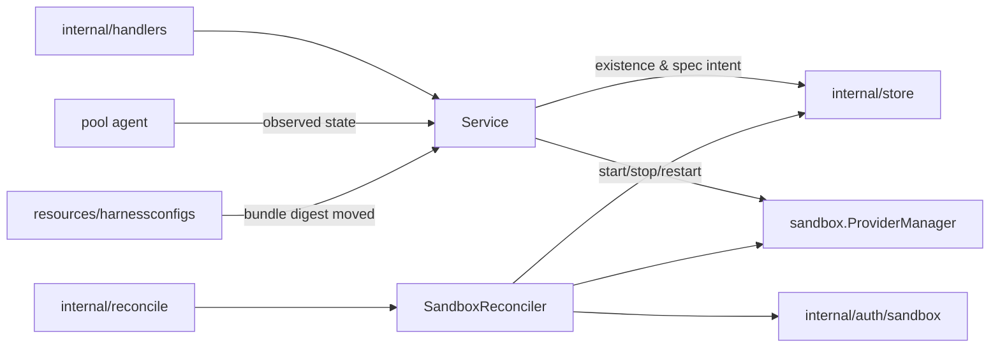
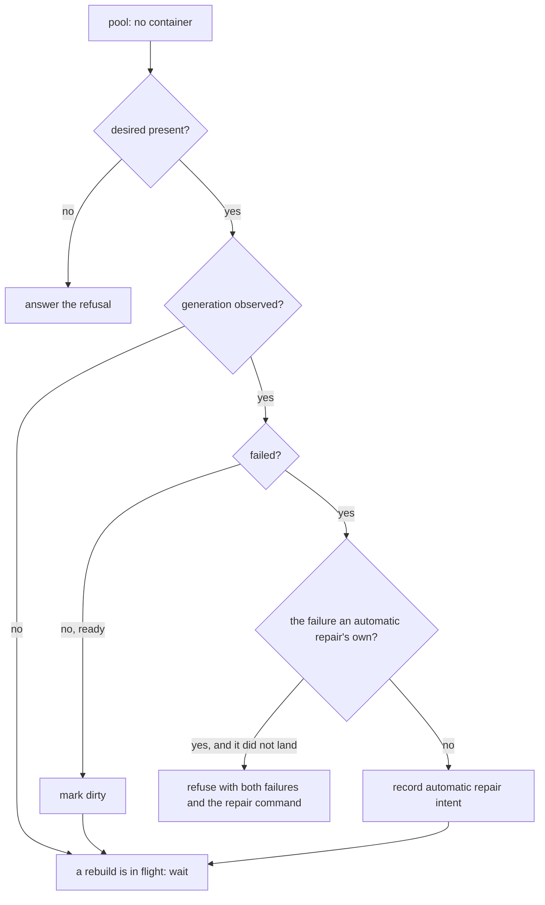
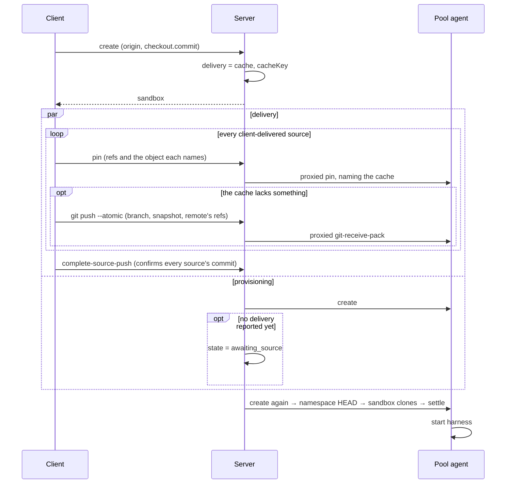

# Sandboxes Design

`internal/resources/sandboxes` owns sandbox API behavior, sandbox lifecycle
reconciliation, sandbox provider catalog access, and sandbox runtime trust
integration.

## Boundaries

- `Service` exposes sandbox API use cases and may call store directly for simple
  reads or non-orchestrated updates.
- Every sandbox carries a harness config (ADR 0032, as amended by ADR 0048).
  `resolveHarnessConfigID` resolves it at create: an explicit
  `harnessConfigId`, or a `--harness` selector (slug first, then display name,
  then ID) →
  the project default → 409. A deleted default counts as no default. A
  sandbox is pinned to its harness config's `Bundle`/`BundleDigest`, or a
  manifest file's template to its `Image`/`ImageDigest`
  (`createHarnessPins`, `services.HarnessConfigPins`) — in config mode too,
  since the configure command is harness-bundle content — and to the platform
  the release names. No harness is an image and there is no default image
  (ADR 26-10-16-423 §10): a config registered before bundles, which has
  neither, is refused with 409, and one whose bundle has no content digest — a
  development bundle no pool has built yet — with 503.
- A sandbox's platform (`os/arch`, the root `platform` package) is its pool's,
  which a manifest file's template must run on (ADR 0145 §1); a bundle names
  none, since its steps select the platform they run on, and rules no pool
  out. A pool of another platform than a manifest file's is refused with a 409
  that says which the template runs on (`platformOnPool`). A pool whose agent has not declared a platform yet is
  an ordinary target, and the sandbox is created without one: it takes the
  pool's when the provider places it (`store.SchedulablePoolForSandbox`,
  `CreateOptions.Platform`), which makes the same check and fails the create's
  reconcile with that reason rather than waiting on the pool. A sandbox from
  before platforms takes its pool's the same way. A pool whose agent never
  declares one — an agent from before platforms — places as before them, and
  its sandboxes have no platform. The platform is never changed
  once set. It is a column beside `PoolID`, not a `SandboxManifest` field: it is
  not a spec that can drift, and adding it to the manifest would have moved
  every sandbox's fingerprint. An upgrade never moves a sandbox onto a harness
  config whose template does not run on its platform (`SandboxUpgradeTarget`).
- A sandbox's pool must also run the kind of box its harness runs on
  (`platform.ImageKind`, ADR 26-10-09-106 §4; OCI for a bundle): a VM harness for boxd is
  refused on a Docker pool of its own platform and placed on a boxd pool. Create
  and import refuse a pool whose agent has declared another kind with a 409
  naming both (`refuseOtherImageKind`), and placement makes the same check
  (`store.SchedulablePoolForSandbox`). A pool that has not declared one is still
  a target. The kind is not recorded on the sandbox: it is its harness config's,
  read at every placement.
- Sandboxes that have no harness config converge by *upgrade*, not by
  migration. The target comes from the reserved `shell` built-in
  (`fallbackHarnessConfig`). Such a sandbox reports `available` regardless of
  its digest, because what the upgrade changes for it is adopting the config.
  Taking the upgrade writes the config as well as re-pinning its bundles, and
  until it does, the sandbox says so in its own listing.
- The upgrade rule has exactly one implementation,
  `services.SandboxUpgradeTarget`. Two callers use it: the read path that
  reports an available upgrade, and `Service.currentRepin`, which resolves
  the change that `UpgradeSandbox`, `RepairSandbox`,
  `UpgradeHarnessConfigSandboxes` and `UpgradeReleaseSandboxes` apply. The
  change is all of a sandbox's pins: harness bundle (or manifest file), the
  harness manifest composed from it (`HarnessManifestDigest`), and the
  release's platform and agent bundles (ADR 26-10-16-423 §7, ADR 26-10-24-953
  §2). The read path is handed the release's bundles last resolved
  (`UpgradeBasis`) so it never waits on a registry; the re-pin resolves them,
  at most a minute stale. Sharing it means a sandbox cannot
  accept an upgrade its listing says it does not have.
- **A sandbox pins the manifest its container is built with.** The harness's
  env, files and volumes are its config's snapshot of the bundle's labels
  composed on the platform's layer, and a platform-layer edit moves no bundle
  digest, so the config's `ManifestDigest` is pinned beside the bundle as
  `HarnessManifestDigest`. It is in both fingerprints: a moved one rebuilds
  the container as a moved bundle does, and is an upgrade of its own
  (`manifestDigestChanged`) when nothing else moved.
- **Pins are one ordered list, in two forms.** A sandbox is pinned to the
  platform and then its harness's bundle, and to the agent its pool places
  it with (ADR 26-10-24-953 §§1–2). One pinned since that ADR keeps them in
  `Bundles`, the list, and the agent in `AgentBundle`; one pinned before
  keeps its `PlatformBundle` and `Bundle` columns, and is re-pinned in them,
  so its fingerprint changes only as its pins do and nothing about the list
  rebuilds it. Everything reads and writes pins through
  `SandboxManifest.PlatformPin`, `HarnessPin`, `BundlePins` and `SetPins`,
  never by form; the list's order is the server's composition, platform
  first, and nothing past the server names which pin is which.
- **A sandbox is not rebuilt by a moved pin.** A sandbox whose every bundle
  pin is a content digest is delivered: it runs the provider's sandbox base
  image, and its pool places the agent and its pins before every start
  (`pool-agent/DESIGN.md`). Its fingerprint is
  `SandboxManifest.DeliveredFingerprint`, which leaves out the image, the
  platform, the list and the agent, so a moved one restarts a running sandbox
  into it and leaves its store and its provisioning in place.
  `HarnessManifestDigest` stays in: the harness's manifest is what its
  container is built with, so a moved one rebuilds it. A sandbox pinned before
  the list keeps its harness `Bundle` in too, as it was. The agent is in
  neither fingerprint, and which one applies turns on the bundles alone
  (`specFingerprint`), so pinning an agent changes neither. A sandbox with a
  bundle pin that is not a content digest — one from before bundles, until
  `PinUndeliveredSandboxes` reaches it — keeps `SandboxManifest.Fingerprint`.
  One with no agent is sent nothing (`sandboxDelivery`): its pool keeps the
  container it has while its fingerprint does not move, and builds it no
  other. `PinUndeliveredSandboxes` pins such a sandbox to the release's agent
  and, with it, the release's platform, in place: the one pin moved with no
  upgrade asked for, since an agent provisions the platform it ships with
  (ADR 26-10-24-953 §1, as amended).
- A sandbox name is unique within its project (`idx_sandbox_project_name`),
  like a pool's or a harness config's. It is an addressable handle, not a
  label: `discobox admin ssh-config` emits it as an `ssh_config` `Host` alias, and
  ssh applies the first matching block, so a second sandbox answering to the
  same name would silently take the first one's connections. `CreateSandbox`
  checks the name and returns 409 so the common case is a readable error; the
  index is the authority that closes the race between two concurrent creates.
  Names free up on delete, since deletes are hard deletes (ADR 0010).
- Existence and spec intent goes through `recordSandboxIntent`: generation bump,
  desired state, and dirty mark in one transaction.
- `SandboxReconciler` converges existence and spec, and nothing else.
- Provider runtime operations belong in reconciliation or in an explicit
  instruction, never in handlers or raw stores.

## Power is not orchestrated

`start`, `stop`, and `restart` are instructions forwarded to the pool agent
(`power.go`). They write no lifecycle state and bump no generation. Their
responses carry the sandbox as it read *before* the instruction took effect, so
a caller learns the outcome by re-reading the sandbox once the agent's report
has landed. `DesiredState` answers existence only: `present`,
`archived`, or `deleted`. Start, stop, and restart are refused with 409 on an
archived sandbox — it has no container to power. One refused for want of a
runtime is also a 409 (`runtimeRefusal`) saying why and what to do, since
the row is here and none of these is a missing sandbox: no container on the
pool (`ErrNoContainer`) is repaired; still archived on the pool
(`ErrArchived`) is an unarchive the pool has not caught up with, waited out,
or one that failed, repaired; no runtime at all (`ErrNotFound`, which is also a create not yet placed
on a pool) is waited out while it is being created and repaired otherwise.

A `start` or `restart` is a use of the sandbox, so one refused with
`ErrNoContainer` goes the way an action does (below): the sandbox is repaired
once, or the rebuild already coming is waited for, and the instruction is sent
again — including through the window in which the repair's teardown has the
pool calling the sandbox archived, which is read as the same answer. It waits for nothing else — a sandbox still being created is refused at
once — and a `stop` is not a use. This is the one place an instruction leads to
recorded intent, and what it records is existence, not power.

## Sleep, idle, and the scheduled start

A sandbox asks for its own power-down, and the control plane carries it out
([ADR 26-10-16-337](../../../../docs/adr/26-10-16-337-a-discobox-asks-to-sleep-and-names-when-to-wake.md)).
Its status reports `autostop.idle` or a pending `autostop.sleep` once its pool
has handed its power over; recording such a status
(`SandboxAgentStatusReported`, from the pools service's status ingest) marks
the sandbox's **power reconcile** (`SandboxPowerResourceType`,
`power_reconcile.go`) — a resource of its own, like egress, so the sandbox
reconcile's ensure is not run on every idle report, and the wake timer lives on
a dirty row no other reconcile returns over.

- **Power-down.** The reconcile sends the provider `PowerDown` with the reason —
  `sleep` wins over `idle` — for a sandbox observed running. The stored status
  is never acted on as it stands: the runtime asks the sandbox to confirm under
  its power lock, and `ErrPowerDownRefused` is the instruction having nothing
  to do. Idle is always a stop; sleep is the runtime's to freeze if it can,
  which a Docker pool does: the sandbox then reports `suspended`, is not
  running, and is not asked again on the status that froze it.
- **Suspend.** `SuspendSandbox` is a power instruction beside stop
  ([ADR 26-10-16-420](../../../../docs/adr/26-10-16-420-a-docker-pool-freezes-a-sleeping-sandbox-and-a-person-can-suspend-one.md)):
  provider `Suspend`, never a use, never a stop in its place — a pool that
  cannot freeze refuses it (`ErrPoolAgentUnsupported`, `ErrNotRunning`, each a
  409 that says why). Every start and every use's `ensureRunning` thaws a
  suspended sandbox; `SandboxIsLive` counts it, so nothing rebuilds under it.
- **The scheduled start.** The confirmation carries the sandbox's earliest
  pending wake, recorded as `WakeAt` and armed as `RequeueAt`. At that time the
  reconcile claims it — clears it on the `WakeEpoch` it read — and sends one
  start whatever the row says the sandbox is doing; nothing retries a failed
  one (ADR 26-10-12-711). The row lags the power-down this reconcile just sent,
  so a sandbox reported running may be on its way down; a start on one that
  really is running is a no-op at the pool.
- **Outside instructions win.** Every start, stop or restart from a caller
  (`instructSandboxOnce`, which repair goes through) and every archive or delete
  (`recordSandboxIntent`) cancels the wake and moves `WakeEpoch`, wake or no
  wake, in one transaction with the power reconcile's mark — before the
  instruction is sent, so a power-down in flight cannot write its wake back.
  A suspend cancels it too, but after the pool accepted it, since a refused
  suspend changes nothing; a power-down reading the epoch once the sandbox is
  frozen is refused by the pool. `WakeAt` and `WakeEpoch` have two writers, so `UpdateSandbox` never writes
  them (`sandboxWakeColumns`).

## A sandbox that is not running is read from its inventory

`ReadSandboxInventory` (`inventory.go`) answers one read — the exec, service
or tool list, one exec or service, a terminal's screen — from the
`sandbox_inventories` row the pool agent last reported for the sandbox
([ADR 26-10-11-657](../../../../docs/adr/26-10-11-657-a-stopped-discobox-is-read-from-what-it-last-posted.md) §4).
The answer preserves posted fields, including unknown ones, plus
`observedAt`; records are served as posted, so an exec last seen running reads
as running. The primary terminal's alias is resolved as the sandbox agent
resolves it: a primary that is starting or running, else the most recently
created one. No inventory, or none of that part, is a 409 naming
`discobox start`; an exec or service the list does not hold is a 404. It is
authorized exactly as the live read is.

`AcquireRunningSandboxHTTPClient` is the acquire for those reads, whose use is
an inspect or, for the screen, an observe. It leases
as `AcquireSandboxHTTPClient` does — the pool agent, not the row, says
whether the sandbox is running — and refuses with `sandbox.ErrNotRunning`
only a sandbox recorded as stopped or suspended whose pool is not reachable.

## What a request is for

`AcquireSandboxHTTPClient` is the choke point every route onto a sandbox goes
through, and it takes the request's **use** (`services.SandboxUse`,
[ADR 26-10-12-711](../../../../docs/adr/26-10-12-711-using-a-failed-discobox-with-no-container-repairs-it-once.md)).
The callers are the whole table of which route does what; the lease marks every
pool token with the use, and the pool agent starts a sandbox, or refuses to, by
that mark.

| Use | Routes | Stopped sandbox | Not usable yet | Failed, no container |
| --- | --- | --- | --- | --- |
| action | exec attach, create, input, start, delete; service start, stop, restart; HTTP, tcp and udp; ssh; the worktree's git; harness configure; meta write | the pool is asked to start it before the lease is handed out | waited for | repaired, once |
| read | exec logs, events, resources; service logs; a source's origin, and what the pool's cache holds of it | started by the pool agent when the request arrives | answered at once | answered at once |
| inspect | exec list and get; service list and get; tools | never started: the pool agent waits out a boot under way and refuses it otherwise, and the refusal is answered from the sandbox's last inventory ([below](#a-sandbox-that-is-not-running-is-read-from-its-inventory)) | answered at once | answered at once |
| observe | terminal screen, exec wait, exec-events, harness-hooks | refused by the pool agent, a boot under way included; the screen is answered from the inventory | answered at once | answered at once |

An acquire for an attach is refused for a sandbox principal: a discobox does
not attach to another.

### An action waits

`acquireForAction` (`attach_wait.go`) returns a lease only onto a sandbox that
can take the request. It waits for a sandbox that is still being provisioned
instead of refusing it, which is what lets a client create a sandbox and use it
in the next call rather than polling for readiness (ADR 0039 tier 1, widened
from attach to every action).

- The wait polls, because what it waits on is a row (ADR 0081). Every pass
  re-reads authoritative state and asks again, so the transition that opens the
  gate has no window to land in unseen.
- Its stall budget is restarted by `provisioningMark`: the gate (the sandbox's
  lifecycle state and convergence, its runtime state, the pool's state and
  readiness) plus the counters that tick while a long provision proceeds (the
  sandbox's pull progress, the pool's own provisioning and image staging). It is
  deliberately not the rows' `updated_at` — the pool's status heartbeat and the
  complete sync's restamp move that on a timer, and a budget they refreshed
  could never expire.
- Three refusals are "not yet": no runtime state naming a pool, a pool that is
  not taking traffic (`sandbox.ErrPoolNotReachable`), and a sandbox that is
  reachable but not usable yet. The pool refusal comes from either side of the
  acquire: the gate reads the pool row, and the provider's driver refuses a
  host whose container is being replaced or whose healthcheck has not passed,
  which the row cannot see because it reads ready until the agent is noticed
  gone. The service answers both with 409. The host refusal carries its own
  ceiling (`sandboxPoolHostWaitCeiling`) because the stall budget cannot bound
  it: a failed acquire marks the pool for reconcile, and every reconcile stamps
  the pool progress the budget reads as movement, so the wait would renew
  itself for as long as the pool kept reconciling. Every
  other refusal is an answer and is returned immediately, as is any refusal for
  a sandbox that is archived, on its way out, or failed and settled — no write
  will clear those. A failed sandbox whose generation is unobserved is a retry
  in flight (an upgrade or repair recorded new intent), and is waited for.
- Reachable is not usable, and the gap is a source its client has not delivered. Such a sandbox
  has a container — and so a runtime state naming its pool — from the moment it
  parks at `awaiting_source`, so the acquire succeeds while its workspace is
  still empty; using it then would start it and launch the harness against
  an unmaterialized workspace. So the wait also holds while the sandbox is
  parked, and while its generation is unobserved — the window after
  complete-source-push in which the reconciler materializes what was pushed.
  The push itself goes to the source's origin, which is a read and does *not*
  wait, so the delivery a wait is waiting on can never be blocked by it.
- A caller's deadline also ends the wait, and is answered like the stall
  budget and the host ceiling: with the last refusal, which names what never
  became true. A cancel is the caller leaving, and gets the context's error.
- The budget is a stall timeout, not a duration cap. Progress restarts it, so an
  image pull that keeps reporting takes as long as it takes while a sandbox that
  has gone silent gives up. Tiers below take budgets that fit inside it, so the
  innermost stage to stall is the one that reports.

Only this tier waits on control-plane facts; what the sandbox agent is doing is
waited on by the tiers that can see it (`pool-agent/DESIGN.md`,
`sandbox-agent/DESIGN.md`).

### An action starts the sandbox, and repairs it once

Once the sandbox is usable, `ensureRunning` (`use.go`) has the pool start it and
returns when the agent inside answers (`Provider.EnsureRunning`). It is asked
before the lease is handed out so that "no container" is learned while nothing
has been forwarded: the request, with its body, is still the caller's.

- A `ready` sandbox the row reads as `running` is not asked about. The HTTP
  port proxy acquires per request, and the pool agent starts the sandbox again
  by the lease's mark if a stop landed after the look. A failed sandbox is
  always asked: its last observation may be a complete sync old.
- A pool agent from before the operation (`ErrPoolAgentUnsupported`) is not an
  error: that agent starts sandboxes by its own table, and nothing is repaired
  on its pool until it moves onto the current agent.
- A sandbox archived by intent is refused before the pool is asked. A pool
  that holds nothing of a settled sandbox, and a failed start, are answered at
  once, with what to do.

`ErrNoContainer` — from the ensure, or from a `start` or `restart` — goes to
`rebuildOnUse`. So does the pool's `ErrArchived` for a row that is `present`
(`runtimeHasNoContainer`): a repair's teardown leaves the archive marker until
its create clears it, so that is a rebuild between its halves or one whose
create failed, which is exactly what a failed automatic repair leaves.

- **The automatic repair is ADR 0035's repair with another author**
  (`recordAutomaticRepair`): the same generation bump, `RepairGeneration`, and
  dirty mark, so the reconciler tears down and rebuilds as for a typed one.
  It is not driven inline and sends no start; the action that caused it is
  waiting, and starts the sandbox itself when the reconcile lands.
- **One, bounded by the generation.** The intent records itself on the row
  (`Sandbox.AutomaticRepair`: generation, when, the trigger, the failure it
  answers, and when it landed), and is never recorded for a failure that is
  that record's own (`AutomaticRepairAllowed`): one on the record's generation
  with the repair not landed. A repair that fails settles the sandbox there;
  any explicit intent moves it on. The reconciler stamps `LandedAt` when the
  repair converges, so a sandbox that fails again later on the same
  generation — its container lost, the rebuild failing — is a new failure and
  gets its own. No timers, no counts.
- **Concurrent actions collapse to one.** Whether the repair is still due is
  re-read in the transaction that records it, against the generation the pool
  answered for. A loser finds a generation not yet observed, and waits.
- **It re-pins only under an `automatic` upgrade policy.** Under `manual` it
  rebuilds on the pin the sandbox has.
- **Reports never trigger it.** "Container gone" arrives on every complete
  sync; acting on it there is the loop a settled failure exists to prevent
  (ADR 0017 §4). Only a use of the sandbox does.
- The record stays after the repair lands, because landing clears the failure
  it answered, and the server logs who caused it.

## Existence is three-valued

`archived` is not a power state but a third form of existence: as data, with no
container (ADR 0022 §1). See [ADR 0022](../../../../docs/adr/0022-sandbox-deletion-is-archive-then-confirmed-purge.md).

| API call | Desired state | Shape |
| --- | --- | --- |
| `DELETE /sandboxes/{id}` | `archived` | orchestrated, 202 |
| `POST .../unarchive` | `present` | orchestrated, 202 |
| `POST .../purge` | `deleted` | **converges in the request**, 204 |
| `POST .../repair` | `present` | **converges in the request**, 200 + start instruction |
| an action on a failed sandbox with no container | `present` | the same repair intent, recorded once and waited for by the action ([above](#an-action-starts-the-sandbox-and-repairs-it-once)) |

Delete archives, because getting a sandbox out of the way is the common request
and the recoverable one. `archive.go` holds the archive branch and retention;
`reconciler.go` holds the rest.

Purge is the one existence change that is not fire-and-forget. Its whole content
is a destructive side effect on a machine the control plane does not own, and a
202 would be a promise the server could not later verify — the row it would check
against is the thing being deleted. So `PurgeSandbox` records intent through the
ordinary `recordSandboxIntent` and then drives that sandbox's reconcile inline,
returning the provider's answer. It is not a second deletion path: the intent and
its dirty mark are durable before the inline attempt starts, so a purge that
fails or loses its client still converges in the background. The row is deleted
only after the provider confirms the data is gone.

Repair (ADR 0035) is archive, unarchive, and start as one operation, for a
sandbox that is wedged — typically a settled failure whose container or
disposable pool-host state is broken while its durable tree is fine. It is one
present-intent whose generation is named by `Sandbox.RepairGeneration`; for
exactly that generation, and only until it converges, `ensure` runs the
provider's `Archive` teardown before the ordinary create, so the rebuild starts
from the retained tree. Recording the intent is what clears a latched
`ErrorMessage`.

The teardown is gated on the repair not having landed yet, not on the
generation alone. `ensure` also runs on observation — "your container is gone"
arrives with the generations already in agreement — so a converged repair
generation would otherwise re-archive a healthy sandbox on every attach, and
leave it settled as archived while its row still read `ready`. Like purge, the request
drives the reconcile inline so the caller gets the verdict; unlike everything
else here, a clean converge is followed by the same start instruction an
explicit start sends — still an instruction, never stored intent.

That same intent carries the re-pin an upgrade would (ADR 0064): repair always
rebuilds on the harness config's current bundle. `currentRepin` is the one
resolver both operations write through, so they cannot pin differently, and
`sandboxRepin.apply` is what each hands `recordSandboxIntent`. The two differ only
in what an unavailable target means — upgrade 409s, because the re-pin is what
it was asked for; repair proceeds on the pin it has, because the re-pin is a
rider on a rebuild that is happening anyway.

`UpgradeHarnessConfigSandboxes` is the automatic author of that same upgrade
(ADR 0082). `resources/harnessconfigs` calls it wherever a harness config's
`BundleDigest`, its `ManifestDigest` or a manifest file's `ImageDigest` moves, and `UpgradePlatformSandboxes` is the
same for every project's sandboxes whenever the release's platform reference
resolves to a new digest (`assets.Service.OnPlatformMoved`, first on every
start). Each re-pins its present, settled sandboxes — the config's, or for
the platform every project's — that are `ready` and observed `stopped`, or `failed` and observed `stopped` or
never observed at all — the eligibility query is
`Store.ListStoppedSandboxes`, and whether each is actually
behind is still `SandboxUpgradeTarget`'s answer, never restated in SQL.
A failed sandbox is included (ADR 0121): the re-pin is intent, so it clears the
latched error and the reconciler retries the create on the new pins — at most
once per digest move, since only a pin that differs from the new digest is
re-pinned. It is the plain upgrade, not a repair: no teardown, no start. A
sandbox still owed a client push is skipped, because the retry could only park
it at `awaiting_source` again.

`PinUndeliveredSandboxes` runs on every start, each time the platform moves,
and every ten minutes (`StartPinningUndelivered`), so one that was running
at the start is pinned soon after it stops. A sandbox created before bundles is pinned to the runnable harness image
it ran and to no platform, and no release builds that image any more (ADR
26-10-16-423 §10), so every such sandbox settled with no container running
(`Store.ListUndeliveredSandboxes`) is pinned to its config's bundle and the
current platform whatever the project's upgrade policy. A stopped or failed one
is recorded intent like a re-pin, so the pool is sent the create that rebuilds
its container onto the sandbox base image; an archived one is pinned in place,
for the unarchive that builds one. A running one is left: its pool keeps its
container while its spec does not move, and it reports its upgrade until it
stops, is upgraded or repaired. One whose config has no bundle to pin, or whose platform
cannot be resolved yet, waits for a later pass.

There is no automatic-upgrade code path, only an automatic author of the upgrade
every sandbox already had: the same `sandboxRepin`, the same
`recordSandboxIntent`, the same generation bump, so the pool agent cannot tell
one from a typed `POST .../upgrade`. Delivery is therefore also unchanged — the
re-pin moves the pins the create carries, the pool agent rebuilds a container
that no longer matches its fingerprint or restarts a delivered one into its
pins, and because it found that container stopped it leaves it stopped (ADR
0021 §3). Nothing here starts anything.

The reconciler still never moves a pin (ADR 0021 §2's rule as narrowed by 0082):
the pin moves only in a recorded intent, and this adds an author of that intent
rather than a new place it moves. `Project.SandboxUpgradePolicy` (`manual`) opts
a project out; empty means the server default, which is `automatic`.

Retention: an archived sandbox is purged once it has been archived longer than
`Project.ArchiveRetentionSeconds`. A project that has not set one follows the
server-wide default as it changes, rather than being frozen to whatever it was
at creation. That default is the server config's `archiveRetention`
(`DISCOBOX_ARCHIVE_RETENTION` takes precedence), else `DefaultArchiveRetention`
(24h), and it reaches the reconciler through `WithArchiveRetention`.
`task dev` sets that variable to 15m, because a development tree costs as much
disk as a production one and is discarded many times a day; the setting is a
default and not a ceiling, so a project that chose its own keeps it. The
deadline derives from `StateChangedAt` and is never stored — the same reason the
source-push timeout derives its own — and is armed by returning it as
`reconcile.Result.RequeueAt`. `ScanDirty` also returns expired archives, because an archived
sandbox has converged and the generation comparison is blind to it by design, so
a lost mark would otherwise mean data kept forever.

Two rules keep archived sandboxes inert:

- The pool agent's complete sync omits them, exactly as it omits a sandbox whose
  container was lost. `ApplySandboxStateReports` skips them outright — recording
  `stopped` would hand the reconciler drift to repair, and `ensure` would rebuild
  the container the archive just removed.
- The pool agent refuses to start them on demand, so an exec cannot quietly
  undo an archive.

Observed state arrives on the agent's reporting channel and lands in
`observations.go`. Two rules there are load-bearing:

- A report never writes intent. Not desired state, not a generation — including
  the report that a sandbox's container is gone, which is news about the world
  rather than a change to what was asked for.
- A complete sync distinguishes "stopped" from "no container", which record the
  same runtime state. Only the second needs a rebuild, and it gets one through a
  dirty mark plus the reconciler's idempotent ensure.

## Two state fields, one writer each

A sandbox's existence and its power are decided by different components, so
they are stored in different columns (ADR 0034). Neither writer touches the
other's field:

| Field | Values | Owner |
| --- | --- | --- |
| `State` | `pending`, `awaiting_source`, `ready`, `failed`, `archived`, `deleted` | `SandboxReconciler`, and nothing else |
| `RuntimeState` | `starting`, `running`, `stopping`, `stopped`, `suspended`, empty | `Store.ApplySandboxStateReports`, and nothing else |
| `ErrorMessage`, `ErrorReason`, `ObservedGeneration` | — | `SandboxReconciler` |

`ready` means the container has been converged against the spec. It says
nothing about power; empty `RuntimeState` means no agent has reported yet,
which is not `stopped`.

The rule is enforced in the store, not by convention: `Store.UpdateSandbox`
omits `observedSandboxColumns` from every write. Those are the runtime state,
its anchor, the report watermark, provisioning progress, and resource
accounting. Without that rule, any caller that loads a sandbox, performs a slow
operation, and saves it back replays a stale observation. A reconcile saving
across a slow `provider.Create`, for example, would push a sandbox observed
`running` back to its pre-create value until the next 60s complete sync.

Two consequences worth stating:

- **`SandboxIsLive` takes the sandbox**, not a state string: the question spans
  both fields, and an archived sandbox is never live however it was last
  observed.
- **`displayState` is the composition** and the only thing clients should read
  (`services.SandboxDisplayState`). Existence answers first; the runtime axis
  fills in what the container is doing once existence is settled at `ready`.
  A repair recorded and not yet landed is `repairing`, whoever authored it, and
  answers before the failure it is repairing: recording it cleared the error
  while the row still reads `failed`.

`ErrorReason` classifies `ErrorMessage` for a client that acts on the failure
rather than only showing it, and is set and cleared with it (`RecordFailure`,
`ClearFailure`, `RecordIntent`). The one reason today is `image_unavailable`
(`failureReason`): the pool has nothing to build the sandbox's container from
(`sandbox.ErrImageUnavailable`) — a sandbox base image it cannot obtain, or a
sandbox from before bundles pinned to no platform. A retry cannot get past that and an upgrade
can, so the API reports it beside `upgrade.available` and a client offers the
upgrade. The reconciler still does not re-pin on its own (see above).

`ensure` creates the container and does not start it. The exception is a
sandbox that has never run — `pending`, or `awaiting_source` resuming after its
push — because asking for a sandbox means asking for one that runs. A rebuild
after the container was lost stays stopped until something uses it, and the
pool agent starts it when that happens.

See [ADR 0017](../../../../docs/adr/0017-resource-state-is-desired-and-observed-with-no-operations.md)
§§9–13.

## A discobox is portable

`transfer.go` moves a discobox between servers (ADR 0123). Export and import are
the two halves, and between them they have one rule everything else follows
from: **what travels is what a container rebuild already preserves**, so an
import is the ordinary create against a restored tree — the unarchive path — and
not a second way to bring a sandbox into being.

| | Route | Shape |
| --- | --- | --- |
| `ExportSandbox` | `GET .../sandboxes/{id}/export` | streams `manifest.json` + `tree/` + `SHA256SUMS` as one tar |
| `ImportSandbox` | `POST .../sandboxes/import` | consumes one, answers with the sandbox and its warnings |

Both are hand-wired in `internal/server/sandbox_transfer.go` rather than
declared in the OpenAPI contract, for the reason the git proxy is: the body is
an unbounded opaque stream. The archive format is
[`internal/sandboxexport`](../../sandboxexport), read and written by the server
alone, so the CLI only ever moves bytes.

A `.dbox` whose `SHA256SUMS` is missing or does not match surfaces from
`Provider.ImportTree`, because the tree is streamed to the pool as it is read,
and is answered as a 400 about the archive rather than an error about the pool
(ADR 0123 §8). No row is created: the failure lands before `createSandboxIntent`.

- **The manifest carries `model.SandboxManifest` whole**, not a chosen subset.
  That struct is already the complete answer to "does this describe the
  container?", so a spec field added there travels from the day it is added.
  Two of its fields are not taken as they arrive: `HarnessConfigID` is cleared
  on export and resolved by slug on import — an import's `--harness` by slug,
  name or ID — because an ID names a row on one server and nothing on another; and its harness pins — `Bundle`/`BundleDigest`,
  or `Image`/`ImageDigest` for a manifest file — and its platform are re-pinned
  to the destination's, exactly as a create takes them from there. The pins
  cannot come from the archive — `buildCreateOptions` reads `RunCommand`,
  `Files`, `Volumes` and `Env` off the harness config row, so a bundle from one
  harness and a command from another is a container that starts and a harness
  that does not.
- **A transfer stays on its platform** (ADR 0145 §8). The manifest records the
  sandbox's platform — its pool's, for one not placed since platforms were
  recorded. Import refuses, with 409 and before the upload, a destination
  harness whose image is not published for the archive's platform, or a
  destination pool of another platform, a destination harness that is not an
  OCI image — an archive is a container's tree, and a machine discobox's
  export is deferred (ADR 26-10-09-106) — or a pool that runs another kind, and
  passes the platform to
  `Provider.ImportTree`, whose placement checks the pool it lands on — waiting
  for one that has not reported yet, and refusing one that never declares a
  platform — before the tree is read. An archive
  from before platforms names none and is not guessed at: nothing refuses it,
  and the sandbox it becomes takes its pool's platform when it is placed.
- **`Origin` travels beside the manifest.** It is a fact about the client, not
  the server, and a move does not change which machine's checkout the discobox
  belongs to. Two things need it: `OriginKey` is re-derived from it, which is
  what makes `discobox ls` in that repository list the moved discobox; and
  `buildCreateOptions` gates the per-source data key on it, so an import
  without it comes up with the primary's `/.discobox/data-per-source/<slug>`
  private to the discobox (see `pool-agent/DESIGN.md`) rather than the
  source's shared data, and its references' absent.
- **No secret value ever enters an archive.** Bindings travel as
  `{env, secret name}`; anonymous secrets (minted from an inline value,
  referenced only by ID) do not travel at all. On
  import, each binding resolves against this project's secret of that name, and
  what cannot be matched is a `Warnings` entry rather than a refusal.
- **Export refuses a running sandbox** here and again in the pool agent. The
  agent is the authority — it can see the container, while this can only see
  what was last reported — and the row-level refusal exists for the message,
  since the control plane knows the discobox's name and "stop it first" is
  worth saying before two network hops rather than after them. The `--stop` the
  CLI offers is the caller's, not something taken on their behalf. An archived
  sandbox exports fine: it is a tree with no container, which is exactly the
  shape an export reads.
- **Export passes the sandbox's pins** (`sandboxDelivery`) to
  `Provider.ExportTree`. The tree is read by the export mode of the agent it
  is pinned to, and an archived sandbox, or one whose create failed, has no
  container left on the pool to name it (ADR 0129 §1), so the pool records
  the pins it is sent. Not the current agent: that agent did not write the
  tree.
- **Import restores the tree before the row exists**, and refuses before it
  restores. The row is what wakes the reconciler, so the order is: resolve pool,
  harness and every secret binding — which is everything that can say no — then
  `Provider.ImportTree`, then `createSandboxIntent`. Nothing between the upload
  and the write reaches the store except the name index, which closes a race
  two concurrent imports could otherwise win together. Refusing after the
  upload would charge the user a whole workspace for a 400, and in a transfer
  the source is already stopped. There is no new lifecycle state and no
  completion call — see ADR 0123 §3 for why parking was rejected, and for what
  an import that dies in the middle leaves behind.
- **An imported source keeps its exported delivery** and is stamped
  `SourceDeliveredAt`. `resolveSourceDelivery` is deliberately not run: delivery
  is already written into the bytes that were restored, and re-deciding it would
  either contradict the tree or park the sandbox waiting for a push nobody will
  make (ADR 0123 §4).

`transfer` is a client-side pipe between two servers' routes, not a
server-to-server copy; the CLI holds both credentials and the reachability
(ADR 0123 §6). A completed move archives the source (ADR 0022 §2), so it is
recoverable and collected by the project's ordinary retention.

## Created by a discobox

A discobox may create discoboxes through the discobox API, in the sandbox role
([ADR 0140](../../../../docs/adr/0140-a-discobox-reaches-the-discobox-api-through-its-pool-with-a-fixed-role.md)).
What it creates is created as the user who created it (`auth.ActingUserID`),
and it may give the new discobox project secrets it was delegated — use
bindings made in the create's own transaction, each a child of a delegate
binding covering it (see the secrets package's
[DESIGN.md](../secrets/DESIGN.md#a-discobox-created-with-secrets)). It may not
give inline secrets, which put a value inside the new discobox where anything
in it could read it. A create may set `DiscoboxAPI`, whether the new discobox
may call the discobox API at all; a discobox creating one may set it only when
it has it itself, and only a person changes it later
([ADR 26-10-27-880](../../../../docs/adr/26-10-27-880-access-to-a-secret-is-a-binding-held-to-static-routes-and-no-judge-decides-it.md)
§9). The flag is not confined to the credentials its holder was given: a
discobox with it may create discoboxes on any harness config in the project,
and each runs with that harness config's credentials. Like the egress level it
has its own setter (`store.SetSandboxDiscoboxAPI`) and is never written by a
whole-row save.

The new discobox records its creator (`CreatedBySandboxID`, immutable after
create). The creator authorizes one thing by it: reading and answering the
secret requests the new discobox files, within what the creator was delegated
([ADR 26-09-30-782](../../../../docs/adr/26-09-30-782-a-discobox-answers-its-own-discoboxes-requests-within-what-it-may-delegate.md)
§§2–3), and everything else the role does to a discobox: it acts only on the
discoboxes it created (ADR 26-10-27-880 §9):
delivering its source; reading and typing into its terminals, and reading an
exec's record, transcript and events; starting, stopping, restarting,
repairing and upgrading it, which are the same instructions a person sends and
need nothing of the service beyond the role; reading its services and their
logs and starting, stopping and restarting them; reaching its ports over HTTP;
and changing its name, description and tags, whose write into the discobox
leases the `exec:write` its terminal input already does. A sandbox's calls
lease only `sandbox:write`, `exec:read`, `exec:write` and `sandbox:http`
(`authorizeRequestedScopes`), and never attach. Nothing cascades by the
creator: no archive, no purge, no inherited binding.

It may not create one that can reach a destination it cannot
(`refuseWiderThanCreator`, [Proxy policy](#proxy-policy)): the new discobox's effective
policy, merged from the project, the pool and harness it names, and the level
in the body, must be covered by the creator's as it stands.

## Proxy policy

What a discobox's pool proxy holds for it beside its sentinels is its proxy
policy: its effective egress policy, below, and its project's gateways
([ADR 26-10-16-470](../../../../docs/adr/26-10-16-470-a-project-may-route-a-providers-api-through-a-gateway.md)),
which `ListProjectGateways` reads as they stand. Both are delivered together,
the same way (`proxy_policy.go`).

A discobox's effective egress policy is the merge of four levels — its
project's, its pool's, its harness config's (with the hosts the harness bundle
declares), and its own `Sandbox.Egress` — by the rule in
[`proxy/egress`](../../../../proxy/egress): restricted when any level sets
`denyByDefault`, and then reaching the union of the allow lists
([ADR 26-10-01-032](../../../../docs/adr/26-10-01-032-a-sandboxs-egress-is-denied-when-any-of-its-levels-says-so.md)).

- **Merged, never stored.** `store.EffectiveSandboxEgress` reads the levels as
  they stand whenever it is needed: into `CreateOptions.Egress`, into each
  push, for the creator check, and in the sandbox role's authorizer, which
  holds a discobox's writes to another to discoboxes within its policy
  ([auth](../../auth/DESIGN.md)). No copy exists to go stale.
- **A create also carries the provisioning policy.** `store.ProvisionEgress`
  is the same merge without the sandbox's own level, sent as
  `CreateOptions.ProvisionEgress`: what a pool provisions a sandbox's platform
  and harness under on no sandbox's behalf, as it builds a snapshot of them
  ([ADR 26-10-16-423](../../../../docs/adr/26-10-16-423-a-harness-is-a-provisioning-bundle-and-the-agent-provisions-any-box.md)
  §8). It rides the create alone; the next create of the plan carries a
  changed one, and a snapshot is keyed by it.
- **A create carries it; a push delivers every change.** A level change —
  project, pool, harness config, or a sandbox's own — or a change to the
  project's gateways marks the `sandboxProxyPolicy` resource of every sandbox
  in its scope that is meant to exist (`MarkProxyPolicyChangedTx`), in the
  transaction that writes it. Its reconciler (`sandboxProxyPolicyReconciler`)
  sends the merged egress policy and the gateways alone through the
  provider's `Update`; gateways are always sent as a list, empty when there
  are none, so one removed is taken away. It is separate from the sandbox's own reconcile on
  purpose: it reaches a settled failure, which ensure skips, and an
  unreachable pool is the engine's retry, never a failure recorded on the
  sandbox. A sandbox never built settles it: its create carries the policy.
- **Every create is followed by a push.** `updateAfterCreate`, the write
  that ends each create attempt, failed ones included, marks the delivery in
  its own transaction, so a push merged before the create, and taken by the
  pool first, cannot be the policy left in force. It is marked with that write
  and not before it, because that write saves the provider state the push
  finds the pool by.
- **Every start is followed by a push of the whole record.** A pool keeps a
  sandbox's sentinels, egress and gateways only in its proxy's files, a start
  never carries them, and a sandbox missing them runs with no secret swapped
  and unrestricted. So the transaction that records a state report of a
  sandbox coming up (`cameUp`), however it was started — a person's start, a
  wake, the pool's own start on use — marks both deliveries,
  `sandboxSentinels` and `sandboxProxyPolicy`: a record the pool lost is whole
  again at the next start, not the next rebuild (#314). The marks are drift
  (`MarkDirtyDriftTx`), so a delivery that keeps failing keeps its backoff
  however often the sandbox starts.
- **A level is written by itself.** `store.SetSandboxEgress`,
  `SetProjectEgress`, `SetPoolEgress` and `SetHarnessConfigEgress` write a
  level and nothing else, and the whole-row saves of those rows omit it: a
  level change moves no generation, so a writer that loaded the row first
  would otherwise put the old level back.
- **Not in the manifest.** The manifest's fingerprint rebuilds the container,
  and a policy change must not.

## Display name

`Sandbox.displayName` is what a listing calls a sandbox, computed on the server
(`services.SandboxDisplayName`) so `discobox ls`, the console, and any other
client agree: the name in the sandbox's meta when one is set
([ADR 26-10-12-026](../../../../docs/adr/26-10-12-026-a-sandboxs-name-is-meta-and-renaming-it-is-a-meta-write.md)),
then the window title the primary terminal last set, the configured name until
one has, and the sandbox ID when it has no name either. The title is what the
harness says the work is about, which tells two sandboxes apart better than two
generated names do; a set name is what a person or the agent chose instead.

It reads the name from the `meta_name` column and the title out of the last
agent-status report already on the row (ADR 0030) — nothing is woken to name a
listing — and it is display only. `config.name` is left untouched beside it: it
is the handle the sandbox was created with, and `UpdateSandbox` still edits it.
A rename is not that edit. It is a meta write (below) that names `name`.

## Meta

A sandbox's name, description and tags live in the sandbox, in its meta file,
and the row holds a copy (ADR 0136, ADR 26-10-12-026): the `meta_name` and
`description` columns, `tags`, and `meta_observed_at`, stamped on the sandbox's
clock. Each is optional there and on the wire. A name or description that is
unset is left out of `Sandbox.meta`; `tags` is always sent, empty or not, for
clients generated while the schema still required it. `UpdateSandboxMeta` carries
a change to the sandbox agent (`PATCH .../meta`, as `exec:write`) and records
what it answers; the status report (pools) records what the file holds. Either
write lands only when newer, and both are observed columns `UpdateSandbox`
omits. Until the first report the description is the create-time one, which
the reconciler also hands the pool as the seed for the file. `ListSandboxes`
filters on the recorded tags in Go. Export writes the copy into the spec and
import restores it unobserved; the file itself travels in the tree.

## Source delivery

Each materialized source also receives an opaque source-data key before the
provider boundary. It is the origin-key derivation (`originkey.Of`) applied to
the client host ID and that source's normalized `GitSource.Root()`, which makes
the primary source's key the sandbox's origin key (`model.SandboxOriginKey`,
ADR 0111); source-code references get independent identities from their own
roots. An
incomplete host/source identity opts out rather than sharing under an ambiguous
key. The pool runtime uses the key only to select durable pool-local storage and
exposes that storage inside a sandbox by source slug; no control-plane or
runtime component interprets its contents. The keys are folded into the
create's spec fingerprint (`sourceDataFingerprint`), so a container built
without those mounts is rebuilt.

Every Git source of a sandbox is delivered into its pool's cache of
Git, and nothing chooses between deliveries
([ADR 26-10-10-545](../../../../docs/adr/26-10-10-545-git-reaches-a-pool-only-from-a-client-and-is-cached-there-per-remote.md)
§1). `resolveSourceDelivery` records that on each source at create — the
primary `Source` and every `SourceCodeReferences` entry alike — as
`GitSource.Delivery = cache` and a `GitSource.CacheKey`. Both are the server's
record: a create that names a delivery is refused, and a cache key a client
sent is replaced. The server never runs Git. The pool pulls remote sources anonymously over
HTTPS alongside create (ADR 26-10-23-948); `SourceDeliveries`, outside the manifest,
records pending pulls and their results by source slug. Only new creates opt
into these pulls; older rows keep their previous client delivery behavior.

`sourceCacheKey` names the pool cache, through `sourcecache`:

| The source | The key |
| --- | --- |
| Has a remote | `remote/<host>/<path>`: the remote, normalized (`sourceref.NormalizeRemote`) |
| Has none, and its client reported a host identity | `directory/<sourceDataKey>` |
| Neither | `sandbox/<sandboxID>/<slug>`: a cache of its own, removed with the sandbox |

- A remote-URL source's remote is its `URL`; a local checkout's is the
  `UpstreamURL` its client reported (`sourceRemote`). A value that is not a
  network remote — a path, `file://`, a pool's origins host — is no remote.
- The host identity is deliberately not part of a remote's key: every member of
  a project shares one cache per remote on a pool (§2).
- A sandbox creating a discobox is treated the same. Its origin and its remote
  are its own claim, and that is harmless: the pool holds a sandbox to what it
  sends and what its own namespaces reach, whichever cache it names (§7).

`GitSource.NoLocalRepository`, `NoLocalCommits` and `NoLocalGitDirectory` are
still recorded facts about the client's filesystem, and decide nothing here.
Only `NoLocalRepository` matters later: its commits are gone once that create
is over, so a client cannot deliver it again
([ADR 0045](../../../../docs/adr/0045-a-directory-with-no-repository-is-delivered-by-push.md)).

Sandboxes created earlier keep their recorded delivery, and it keeps its
meaning: `push` is a bare repository the pool made for that sandbox, which a
client pushes into; `clone` is a source the sandbox fetched itself. Nothing
rewrites them (§8).

`clientDeliveredSources` is what a sandbox waits on: every `cache` and `push`
source, and — only while the sandbox has never run (`sandboxHasNeverRun`) — a
local source recorded as `clone`. That last one was served live from the
developer's Git directory, which no pool does now, so one that has not cloned
yet has nothing to clone until a client pushes.

A delivery does not wait for the sandbox (§3). Its route names the sandbox and
the slug, the proxy names the cache, and the pool needs nothing else, so the
client delivers while the image is pulled. `CompleteSandboxSourcePush` is
therefore accepted for any sandbox still owed its source that has never run —
`pending` as well as `awaiting_source` — and a sandbox whose delivery is
reported before it is provisioned never parks. Any other state is refused: a
completion there would restart a sandbox out from under whatever runs in it.

The push transport is the sandbox Git proxy
(`internal/server/sandbox_git_proxy.go` → `pool-agent/githttp`); delivery adds
no transport of its own. Each source has its own origin there, addressed by
its slug: a namespace of a cache, or a repository of its own.
The commit is fixed at create in `Checkout.Commit`; `complete-source-push` only
confirms it, and a mismatch is refused.

Completion is recorded per source in `SourceDeliveries`. A client may report a
subset of sources at their immutable checkout commits; unknown slugs and
mismatched commits are refused. Repeating the same report is idempotent, even
after the sandbox starts. `SourceDeliveredAt` records when the last source
arrived, whether by a pool pull or a client push. Until then the sandbox stays
parked. The additive nullable JSON column needs no backfill: old sandboxes
continue to use their existing `SourceDeliveredAt`.

`POST …/sources/{slug}/pull` lends a user's credential for one request to the
pool, after an anonymous pull reported `needs_credential`. The service reads
the source from the sandbox and forwards it with the credential in memory;
neither is accepted as source metadata from the caller. Sandbox callers may
push, but cannot lend credentials.

Waiting is bounded (`sourcePushTimeout`, 30m): `StateChangedAt` anchors the
deadline and the reconcile returns it as `reconcile.Result.RequeueAt`, which
wakes the sandbox to fail it.
The anchor is stamped only on a real state change, so neither a reconcile that
re-parks nor a repeated runtime report can push the deadline out.

Both deadlines are returned rather than marked. A reconciler that marks its own
resource can never settle — see the engine's
[self-marking rule](../../reconcile/DESIGN.md#self-marking).

See [ADR 0001](../../../../docs/adr/0001-sandbox-origin-and-remote-source-push.md).

## Runtime loss

A sandbox whose container disappears is reported by omission from the pool
agent's next complete sync. The service records the observed state, marks the
sandbox dirty, and the reconciler rebuilds the container from the persisted
spec — leaving it stopped, because nothing has asked for it to run.

Duplicate reports, reports from a pool the sandbox has left, and reports older
than the recorded watermark are no-ops.

## Image-backed harnesses

A sandbox selects a persisted image-backed `HarnessConfig`. The selected image
overrides a caller-supplied generic sandbox image. Providers receive only the
harness identity and project-configured non-secret file overlay; run, relaunch,
config, and static file metadata stay inside the image.

`harnessMode` is persisted sandbox intent. Normal/omitted `run` mode applies the
harness secret requirement gate before scheduling, binding each of the harness
config's secrets to its declared env name. `config` mode skips that gate so the
image-owned interactive command can collect required credentials, and instead
binds the secrets a previous configure run created under
`harness.ConfigurePreviousEnvPrefix` (`materializeSandboxSecrets`) — the
same sentinels, under `PREV_`-prefixed names so the harness CLI cannot quietly
authenticate with the old credential. See
`resources/harnessconfigs/DESIGN.md`.

Secret assignments commit in the same transaction as the sandbox row and its
dirty mark (`createSandboxIntent`): the mark wakes the reconciler on commit, so
a reconciler that could observe the sandbox without its assignments would
launch it with no secrets. The container's environment would keep the miss
for good — assignments are deliberately excluded from the spec fingerprint
(see `SandboxManifest.Fingerprint`), so late-arriving rows never read as drift
and nothing rebuilds it — and the proxy would hold no sentinels for it until it
next came up. For the same reason the reconciler fails the reconcile when it
cannot read the assignments or the harness config, rather than degrading to a
secretless launch.

A sandbox's assignments are its effective use bindings, materialized
(`materializeSandboxSecrets`, ADR 26-10-27-880 §2): one row per variable,
naming the binding that delivers it — the sandbox's own, else its harness
config's, else the project's. A row for a variable nothing binds any more is
removed; one whose binding moved to another secret is repointed, keeping its
sentinel unless the new secret's format differs; a newly bound variable gets a
new sentinel. A configure-mode sandbox gets, of its harness config's bindings,
only the configure-created secrets, under `harness.ConfigurePreviousEnvPrefix`.
The create materializes in its transaction, after storing the bindings it was
given (inline secrets become an anonymous secret routed to their host or `*`
and a use binding, both written in that transaction, so a failed create keeps
no value); `ensure` materializes again before building the create
options, catching what changed while the sandbox was down. A required secret
of the harness config that nothing delivers refuses the create
(`checkRequiredSecrets`).

A change to a binding, or to a secret's routes (ADR 26-10-02-924), is
delivered level-triggered by a reconciler of its own, `SentinelReconciler`
(`sandboxSentinels`, keyed like the sandbox): the write marks every sandbox it
reaches in its transaction (`MarkBindingHoldersDirtyTx`,
`MarkSecretHoldersDirtyTx`), and the reconciler materializes the sandbox's
bindings and sends its sentinel set with each sentinel's route lists — every
sentinel has some, an empty list sending it nowhere — as a provider
`Update`. Deleting a sandbox marks the discoboxes holding what was handed on
under its delegate bindings (`store.OnBindingsDeleted`).

Running a second harness in a sandbox (`AssignSandboxHarnessSecrets`, `POST
.../harness-secrets`) attaches that harness config to it
(`store.AttachSandboxHarnessConfig`, its own setter) rather than copying its
bindings: they apply after the sandbox's own harness config's and before the
project's, so a binding removed or narrowed at the harness config reaches the
sandbox as it reaches every sandbox running the config, and marking covers it
(`ListSandboxIDsCoveredBy`). It binds for use only: its delegate bindings do
not cover the sandbox ([ADR 26-10-27-172](../../../../docs/adr/26-10-27-172-a-harness-config-attached-to-a-discobox-binds-it-for-use.md)).
Attaching is a person's; a discobox may only use one already attached. An
attachment lasts as long as the sandbox, or until its harness config is
deleted: the delete marks every sandbox it was attached to and removes its ID
from them (`store.DeleteHarnessConfig`), and an attachment does not hold the
config in use. A state report of the sandbox coming up marks it too
([Proxy policy](#proxy-policy)). A pool with no container for the sandbox
answers not found, which settles the delivery: the create carries the set.
A delivery the pool does not take is returned and
retried with backoff, and shows in the jobs API. It is not a mark on the
sandbox, because a sandbox reconcile failing on a settled generation records
the sandbox as failed. A sandbox no pool holds yet is skipped. Every send of a
sentinel set — `ensure`'s create, a live push, this delivery — re-reads the
routes once its pool has answered and marks the delivery again if they moved
(`markSentinelsIfStale`), so a create that read the routes before a change and
landed after its delivery cannot leave the old ones in place.

## The Sandbox's Own Address

The create options carry `DISCOBOX_ADDRESS` (`endpoint.EnvSandboxAddress`):
`discobox://<server-peer-id>/<sandbox-id>`, the address a process inside hands
somebody to reach this discobox. The peer ID is the one `GET /peer` serves
(`WithServerPeerID`), passed only when the server listens on iroh: a peer ID is
dialed over nothing else (ADR 0116 §1), and ADR 0117 keeps an always-present ID
from being handed out as an address. It overrides a caller-set value of the
same name.

Like the trust key it is outside the spec fingerprint, and a container's env is
fixed when the container is built. A sandbox that existed before the server
began listening on iroh — or before this variable existed — has none until
something else rebuilds its container; stop and start reuse it. The reverse holds too:
a value, once set, is never updated or removed, so a sandbox built while the
server listened on iroh keeps its address after the server stops listening
there or its peer ID changes (a lost `iroh_endpoint_key`), and that address
then reaches nothing.

## Creation While Pool Health Is Unknown

Create accepts and persists the requested pool assignment without requiring
current health. The pool-backed provider waits for `Pool.IsReady` and the
schedulable report before launching the sandbox. The sandbox stays pending;
client narration reads pool provisioning progress, falling back to "waiting
for the pool agent to become ready". Fresh health resumes creation, even while
the pool lifecycle verdict still reflects a previous server run. Concrete pool
failures and a silent startup timeout propagate to the sandbox error.

## Changing the selected harness

`UpdateSandbox` accepts a harness selector or explicit config ID (ADR
26-10-24-650). Same-config selection does not upgrade. A different selection
requires a settled, present sandbox and a configured, compatible target.

A persisted `PendingHarnessChange` carries the proposed manifest separately from
its effective spec, with a generation bump and dirty mark. Reconciliation asks
the pool to reserve its stopped runtime using that proposal's ID. A runtime
refusal clears the proposal and records the refusal without changing the
selected harness. A transient connection failure keeps the proposal retryable.
The pool's durable fence blocks starts and stale creates across process restarts.

Once reserved, a transaction applies the whole target manifest and harness-owned
secret assignments, advances the generation, clears the proposal and marks it
dirty. Reconciliation sends the matching fence ID with its create; the pool
releases starts only after that spec is applied. The replacement stays stopped;
boot-time provisioning and readiness run on the next start. Archive/delete
cancel a pending proposal and archive clears the pool fence. Promotion
re-materializes the sandbox's bindings (`materializeSandboxSecrets`): the new
config's apply, and the sandbox's own bindings keep winning per variable.

The pending target has an indexed `PendingHarnessConfigID` foreign key, so it
cannot be deleted while reservation or promotion is outstanding. Terminal
inventory and cached status sessions compose only the new `currentHarnessId`
from the selected config, leaving historical fields and timestamps as posted.
The original initial prompt is cleared when selecting another harness.
