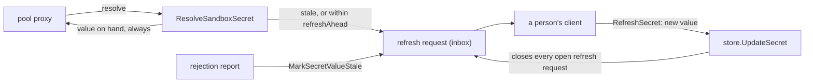

# Secrets Design

This package owns credentials: their storage, the approval lifecycle that
authorizes them, and how a sandbox comes to hold one. It also owns host trust
([below](#host-trust)), the other thing an agent asks a person for.

Cleartext leaves the control plane through exactly one door — `ResolveSandboxSecret`,
called by a pool agent's proxy for one sentinel and one destination host. An
approved answer names the secret beside its value, which the proxy records on
the request it swaps the value into
([ADR 26-10-01-240](../../../../docs/adr/26-10-01-240-a-swapped-request-records-the-secrets-it-spent.md)).
Every other surface here deals in sentinels, requests, and grants.

Nothing here judges. What a credential may do is static: the hosts its grant
covers, the secret's own host binding, and the secret's routes, which the
pool checks on every request
([ADR 26-10-27-880](../../../../docs/adr/26-10-27-880-access-to-a-secret-is-a-binding-held-to-static-routes-and-no-judge-decides-it.md)).

## Grants authorize; requests are the inbox

A `SecretGrant` is the durable authorization: a secret, a scope (sandbox,
harness config, or project), its hosts, a purpose, and an expiry. A
`SecretRequest` is only a question someone asked, and approving one mints a
grant. Revoking the grant takes the credential away even though the request
row stays approved — the request is history, the grant is the authority.

A grant authorizes a sentinel a discobox already holds: a `SandboxSecret`
binding of one variable to one secret, written by the discobox's harness
config, its create, or an approved agent request. A grant binds nothing of its
own (`CreateSecretGrant`), and a binding with no grant covering it resolves to
nothing.

A grant lives as long as what it is scoped to: deleting a sandbox or harness
config deletes the grants scoped to it (`deleteSecretGrantsByScopeTx`), since
its ID is never reused and the grant could cover nothing again, and
`CreateSecretGrant` refuses one for a sandbox or harness config that does not
exist — reading it `FOR SHARE` against the delete's `FOR UPDATE`, so the two
serialize. Deleting a sandbox also closes its open requests as denied
(`denySandboxSecretRequestsTx`): the agent waiting on the answer is gone. A
refresh request stays open, since it is about the secret, not the sandbox that
noticed. An expired grant is kept and listed; the console hides it until asked.

## Three species of request

They share a table and are handled apart on purpose (ADR 0031 §5).

| | Reactive | Protocol-originated | Refresh |
| --- | --- | --- | --- |
| Origin | The proxy hit a sentinel with no grant | An agent asked, through the agent credentials protocol | A token went stale or was refused |
| Carries | type, host, sandbox | plus name, env var (for a use), hosts, justification, purpose, and optionally the lifetime asked for | the secret, the sandbox that needed it |
| Answered by | a grant at the chosen scope | a sandbox-scoped, host-scoped grant, and for a use the variable bound on the asking sandbox | a new value |

`SecretRequest.FromProtocol` is what tells a protocol request apart: only an
agent that asked names the credential it wants. `IsRefresh` tells the third;
it is never approved, see [below](#a-token-may-expire-and-suggest-its-renewal).

An agent's ask for a **use** names the variable it wants the credential in;
an ask to **delegate** names none and is refused if it does, since a
delegation delivers nothing to the discobox that asks. A host is required
either way: approving the request mints a grant, and a grant this flow mints
is never host-unscoped.

The lifetime an agent asks for (`SecretRequest.GrantTTL`) is recorded, never
enforced: it is what the window opens on and what an approval that names no
lifetime grants (`defaultApprovalTTL`: the ask, else `agentcreds.DefaultGrantTTL`,
an hour, fitted within the secret's limit), so approving reads nothing first; an
approval that names one still takes whatever lifetime it is sent. It is not
checked against a secret's limit at the ask, because which secret answers is the
approval's choice. Zero is no ask, not forever. It is bounded at
`agentcreds.MaxGrantTTLSeconds` — thirty days — and an ask outside `1..max` is a
400: an ask becomes the answer a human is shown already chosen, so an unbounded
one is how forever arrives under another name.

The proxy's ask is deduplicated to one pending request per sandbox, secret, and
host. An agent's ask is deduplicated per sandbox, variable, purpose, set of
hosts (in any order, ADR 26-10-02-393 §3), name and lifetime. A request made
through the API (`CreateSecretRequest`) is the reactive species without a
sandbox: it names a type and host, and is approved on the spot when a
project-wide grant on a matching secret already covers it.

Approving a protocol request is stricter than approving a reactive one, and the
strictness is refused rather than silently relaxed:

- **A concrete host is mandatory.** `FindLiveGrant` matches the destination the
  proxy actually observed, so the hosts are what stop a token being swapped
  toward somewhere it was not approved for. A wildcard grant stays an explicit
  administrative act via `discobox secret grant create`.
- **Sandbox scope only.** The agent asked on behalf of one sandbox; approving it
  project-wide would answer a question nobody asked.
- **A use binds its variable on the asking sandbox** (`bindApprovedVariable`),
  as an ordinary injected binding, and marks that sandbox's sentinel delivery
  (`SecretHolders.MarkSandboxSentinelsDirtyTx`) so the binding reaches it while
  it runs. A variable already bound to the approved secret keeps its binding
  and sentinel; one bound to another secret is a 409, never taken over.

**An approval is one write.** Rebinding the answering secret and setting its
grant limit (`secretHost`, `secretMaxGrantTTLSeconds`) ride on the approval. The
secret is re-read inside the transaction, the change is applied to it, and the
grant is checked against the result. Only the fields sent are written, so a
concurrent edit to the other one stands. The change, the grant, the binding,
the delivery mark, and the request marked approved share one transaction. A
refusal anywhere leaves none of them behind. A discobox answering the inbox
approves with the secret as it is, because its role changes no secret. It sees
and answers only the requests it owns — filed by a discobox it created: the
sandbox role decides that for one request by its ID, and `ListSecretRequests`
filters the listing with `store.OwnedBy`
([ADR 26-09-30-782](../../../../docs/adr/26-09-30-782-a-discobox-answers-its-own-discoboxes-requests-within-what-it-may-delegate.md) §2).

### A request and its grant name a list of hosts

`SecretRequest.Hosts` and `SecretGrant.Hosts` are lists (ADR 26-10-02-393): one
credential a tool sends to unrelated sites — Copilot CLI's GitHub token, at
`api.github.com` and `githubcopilot.com` — is one ask and one grant. A grant
covers a destination any of its hosts covers (`hostscope.CoversAny`); no hosts
is the wildcard. Every check reads the list: the grant lookup, the secret
binding (each host inside it, `guardGrantHosts`), and the delegation a discobox
hands on under (`hostscope.CoversEvery`).

`hosts` is the only spelling on the API (ADR 26-10-02-393 §4). A body that
leaves it out takes the default — the secret's host for a grant, the request's
hosts for an approval — and one that sends an empty list names none, which is
how a grant asks for the wildcard (`askedHosts`).

## A discobox created with secrets

A create may give the new discobox project secrets
(`CreateSandboxBody.grants`), each naming a secret, the variable it is
delivered in, and its hosts (`sandboxGrantTarget`).
`PrepareSandboxGrants` checks each as a person's grant of the same shape is
checked — a concrete host within the secret's binding (`guardGrantHosts`), a
lifetime within its limit (`guardGrantTTL`), one credential per variable — and
builds the sandbox grants and ordinary bindings without storing them; the
sandbox create stores them in the transaction that stores the discobox, so a
create that cannot give them all creates nothing. A grant a sandbox makes
records the sandbox as its granter (`grantedByOf`).

A discobox giving them is held to what it may hand on, as when it approves a
request: each grant is made under a live delegation grant it holds of that
secret, covering the hosts and fitting the lifetime (`delegationsOf`,
`delegationsFitting`), the longest-lived that does, and records it as
`DelegationID`. A lifetime it did not name is fitted to that delegation. The
create's transaction holds each grant to its delegation again
(`HoldDelegations`), so a delegation revoked in between creates nothing.

## Delegation grants

A grant's `Purpose` is what it authorizes its holder to do: `use` the
credential, or `delegate` it — give it to the discoboxes it creates
([ADR 26-10-27-880](../../../../docs/adr/26-10-27-880-access-to-a-secret-is-a-binding-held-to-static-routes-and-no-judge-decides-it.md) §3).
One or the other, never both: a person approving a grant agrees to one thing,
and a discobox that needs both holds two grants.

- **A delegation grant authorizes nothing its holder sends.** It binds no
  sentinel and is skipped by every lookup that hands a credential out
  (`FindLiveGrant`; `SecretGrant.MayUse`). The broker lists it, with no
  variable, as what its holder may hand on.
- **It is one discobox's** (`guardPurpose`, in `mintGrantAs` beside the host
  and lifetime guards): a grant wider than a discobox has nobody in particular
  to delegate it.
- **An agent may ask for one.** An agent credentials request carries a
  `Purpose`, and approving it mints a grant with that purpose. Only a person
  approves one: a discobox never hands on the power to hand on
  (`refuseDelegatedApproval`).
- **It bounds what its holder hands on** (`delegated_approval.go`). A discobox
  approving one of its discoboxes' requests answers it with the secret of a
  live delegation grant it holds (`ListLiveDelegationGrants`), not by choosing
  among the project's — its `ListSecrets` holds only those
  (`store.DelegatedTo`): one that covers every host asked for, and — when it
  was delegated more than one secret that fits — the one it names. A secret it
  was not delegated answers as one that does not exist.
- **The bound is static.** Of that secret's delegations, those the lifetime
  fits are candidates (`delegationsFor`, `delegationsFitting`): one the
  approver named must end no later than the delegation, and one nobody named
  needs a delegation with time left. The approval is made under the
  longest-lived. The chosen delegation is read again by its ID in the
  approval's transaction (`delegatedTTL`): still live and covering the hosts,
  a lifetime nobody named fitted to its remaining time and one the approver
  named refused if it does not fit. The lifetime is fitted against, and the
  expiry stamped from, one reading of the clock (`mintGrantAs` takes it).

A handed-on grant names the delegation it was made under
(`SecretGrant.DelegationID`), on an approval and on a create alike: that is how
it is traced to the delegation that allowed it. It records, and revokes
nothing: the grant stands if the delegation goes. A request the proxy opened is
a person's, and so is one to delegate.

## The agent credentials broker

`agentcredentials.go` is the control-plane half of the agent credentials
protocol (ADR 0031, as ADR 26-10-27-880 leaves it). A pool agent calls it for
one of its own sandboxes, and every entry point re-derives the sandbox from the
calling pool rather than trusting the caller about which sandbox it speaks
for. Nothing here returns a value: an approved use is delivered as every
credential is, a sentinel in its variable that the pool swaps.

The entry points:

- **`ListSandboxCredentials`** — what the sandbox holds: each variable bound on
  it whose secret a live use grant covering it authorizes — the narrowest
  grant, which is the one a resolve finds — with that grant's hosts and
  expiry, and each live delegation grant it holds, with no variable.
- **`CreateSandboxCredentialRequest`** — records the ask as a pending request
  and returns at once; the caller polls. An identical pending ask is reused
  rather than duplicated.
- **`GetSandboxCredentialRequest`** — a sandbox's own protocol request and, once
  approved, its grant. `services.AgentCredentialRequestStatus` reports an
  approval whose grant has since been revoked as `denied`; a granted status
  carries the grant's hosts and expiry and, for a use, the variable.
- **`ListSecretRefreshEvents`** — the refresh trail (ADR 26-09-25-122 §6), at
  `/projects/{projectId}/secret-refreshes`: each refresh request as its
  `asked` event at `CreatedAt` and, once closed, its `answered` or `dismissed`
  event at `ClosedAt`. Two events rather than one row because the trail is read
  forward by time and a request changes after it is asked. Both times are
  stamped in UTC because the bounds are compared in SQL; the limit is exact
  because requests are ordered by their event nearest the reading edge. Never
  a value; the answer is the client's account.

A protocol request is always recorded as type `token`. Both types carry their
current value in `Value.Token`, the one field `ResolveSandboxSecret` emits, so
either works through this flow.

## Host trust

`hosttrusts.go` is the control-plane half of
[ADR 0149](../../../../docs/adr/0149-a-host-certificate-is-trusted-for-one-sandbox-when-a-person-pins-it.md):
an agent's ask, relayed by its pool, to trust a host whose certificate the
pool's egress refuses. It sits here because it is the broker's act — an ask
and a person's approval — about a different thing, and it reuses the broker's
pool-ownership check. A trust pins one certificate for one endpoint and
decides nothing about what is sent there (ADR 26-10-27-880 §10). It is its own
resource all the same: `HostTrustRequest` and `HostTrust` are their own
tables, served through `services.HostTrustService`, and nothing in a
credential path reads them.

- **The chain is the pool's.** `CreateSandboxTrustRequest` records the chain
  the pool observed and a CA the agent supplied, which the pool has already
  checked the chain verifies against. The sandbox's word about the host is
  never stored.
- **A pin names something the request offers.** `ApproveTrustRequest` refuses
  a `ca` pin that is not a CA in the chain or the supplied one, and a
  `leaf-spki` pin that is not the leaf's key; with none named it takes
  `DefaultTrustPin` — the supplied CA, then a self-signed CA in the chain,
  then the leaf's key. The trust carries the pinned CA's PEM for the proxy.
- **Only a person approves one**: a sandbox principal is refused, since a pin
  decides who the sandbox's credentials for that host are handed to.
- **A trust is one sandbox's and always lapses.** Its routes are under the
  sandbox, it is deleted with the sandbox (`deleteSandboxHostTrustsTx`), and
  its lifetime runs from an hour by default to thirty days at most.
- **`ListPoolHostTrusts`** is what a pool's proxy enforces: the live trusts of
  every sandbox on it. A revoked or lapsed trust leaves it, and a poll of the
  request that minted it answers `denied`, as a revoked grant does.

The window's inbox is `GET /projects/{projectId}/approval-requests`, a read
model in the handlers over this resource's `ListSecretRequests` and
`ListTrustRequests`: one call per server per beat, each item answered on its
own resource's routes.

## Three types, all doing work

A secret is a **token**, an **oauth** credential, or an **exchange** credential,
and nothing else.

`token` is one opaque string, not named after an HTTP scheme: the proxy swaps
the value into whatever header the sandbox put it in — `x-api-key`,
`PRIVATE-TOKEN`, `Authorization` — so a name like `bearer` would state a
requirement nothing enforces. `oauth` is a token that rotates, and the
distinction is load-bearing: `ensureFresh` refreshes a near-expired access
token on resolve and the resolution's expiry is capped by the token's own
(ADR 0011). `exchange` is fields a person stores, such as an API key, that the
server trades for a short-lived token (ADR 26-10-08-452; see
[Exchange](#exchange)). All three swap identically, because the current token
of each lives in the same field.

There is no username/password or private-key type: cleartext leaves only
through `ResolveSandboxSecret`, which emits `Value.Token`, so such a credential
has no path into a sandbox. `migrateSecretTypes` (in `internal/database`'s
`DB.Migrate`, at every startup) holds stored data to these types: it renames
`bearer` rows to `token` and deletes `git` and `ssh` ones with the grants,
requests, and bindings standing on them. The API validates the enum on the way
out as well as in, so one row left behind would fail to serialize and take the
whole secret listing with it.

## What the API says about a credential

The value goes in and never comes back. `SecretValue` is a request shape only:
the token, and for an OAuth credential the refresh token, token URL, client id,
client secret, scopes, subscription type and access-token expiry. That is enough to register
one by hand — a credential captured somewhere else, or rotated outside a
configure flow — rather than only through a harness's login.

What comes back is `Secret.oauth`: where it renews, whose client it is, what the
grant may do, which plan it belongs to, when the access token goes stale, and
whether it can renew itself at all. Never the access token, never the refresh
token. It is read out of the encrypted value on the way past, because that is
where the metadata was captured with the tokens; a value that cannot be
decrypted leaves the summary empty rather than failing the read.

`oauth` means *renews itself*. Creating one without a refresh token and a token
URL is refused: what has been handed over is a token that will expire and stay
expired, and the type would promise a refresh nothing can perform.

A refresh is the client's to authenticate, as the code exchange was (RFC 6749
§6). A public client (PKCE, no secret) refreshes with its client id alone; a
confidential one also needs its client secret, which whoever ran the sign-in
hands over with the tokens (ADR 26-10-07-005 §4: discobot signs in, discobox
refreshes). It is sealed with the rest of the value, sent as `client_secret`
in the refresh body when present, carried through every rotation, and never
returned. The server runs no authorization flow of its own.

## A token may expire, and suggest its renewal

A `token` may carry a lifetime (`TTL`) and a refresh command
([ADR 26-09-25-122](../../../../docs/adr/26-09-25-122-a-token-may-expire-and-suggest-the-command-that-renews-it.md)).
Delivery and renewal are separate loops, and `refresh.go` owns both halves here.

- **Delivery never waits.** Resolve serves the stored value, capping the
  resolution at the value's stale time (`Secret.StaleTime`: an expiry the value
  carried, else `ValueUpdatedAt + TTL`). A stale value is still served, for
  `staleResolutionTTL`, because a lifetime is an estimate and the upstream is the
  authority.
- **Renewal is asked for, not performed.** A resolve of a value stale or within
  `refreshAhead` of it opens one refresh request per secret, naming the
  discobox that last needed it. The command is advice to the client that
  answers: nothing on this side runs it, and nothing checks a value came from it.
- **Any value write answers it.** `store.UpdateSecret` stamps `ValueUpdatedAt`
  on a replaced value unless the writer stamped it already, and closes every
  open refresh request (`via: update`). `RefreshSecret` closes them first with
  the client's own account of the value (`SecretRefreshAnswer`), and when it
  names a request, the first answer wins: one already answered is a 409 and
  writes nothing.
- **A refusal of a renewable token is not a rejection.** `Secret.Renewable`
  tokens skip `judgeRejection`: the value is marked stale and a refresh request
  opened (`renewableRejection`), except within `rejectionAfterRenewal` of a
  write, when the report may be about the value just replaced.
- **A command's value lasts 5m unless named otherwise**
  (`model.DefaultRefreshTTL`).
- **One open refresh request per secret**, held by a partial unique index
  (`idx_secret_request_open_refresh`), so two resolves racing past the find
  cannot both open one; the loser's create conflict is "already open".
- **The value's fields have their own writer.** `store.UpdateSecret` leaves
  `value_updated_at` and `value_expires_at` out of a write that keeps the value,
  so a rename read before a rejection cannot put back what the rejection
  marked; `MarkSecretValueStale` refuses, in its `WHERE`, a value written within
  `rejectionAfterRenewal`.
- **A discobox never reads a refresh command or answer.** The sandbox role lists
  secrets and requests for names and bindings (ADR 0140 §4); a command a person
  wrote can name a vault path or carry a credential, so it and the answer
  recorded against a request are withheld from a sandbox principal
  (`withholdRenewalFromSandbox`, `withholdAnswerFromSandbox`).
- **Only a person renews.** A command is a secret write, which the sandbox role
  lists none of. A discobox may not approve, dismiss, or answer a refresh
  request; approving one is refused for anybody, since there is no grant to mint.

## A secret's host is a binding somebody set

`Secret.Host` is optional and is only ever set explicitly — `--host` at create
or update, the approval dialog proposing the host a request named, or a harness
configure command naming the host of a secret it outputs. Nothing infers it:
the provider table in the root `secretformat` package describes how a
credential is *shaped*, so a sentinel can byte-mimic it, and says nothing
about where it belongs. A host guessed from four leading characters is a
binding nobody chose, and being wrong in the narrow direction is how the
credential that plainly answers a request becomes the one an approver cannot
pick.

A secret that carries one may be used for that host and the hosts beneath it,
and nowhere else. That is checked twice, because the two checks answer
different questions:

- **`guardGrantHosts`, when a grant is minted** — refuses an approval that
  would point the credential outside its binding at any of the grant's hosts,
  which is the typo worth catching while somebody is still looking at it.
- **`ResolveSandboxSecret`, when the value is handed out** — the same test
  against the destination the proxy observed, so a grant written before the
  binding existed does not outlive it.

A secret with no host is unconstrained by this, and the grant is what scopes it.
A binding stays one host: a credential sent to unrelated sites is an unbound
secret whose grants list them (ADR 26-10-02-393 §2).

## A secret's routes bind whoever holds it

`Secret.Routes` (ADR 26-10-02-924) say where the credential itself may be
sent. Each is a host with an optional path prefix, and may be blocked. They
are set at create or update (`--route HOST[/PATH][=blocked]`) or written by a
harness configure flow from its image. Every swap of the secret must fall on
one, the most specific route decides, and a blocked one refuses
(`secretroute.Decide`, run by the pool); a request no route covers is refused
too. This is on top of the hosts of the grant the secret was handed out
under. No routes leaves it to its grants. A blocked route is what a route a
judge used to read became, so removing the judge sent nothing on it unjudged
(ADR 26-10-27-880 §8).

- **`Secret.ReplaceRoutes` normalizes and dedupes**, and reports whether
  anything moved.
- **A change reaches running discoboxes level-triggered.** `UpdateSecret`
  writes a changed set and has `SecretHolders` (the sandbox service) mark
  the sentinel delivery of every discobox the secret is bound in, in the
  same transaction; its reconciler re-sends the sentinel set with
  `sentinelRoutes`, and retries a delivery the pool did not take (see
  [`sandboxes/DESIGN.md`](../sandboxes/DESIGN.md)).

## A secret's grant limit is a ceiling, not a default

`Secret.MaxGrantTTL` is the longest a grant on that credential may live, and the
lifetime a standing grant takes when nobody names one. Both jobs, one number: the
value a person reads on the row is the value that binds. An approval that names
no lifetime is fitted within it rather than given it: it grants what the agent
asked for, else an hour.

`guardGrantTTL` enforces it beside `guardGrantHosts`, in `mintGrantAs`, for the
same reason: the lifetime arrives from an approval, a pre-approval, or a
create, and a rule enforced in one of those is a rule the other two walk
around. Over the limit is refused, and so is a grant that never expires —
that case is named separately in the message, because it is not "longer"
arithmetically and it is the one an approver reaches for.

**Zero is the meaningful value "no limit"**, not an unset field: grants on such
a credential may live forever, which is how an unlimited credential says so out
loud. Two consequences follow. The column carries no GORM `default`, since GORM
omits a zero-valued field from an INSERT when one exists and would quietly
substitute an hour for "no limit"; the service owns the default a creator who
names none receives (`defaultMaxGrantTTLSeconds`, an hour). And every writer
says the lifetime explicitly rather than dropping a zero, or the same
substitution happens a layer higher.

Lowering a limit binds what is granted next, not what already stands: a live
grant is an authorization somebody made, and it is revoked deliberately rather
than shortened behind their back.

**A harness's own credential carries no limit.** The configure flow creates the
secret, binds it, and grants it at harness scope with no expiry — a harness that
stops working an hour after it was configured is a harness nobody configured —
so a ceiling there would describe a lifetime that grant does not have, and would
refuse the next grant somebody writes for it. That grant is minted through the
store rather than through `mintGrantAs`, which is why the limit never applied to
it either way; stating the zero is what makes the record agree with the
authorization. `liftConfiguredSecretGrantLimits` zeroes the limit on
configure-created secrets, and only on rows still carrying the old 3600 column
default, so a limit somebody chose is kept.

## What a host scope covers

A host on a grant, a secret, or an approved use is a **scope**, read by the
root [`hostscope`](../../../../pkg/hostscope) package: it covers itself and
everything beneath it, and never its parent. `github.com` answers for
`api.github.com`; `api.github.com` answers for neither `github.com` nor
`uploads.github.com`.

The relation is one-way because the two directions are not the same act.
Narrowing a credential to a host under its binding is the approver being
careful. Widening one to the host above it hands the credential to a different
service — the one the site's other subdomains belong to — which is what the
binding said it was not for.

Every check reads it and they must agree: `FindLiveGrant` matching the
destination the proxy observed, `ResolveSandboxSecret` holding that destination
inside the secret's binding, `guardGrantHosts` refusing a grant outside it, and
the delegation a discobox hands on under. `FindLiveGrant` therefore matches the host
in Go rather than in SQL, and prefers the narrowest covering grant
(`hostscope.Specificity`). Hosts are stored through `hostscope.Normalize`
(lowercased, no port), the form the proxy reports.

## A refused credential is recorded, and only the unfixable kind

`rejections.go` is the control-plane half of [ADR 0132](../../../../docs/adr/0132-a-credential-rejected-after-its-retry-is-recorded-against-its-secret.md).
A pool agent's proxy reports what an upstream made of a credential it swapped
in — `rejected`, `rejected-after-retry`, or `accepted` — and this decides
whether that needs a person. The proxy cannot: it knows a value was refused,
and whether that is recoverable depends on what kind of credential it is and
whether it can be renewed, neither of which it may ever be told.

The judgment, in one line each: a `token` has nothing to renew, so the refusal
is the answer; an `oauth` credential is **renewed first**, past
`oauthRefreshSkew` and through the same singleflight as every other refresh,
because an access token can die before its stated expiry while its refresh token
is perfectly good. A renewal that produced a new token clears everything and
says nothing — the proxy dropped its cached copy on the way here, so the next
request carries the new value.

**Only an answer is a verdict** (`renewal`, in `oauth.go`). A 4xx from the token
endpoint is a refusal and is recorded; an unreachable or 5xx endpoint, a value
that will not decrypt, and a forced refresh that joined a *non*-forced one on
the shared singleflight are all `renewalUnavailable` — nothing is recorded, and
the next report tries again. Recording one of those would ask a person to redo a
sign-in they do not need, and then suppress the renewal that would have worked.

Three windows bound the work, and they are deliberately different lengths: the
proxy reports one rejection a minute, a standing rejection is re-judged no more
often than `rejectionJudgeCooldown` (5m), and a renewal stands for
`rejectionRefreshCooldown` (10m, `renewedRecently`, in memory). The last is the
longest because it guards a refresh token that rotates on use, and it is what
stops the quiet failure: a lapsed subscription can hold a good refresh token, so
every rejection would renew happily, read as recovered, record nothing, and be
refused again a minute later — forever, with nothing on screen.

What is stored is live state, not history: one `SecretRejection` per secret and
host, cleared when the value is replaced, when an `accepted` report retracts it,
and when nothing has re-reported it for `rejectionStaleAfter` (30m, dropped on
the read). That last one matters because a clearance can only come from the
proxy process that reported the rejection: restart the pool agent, or delete the
discobox that hit the failure, and a credential fixed upstream would otherwise
keep a band nobody can dismiss.

Replacing a value clears the rejections on it in `store.UpdateSecret`, which is
the one point every writer passes through — the secrets service and the harness
configure flow's update-in-place both — and the test is against what is stored
rather than the shape of what arrived, so it holds with a sealer and without
one. The harness that owns a credential is derived at read time from
`ConfiguredSecretIDs` and the config's bindings rather than stored, because
every path that would have to clear a stored copy belongs to the secret.

**Which requests are evidence is the harness's to say**
([ADR 26-10-13-595](../../../../docs/adr/26-10-13-595-a-harness-names-the-requests-whose-refusal-means-its-login-is-dead.md)).
A resolve answers with the rejection scope the sandbox's harness config
declares for the variable the sentinel is bound to (`reportScope`,
`SandboxSecretResolution.ReportScope`), and the pool's proxy reports nothing
about a request outside it. It is read from the config on every resolve, never
kept on the assignment or the secret, so a stored login gains a scope when its
harness bundle does. Nothing here filters a report: one that arrives is judged
as above.

## Sentinel shape

Sentinels are minted from the secret's `Format` through the root
`secretformat` package, so a placeholder is byte-shape-identical to a real
provider key. Every binding's sentinel — a person's, a harness config's, an
approved agent use's — comes from that one function
(`secretformat.MintSentinel`) on the format `Store.SentinelFormat` reads; a
sentinel shaped by different rules on different paths would be distinguishable
from the real thing.

A `Format` nobody set is the value's shape, and the store keeps it so: it is
re-read on every write of the secret (`sealSecretForWrite`), the OAuth refresh's
value-only write included (`UpdateSecretValueIfUnchanged`), for every writer
and every type — an OAuth secret's access token is in `Token` — so the harness
configure flow's raw rows carry one too. `Store.RefreshSecretFormats` runs at
startup as the upgrade path: it re-reads every such row, so a shape stored under
an older provider table (`sk-ant-{alnum:5}-` before the kind marker was kept) is
corrected without anybody replacing the value. A person may set a format instead
(`format` on create and update, bounded by `secretformat.ParseChosen`);
`FormatSet` then keeps it through every write and the startup pass, and setting
it to empty clears it. Minters read it through `Store.SentinelFormat`. A changed
format reaches every sentinel minted after it — a new sandbox's, and the pool
agent's per-use ones — but not the stable sentinel already in a running
sandbox's environment, which is minted once and stored.

## OAuth

An OAuth secret's access token rides in `SecretValue.Token` so the proxy swap is
identical to a token's. It is refreshed server-side on resolve when near
expiry, collapsed onto one upstream refresh by a singleflight group so a
rotating refresh token is spent once, persisted behind an `updated_at` guard so
a concurrent rotation elsewhere wins rather than being clobbered, and the
resolution's expiry is capped by the token's own so the proxy re-resolves as it
ages out. A failed refresh serves the token on hand; only having no token at
all fails the resolve. See ADR 0011.

The refresh request is JSON unless the secret records
`tokenRequestEncoding: form`, which sends it form-encoded as RFC 6749 defines
(xAI's endpoint requires it). JSON stays the default because every secret stored
before the field existed was refreshed that way. The encoding is recorded at
capture and never guessed at refresh time: a refresh token rotates on use, so a
request retried in the other encoding may be spending a token the first attempt
already spent. See ADR 0127 §3.

## Exchange

An exchange credential's renewal is OAuth's with a different request
(ADR 26-10-08-452). `renew.go` owns what the two share: renewal on resolve
within `tokenRenewSkew`, one renewal per secret at a time (`renewing`), the
`updated_at` guard, the resolution's expiry capped by the token's own, the
token on hand served when a renewal fails, and `forceRenew` on a rejection.
`oauth.go` makes OAuth's refresh request; `exchange.go` makes the exchange, by
the recipe `recipe.go` reads.

- **The recipe is the secret's** (`Secret.ExchangeRecipe`, a column, shown on
  read as `exchange.recipe`): the https endpoint, the body and headers built
  from the stored fields, and where the token and its expiry are in the
  answer. The fields themselves are sealed in the value.
- **A key goes only where its token may go** (`checkRecipe`): the URL's host
  sits inside the secret's binding, which an exchange secret must have, and a
  new binding — by an update or by an approval — is held to the recipe.
  `tokenHTTPClient` follows no redirect, since a 307 would re-send the key to
  whatever it names.
- **An exchange never reaches an internal address** (`internalAddress`):
  loopback, private, CGNAT, link-local, unspecified, multicast. The recipe's
  host is resolved and refused at create and at every exchange, and
  `exchangeClient` checks the address the direct dial connects to, so a name
  that resolves inward the second time is still refused; a dial to the
  configured proxy is left alone. A recipe is somebody's to write, and the
  server's own network position is not theirs.
- **A recipe changes only with the key** (`UpdateSecret`), so a stored key is
  never pointed at a new endpoint, and only a person gives one
  (`exchangeRecipe` refuses a sandbox principal).
- **Stored fields are exchanged before they are stored** (`firstExchange`), on
  create and on a replaced value: a key the endpoint refuses is a 400 to the
  person storing it, and the sentinel takes the token's shape, not the key's.
- **Nothing is spent by an exchange**, unlike a refresh token, so one may be
  repeated; the singleflight still keeps concurrent resolves to one exchange.
  A token whose lifetime neither the answer nor the token states is trusted
  for `exchangeUnknownLifetime`, not renewed on every resolve.
- **A 429 is not a refusal**, for an exchange or an OAuth refresh
  (`refusedStatus`): it says nothing about the credential.
- **A refused exchange is `refresh-failed`**: the key is dead and a person
  replaces it. A refused token whose exchange then succeeds is recovered.
