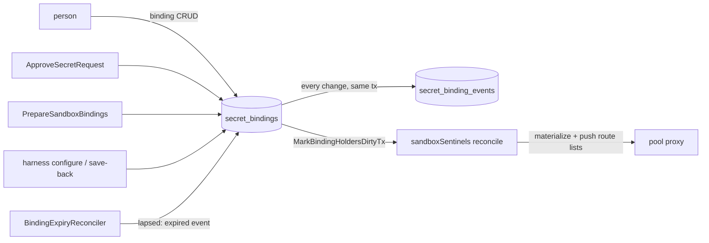
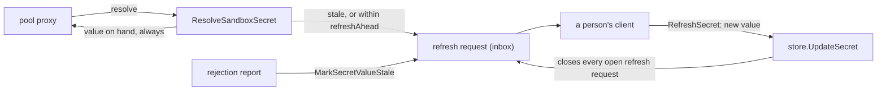

# Secrets Design

This package owns credentials: their storage, the bindings that authorize
them, the requests that ask a person for one, and how a sandbox comes to hold
one. It also owns host trust ([below](#host-trust)), the other thing an agent
asks a person for.

Cleartext leaves the control plane through two doors, both called by a pool
agent's proxy for one of its own sandboxes: `ResolveSandboxSecret`, for one
sentinel and one destination host, and `ResolveSandboxRawSecret`, for one raw
binding's handle and no host ([below](#a-raw-binding-hands-over-the-value)). An
approved answer names the secret beside its value, which the proxy records on
the request it swaps the value into
([ADR 26-10-01-240](../../../../docs/adr/26-10-01-240-a-swapped-request-records-the-secrets-it-spent.md)).
Every other surface here deals in sentinels, bindings and requests.

Nothing here judges. What a credential may do is static: the route lists its
binding holds it to, which the pool checks on every request
([ADR 26-10-27-880](../../../../docs/adr/26-10-27-880-access-to-a-secret-is-a-binding-held-to-static-routes-and-no-judge-decides-it.md)).

## Bindings authorize

A `SecretBinding` is the whole of the permission (ADR 26-10-27-880 §1): a
secret, a target (a sandbox, a harness config or the project), what it is for
— `use` in a variable, `delegate`, or both — its routes, an expiry, and the
parent it was handed on under. One that exists and has not lapsed authorizes;
nothing else does.

- **What applies is resolved, not stacked** (`store.ResolveBindings`): per
  variable, the use binding on the narrowest of four levels that has one —
  the sandbox, its harness config, the harness configs attached to it to run a
  second harness ([ADR 26-10-27-172](../../../../docs/adr/26-10-27-172-a-harness-config-attached-to-a-discobox-binds-it-for-use.md)),
  then the project — and every live delegate binding on any level but an
  attached harness config's, which binds for use only (`BindingTarget.UseOnly`,
  `store.Covers`). A binding that has lapsed, or whose parent has gone or
  lapsed, is not there. `ListBoundSecrets` is that view, with each binding's
  route lists and the earlier of its and its parent's expiry.
- **Every change is recorded** in `secret_binding_events`, in the transaction
  that makes it: created, updated, deleted, expired, with who did it and why
  — a request ID, the parent whose removal took it, the target or secret whose
  delete took it, or `upgrade`. Cascades and expiry are the system's.
- **Every change reaches the discoboxes it covers.** A write marks
  `sandboxSentinels` for each in the same transaction
  (`SecretHolders.MarkBindingHoldersDirtyTx`); the sandbox service
  materializes and pushes ([`sandboxes/DESIGN.md`](../sandboxes/DESIGN.md)).
- **A person's.** Binding CRUD and events refuse a sandbox principal
  (`refuseSandboxPrincipal`); a discobox hands a credential on only by
  approving a request or at a create, under a delegate binding.
- **Shaped for what it does** (`checkBindingShape`): a use names a variable
  matching `services.EnvVarNamePattern`, a delegation alone names none. One
  use binding per target and variable, one delegate binding per target and
  secret — unique indexes, a 409 on collision. An update may change what it is
  for (`UpdateSecretBinding`): use off takes the variable away; delegate off
  removes everything handed on under it, each recorded and its holders
  marked; delegate on is refused for a binding handed on itself, since no
  chain grows from a discobox; a binding left for neither is refused.
- **A binding lives as long as its target and its parent.** Deleting a sandbox,
  harness config or secret deletes the bindings on it, and what was handed on
  under them (`store.DeleteSecretBindingsForTargetTx`); `CreateSecretBinding`
  reads the target `FOR SHARE` against the delete's `FOR UPDATE`. Deleting a
  binding deletes its children (`DeleteSecretBinding` answers every ID).
- **Expiry is swept, not polled.** `BindingExpiryReconciler`
  (`secretBindingExpiry`, one row) removes lapsed bindings and their children
  with `expired` events, marks their holders, and arms itself with
  `RequeueAt` for the next. Every binding written with an expiry marks it at
  that time, by whichever path writes it: the store arms it with the
  binding's event, in the same transaction (`recordBindingEventTx`), so no
  writer can skip it. A lapsed binding authorizes nothing before the sweep
  either: every read checks `Live`.
- **A child's lists include its parent's**, so a change to a binding marks the
  holders of its children too (`UpdateSecretBinding`).

## A raw binding hands over the value

A binding may hand the discobox the value itself rather than a sentinel
([ADR 26-10-27-840](../../../../docs/adr/26-10-27-840-a-binding-may-hand-over-the-raw-value-held-in-memory-and-watched-for-at-the-proxy.md)),
for a program that signs with it or sends it where a swap cannot reach.
`SecretBinding.Raw` is the delivery: `env` (the value in the variable) or
`file` (the path of a file under `/run/discobox/raw-secrets` holding it).

- **Both opt in** (`checkRawBinding`, on every binding write: CRUD, approval,
  create): the secret allows it (`Secret.AllowRaw`), the binding is a use, and
  it is not handed on under a delegation. Clearing `AllowRaw` deletes the raw
  bindings that stand (`deleteRawBindingsTx`), each recorded and its holders
  marked.
- **Only a person, and nothing asks.** A discobox may neither allow raw on a
  secret (`guardAllowRaw`) nor make or create-with a raw binding, and no
  request asks for raw, so no approval makes one or extends one: approving
  a request for a variable a raw binding delivers is a 409
  (`putRequestedBinding`), and a person renews the binding itself. A raw binding on a harness config or the
  project reaches the discoboxes a discobox created there too, which ADR
  26-10-27-840 §2 accepts.
- **The handle is a sentinel the sandbox never sees.** A raw binding
  materializes as a `SandboxSecret` row with `Raw` set, whose sentinel the
  pool is sent as a raw secret rather than a sentinel or a variable
  ([`sandboxes/DESIGN.md`](../sandboxes/DESIGN.md)). `ResolveSandboxSecret`
  refuses it, so it is never swapped.
- **`ResolveSandboxRawSecret`** answers only for a raw row of a standing raw
  binding of a secret still allowing raw, renewed as a swap is
  (`resolution` and `handOut`, which both doors share), with the binding's
  ID. The first answer at each secret revision records the binding's
  `delivered` event (`store.RecordRawDelivery`, cause the discobox), which
  reads the row and the binding again, the row locked: one no longer raw is
  denied rather than handed out. A row repointed starts its count again.

## Requests are the inbox

A `SecretRequest` is only a question an agent asked through the agent
credentials protocol (ADR 0031): a credential name, a variable for a use,
routes (one to each exact host it named, and each typed route it named, read
by `secretroute.Parse`), a lifetime, a justification and a purpose. No
other species exists: a sentinel exists only because a binding does, so the
proxy never asks. Refresh requests are their own record
([below](#a-token-may-expire-and-suggest-its-renewal)).

Approving one (`ApproveSecretRequest`) makes a binding on the discobox that
asked — a use of the chosen secret in the variable it named, or a delegation —
with the routes the approver named, else the ones asked for, and a lifetime
the approver named, else `defaultApprovalTTL` (the ask, else
`agentcreds.DefaultGrantTTL`, fitted within the secret's limit). The binding,
its event, the holders' mark and the request's decision (`DecidedBy`,
`DecidedAt`, `BindingID`) are one transaction (`commitApproval`). A variable
the discobox already holds with another secret is a 409, never taken over; one
holding the same secret is extended (`putRequestedBinding`), unless that
binding is raw, which is a 409 too: a person renews a raw binding itself
([above](#a-raw-binding-hands-over-the-value)).

Deleting a sandbox closes its open requests as denied: the agent waiting on
the answer is gone. A discobox sees and answers only the requests filed by a
discobox it created: the sandbox role decides that for one request by its ID,
and `ListSecretRequests` filters the listing with `store.OwnedBy`
([ADR 26-09-30-782](../../../../docs/adr/26-09-30-782-a-discobox-answers-its-own-discoboxes-requests-within-what-it-may-delegate.md) §2).

The lifetime an agent asks for is bounded at `agentcreds.MaxGrantTTLSeconds`
— thirty days — and an ask outside `1..max` is a 400: an ask becomes the answer
a human is shown already chosen. An ask names a host or a route, and a route
that does not parse is a 400 naming it. An agent's ask is deduplicated per
sandbox, variable, purpose, set of routes in any order (each host asked for
being one), name and lifetime.

## Delegation

A delegate binding lets a discobox it covers hand the secret, for use, to the
discoboxes it creates (ADR 26-10-27-880 §3). It authorizes nothing its holder
sends.

- **Only a person makes one**, and only a person answers an ask to delegate.
- **What is handed on is a child.** A discobox approving a request from a
  discobox it created, or binding at a create, does it under a live delegate
  binding covering it — at any level — of the secret it answers with
  (`delegationsFor`: among what it was delegated, never the project's
  secrets; its `ListSecrets` holds only those, `store.DelegatedTo`). The child
  is a use on the new discobox with `ParentID` set, the routes as asked — the
  parent's list holds it as well — and a lifetime fitted to the parent's:
  unnamed it is fitted, named longer it is refused (`fitToParent`). The
  longest-lived parent is preferred; it is read again in the write's
  transaction (`heldParent`), so one removed in between makes nothing.
- **A child goes with its parent**, by delete or expiry, and is not live
  without it.

## A discobox created with secrets

A create may give the new discobox bindings (`CreateSandboxBody.bindings`):
`PrepareSandboxBindings` checks and builds them, and the sandbox create stores
them in the transaction that stores the discobox
(`StoreSandboxBindingsTx`), then materializes its sentinels, so a create that
cannot make them all creates nothing. Inline secrets (`config.secrets`, a
value) are the sandbox service's: an anonymous secret routed to the exact host
given, else `*` (ADR 26-10-27-939 §2), and a use binding of it.

## The agent credentials broker

`agentcredentials.go` is the control-plane half of the agent credentials
protocol. A pool agent calls it for one of its own sandboxes, and every entry
point re-derives the sandbox from the calling pool. Nothing here returns a
value.

- **`ListSandboxCredentials`** — the sandbox's effective use bindings, each in
  its variable, with the host patterns the open routes of the narrowest list
  it is held to name (`model.OpenRouteHosts`) and its expiry, and its live delegate bindings with no variable.
- **`CreateSandboxCredentialRequest`** — records the ask and returns at once.
- **`GetSandboxCredentialRequest`** — a sandbox's own request and, once
  approved, the binding it made while it stands.
  `services.AgentCredentialRequestStatus` reports an approval whose binding has
  gone as `denied`.
- **`ListSecretRefreshEvents`** — the refresh trail (ADR 26-09-25-122 §6): each
  refresh request as its `asked` event and, once closed, its `answered` or
  `dismissed` event.

## Host trust

`hosttrusts.go` is the control-plane half of
[ADR 0149](../../../../docs/adr/0149-a-host-certificate-is-trusted-for-one-sandbox-when-a-person-pins-it.md):
an agent's ask, relayed by its pool, to trust a host whose certificate the
pool's egress refuses. It sits here because it is the broker's act — an ask
and a person's approval — about a different thing, and it reuses the broker's
pool-ownership check. A trust pins one certificate for one endpoint and
decides nothing about what is sent there (ADR 26-10-27-880 §10). It is its own
resource all the same: `HostTrustRequest` and `HostTrust` are their own
tables, served through `services.HostTrustService`, and nothing in a
credential path reads them.

- **The chain is the pool's.** `CreateSandboxTrustRequest` records the chain
  the pool observed and a CA the agent supplied, which the pool has already
  checked the chain verifies against. The sandbox's word about the host is
  never stored.
- **A pin names something the request offers.** `ApproveTrustRequest` refuses
  a `ca` pin that is not a CA in the chain or the supplied one, and a
  `leaf-spki` pin that is not the leaf's key; with none named it takes
  `DefaultTrustPin` — the supplied CA, then a self-signed CA in the chain,
  then the leaf's key. The trust carries the pinned CA's PEM for the proxy.
- **Only a person approves one**: a sandbox principal is refused, since a pin
  decides who the sandbox's credentials for that host are handed to.
- **A trust is one sandbox's and always lapses.** Its routes are under the
  sandbox, it is deleted with the sandbox (`deleteSandboxHostTrustsTx`), and
  its lifetime runs from an hour by default to thirty days at most.
- **`ListPoolHostTrusts`** is what a pool's proxy enforces: the live trusts of
  every sandbox on it. A revoked or lapsed trust leaves it, and a poll of the
  request that minted it answers `denied`, as a removed binding does.

The window's inbox is `GET /projects/{projectId}/approval-requests`, a read
model in the handlers over this resource's `ListSecretRequests` and
`ListTrustRequests`: one call per server per beat, each item answered on its
own resource's routes.

## Three types, all doing work

A secret is a **token**, an **oauth** credential, or an **exchange** credential,
and nothing else.

`token` is one opaque string, not named after an HTTP scheme: the proxy swaps
the value into whatever header the sandbox put it in — `x-api-key`,
`PRIVATE-TOKEN`, `Authorization` — so a name like `bearer` would state a
requirement nothing enforces. `oauth` is a token that rotates, and the
distinction is load-bearing: `ensureFresh` refreshes a near-expired access
token on resolve and the resolution's expiry is capped by the token's own
(ADR 0011). `exchange` is fields a person stores, such as an API key, that the
server trades for a short-lived token (ADR 26-10-08-452; see
[Exchange](#exchange)). All three swap identically, because the current token
of each lives in the same field.

There is no username/password or private-key type: cleartext leaves only
through `ResolveSandboxSecret`, which emits `Value.Token`, so such a credential
has no path into a sandbox. `migrateSecretTypes` (in `internal/database`'s
`DB.Migrate`, at every startup) holds stored data to these types: it renames
`bearer` rows to `token` and deletes `git` and `ssh` ones with the requests,
bindings and sentinels standing on them. The API validates the enum on the way
out as well as in, so one row left behind would fail to serialize and take the
whole secret listing with it.

## What the API says about a credential

The value goes in and never comes back. `SecretValue` is a request shape only:
the token, and for an OAuth credential the refresh token, token URL, client id,
client secret, scopes, subscription type and access-token expiry. That is enough to register
one by hand — a credential captured somewhere else, or rotated outside a
configure flow — rather than only through a harness's login.

What comes back is `Secret.oauth`: where it renews, whose client it is, what the
grant may do, which plan it belongs to, when the access token goes stale, and
whether it can renew itself at all. Never the access token, never the refresh
token. It is read out of the encrypted value on the way past, because that is
where the metadata was captured with the tokens; a value that cannot be
decrypted leaves the summary empty rather than failing the read.

`oauth` means *renews itself*. Creating one without a refresh token and a token
URL is refused: what has been handed over is a token that will expire and stay
expired, and the type would promise a refresh nothing can perform.

A refresh is the client's to authenticate, as the code exchange was (RFC 6749
§6). A public client (PKCE, no secret) refreshes with its client id alone; a
confidential one also needs its client secret, which whoever ran the sign-in
hands over with the tokens (ADR 26-10-07-005 §4: discobot signs in, discobox
refreshes). It is sealed with the rest of the value, sent as `client_secret`
in the refresh body when present, carried through every rotation, and never
returned. The server runs no authorization flow of its own.

## A token may expire, and suggest its renewal

A `token` may carry a lifetime (`TTL`) and a refresh command
([ADR 26-09-25-122](../../../../docs/adr/26-09-25-122-a-token-may-expire-and-suggest-the-command-that-renews-it.md)).
Delivery and renewal are separate loops, and `refresh.go` owns both halves here.

- **Delivery never waits.** Resolve serves the stored value, capping the
  resolution at the value's stale time (`Secret.StaleTime`: an expiry the value
  carried, else `ValueUpdatedAt + TTL`). A stale value is still served, for
  `staleResolutionTTL`, because a lifetime is an estimate and the upstream is the
  authority.
- **Renewal is asked for, not performed.** A resolve of a value stale or within
  `refreshAhead` of it opens one refresh request per secret, naming the
  discobox that last needed it. The command is advice to the client that
  answers: nothing on this side runs it, and nothing checks a value came from it.
- **Any value write answers it.** `store.UpdateSecret` stamps `ValueUpdatedAt`
  on a replaced value unless the writer stamped it already, and closes every
  open refresh request (`via: update`). `RefreshSecret` closes them first with
  the client's own account of the value (`SecretRefreshAnswer`), and when it
  names a request, the first answer wins: one already answered is a 409 and
  writes nothing.
- **A refusal of a renewable token is not a rejection.** `Secret.Renewable`
  tokens skip `judgeRejection`: the value is marked stale and a refresh request
  opened (`renewableRejection`), except within `rejectionAfterRenewal` of a
  write, when the report may be about the value just replaced.
- **A command's value lasts 5m unless named otherwise**
  (`model.DefaultRefreshTTL`).
- **Refresh requests are their own record** (`SecretRefreshRequest`):
  pending, answered or dismissed, listed in the inbox as their own kind, with
  their service methods in `refresh.go`. A discobox is shown none
  (`ListSecretRefreshRequests`). One open per
  secret, held by a partial unique index (`idx_secret_refresh_open`), so two
  resolves racing past the find cannot both open one; the loser's create
  conflict is "already open".
- **The value's fields have their own writer.** `store.UpdateSecret` leaves
  `value_updated_at` and `value_expires_at` out of a write that keeps the value,
  so a rename read before a rejection cannot put back what the rejection
  marked; `MarkSecretValueStale` refuses, in its `WHERE`, a value written within
  `rejectionAfterRenewal`.
- **A discobox never reads a refresh command.** The sandbox role lists
  secrets for names (ADR 0140 §4); a command a person wrote can name a vault
  path or carry a credential, so it is withheld from a sandbox principal
  (`withholdRenewalFromSandbox`), and the inbox shows a discobox no refresh
  request.
- **Only a person renews.** A discobox may neither dismiss
  (`DismissSecretRefreshRequest`) nor answer a refresh request.

## A secret's routes say where it may go

`Secret.Routes` (ADR 26-10-02-924, ADR 26-10-27-939) say where the credential
may be sent. Each is `secretroute.Route` (ADR 26-10-27-880 §4): host
patterns, and optionally methods, path globs and a GraphQL or MCP block, open
or blocked; `*` covers every host and is the least specific route. A secret with no routes
is sent nowhere: `*` is how a person says anywhere. A binding may narrow them
with routes of its own, and a child is held to its parent's too.

- **Route lists, every one of which must allow.** A sentinel's lists are the
  secret's, the binding's when it has any, and the parent's when it has any
  (`store.RouteLists`). The pool runs `secretroute.Decide` over them on every
  swap; `ResolveSandboxSecret` hands a value out only for a host every list
  allows (`secretroute.HostAllowed`), from a binding that stands
  (`standingBinding`: present, a use of the sentinel's secret, on a level
  covering the sandbox, live, under a live parent).
- **`model.NormalizeRoutes` normalizes and dedupes** every route written —
  a secret's, a binding's, a request's or an approval's, a harness's declared
  ones, an inline secret's — through `secretroute.Normalize`, and
  `Secret.ReplaceRoutes` reports whether anything moved. The API's route
  types convert in one place (`services.SecretRoutesToModel`,
  `SecretRoutesFromModel`); `model.SecretRoute` is `secretroute.Route`, so the
  lists the pool is sent and resolve checks are the stored ones.
- **A change reaches running discoboxes level-triggered.** `UpdateSecret`
  marks every discobox holding the secret in the same transaction
  (`MarkSecretHoldersDirtyTx`), and so does `DeleteSecret`.
- **An exchange recipe's URL is held to the routes** (`checkRecipe`): a key is
  never sent to a host its token could not be.

## A secret's binding limit is a ceiling

`Secret.MaxBindingTTL` is the longest a binding of that credential may live,
and the lifetime a person's binding takes when nobody names one. An approval
that names no lifetime is fitted within it rather than given it.
`guardBindingTTL` enforces it wherever a binding is made — a person's, an
approval, a create — and refuses forever under a limit.

**Zero is "no limit"**, not an unset field; the column carries no GORM
`default`, and the service owns the hour a creator who names none receives
(`defaultMaxBindingTTLSeconds`). Lowering a limit binds what is bound next,
not what stands. A harness's own credential carries no limit: configure binds
it with no expiry, and `liftConfiguredSecretGrantLimits` zeroes the old 3600
column default on configure-created secrets.

## What a route's host covers

A route's host is a pattern read by [`secretroute`](../../../../pkg/secretroute)
(ADR 26-10-27-880 §4, ADR 26-10-27-939): an exact name covers itself alone,
`*.suffix` the hosts strictly beneath the suffix, and `*` everything. Hosts are
stored lowercased with no port (`hostscope.Normalize`), the form the proxy
reports. A route stored before patterns, whose host covered the hosts beneath
it, was converted by the upgrade without widening (`database`'s
`upgradeRouteShapes`).

## A refused credential is recorded, and only the unfixable kind

`rejections.go` is the control-plane half of [ADR 0132](../../../../docs/adr/0132-a-credential-rejected-after-its-retry-is-recorded-against-its-secret.md).
A pool agent's proxy reports what an upstream made of a credential it swapped
in — `rejected`, `rejected-after-retry`, or `accepted` — and this decides
whether that needs a person. The proxy cannot: it knows a value was refused,
and whether that is recoverable depends on what kind of credential it is and
whether it can be renewed, neither of which it may ever be told.

The judgment, in one line each: a `token` has nothing to renew, so the refusal
is the answer; an `oauth` credential is **renewed first**, past
`oauthRefreshSkew` and through the same singleflight as every other refresh,
because an access token can die before its stated expiry while its refresh token
is perfectly good. A renewal that produced a new token clears everything and
says nothing — the proxy dropped its cached copy on the way here, so the next
request carries the new value.

**Only an answer is a verdict** (`renewal`, in `oauth.go`). A 4xx from the token
endpoint is a refusal and is recorded; an unreachable or 5xx endpoint, a value
that will not decrypt, and a forced refresh that joined a *non*-forced one on
the shared singleflight are all `renewalUnavailable` — nothing is recorded, and
the next report tries again. Recording one of those would ask a person to redo a
sign-in they do not need, and then suppress the renewal that would have worked.

Three windows bound the work, and they are deliberately different lengths: the
proxy reports one rejection a minute, a standing rejection is re-judged no more
often than `rejectionJudgeCooldown` (5m), and a renewal stands for
`rejectionRefreshCooldown` (10m, `renewedRecently`, in memory). The last is the
longest because it guards a refresh token that rotates on use, and it is what
stops the quiet failure: a lapsed subscription can hold a good refresh token, so
every rejection would renew happily, read as recovered, record nothing, and be
refused again a minute later — forever, with nothing on screen.

What is stored is live state, not history: one `SecretRejection` per secret and
host, cleared when the value is replaced, when an `accepted` report retracts it,
and when nothing has re-reported it for `rejectionStaleAfter` (30m, dropped on
the read). That last one matters because a clearance can only come from the
proxy process that reported the rejection: restart the pool agent, or delete the
discobox that hit the failure, and a credential fixed upstream would otherwise
keep a band nobody can dismiss.

Replacing a value clears the rejections on it in `store.UpdateSecret`, which is
the one point every writer passes through — the secrets service and the harness
configure flow's update-in-place both — and the test is against what is stored
rather than the shape of what arrived, so it holds with a sealer and without
one. The harness that owns a credential is derived at read time from
`ConfiguredSecretIDs` and the config's bindings rather than stored, because
every path that would have to clear a stored copy belongs to the secret.

**Which requests are evidence is the harness's to say**
([ADR 26-10-13-595](../../../../docs/adr/26-10-13-595-a-harness-names-the-requests-whose-refusal-means-its-login-is-dead.md)).
A resolve answers with the rejection scope the sandbox's harness config
declares for the variable the sentinel is bound to (`reportScope`,
`SandboxSecretResolution.ReportScope`), and the pool's proxy reports nothing
about a request outside it. It is read from the config on every resolve, never
kept on the assignment or the secret, so a stored login gains a scope when its
harness bundle does. Nothing here filters a report: one that arrives is judged
as above.

## Sentinel shape

Sentinels are minted from the secret's `Format` through the root
`secretformat` package, so a placeholder is byte-shape-identical to a real
provider key. Every binding's sentinel — a person's, a harness config's, an
approved agent use's — comes from that one function
(`secretformat.MintSentinel`) on the format `Store.SentinelFormat` reads; a
sentinel shaped by different rules on different paths would be distinguishable
from the real thing.

A `Format` nobody set is the value's shape, and the store keeps it so: it is
re-read on every write of the secret (`sealSecretForWrite`), the OAuth refresh's
value-only write included (`UpdateSecretValueIfUnchanged`), for every writer
and every type — an OAuth secret's access token is in `Token` — so the harness
configure flow's raw rows carry one too. `Store.RefreshSecretFormats` runs at
startup as the upgrade path: it re-reads every such row, so a shape stored under
an older provider table (`sk-ant-{alnum:5}-` before the kind marker was kept) is
corrected without anybody replacing the value. A person may set a format instead
(`format` on create and update, bounded by `secretformat.ParseChosen`);
`FormatSet` then keeps it through every write and the startup pass, and setting
it to empty clears it. Minters read it through `Store.SentinelFormat`. A changed
format reaches every sentinel minted after it — a new sandbox's, and the pool
agent's per-use ones — but not the stable sentinel already in a running
sandbox's environment, which is minted once and stored.

## OAuth

An OAuth secret's access token rides in `SecretValue.Token` so the proxy swap is
identical to a token's. It is refreshed server-side on resolve when near
expiry, collapsed onto one upstream refresh by a singleflight group so a
rotating refresh token is spent once, persisted behind a `revision` guard so
a concurrent rotation elsewhere wins rather than being clobbered, and the
resolution's expiry is capped by the token's own so the proxy re-resolves as it
ages out. A failed refresh serves the token on hand; only having no token at
all fails the resolve. See ADR 0011.

The refresh request is JSON unless the secret records
`tokenRequestEncoding: form`, which sends it form-encoded as RFC 6749 defines
(xAI's endpoint requires it). JSON stays the default because every secret stored
before the field existed was refreshed that way. The encoding is recorded at
capture and never guessed at refresh time: a refresh token rotates on use, so a
request retried in the other encoding may be spending a token the first attempt
already spent. See ADR 0127 §3.

## Exchange

An exchange credential's renewal is OAuth's with a different request
(ADR 26-10-08-452). `renew.go` owns what the two share: renewal on resolve
within `tokenRenewSkew`, one renewal per secret at a time (`renewing`), the
`revision` guard, the resolution's expiry capped by the token's own, the
token on hand served when a renewal fails, and `forceRenew` on a rejection.
`oauth.go` makes OAuth's refresh request; `exchange.go` makes the exchange, by
the recipe `recipe.go` reads.

- **The recipe is the secret's** (`Secret.ExchangeRecipe`, a column, shown on
  read as `exchange.recipe`): the https endpoint, the body and headers built
  from the stored fields, and where the token and its expiry are in the
  answer. The fields themselves are sealed in the value.
- **A key goes only where its token may go** (`checkRecipe`): the URL's host
  is one the secret's routes allow, which an exchange secret must have, at
  create and whenever its recipe, value or routes change.
  `tokenHTTPClient` follows no redirect, since a 307 would re-send the key to
  whatever it names.
- **An exchange never reaches an internal address** (`internalAddress`):
  loopback, private, CGNAT, link-local, unspecified, multicast. The recipe's
  host is resolved and refused at create and at every exchange, and
  `exchangeClient` checks the address the direct dial connects to, so a name
  that resolves inward the second time is still refused; a dial to the
  configured proxy is left alone. A recipe is somebody's to write, and the
  server's own network position is not theirs.
- **A recipe changes only with the key** (`UpdateSecret`), so a stored key is
  never pointed at a new endpoint, and only a person gives one
  (`exchangeRecipe` refuses a sandbox principal).
- **Stored fields are exchanged before they are stored** (`firstExchange`), on
  create and on a replaced value: a key the endpoint refuses is a 400 to the
  person storing it, and the sentinel takes the token's shape, not the key's.
- **Nothing is spent by an exchange**, unlike a refresh token, so one may be
  repeated; the singleflight still keeps concurrent resolves to one exchange.
  A token whose lifetime neither the answer nor the token states is trusted
  for `exchangeUnknownLifetime`, not renewed on every resolve.
- **A 429 is not a refusal**, for an exchange or an OAuth refresh
  (`refusedStatus`): it says nothing about the credential.
- **A refused exchange is `refresh-failed`**: the key is dead and a person
  replaces it. A refused token whose exchange then succeeds is recovered.
