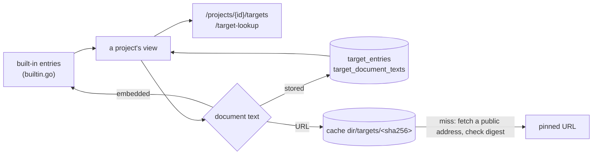

# Targets Design

The target database as a project sees it (ADR 26-10-20-782 §6; the contract is
[`targetdb`](../../targetdb/DESIGN.md)).

- **Built-ins ship in the binary, without their large documents.** These are
  GitHub (`github.com`: the REST description, the GraphQL schema and an
  embedded prose description of git over HTTPS) and the discobox API
  (`api.discobox.internal`, its own `server.yaml`). GitHub's documents are
  named by URLs pinned to a commit, with their digests. Moving a pin changes
  the built-in's version.
- **A project's own entry replaces the built-in for the same host**, for that
  project alone. Deleting it brings the built-in back. A built-in cannot be
  deleted. A put replaces the whole entry and the text it held.
- **Document text comes from one of three places.** It is the binary's for an
  embedded built-in document, the database's (`target_document_texts`, kept
  apart so reading an entry loads no text) for a person's upload, or the cache
  for a URL. The cache is a directory under the cache directory with one file
  per digest: deleting it costs only fetching again. A download is kept only if
  it matches its digest, and a file is re-checked the first time a process
  opens it, so a document answers only its digest's text. Concurrent misses share one download. A server with no cache
  directory fetches nothing.
- **Only a person.** The routes are not on the sandbox role, and the service
  refuses a discobox that reaches it another way: an entry is trusted input,
  and the documents a policy is checked against are not a discobox's to choose.
- **A URL must be https, come with its digest, and name a public address.**
  The server fetches it with no credential and follows no redirect, through
  `publicnet` (see [the review note](../REVIEW.md)). The host is refused when the URL is written,
  and the address dialed is refused at the fetch: a project member must not
  reach what only the server's network position does.
- **A put's body is bounded** at 64 MiB by the router, before the generated
  server buffers it. Larger text is given by URL.
- **Lookup** answers from the narrowest entry covering a host. On a miss it
  returns the entry's documents, for the caller to read.
