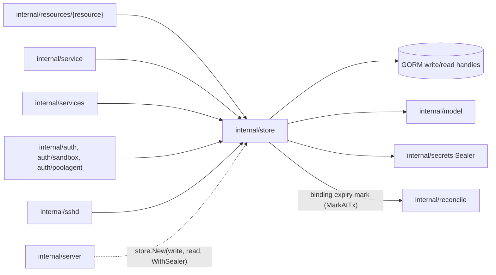
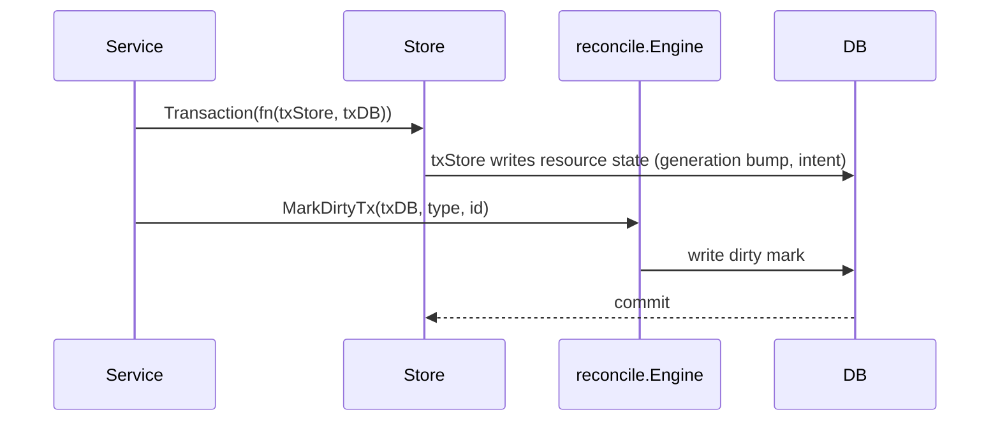

# Store Design

`internal/store` owns application persistence. It is the only server package that
should issue resource-level GORM queries or write resource rows directly. The one
exception is the reconcile engine's dirty marks, which `internal/reconcile` writes
itself — inside a store transaction when they commit with intent.

The store marks in one place: a binding written with an expiry arms the
binding expiry sweep at that instant (`reconcile.MarkAtTx` in
`recordBindingEventTx`), because that timer has to commit with every binding
write whoever writes it. It is not licence for others: every other mark is the
resource service's, through the engine, so the engine is woken.

## Boundaries

- Construct with `New(write, read, ...Option)`; a nil read handle falls back to
  the write handle. `internal/server` wires it, and `cmd/discobox-secret-dump`
  builds its own.
- Keep GORM types and query details inside this package.
- Scope resource queries by project/user/pool IDs as appropriate.
- Re-export the server-owned `apperrors` sentinels through package aliases.

## Transaction Rules

`Store.Transaction(ctx, fn(txStore, txDB))` runs `fn` in one write
transaction. `txStore` is a `Store` bound to the transaction; `txDB` is the raw
handle, passed on to `reconcile.Engine.MarkDirtyTx` so the dirty mark commits with
the intent that caused it.

Use a transaction only where two statements must commit together: intent plus
its dirty mark, a create plus its secret assignments, a delete plus its
cascades (`DeleteProject`, `DeleteSecret`, `DeleteSandbox`,
`DeleteHarnessConfig`), a state-report batch. A mutation that is a single
statement does not need one. Nothing is published on commit: a waiting caller
re-reads the rows rather than being told
([ADR 0081](../../../docs/adr/0081-project-events-are-not-persisted-and-the-wait-polls.md)).

## Conditional Writes

- `WithGeneration` / `WithPoolGeneration` (and `UpdatePoolWithGeneration`)
  guard reads and writes on the resource generation; a write that matches no
  row returns `ErrGenerationConflict`.
- `UpdateSecretValueIfUnchanged` (guarded on the secret's `revision`) and
  `UpdateSecretRequestIfPending` (guarded on status) return
  `ErrGenerationConflict` the same way.
- A secret's `revision` advances in SQL on every write that moves `updated_at`
  (`UpdateSecret`, `UpdateSecretValueIfUnchanged`). Checks
  compare it, never a timestamp: a coarse clock (Windows) stamps two writes in
  one tick alike.
- A binding's events carry a per-binding `seq` beside their clock time `at`,
  and listings order by `at`, then `seq`: one binding's history stays in order
  when a coarse clock stamps two of its changes alike. Events of different
  bindings in one tick (a cascade) have no order beyond a stable one.

## Field Ownership on Whole-Row Writes

A resource whose status has more than one writer must not be saved by writing
every column from an in-memory copy. The copy was read before whatever the
caller just did, and a concurrent writer's update lands in that window — so the
save silently replays a stale value.

- `Store.UpdateSandbox` omits `observedSandboxColumns` (runtime state and its
  report watermark, provisioning progress, resources); only
  `ApplySandboxStateReports`, `ApplySandboxProgressReports`, and
  `UpdateSandboxResources` write them. See
  [`resources/sandboxes/DESIGN.md`](../resources/sandboxes/DESIGN.md) for who
  owns what and
  [ADR 0034](../../../docs/adr/0034-sandbox-state-and-runtime-state-are-separate-fields.md)
  for the incident. It omits `sandboxMetaColumns` (ADR 0136's meta copy) and
  `sandboxPlatformColumns` too, for the same reason: the sandbox's platform is
  written by the insert and by placement (`SchedulablePoolForSandbox`), which
  runs inside the reconciler's provider call, and the reconciler then saves the
  row it loaded before that call. And `sandboxSkillColumns` (`skills`,
  `skill_names`): skills are fixed at create, and every scan of many sandboxes
  (`ListSandboxes`, a pool's state sync, the upgrade sweep) leaves `skills`
  unloaded — only a read of one sandbox loads them — so a scanned row saved
  back must not write an empty set over them (ADR 26-10-09-395).
- The egress level of a sandbox, a project, and a harness config
  (`egressColumn`, ADR 26-10-01-032) is written by create and by its own
  setter alone — `SetSandboxEgress`, `SetProjectEgress`,
  `SetHarnessConfigEgress` — and `UpdateSandbox` (`sandboxEgressColumns`),
  `UpsertProject` and `UpdateHarnessConfig` omit it. A level change moves no
  generation, so a writer that loaded the row before it would otherwise save
  the old level back, and the next egress push would deliver it. `UpdatePool`
  names its columns and writes the pool's level for the person's own update;
  `SetPoolEgress` is the copy's.
- A sandbox's scheduled start (`wake_at`) and its guard (`wake_epoch`,
  ADR 26-10-16-337 §6) have two writers — the power reconcile sets and claims
  the wake, every outside power instruction cancels it — so `UpdateSandbox`
  omits both (`sandboxWakeColumns`) and only `CancelSandboxWakeTx` and
  `SetSandboxWakeIfEpoch` write them. The latter writes only on the epoch its
  caller read, which every cancellation moves.
- Agent telemetry is written as narrow column updates, never a row `Save`:
  `UpdateSandboxAgentStatus`, `UpdateSandboxResources`,
  `RecordPoolProvisionProgress`, `RecordPoolResources`.
- Pool status ownership is split between the pool's maker (`EnrollPool`, its
  key alone), the agent (`UpdatePoolStatus`) and the reconciler; see
  [`resources/pools/DESIGN.md`](../resources/pools/DESIGN.md).

When a new field gains a second writer, narrow the write rather than relying on
callers to be careful.

`HarnessConfig.BoundSecrets` is the other way round: no writer at all. It is a
read-only, unmigrated field that `withBoundSecrets` counts from the bindings on
every read that returns a harness config, the `HarnessConfig` a sandbox preloads
included. A new read of either must apply it, or it reports a harness with
credentials as having none.

## Resource Scope

Every resource query must use the store-owned GORM handles rather than opening or
resolving databases itself. Project-owned resources should filter by `project_id`;
user-owned resources should
filter by `user_id`. Peers and `server_state` rows are server-wide and carry no
project scope. `*ByID` lookups (`GetPoolByID`, `GetSandboxByID`,
`GetHarnessConfigByID`) skip project scope and are for trusted control-plane
paths that hold only an ID (agent auth, reconcile dirty IDs).

Lookups by ID go through `firstByID`, which also resolves a unique prefix of a
generated ID; a non-unique prefix is `ErrNotFound`.

Pool deletion guards depend on sandbox assignment checks. `CountSandboxesForPool`
counts every `sandboxes` row with that `pool_id`, and the pool service and
reconciler treat that count as the authoritative stateful assignment; do not infer
emptiness from pool health, driver drift detection, or runtime state.
`DeletePool` itself only removes the row.

Deletes are real row deletes, not tombstones; `hard_delete_test.go` guards
against `gorm.DeletedAt` reappearing on a model.

Do not add database-routing or request-context identity assumptions to store
methods. Pass the resource boundary explicitly through method parameters or use
IDs already carried by persisted rows.

## Secret Sealing

With `WithSealer`, the store encrypts secret material on write and decrypts it
only on request: `secrets.encrypted_value` (`OpenSecretValue`) and
`sandboxes.secret_state` (`OpenSandboxSecretState`). Plaintext rows pass through
unchanged. Deleting secrets (directly, with an anonymous sandbox assignment, or
with the project) nulls `encrypted_value` before removing the row.

## Error Contract

`ErrNotFound` and `ErrGenerationConflict` alias server-owned `apperrors`
sentinels so store callers can compare errors through this package without
depending on implementation details. `ErrInUse` is store-owned: a delete
refused because a live resource still references the target
(`DeleteHarnessConfig` with sandboxes on it).

Map database-specific not-found errors to `ErrNotFound` at the store boundary
(`mapNotFound`). Use `ErrGenerationConflict` when a generation-guarded or
otherwise conditional read or write proves the request is stale.

## File Organization

Keep files split by resource area:

| File area | Responsibility |
| --- | --- |
| `store.go` | `Store`, `New`, `WithSealer`, handle resolution, error aliases. |
| `transactions.go` | `Store.Transaction`. |
| `id_lookup.go` | `firstByID`: exact or unique-prefix ID lookup. |
| `projects.go`, `users.go` | Projects, members, per-user defaults, users, project user keys. |
| `harness_configs.go` | Harness configs. |
| `sandboxes.go` | Sandbox desired-state persistence, reconcile scans, archive expiry, agent-status/resource telemetry. |
| `sandbox_state_reports.go` | Pool-agent state and provisioning-progress reports (the observed columns' only writer). |
| `providers.go` | Provider instance persistence. |
| `pools.go` | Pool persistence: CRUD, enrollment (the key a pool's maker read from its box) and heartbeats (the first registers it), telemetry, the schedulable-pool placement gate, and pool-scoped sandbox counts. |
| `secrets.go` | Secrets (sealed values), secret requests and refresh requests. |
| `secret_bindings.go`, `effective_bindings.go` | Bindings with their events and cascades, and what applies at a target (narrowest per variable). |
| `sandbox_secrets.go` | Sandbox secret assignments: every binding is injected into its sandbox. |
| `egress.go` | A sandbox's effective egress policy, merged from its four levels (`EffectiveSandboxEgress`), the same merge without the sandbox's own level for provisioning on no sandbox's behalf (`ProvisionEgress`), and the setters that alone write a level (ADR 26-10-01-032). |
| `project_skills_sources.go` | A project's skills sources, in the order added (`position`, one past the last, not the creation time, which a coarse clock shares between two adds); an add holds the project's row for update and refuses a repeat or a second ref of one repository in the same transaction (ADR 26-10-14-894). |
| `project_gateways.go` | A project's gateways, by name; a put replaces one in place and holds the project's row for update while it refuses a second gateway with the same match (ADR 26-10-16-470), or a change to one the configuration file keeps; `ConvergeConfiguredGateways` makes a project's config-managed gateways the file's under the same lock (ADR 26-10-17-271). |
| `ssh_keys.go` | Project SSH keys. |
| `peers.go` | Enrolled peers, looked up by ID or validated prefix. |
| `server_state.go` | Server-wide key/value markers (e.g. one-time seeding). |

## Pool Health Freshness

`BeginPoolHealthChecks` stamps all pools before service workers start, leaving
identity, registration, lifecycle, and agent observations intact. Only a new
`UpdatePoolStatus` stamps `StatusReportedAt`. Generation-guarded pool updates
write lifecycle and runtime fields only; metadata updates write the editable
manifest only. Neither can overwrite a newer heartbeat, registration, or
telemetry report.
Placement uses `Pool.IsReady`, not a persisted lifecycle verdict. API projections
use the same health derivation; see [pools](../resources/pools/DESIGN.md).

## Harness configuration revisions

`UpdateHarnessConfig` compares the caller's `Revision`, advances it on success,
and returns `ErrGenerationConflict` on a stale snapshot; it never inserts a row
as a fallback. `CaptureBaseline` records config revision and the identity plus
`Revision` of every bound secret. Save-back checks it under row locks, so both
binding replacement and an OAuth refresh invalidate an earlier candidate.
`HarnessCaptureReceipt` records the accepted baseline under project, sandbox,
config and opaque candidate ID; it retains no exported credential material.
