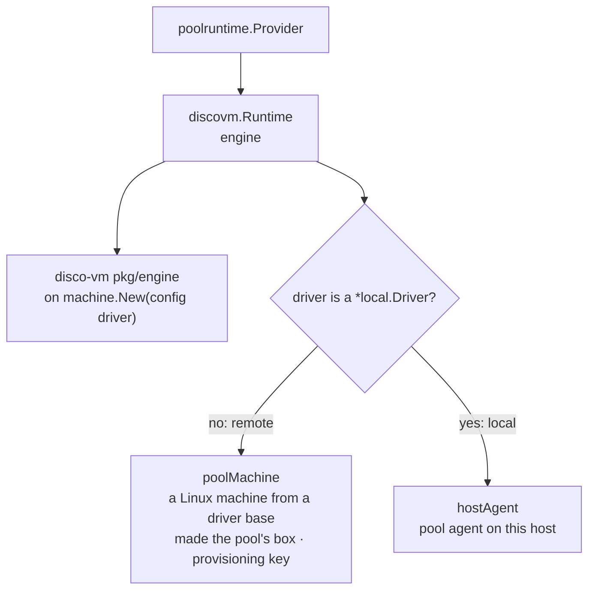

# vm Provider Design

The `vm` provider (package `discovm`) is the `poolruntime.RuntimeProvider`
for pools whose sandboxes are disco-vm machines ([github.com/discobox-ai/vm](https://github.com/discobox-ai/vm)),
beside `dockerworker.Engine` rather than under it: a vm pool has no
pool-agent container, Docker daemon or sandbox network of the engine's
(ADR 26-10-09-106 §1). This package holds the provider kind, the embedded
engine and its shim, and pool hosting: a remote driver's pool machine, made
the pool's box and given its provisioning key, with its console and log. The
driver is configuration it passes to disco-vm; how a pool is hosted follows
from the driver's kind: whether it is disco-vm's local driver, whose provider
is this host's disk. A local driver's host pool agent is not staged yet
(#64): its `EnsurePool` and `AcquirePoolAgentClient` answer so.

## The Engine Is the Server's

- The engine is stateless (disco-vm ADR 26-10-23-417): the driver holds its
  project and its state, and every image and instance is read from it.
  `driverConfig` is the one `machine.Config` the server and its shims make a
  driver with: the state root as `Dir`, this binary's shim as `ShimCommand`,
  and as `Keys` the provider's `apiKey` for a remote driver (`providerKeys`),
  none for a local one.
- One state root per driver per host (`stateRoot`, under the platform's data
  directory), shared by every provider instance on that driver; it is not
  configurable. Only a local driver keeps anything in it. Each provider
  instance's driver is made in a disco-vm project (disco-vm ADR 0004;
  `openDriver`):
  - **remote driver**: the provider instance's own, spelled from its ID
    (`prov_x` → `prov-x`; ADR 26-10-23-551 §1). A remote driver's machines
    outlive any store and are named for their project, so the project is
    what keeps two servers, or two providers, on one account from taking each
    other's machines as their own orphans.
  - **local driver**: `discobox` (`localProject`) for every provider
    instance. The engine counts a driver's running-guest cap at `Start`
    over the driver's instances, which are its project's, so one project per
    root is what makes vz's two running macOS guests the host's (ADR
    26-10-09-106 §4). It is not disco-vm's default project, which is the
    disco-vm CLI's.
- Which project follows from the driver's kind, so the driver is made in
  `localProject` first and made again in the provider's when it is not a
  `*local.Driver`; construction touches no hypervisor or service.
- The engine keeps no database. What the provider placed on a pool's machine
  is its record on the pool's row (below); `Runtime.Close` releases nothing,
  and exists for `poolruntime.RuntimeProvider`.
- The module is imported by commit (a pseudo-version), never a tag.
- **Upgrading from an engine with a database** (disco-vm before c88c4006,
  ADR 26-10-23-417 there): its root and database are not read. Nothing of
  value was in them: a local driver's pool never ran (its host agent is not
  staged, #64), and a boxd pool machine carried nothing placed on it. A boxd
  machine that engine made is named by its old instance ID, not by its
  pool's project, so it is not found: the pool's next reconcile makes its
  machine again, and the old one is the operator's to remove from the
  account (`dvm-<project>--<id>`).
- A local machine's shim is this binary re-executed as `__vm-shim`
  (`RunShimIfInvoked`, called from `server.RunVMLauncherIfInvoked` before
  anything a server does) with the driver's directory, name and project; it
  makes the same driver from `driverConfig` and runs `local.ShimMain`, so the
  server ships no disco-vm binary. A remote driver (boxd) runs no shim: the
  engine attaches to the service's machine on every call, so a running one is adopted across
  restarts, which "VM Lifetime" in [../DESIGN.md](../DESIGN.md) does not forbid
  for a machine that is not the host's.
- A local shim does not die with the server (discobox-ai/vm#8).

## Drivers

The driver is configuration, passed to disco-vm as it is: `newDriver` is
`machine.New(cfg.Driver, driverConfig(...))` on disco-vm's own registry, and validation asks the
same registry. Nothing in this package is written per driver, but for
`unreachable` (below), which reads the transports the linked remote drivers
use, because disco-vm reports no unreachable service of its own. A build links
the real drivers its OS has (`drivers.go`: boxd everywhere,
`drivers_darwin.go`: vz, `drivers_windows.go`: hcs), as imports and nothing
else. disco-vm's docker driver is not linked: it is deferred (ADR
26-10-09-106 Deferred, ADR 26-10-23-551 §5). Nor is its `fake` driver, whose
guest agent is the running binary serving exec on loopback; only tests link
it.

`driver` is `Immutable`: it cannot change while the provider has pools,
because only the driver that made a pool's host can remove it.

Where a pool's agent runs follows from whether the driver's provider is this
host's disk — the driver is a `*local.Driver` (`newPoolHost`, `isLocal`) —
as ADR 26-10-09-106 §1 places it:

| driver | pool host | console | log |
| --- | --- | --- | --- |
| remote (boxd) | `poolMachine`: a Linux machine named for the pool's project (`pool_x` → `pool-x`), booted from a driver base | `bash -l` in it, through the driver's guest exec | its journal for this boot, through the same exec |
| local (vz, hcs) | `hostAgent`: a pool agent process under `<driver Dir>/pools/<pool>` (the state root) | refused, `sandbox.ErrPoolConsoleUnsupported`: the host is the user's own machine | the agent's `pool-agent.log` |

- `poolMachine` reaches the host through the driver's guest operations
  (`Engine.Guest`: boxd's own API, or disco-vm's guest agent), never through
  the pool agent, for the console's reason ([../DESIGN.md](../DESIGN.md#pool-host-console)).
- A pool machine is created from a driver base (ADR 26-10-23-551 §1): the
  provider's `base`, matched by ID alone against what the driver lists
  (`machine.Driver.Bases`), or else the first it lists: on boxd its default
  image when the account has one, and otherwise the account's oldest
  snapshot, so an account with no default image names an ID. A name is never taken for a base, because a name can be
  given to another base (a boxd snapshot's) after an operator chose it. A
  driver with no base answers that the provider must name one. Repair stops
  and starts the same machine, keeping its disk, and provisions it again;
  remove deletes it and revokes the pool's keys.
- The pool's machine is created on a network of the pool's own (its project's
  name) and no other, off the account's default one, so no other machine of
  the provider's reaches it; it is not isolated, since boxd peers an isolated
  machine only with machines that are not, so it keeps what the driver gives
  a machine (its machine token, shown on the pool). The pool agent makes
  every sandbox's machine isolated on that network (ADR 26-10-23-551 §4). A
  driver that cannot isolate (`Capabilities.Isolation`) makes no pool
  machine.
- A remote machine whose service does not answer reads `Unknown`, which is
  neither running nor stopped. The engine reads `Unknown` for any failure to
  ask, so the machine is asked again through `Engine.Guest`, which makes the
  same call and returns its error. A service that cannot be reached
  (`unreachable`: a network error, a deadline, gRPC `Unavailable` or
  `DeadlineExceeded`) answers `sandbox.ErrPoolNotReachable`, which the
  reconciler waits on, rather than booting a second time or stopping a
  healthy pool for a network fault; any other error, such as a missing,
  refused or too narrow key, is the pool's.
- Tests host pools in machines of the `fake` driver booted from its bases
  (`fake.BasesEnv`; a local driver, so they build that `poolMachine`
  themselves), which runs the engine, its shim, and the guest operations as a
  real machine does.
- A remote driver authenticates with the provider's `apiKey`, passed as
  `Config.Keys` (`providerKeys`); disco-vm reads no key of its own accord,
  and the server's environment is not read. A provider made before it held
  one fails each call to the service, naming `apiKey`. A remote driver also
  needs `controlPlaneUrl`, where its pool machines reach this server: a
  server they cannot reach cannot run their pools. `Validate` requires both
  for a remote driver and refuses them for a local one.

## The Pool's Box

A remote driver's pool machine is made the pool's box as a Docker pool's
container is, with `poolruntime.ProvisionBox` over the machine's guest
operations (ADR 26-10-24-953 §2), every feature of the pool bundle applied:
the pool-shared builder serves its sandboxes' builds there, beside the
provisioning key and the driver's machine token, a cost ADR 26-10-27-767
states. Its bootstrap names its own engine (ADR 26-10-23-551 §3):
the machine runtime, the driver, the pool's project as the project and
network its sandboxes' machines are made in, the provider's base, the
provider's `controlPlaneUrl`, and where the agent listens: the driver's
`Service.Listen` for the machine, which its one URL reaches (ADR
26-10-27-345 §2's rule, for the pool agent). The pool agent is reached at that
URL (`acquireAgentClient`, `Engine.URL`): boxd's public HTTPS URL, the same
across stop and start. The bootstrap also names the machine's public and
private URLs (`Engine.URL`, `Engine.PrivateURL`), from which the agent derives
where its sandboxes reach it and what fences them (ADR 26-10-29-481 §§1–2);
a driver whose machines have no private URL carries no pool. They are in the
placement's fingerprint, so a machine whose URLs moved with a start — a local
driver's loopback port — is placed again with its new ones; boxd's stay put.

`converge` runs on every reconcile, against the provider's own record on the
pool's row (`poolRuntimeState` in `RuntimeState`: the machine, the pool's
project, the agent and bundles placed, and the key without its secret),
never against anything the machine reports (551 §1):

- no machine: the pool's keys are revoked by name (a machine lost outside
  discobox, or a record lost), and one is made, keyed and provisioned; it
  registers anew;
- a stopped machine is started on the disk it kept; the agent starts from the
  units `apply` enabled, on the key it holds;
- a key due for renewal is replaced (below);
- moved bundles, or a moved bootstrap or policy (the box record's
  `Placement`, `poolruntime.PlacementFingerprint` of what the provider's
  configuration and the pool's own settings say of it: its
  `controlPlaneUrl`, its base, its policy, its machine's URLs, its
  `disableAgentEndpointTls`), are applied again in the running machine.
  `apply` restarts what moved bundles move; a moved placement restarts the
  agent and proxy, which read it once at start
  (`poolruntime.RestartPoolUnits`), as a Docker pool's are. A record from
  before the box's record held its placement kept it beside the box, and is
  read from there. A running pool whose moved bundles do not resolve or apply
  keeps what it last provisioned and is tried again, as a Docker pool is
  (953 §5); a new or restarted machine's failure fails the reconcile.

The record is written as each step lands, so a reconcile that fails part way
still records a key it placed. The bundle's `pool-agent` feature lays a
journald drop-in (`journald.conf`): persistent and bounded at 256M, since
boxd's image keeps no journal and the journal is what says why an agent did
not come up, across a stop and start as often as not.

## The Provisioning Key

A pool's machine is given the key its engine calls the driver with
(`poolkey.go`, ADR 26-10-23-551 §4), as `bundle.ProvisioningKeyFile`, a
`machine.Key` root's alone, placed before the agent is provisioned or alone
when it is renewed: the agent's engine reads it on every call, so a renewed
key restarts nothing.

- **Issued** (`Driver.IssueKey`): named `<pool project>-<time>`, so every key
  of a pool is found by name, lasting `poolKeyTTL` (seven days), replaced by
  half its life. The old key is left to expire, not revoked, so no call in
  flight meets a revoked key; expired keys of the pool are swept at each
  renewal. A renewal that fails in any way — not issued, not issuable, not
  placed — leaves the pool on its key until it expires, so a working pool is
  never failed, and repaired, over a key it does not need yet.
- **The provider's own**, only with `deliverProviderKey`, and only when the
  driver cannot issue one (`ErrCannotIssue`, `ErrNoKey`; boxd issues none
  from an API key). Placed again when the configured key changes (its
  fingerprint is recorded), and replaced by an issued key when the driver
  issues one, which it is asked daily (`providerKeyRecheck`). Without the
  opt-in, such a pool is blocked with that reason; withdrawing the opt-in
  takes the provider's key off the machine. An issue that fails for any other reason is retried, never
  answered with the provider's key.
- **Revoked**: every key of the pool, by name, when the pool is deleted or its
  machine replaced. A record that says a key was issued makes a refused
  listing an error to retry rather than a key left behind.
- **Shown**: the pool's `HostCredential` says which key its host holds, its
  scope, ID and expiry, and that the machine carries the driver's own token
  (`MachineToken`: a driver that isolates gives a machine that is not
  isolated what isolation strips). `admin pool get` prints it. Neither the
  record nor the credential holds a secret.

## Images

`BuildGuestImage` builds nothing, on any driver, and answers
`ErrGuestImageBuildUnsupported` saying why, before reading anything. A remote
driver's pool machine and its sandboxes boot from a driver base the agent is
placed on (ADR 26-10-23-551 §1, ADR 26-10-16-423 §7), so it has no image. A
local driver has no image defined in a checkout to build.
