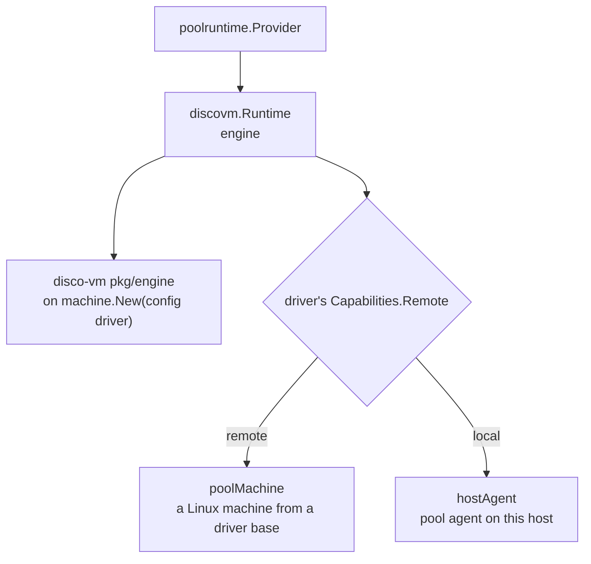

# vm Provider Design

The `vm` provider (package `discovm`) is the `poolruntime.RuntimeProvider`
for pools whose sandboxes are disco-vm machines ([github.com/discobox-ai/vm](https://github.com/discobox-ai/vm)),
beside `dockerworker.Engine` rather than under it: a vm pool has no
pool-agent container, BuildKit, registry or sandbox network of the engine's
(ADR 26-10-09-106 §1). This package holds the provider kind, the embedded
engine and its shim, and pool hosting with its console and log. The driver is
configuration it passes to disco-vm; how a pool is hosted follows from what
that driver reports. It starts no pool agent: `EnsurePool` mints no
bootstrap, and `AcquirePoolAgentClient` answers that the pool runs none.

## The Engine Is the Server's

- One state root per driver per host (`stateRoot`, under the platform's data
  directory), shared by every provider instance on that driver; it is not
  configurable. Each provider instance opens an engine on it, in a disco-vm
  project (disco-vm ADR 0004; `engineProject`):
  - **remote driver**: the provider instance's own, spelled from its ID
    (`prov_x` → `prov-x`; ADR 26-10-23-551 §1). A remote driver's machines
    outlive any store and are named for their project, so the project is
    what keeps two servers, or two providers, on one account from taking each
    other's machines as their own orphans.
  - **local driver**: `discobox` (`localProject`) for every provider
    instance. The engine counts a driver's running-guest cap at `Start`
    within a project, so one project per root is what makes vz's two running
    macOS guests the host's (ADR 26-10-09-106 §4). It is not disco-vm's
    default project, which is the disco-vm CLI's.
- The engine keeps its metadata in its own SQLite database in the root
  (`engine.Open` with no database), not in the server's: the root is the
  user's, shared by every server of theirs on the host, and a database serves
  one root. `Runtime.Close` and the shim close it.
- The module is imported by commit (a pseudo-version), never a tag.
- A local machine's shim is this binary re-executed as `__vm-shim`
  (`RunShimIfInvoked`, called from `server.RunVMLauncherIfInvoked` before
  anything a server does) with the engine's root, driver and project, so the
  server ships no disco-vm binary. A remote driver (boxd) runs no shim: the
  engine attaches to the service's machine on every call, so a running one is adopted across
  restarts, which "VM Lifetime" in [../DESIGN.md](../DESIGN.md) does not forbid
  for a machine that is not the host's.
- A local shim does not die with the server (discobox-ai/vm#8).

## Drivers

The driver is configuration, passed to disco-vm as it is: `newDriver` is
`machine.New(cfg.Driver)` on disco-vm's own registry, and validation asks the
same registry. Nothing in this package is written per driver, but for
`unreachable` (below), which reads the transports the linked remote drivers
use, because disco-vm reports no unreachable service of its own. A build links
the real drivers its OS has (`drivers.go`: boxd everywhere,
`drivers_darwin.go`: vz, `drivers_windows.go`: hcs), as imports and nothing
else. disco-vm's docker driver is not linked: it is deferred (ADR
26-10-09-106 Deferred, ADR 26-10-23-551 §5). Nor is its `fake` driver, whose
guest agent is the running binary serving exec on loopback; only tests link
it.

`driver` is `Immutable`: it cannot change while the provider has pools,
because only the driver that made a pool's host can remove it.

Where a pool's agent runs follows from what the driver reports
(`newPoolHost`, `machine.Capabilities.Remote`), as ADR 26-10-09-106 §1 places
it:

| driver reports | pool host | console | log |
| --- | --- | --- | --- |
| remote (boxd) | `poolMachine`: a Linux machine named `discobox-pool-<pool>`, booted from a driver base | `bash -l` in it, through the driver's guest exec | its journal for this boot, through the same exec |
| local (vz, hcs) | `hostAgent`: a pool agent process under `<stateRoot>/pools/<pool>` | refused, `sandbox.ErrPoolConsoleUnsupported`: the host is the user's own machine | the agent's `pool-agent.log` |

- `poolMachine` reaches the host through the driver's guest operations
  (`Engine.Guest`: boxd's own API, or disco-vm's guest agent), never through
  the pool agent, for the console's reason ([../DESIGN.md](../DESIGN.md#pool-host-console)).
- A pool machine is created from a driver base (ADR 26-10-23-551 §1): the
  provider's `base`, matched by ID alone against what the driver lists
  (`machine.Driver.Bases`), or else the first it lists: on boxd its default
  image when the account has one, and otherwise the account's oldest
  snapshot, so an account with no default image names an ID. A name is never taken for a base, because a name can be
  given to another base (a boxd snapshot's) after an operator chose it. A
  driver with no base answers that the provider must name one. The machine
  is started and recorded on the pool row as registering, with nothing placed
  on it. Repair stops and starts the same machine, keeping its disk; remove
  deletes it.
- On boxd the machine is created as disco-vm creates any: neither isolated
  nor under a network policy of the pool's own, since disco-vm's create offers
  neither. See [REVIEW.md](REVIEW.md).
- A remote machine whose service does not answer reads `Unknown`, which is
  neither running nor stopped. The engine reads `Unknown` for any failure to
  ask, so the machine is asked again through `Engine.Guest`, which makes the
  same call and returns its error. A service that cannot be reached
  (`unreachable`: a network error, a deadline, gRPC `Unavailable` or
  `DeadlineExceeded`) answers `sandbox.ErrPoolNotReachable`, which the
  reconciler waits on, rather than booting a second time or stopping a
  healthy pool for a network fault; any other error, such as a missing,
  refused or too narrow key, is the pool's.
- Tests host pools in machines of the `fake` driver booted from its bases
  (`fake.BasesEnv`; a local driver, so they build that `poolMachine`
  themselves), which runs the engine, its shim, and the guest operations as a
  real machine does.
- disco-vm's boxd driver reads `BOXD_API_KEY` from the server's environment;
  the provider's configuration holds no key.

## Images

`BuildGuestImage` builds nothing, on any driver, and answers
`ErrGuestImageBuildUnsupported` saying why, before reading anything. A remote
driver's pool machine and its sandboxes boot from a driver base the agent is
placed on (ADR 26-10-23-551 §1, ADR 26-10-16-423 §7), so it has no image. A
local driver has no image defined in a checkout to build.
