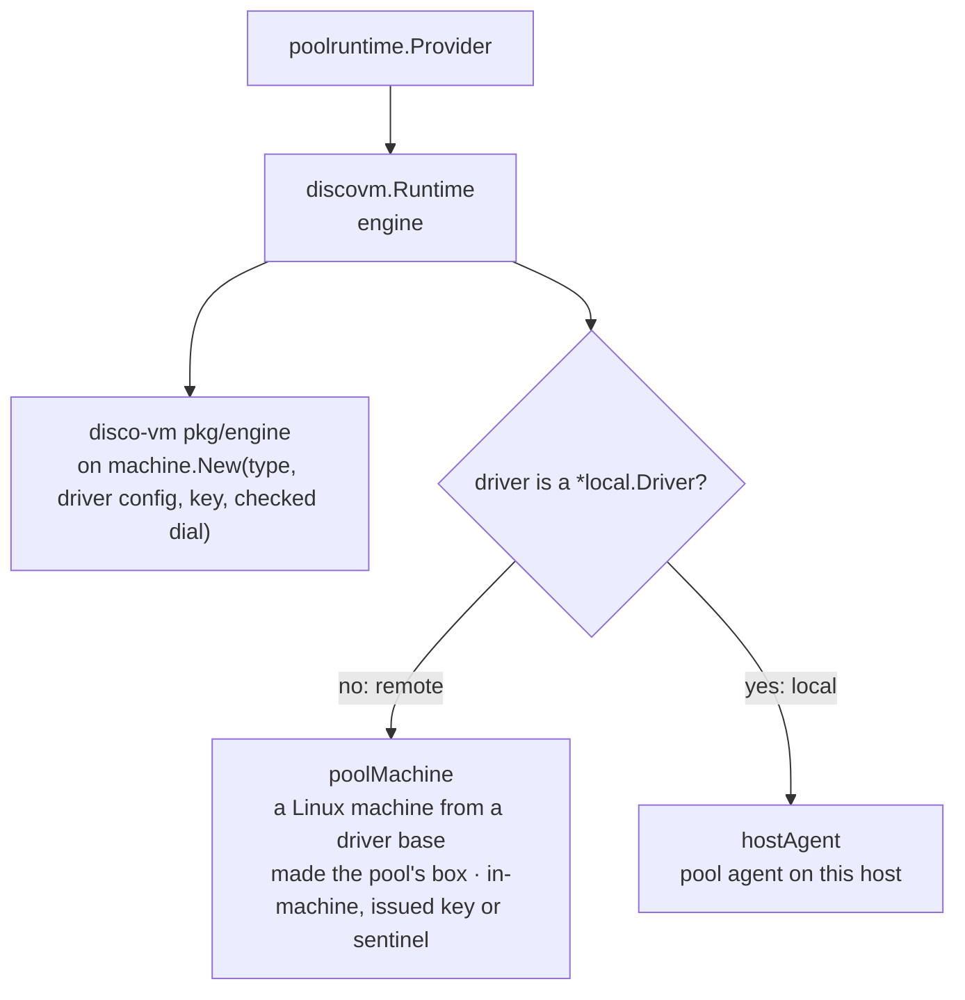

# disco-vm Provider Types Design

Package `discovm` registers a provider type for each disco-vm driver the build
links, by the driver's own name (`boxd`, `archil`, `hcs` on Windows; ADR
26-11-11-080 §1), all served by one `poolruntime.RuntimeProvider`
for pools whose sandboxes are disco-vm machines ([github.com/discobox-ai/vm](https://github.com/discobox-ai/vm)),
beside `dockerworker.Engine` rather than under it: such a pool has no
pool-agent container, Docker daemon or sandbox network of the engine's
(ADR 26-10-09-106 §1). This package holds the provider kind, the embedded
engine and its shim, and pool hosting: a remote driver's pool machine, made
the pool's box and authenticated (in-machine, with an issued key, or with a sentinel its proxy swaps), with its console and log. The
type is the driver; how a pool is hosted follows from the driver's kind:
whether it is disco-vm's local driver, whose provider is this host's disk. A local driver's host pool agent is not staged yet
(#64): its `EnsurePool` and `AcquirePoolAgentClient` answer so.

## The Engine Is the Server's

The disco-vm scope is named `pool` in its API. Bootstrap uses `MachinePool`
(`machinePool` in JSON), driver configuration uses `Config.Pool`, and the
server's shim takes `--pool`. Discobox's own project model is unchanged.
Existing scope values and provider placement policy are retained here;
host-wide capacity enforcement and one disco-vm scope per discobox pool
are separate follow-ups. This cutover provides no bootstrap/state migration.

- The engine is stateless (disco-vm ADR 26-10-23-417): the driver holds its
  scope and its state, and every image and instance is read from it.
  `driverConfig` is the one `machine.Config` the server and its shims make a
  driver with: the state root as `Dir`, this binary's shim as `ShimCommand`,
  as `Keys` the provider's secret (`driver.apiKey`, which `decode` takes out
  of the driver's configuration) for a remote driver (`providerKeys`), none
  for a local one, as `DriverConfig` the rest of the provider's `driver`
  object, and as `Dial` the checked dial (Drivers, below).
- One state root per driver per host (`stateRoot`, under the platform's data
  directory), shared by every provider instance on that driver; it is not
  configurable. Only a local driver keeps anything in it. Each provider
  instance's driver is made in a disco-vm scope (disco-vm ADR 0004;
  `openDriver`):
  - **remote driver**: the provider instance's own, spelled from its ID
    (`prov_x` → `prov-x`; ADR 26-10-23-551 §1). A remote driver's machines
    outlive any store and are named for their scope, so the scope is
    what keeps two servers, or two providers, on one account from taking each
    other's machines as their own orphans.
  - **local driver**: `discobox` (`localPool`) for every provider
    instance. The engine counts a driver's running-guest cap at `Start`
    over the driver's instances, which are its scope's, so one scope per
    root is what makes a driver's cap of running guests the host's (ADR
    26-10-09-106 §4). It is not disco-vm's default scope, which is the
    disco-vm CLI's.
- Which scope follows from the driver's kind, so the driver is made in
  `localPool` first and made again in the provider's when it is not a
  `*local.Driver`; construction touches no hypervisor or service.
- The engine keeps no database. What the provider placed on a pool's machine
  is its record on the pool's row (below); `Runtime.Close` releases nothing,
  and exists for `poolruntime.RuntimeProvider`.
- The module is imported by commit (a pseudo-version), never a tag.
- **Upgrading from an engine with a database** (disco-vm before c88c4006,
  ADR 26-10-23-417 there): its root and database are not read. Nothing of
  value was in them: a local driver's pool never ran (its host agent is not
  staged, #64), and a boxd pool machine carried nothing placed on it. A boxd
  machine that engine made is named by its old instance ID, not by its
  pool's scope, so it is not found: the pool's next reconcile makes its
  machine again, and the old one is the operator's to remove from the
  account (`dvm-<scope>--<id>`).
- A local machine's shim is this binary re-executed as `__vm-shim`
  (`RunShimIfInvoked`, called from `server.RunVMLauncherIfInvoked` before
  anything a server does) with the driver's directory, name and scope; it
  makes the same driver from `driverConfig` and runs `local.ShimMain`, so the
  server ships no disco-vm binary. A remote driver (boxd) runs no shim: the
  engine attaches to the service's machine on every call, so a running one is adopted across
  restarts, which "VM Lifetime" in [../DESIGN.md](../DESIGN.md) does not forbid
  for a machine that is not the host's.
- A local shim does not die with the server (discobox-ai/vm#8).

## Drivers

Each linked driver is a provider type of its name (`Register`, last in
`RegisterBuiltInSandboxProviderFactories`): `Types` is `machine.Names()`
without `fake`, which only tests link. A build links the drivers its OS has
(`drivers.go`: archil and boxd everywhere, `drivers_windows.go`: hcs) as
imports and nothing else. A pool on a driver that reports `Capabilities.Pause`
freezes a sleeping or suspended box whole (ADR 26-11-21-395): boxd
(`SuspendVm`), archil (its sandbox pause) and hcs here, and disco-vm's vz and
docker; libkrun has no pause, so a sleep there stops the box and a suspend is
refused. The pool agent's machine runtime does it (`pool-agent/DESIGN.md`).
docker, libkrun and vz are built-in provider types,
so disco-vm's drivers of those names are not linked (ADR 26-11-11-080
Deferred); registering a taken name panics, and a test fails a build that
does.

A provider's configuration is one object in two parts that share no key
(ADR 26-11-11-080 §2):

- **discobox's pool-hosting fields**, at the top level: the pool policy;
  `controlPlaneUrl` for a driver reached at its URLs; `base` for one whose
  definition takes one (`TakesBase`). A held driver refuses both.
- **the driver's own**, under `driver`: given to disco-vm as
  `machine.Config.DriverConfig` and validated by it alone (`machine.New`),
  less the driver's secret, which `decode` takes out and passes as
  `machine.Config.Keys` (disco-vm ADR 26-11-12-461).

`Definition(name)` is read from `machine.DefinitionOf` when the server
starts: each field as `driver.<key>` (`Default` shown, `Retired` hidden), its
secret as the `secret` field `driver.<key>` (`driver.apiKey` for boxd and
archil), sealed in the row as any secret field is. Every driver field is
`Immutable` (§5); a `Privileged` one is an endpoint the key is sent to,
`Advanced` and marked `Privileged`, which the providers service checks on
the write that sets it and which needs the key in the same write (§§3–4).
A field disco-vm adds shows up with no change here, but for a `Privileged`
one, which `TestPrivilegedFieldsAreTheCheckedEndpoints` holds back. A field
disco-vm marks `Required` must be set at creation. A boxd provider stored
without a region fails to resolve until the owner replaces it and its pools
(ADR 26-11-15-507). An Archil provider must specify its region.
`Definition` also reads whether the driver sizes the machine it makes
(`machine.Definition.Sizes`): one that does gets `cpuVcpus` and
`memoryBytes` as its `SizeFields`, so a box's size, or its pool's as their
default, reaches the engine through the pool agent; one that does not gets
none, and a size asked of it is refused (ADR 26-11-23-445 §6). At this pin
archil, boxd and hcs do. The pool's own machine is not sized from them (§5).

The server reads no driver's environment (ADR 26-11-11-080 §2): a variable a
linked driver names, set in the server's environment, is warned of at start,
never read. The one exception is the upgrade of a `vm` row
(`store.MigrateVMProviders`, §8), which carries `BOXD_GRPC_ADDR` and
`BOXD_TOKEN_URL` into a boxd row's `driver` fields and marks them carried.
Every connection the engine makes to the driver's service goes through
`sandbox.EndpointPolicy.Dial` (`machine.Config.Dial`): an address that is not
public is refused unless the operator's `providerEndpoints` or the row's
carried endpoints name it. A driver given a dialer reads no proxy variable,
so the dial proxies as the driver would have: through `HTTPS_PROXY` (under
`NO_PROXY`), or else a SOCKS5 `ALL_PROXY`, of the server's environment
(`sandbox.EnvironmentProxy`), by name. The proxy resolves it, and what an
operator's proxy lets the server reach is that proxy's policy: the dial
refuses only a literal non-public address there. Without a proxy the dial
resolves the name itself and connects to the address it checked. A refused dial is the pool's error, never
`unreachable`: the reconciler would wait on it unseen.

A pool on a driver reached at its URLs is carried only if the driver fences
its sandboxes one of two ways, decided from its capabilities alone by
`sandboxruntime.PoolFencing`, the one rule the pool agent asks too (ADR
26-11-11-963 §5, ADR 26-11-16-619 §1):

| fencing | the driver reports | pool and sandbox machines |
| --- | --- | --- |
| on networks (boxd) | `Bare` strips, `Networks`, an `EgressAllow` fence | on the pool's own network |
| at its provider's edge (archil) | `Bare` strips or always, no `Networks` needed, `EgressAllow` and `EgressCloseDNS`, `URLs.Credential` | on no network; a sandbox reaches the pool only at its URL, through the edge, and Archil's own mount hosts while its data disk is mounted |

A driver that does both is taken on its networks. One that does neither is
refused when the pool is created, by the type's `PoolOSValidator` (`fences`),
saying what it lacks, and again by `converge` for a pool made before. A held
driver's way, a sandbox with no network device and the server's peer forward
(963 §5), is not in the rule: no pool reaches a held driver yet.

The type cannot change, and no `driver` field can while the provider has
pools: they decide where a pool's machines are, and only the driver that
made a pool's host can find and remove it.

A pool names the OS its sandboxes run when it is created (ADR 26-11-11-963
§1). The type's `PoolOSValidator` takes the OSes the driver's
`Capabilities().GuestOS` reports, never the driver's name: linux on every
driver that boots it (no linked driver boots darwin; vz is not linked), and
refuses a driver that cannot fence its pools (`fences`, above). hcs reports only windows,
so a pool on it is refused, linux included, until the Windows work ADR
26-11-11-963 §13 defers.

Where a pool's agent runs follows from whether the driver's provider is this
host's disk — the driver is a `*local.Driver` (`newPoolHost`, `isLocal`) —
as ADR 26-10-09-106 §1 places it:

| driver | pool host | console | log |
| --- | --- | --- | --- |
| remote (boxd) | `poolMachine`: a Linux machine named for the pool's scope (`pool_x` → `pool-x`), booted from a driver base | `bash -l` in it, through the driver's guest exec | its journal for this boot, through the same exec |
| local (vz, hcs) | `hostAgent`: a pool agent process under `<driver Dir>/pools/<pool>` (the state root) | refused, `sandbox.ErrPoolConsoleUnsupported`: the host is the user's own machine | the agent's `pool-agent.log` |

- `poolMachine` reaches the host through the driver's guest operations
  (`Engine.Guest`: boxd's own API, or disco-vm's guest agent), never through
  the pool agent, for the console's reason ([../DESIGN.md](../DESIGN.md#pool-host-console)).
- A pool machine is created fresh from the driver's base (ADR 26-10-23-551
  §1), which is the driver's own configuration (`machine.Config.Base`,
  disco-vm ADR 26-11-03-606): the provider's `base`, in the driver's terms
  (boxd's image), or else, on a driver whose base disco-vm declares an OCI
  image (`Definition.Base.Format`, `machine.OCIImage`: archil), discobox's
  `DefaultOCIBase`, or else the driver's default (boxd's default image)
  (`settings.base`, disco-vm ADR 26-11-20-547 §2). `DefaultOCIBase` is
  archil's default base (ADR 26-11-16-619 §4, settling its Open item on where
  it is built and pinned): the sandbox base image a release publishes
  (`discobox-sandbox-base`, with systemd, systemd-sysv, dbus and nftables,
  where Archil's default image has no systemd), pinned by tag and digest in
  `base.go` and moved after a release by `go tool task oci-base:pin`, since a
  release cannot link the digest of an image it builds in parallel. The pin
  trails the release it ships in, and nothing refuses a release whose pin was
  not moved: the release skill moves it. It is
  read from the declared format, never the driver's name, and the catalog
  shows it as the base field's default. The
  driver is made with it (`openDriver`), and the pool agent makes its own
  with the same base, which its bootstrap names, so moving the pin is a moved
  placement: a running pool's agent is placed again, and its next machines
  are made from the new image. It was once an ID matched
  against the bases the driver listed, which disco-vm no longer has: a value
  stored then is handed to the driver as its base, which on boxd works for
  an image's ID and not for a snapshot's, since a snapshot is no longer a
  base (disco-vm ADR 26-11-03-606); set such a provider's base to an image.
  A base is matched by what it is called, so one replaced under the same
  name is not seen by the pool's snapshot key: clear the pool's cache.
  Repair stops
  and starts the same machine, keeping its disk, and provisions it again;
  remove deletes it, revokes the pool's keys, then force-removes every
  machine the driver lists in the pool's own scope (`emptyPoolScope`: its
  committed snapshots, a snapshot build's machine, any sandbox machine
  left), on the provider's driver opened in that scope (`engineIn`). The
  machine and keys go first, so nothing of the pool's makes more while the
  scope is emptied; a scope that cannot be listed, or a machine not
  removed, fails the removal, which is tried again. On boxd, removing a
  build's machine takes its commit's snapshot with it while that is still
  pending, and a failed snapshot with no machine is listed, so it is
  removed too (disco-vm `docs/drivers/boxd.md`, Destroy).
- Every machine runs discobox's units under systemd, so a base with
  `systemd` at neither `/lib/systemd/systemd` nor `/usr/lib/systemd/systemd`
  is refused before anything is placed in it, naming the requirement
  (`provisioner.RequireSystemd`, in `poolruntime.ProvisionBox` for every
  pool's box, [../DESIGN.md](../DESIGN.md), and at a sandbox machine's first
  placement, [pool-agent](../../../pool-agent/DESIGN.md#machine-sandboxes)).
  An archil guest's init is Archil's: disco-vm's driver starts systemd as
  PID 1 of namespaces of its own and runs every guest operation in them
  (disco-vm ADR 26-11-20-447). It installs systemd in a base that has none
  where the machine's fence lets it, and refuses the create naming
  `/lib/systemd/systemd` where not. Its `Create` and `Start` wait (up to a
  minute) only until systemd is launched, not until its boot settles, as
  boxd's do, so what runs here next may meet a guest mid-boot; its `Stop`
  kills systemd and flushes the data disk before Archil's stop (disco-vm
  vm#217, vm#219). So the units are unchanged and nothing here knows Archil (ADR 26-11-16-619
  §4). An archil provider that names no base runs `DefaultOCIBase`
  (above), which carries systemd, so neither path is taken. One that names
  a base without systemd takes them: the driver installs systemd in the
  pool's machine, which is not fenced, but a sandbox's machine is fenced
  from the mirror, so its create fails naming `/lib/systemd/systemd`. `TestArchilGuestRunsThePoolsAndSandboxsUnits` (`go tool
  task test:e2e:archil-systemd`) provisions a pool's box and
  places a sandbox's machine from the real bundles in containers whose PID 1
  is not systemd, entered by copies of the driver's lines, each placed as
  soon as systemd is launched, and reboots each as the driver stops it.
- The pool's machine is created on a network of the pool's own (its scope's
  name) and no other, off the account's default one, so no other machine of
  the provider's reaches it; it is not isolated, since boxd peers an isolated
  machine only with machines that are not, so it keeps what the driver gives
  a machine (its machine token, shown on the pool). It asks the driver for
  its ingress URL, strictly (`CreateOptions.URLs`), which the server, the
  pool's controller, reaches its agent at, so a driver that gives none
  refuses the machine at create rather than at the server's first dial; its
  pool URL is the driver's default. It is made running
  (`CreateOptions.Start`, bounded by `poolStartTimeout`; disco-vm ADR
  26-11-23-458), so the pass's state check finds it up and starts nothing: a
  create left stopped and then started would stop the sandbox Archil makes
  running and power a fresh boxd machine off, only to boot it again.
  Its steps report it made and started; a create whose start fails leaves
  no machine. The pool agent makes every sandbox's
  machine isolated on that network (ADR 26-10-23-551 §4) with its pool URL
  on and its ingress URL off, both strictly, so boxd gives it no URL beyond
  its pool one (disco-vm ADR 26-11-14-610). On a driver fenced at its edge
  the pool's machine is made on no network, and its bootstrap names none
  (`poolNetworks`). A driver that carries no pool (`fences`) makes no pool
  machine.
- A remote machine whose service does not answer reads `Unknown`, which is
  neither running nor stopped. The engine reads `Unknown` for any failure to
  ask, so the machine is asked again through `Engine.Guest`, which makes the
  same call and returns its error. A service that cannot be reached
  (`unreachable`: a network error, a deadline, gRPC `Unavailable` or
  `DeadlineExceeded`, or disco-vm's `machine.ErrUnavailable`, which archil
  gives for its REST API's 502, 503 and 504) answers
  `sandbox.ErrPoolNotReachable`, which the reconciler waits on, rather than
  booting a second time or stopping a healthy pool for a network fault; any
  other error, such as a missing, refused or too narrow key, is the pool's. Every other call that asks the
  driver's service about the machine — the lookup in front of every operation
  (`instance`), its guest, URLs, create, keys — reads its error the
  same way (`notReachable`), so a service that drops for a moment during a
  running pool's reconcile records no failure on the pool and does not end a
  create waiting for its agent. Not mapped: a start or stop, whose own
  deadline is the guest's boot or shutdown, and a create its boot's
  deadline ended (it is made running, above), and what runs inside the guest
  (placing files, provisioning, restarting units), whose errors are the
  guest's; a drop during those still fails the pass, which matters only to a
  pool being made or moved. The reconciler's repair passes (a registration
  that timed out, a failed reconcile of a pool with sandboxes) record a
  failure either way: they do not requeue on `ErrPoolNotReachable`.
- Tests host pools in machines of the `fake` driver made fresh from its
  configured base (a local driver, so they build that `poolMachine`
  themselves), which runs the engine, its shim, and the guest operations as a
  real machine does.
- A remote driver authenticates with the provider's secret
  (`driver.apiKey`), passed as `Config.Keys` (`providerKeys`); disco-vm
  reads no key of its own accord, and the server's environment is not read.
  It is sealed in the provider's row and joined into its config only at
  resolve (ADR 26-10-31-694). A provider without one fails each call to the
  service, naming the field. A remote driver's
  `controlPlaneUrl`, where its pool machines reach this server, is optional:
  without one the server opens a
  [control-plane channel](../DESIGN.md#the-control-plane-channel) to each pool
  machine's agent, so it needs no URL a machine can reach (ADR 26-10-30-875).
  Validation requires the key of a driver that declares one, and an
  `http(s)` URL when one is given, for a remote driver, and refuses the URL
  for a local one.

One-off console argv runs through the same login shell (`-c 'exec "$@"'` with
positional arguments), preserving the machine's login environment without
interpreting command arguments as shell source. Its stream separates stderr,
forwards stdin EOF and reports the process status. No-command consoles remain
interactive, and local host consoles remain refused.

## The Pool's Box

`placement` asks for the network fence (`BoxPlacement.Fence`), which
`ProvisionBox` runs before anything else ([../DESIGN.md](../DESIGN.md)),
when the driver is held (`held`: it lists `Capabilities.Ports` and issues no
key; ADR 26-11-11-963 §1): such a machine's network device is shared with the
host and the driver's other guests, and every way into it is vsock (963 §6).
No pool reaches it today: a held driver that is linked (vz, hcs) is a
`*local.Driver`, hosted by `hostAgent` (above), and `converge` refuses a
driver that carries no pool (`fences`); libkrun is not linked in the server. Only
`TestFenceBoxOnALibkrunPoolMachine`, and the unit tests, run the fence. boxd's
machine is not fenced so: its fence is the pool's network (963 Deferred), and
its placement fingerprint is unchanged.

A remote driver's pool machine is made the pool's box as a Docker pool's
container is, with `poolruntime.ProvisionBox` over the machine's guest
operations (ADR 26-10-24-953 §2), every feature of the pool bundle applied:
the pool-shared builder serves its sandboxes' builds there, beside the
driver's machine token (and an issued key, on a driver that issues one), a cost ADR 26-10-27-767
states. Its bootstrap names its own engine (ADR 26-10-23-551 §3):
the machine runtime, the driver, the pool's scope as the scope and
network its sandboxes' machines are made in, the provider's base and its
driver configuration without the secret (ADR 26-11-11-080 §6), the
provider's `controlPlaneUrl` or, with none, the channel's socket, and where
the agent listens: the driver's `Driver.Listen` for the machine, which its
URLs reach (ADR 26-10-27-345 §2's rule, for the pool agent).

A service's two URLs are named by who reaches them (disco-vm ADR
26-11-14-610), and discobox never chooses between them:

| scope | who reaches it | discobox uses it for |
| --- | --- | --- |
| ingress | the pool's controller, this server | server → pool agent (`acquireAgentClient`, `Engine.URL` with `machine.URLIngress`): boxd's HTTPS URL, the same across stop and start; asked on, strictly |
| pool | the pool's machines, as peers on its network | sandbox ↔ pool (the agent's hop, [../../../pool-agent/DESIGN.md](../../../pool-agent/DESIGN.md#the-hop)); a sandbox's machine asks for it on and for ingress off, both strictly |

On a driver whose URLs answer only a credential the driver mints
(`URLCapabilities.Credential`; archil), the pool machine's listener takes one
too, and the server holds two (`pooledge.go`, ADR 26-11-16-619 §2):

- **Its own**, for every call to the pool's agent at the ingress URL, the
  control-plane channel's included (`acquireAgentClient`): sent in the header
  the driver names on every request to the machine's own host, never on a
  redirect elsewhere, over HTTP/1.1 alone, by one client per credential that
  every lease shares. It is never placed in the machine.
- **The sandboxes'**, one token they all share: minted for them from the
  pool URL (`ensureSandboxEdge`), placed beside the bootstrap
  (`bundle.SandboxEdgeCredentialFile`) and recorded on the pool's row without
  its token (`sandboxEdge`); replaced by half its life, or by a repair,
  which places everything again; kept over a renewal
  that fails while it still works. It is no part of the placement or its
  fingerprint: the agent reads it as it decides each sandbox's runtime-config
  document, so a renewal restarts nothing
  ([pool-agent](../../../pool-agent/DESIGN.md#the-hop)). This is how the
  ADR's "placed in the pool's bootstrap" is carried, under its open item on a
  token's life and renewal (owner, 2026-11-21): the bootstrap is read once at
  start and is in the placement's fingerprint, so a token renewed in it would
  restart the agent and proxy at every renewal.

On such a driver each URL lookup mints a token, so the server reads a pool
machine's URLs, the placement's included, through `serviceEndpoints`: held in
memory per machine and scope, with its own lock, until half the credential's
life has passed. A reconcile mints nothing while those it holds are current;
a server restart mints them again.

"Ingress" says nothing of how public the network under it is: on boxd it is
an internet HTTPS URL, in an enterprise install it may be a VLAN address.
The server never dials a pool URL, which only peers reach and which is plain
HTTP on boxd. The bootstrap names both (`ingressUrl`, `poolUrl`), from which
the agent derives where its sandboxes reach it and what fences them (ADR
26-10-29-481 §§1–2); a driver whose machines have no pool URL carries no
pool. They are in the placement's fingerprint, so a machine whose URLs moved
with a start — a local driver's loopback port — is placed again with its new
ones; boxd's stay put.

`converge` runs on every reconcile, against the provider's own record on the
pool's row (`poolRuntimeState` in `RuntimeState`: the machine, the pool's
scope, the agent and bundles placed, the key without its secret, and the
driver's machine limit), never against anything the machine reports (551 §1):

- no machine: the pool's keys are revoked by name (a machine lost outside
  discobox, or a record lost), and one is made, keyed and provisioned; it
  registers anew. The driver's `Check` runs first, against its provider's
  API, so an account that cannot carry a pool makes no machine and the pool's
  error names why (boxd's: its key, its region, and a host-bound secret in
  its org or its key owner's scope, which boxd lets every machine reach
  whatever its fence). A check the service does not answer is
  `sandbox.ErrPoolNotReachable`, as `notReachable` marks, and waited on. The
  same check (`checkDriver`) is `Runtime.Check`, the provider check the
  server runs on request (ADR 26-11-15-089), and the running pool's
  machine-limit check below, so all say the same thing, except that the
  provider check marks a service that does not answer
  `sandbox.ErrProviderNotReachable`: it has no pool, so no pool agent to name;
- a machine under the pool's name that is not the one the record names (a
  pass made it and stopped before its record was saved): it is taken as made —
  the pool's keys revoked, the record reset, the agent placed and keyed — but
  only when it is on the networks create makes it on (the pool's own, or
  none on a driver fenced at its edge) and not stripped; any other is
  refused, and nothing is placed on it (551 §4);
- a stopped machine is started on the disk it kept; the agent starts from the
  units `apply` enabled, on the key it holds. A machine its provider paused
  (Archil at its session limit) is resumed the same way, by the engine's
  `Start`, which boots nothing, so the pool's machine is never left paused
  past a scan (ADR 26-11-16-619 §5);
- a key due for renewal is replaced (below);
- the driver's machine limit (`Capabilities.MaxMachines`) is read at its
  `Check`, with the provider's key, and recorded as `maxMachines` with when
  it was checked (`limitCheckedAt`); create's own `Check` stands for it when
  the pass made the machine. Every pool is reconciled each scan, once a
  minute, and boxd's `Check` is several calls to the org's API, so a pass
  checks again only `machineLimitInterval` (10 minutes) after the last
  attempt, under its own timeout. A `Check` that fails here neither fails the
  pass nor takes the pool down: the recorded limit stands, and so across a
  server restart. The bootstrap carries it (`Bootstrap.MaxMachines`) for the
  agent's `runtime` condition, since a pool's in-machine credential may not
  read it (26-11-15-831);
- moved bundles, or a moved bootstrap or policy (the box record's
  `Placement`, `poolruntime.PlacementFingerprint` of what the provider's
  configuration and the pool's own settings say of it: its
  `controlPlaneUrl`, its base, its policy, its machine's URLs, its
  `disableAgentEndpointTls`, its driver's machine limit), are applied again in the running machine.
  The box's units then hand over to a new agent and proxy beside the
  running ones, which drain (`BoxPlacement.HandOver`, ADR 26-11-26-536 §4; see
  [pool-agent](../../../pool-agent/DESIGN.md#handing-over)): every driver
  asks for it but one whose machines this server's engine holds on this host
  (`held`), whose host agent is not staged. A pool's base moving still keeps
  the machine's base (953 §5). A record from
  before the box's record held its placement kept it beside the box, and is
  read from there. A running pool whose moved bundles do not resolve or apply
  keeps what it last provisioned and is tried again, as a Docker pool is
  (953 §5), and says so with `sandbox.ReportBoxKept`, since the reconcile
  still settles cleanly (26-11-14-624 §1); a new or restarted machine's failure fails the reconcile.
  A created or started machine is reported with `sandbox.ReportAgentStarted`
  as a box start before the machine answers, as the pass that settles is a
  later one (26-11-15-294 §1); a machine the pass did not create, as an
  in-place start once `gate` has closed placement and before the apply,
  whose units may hand over to a new agent (26-11-15-602 §1), unless the pass booted it and places it again with
  nothing moved (a repair), which keeps its box start (`replacesAgent`).

The record is written as each step lands, so a reconcile that fails part way
still records a key it placed. The bundle's `pool-agent` feature lays a
journald drop-in (`journald.conf`): persistent and bounded at 256M, since
boxd's image keeps no journal and the journal is what says why an agent did
not come up, across a stop and start as often as not.

### What Bringing It Up Reports

`converge` reports the shared provisioning phases where its steps mean what
the engine's do, through the `sandbox.PoolProgressReporter`
`FactoryWithPoolManager` builds from its pool manager, under the rules in
[../DESIGN.md](../DESIGN.md#reporting-what-bringing-a-pool-up-is-doing),
each held call under the context its hold returns:

- `starting_vm`, held around making the machine, which its create starts,
  and around starting a stopped one;
- `starting_pool_agent`, held around `ProvisionBox` on a pass that made,
  started or repairs the machine,
  or finds its box never provisioned (the pass that made it failed while it
  booted).
  The apply's start of the agent returns only once the agent's first report
  has landed (ADR 26-11-15-602), so this phase covers the agent coming up;
- `waiting_for_pool_agent`, reported once, not held, when a pass starts a
  machine whose box is current: the boot started the agent the box holds,
  and no call of the pass spans its coming up.

Re-applying moved bundles in a running machine is not bringing the pool up
and reports nothing, as the engine's in-place apply does; nor does a pass
that finds the machine running and its box current. `hostAgent` reports
nothing yet (#64).

## How a Pool's Machine Authenticates

A pool's engine authenticates in the first of these ways its driver offers
(`poolkey.go`, ADR 26-11-11-080 §9). The provider's own key is never placed
on a pool's machine: the server alone uses it, to make, repair and remove
the machine.

- **In-machine** (`inMachineField`): a driver whose definition declares
  in-machine auth (disco-vm's `Definition.InMachine`, vm#140; boxd's
  `inMachine`) authenticates a machine as itself, with the credential the
  driver gives it. discobox reads the field from the declaration, never by
  its name. Nothing is placed: no key, issued or the provider's, and no key
  file. The pool's bootstrap turns that field on in its `DriverConfig`, the
  one place it says so, and the agent's engine is made with no key. The
  agent keeps the declaration's endpoints from every other process on the
  machine ([pool-agent](../../../pool-agent/DESIGN.md#machine-sandboxes)).
  The server never offers or takes the field: its own engine calls with the
  provider's key. Nothing is revoked per pool: the credential goes with the
  machine. A key an older server placed stays, with its record, until the
  placement that turns in-machine auth on has applied, since the running
  agent reads it on every call, and an issued one is renewed until then;
  then it is taken off and every key issued for the pool revoked by name
  (`poolKeys.retire`). With no record, as on a new machine or one whose
  record was lost, the same is done once: a lost record says nothing of
  what an older server left.
- **Issued** (`Driver.IssueKey`), placed as `bundle.ProvisioningKeyFile`, a
  `machine.Key` root's alone, before the agent is provisioned or alone when
  it is renewed; the agent's engine reads it on every call, so a renewed key
  restarts nothing. Named `<pool scope>-<time>`, so every key of a pool is
  found by name, lasting `poolKeyTTL` (seven days), replaced by half its
  life. The old key is left to expire, not revoked, so no call in flight
  meets a revoked key; expired keys of the pool are swept at each renewal. A
  renewal that fails in any way — not issued, not issuable, not placed —
  leaves the pool on its key until it expires, so a working pool is never
  failed, and repaired, over a key it does not need yet.
- **Sentinel** (`poolKeys.sends`): a driver that neither authenticates
  in-machine nor issues keys (`KeysNone`: archil), and declares where it
  sends its one key (disco-vm's `SecretSends`, under the provider's
  configuration: a host, path and header or JSON field, none `Listed`), has
  its pool's key file hold a sentinel shaped as its key (its placeholder's
  prefix, where that survives the driver's own rewriting of the key at every
  place it sends it), in a key file named `discobox-sentinel`, recorded on the pool (`poolKeyRecord.Sentinel`, no
  secret) and kept for the pool's life. It replaces whatever the file held,
  an older server's provider key included. The bootstrap says so
  (`KeySentinel`): the agent's engine calls those hosts through the pool's
  proxy, which swaps the sentinel for the provider's key at those places
  alone ([pool-agent](../../../pool-agent/DESIGN.md#machine-sandboxes)). The
  proxy asks the server (`resolve-driver-key`, `poolKeys.resolve`), which
  answers only the asking pool, while it is present, for its recorded
  sentinel and a host the driver sends its key to, with the key as the
  driver would put it there in the sentinel's place (`inPlaceOf`: archil's
  `Bearer key-` holds whether or not the key was typed with `key-`). The
  method, path and place are held by the pool agent's grant, from the same
  declaration (`proxyagent.DriverKeySends`), checked by the proxy on every
  request before anything is resolved, as a sandbox's routes are. A record
  lost takes the sentinel the key file already holds (`heldSentinel`), only
  one this server placed (named `discobox-sentinel`, of its exact shape);
  any other key there is replaced. The
  key's reach is the provider's: the sentinel keeps it off the machine's
  disk, not narrower (ADR 26-11-11-080 §9, "The sentinel's cost").
- **None of these**: the pool is blocked, saying why. A driver that issues
  no keys at all and declares no place its key could be swapped is blocked
  before its machine is made (`keyable`), so no machine is billed that no
  key could reach; the provider's key an older server placed
  (`deliverProviderKey`, gone) is taken off the machine.
- **Saved at once**: whatever key the pass placed, its record is saved on the
  pool's row the moment it is placed (`PoolMaker.RecordHost`), before the
  box's agent is provisioned, not when the pass settles. The agent calls its
  driver as soon as it starts, and the proxy's `resolve-driver-key` is answered
  from the row: a sentinel the row did not yet hold would be refused, and the
  proxy holds a refusal for a while, past the pool turning active. A pass that
  places nothing new saves nothing.
- **Revoked**: every issued key of the pool, by name, when the pool is
  deleted or its machine replaced. A record that says a key was issued makes
  a refused listing an error to retry rather than a key left behind.
- **Shown**: the pool's `HostCredential` says how its host authenticates
  (`in-machine`, `issued` or `sentinel`), an issued key's scope, ID and expiry, and that
  the machine carries the driver's own token (`MachineToken`: a driver whose
  `Bare` is strip gives a machine it does not strip what stripping takes; one
  that gives a machine nothing of the account, archil, gives none). On
  boxd that token is the owner's member credential for the whole org, which
  can delete the owner's other machines, other pools' included (ADR
  26-11-11-080 §9, #1090). `admin pool get` prints it. Neither the record
  nor the credential holds a secret.

## Images

`BuildGuestImage` builds nothing, on any driver, and answers
`ErrGuestImageBuildUnsupported` saying why, before reading anything. A remote
driver's pool machine and its sandboxes boot from a driver base the agent is
placed on (ADR 26-10-23-551 §1, ADR 26-10-16-423 §7), so it has no image. A
local driver has no image defined in a checkout to build.
