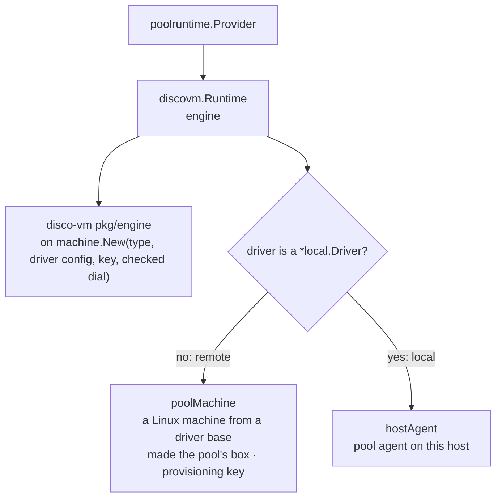

# disco-vm Provider Types Design

Package `discovm` registers a provider type for each disco-vm driver the build
links, by the driver's own name (`boxd`, `archil`, `hcs` on Windows; ADR
26-11-11-080 §1), all served by one `poolruntime.RuntimeProvider`
for pools whose sandboxes are disco-vm machines ([github.com/discobox-ai/vm](https://github.com/discobox-ai/vm)),
beside `dockerworker.Engine` rather than under it: such a pool has no
pool-agent container, Docker daemon or sandbox network of the engine's
(ADR 26-10-09-106 §1). This package holds the provider kind, the embedded
engine and its shim, and pool hosting: a remote driver's pool machine, made
the pool's box and given its provisioning key, with its console and log. The
type is the driver; how a pool is hosted follows from the driver's kind:
whether it is disco-vm's local driver, whose provider is this host's disk. A local driver's host pool agent is not staged yet
(#64): its `EnsurePool` and `AcquirePoolAgentClient` answer so.

## The Engine Is the Server's

The disco-vm scope is named `pool` in its API. Bootstrap uses `MachinePool`
(`machinePool` in JSON), driver configuration uses `Config.Pool`, and the
server's shim takes `--pool`. Discobox's own project model is unchanged.
Existing scope values and provider placement policy are retained here;
host-wide capacity enforcement and one disco-vm scope per discobox pool
are separate follow-ups. This cutover provides no bootstrap/state migration.

- The engine is stateless (disco-vm ADR 26-10-23-417): the driver holds its
  scope and its state, and every image and instance is read from it.
  `driverConfig` is the one `machine.Config` the server and its shims make a
  driver with: the state root as `Dir`, this binary's shim as `ShimCommand`,
  as `Keys` the provider's secret (`driver.apiKey`, which `decode` takes out
  of the driver's configuration) for a remote driver (`providerKeys`), none
  for a local one, as `DriverConfig` the rest of the provider's `driver`
  object, and as `Dial` the checked dial (Drivers, below).
- One state root per driver per host (`stateRoot`, under the platform's data
  directory), shared by every provider instance on that driver; it is not
  configurable. Only a local driver keeps anything in it. Each provider
  instance's driver is made in a disco-vm scope (disco-vm ADR 0004;
  `openDriver`):
  - **remote driver**: the provider instance's own, spelled from its ID
    (`prov_x` → `prov-x`; ADR 26-10-23-551 §1). A remote driver's machines
    outlive any store and are named for their scope, so the scope is
    what keeps two servers, or two providers, on one account from taking each
    other's machines as their own orphans.
  - **local driver**: `discobox` (`localPool`) for every provider
    instance. The engine counts a driver's running-guest cap at `Start`
    over the driver's instances, which are its scope's, so one scope per
    root is what makes a driver's cap of running guests the host's (ADR
    26-10-09-106 §4). It is not disco-vm's default scope, which is the
    disco-vm CLI's.
- Which scope follows from the driver's kind, so the driver is made in
  `localPool` first and made again in the provider's when it is not a
  `*local.Driver`; construction touches no hypervisor or service.
- The engine keeps no database. What the provider placed on a pool's machine
  is its record on the pool's row (below); `Runtime.Close` releases nothing,
  and exists for `poolruntime.RuntimeProvider`.
- The module is imported by commit (a pseudo-version), never a tag.
- **Upgrading from an engine with a database** (disco-vm before c88c4006,
  ADR 26-10-23-417 there): its root and database are not read. Nothing of
  value was in them: a local driver's pool never ran (its host agent is not
  staged, #64), and a boxd pool machine carried nothing placed on it. A boxd
  machine that engine made is named by its old instance ID, not by its
  pool's scope, so it is not found: the pool's next reconcile makes its
  machine again, and the old one is the operator's to remove from the
  account (`dvm-<scope>--<id>`).
- A local machine's shim is this binary re-executed as `__vm-shim`
  (`RunShimIfInvoked`, called from `server.RunVMLauncherIfInvoked` before
  anything a server does) with the driver's directory, name and scope; it
  makes the same driver from `driverConfig` and runs `local.ShimMain`, so the
  server ships no disco-vm binary. A remote driver (boxd) runs no shim: the
  engine attaches to the service's machine on every call, so a running one is adopted across
  restarts, which "VM Lifetime" in [../DESIGN.md](../DESIGN.md) does not forbid
  for a machine that is not the host's.
- A local shim does not die with the server (discobox-ai/vm#8).

## Drivers

Each linked driver is a provider type of its name (`Register`, last in
`RegisterBuiltInSandboxProviderFactories`): `Types` is `machine.Names()`
without `fake`, which only tests link. A build links the drivers its OS has
(`drivers.go`: archil and boxd everywhere, `drivers_windows.go`: hcs) as
imports and nothing else. docker, libkrun and vz are built-in provider types,
so disco-vm's drivers of those names are not linked (ADR 26-11-11-080
Deferred); registering a taken name panics, and a test fails a build that
does.

A provider's configuration is one object in two parts that share no key
(ADR 26-11-11-080 §2):

- **discobox's pool-hosting fields**, at the top level: the pool policy;
  `controlPlaneUrl` and `deliverProviderKey` for a driver reached at its
  URLs; `base` for one whose definition takes one (`TakesBase`). A held
  driver refuses all three.
- **the driver's own**, under `driver`: given to disco-vm as
  `machine.Config.DriverConfig` and validated by it alone (`machine.New`),
  less the driver's secret, which `decode` takes out and passes as
  `machine.Config.Keys` (disco-vm ADR 26-11-12-461).

`Definition(name)` is read from `machine.DefinitionOf` when the server
starts: each field as `driver.<key>` (`Default` shown, `Retired` hidden), its
secret as the `secret` field `driver.<key>` (`driver.apiKey` for boxd and
archil), sealed in the row as any secret field is. Every driver field is
`Immutable` (§5); a `Privileged` one is an endpoint the key is sent to,
`Advanced` and marked `Privileged`, which the providers service checks on
the write that sets it and which needs the key in the same write (§§3–4).
A field disco-vm adds shows up with no change here, but for a `Privileged`
one, which `TestPrivilegedFieldsAreTheCheckedEndpoints` holds back.

The server reads no driver's environment (ADR 26-11-11-080 §2): a variable a
linked driver names, set in the server's environment, is warned of at start,
never read. The one exception is the upgrade of a `vm` row
(`store.MigrateVMProviders`, §8), which carries `BOXD_GRPC_ADDR` and
`BOXD_TOKEN_URL` into a boxd row's `driver` fields and marks them carried.
Every connection the engine makes to the driver's service goes through
`sandbox.EndpointPolicy.Dial` (`machine.Config.Dial`): an address that is not
public is refused unless the operator's `providerEndpoints` or the row's
carried endpoints name it. A driver given a dialer reads no proxy variable,
so the dial proxies as the driver would have: through `HTTPS_PROXY` (under
`NO_PROXY`), or else a SOCKS5 `ALL_PROXY`, of the server's environment
(`sandbox.EnvironmentProxy`), by name. The proxy resolves it, and what an
operator's proxy lets the server reach is that proxy's policy: the dial
refuses only a literal non-public address there. Without a proxy the dial
resolves the name itself and connects to the address it checked. A refused dial is the pool's error, never
`unreachable`: the reconciler would wait on it unseen.

A pool on a driver reached at its URLs that cannot fence its machines
(`Capabilities.Isolation`; archil today) is refused when it is created, by
the type's `PoolOSValidator` (`fences`), saying so (ADR 26-11-11-080 §1).

The type cannot change, and no `driver` field can while the provider has
pools: they decide where a pool's machines are, and only the driver that
made a pool's host can find and remove it.

A pool names the OS its sandboxes run when it is created (ADR 26-11-11-963
§1). The type's `PoolOSValidator` takes the OSes the driver's
`Capabilities().GuestOS` reports, never the driver's name: linux on every
driver that boots it (no linked driver boots darwin; vz is not linked), and
refuses a driver that cannot fence its pools (`fences`, above). hcs reports only windows,
so a pool on it is refused, linux included, until the Windows work ADR
26-11-11-963 §13 defers.

Where a pool's agent runs follows from whether the driver's provider is this
host's disk — the driver is a `*local.Driver` (`newPoolHost`, `isLocal`) —
as ADR 26-10-09-106 §1 places it:

| driver | pool host | console | log |
| --- | --- | --- | --- |
| remote (boxd) | `poolMachine`: a Linux machine named for the pool's scope (`pool_x` → `pool-x`), booted from a driver base | `bash -l` in it, through the driver's guest exec | its journal for this boot, through the same exec |
| local (vz, hcs) | `hostAgent`: a pool agent process under `<driver Dir>/pools/<pool>` (the state root) | refused, `sandbox.ErrPoolConsoleUnsupported`: the host is the user's own machine | the agent's `pool-agent.log` |

- `poolMachine` reaches the host through the driver's guest operations
  (`Engine.Guest`: boxd's own API, or disco-vm's guest agent), never through
  the pool agent, for the console's reason ([../DESIGN.md](../DESIGN.md#pool-host-console)).
- A pool machine is created fresh from the driver's base (ADR 26-10-23-551
  §1), which is the driver's own configuration (`machine.Config.Base`,
  disco-vm ADR 26-11-03-606): the provider's `base`, in the driver's terms
  (boxd's image), or else the driver's default (boxd's default image). The
  driver is made with it (`openDriver`), and the pool agent makes its own
  with the same base, which its bootstrap names. It was once an ID matched
  against the bases the driver listed, which disco-vm no longer has: a value
  stored then is handed to the driver as its base, which on boxd works for
  an image's ID and not for a snapshot's, since a snapshot is no longer a
  base (disco-vm ADR 26-11-03-606); set such a provider's base to an image.
  A base is matched by what it is called, so one replaced under the same
  name is not seen by the pool's snapshot key: clear the pool's cache.
  Repair stops
  and starts the same machine, keeping its disk, and provisions it again;
  remove deletes it and revokes the pool's keys.
- The pool's machine is created on a network of the pool's own (its scope's
  name) and no other, off the account's default one, so no other machine of
  the provider's reaches it; it is not isolated, since boxd peers an isolated
  machine only with machines that are not, so it keeps what the driver gives
  a machine (its machine token, shown on the pool). It asks the driver for a
  public URL, not strictly (`CreateOptions.URLs`), which the server reaches
  its agent at. The pool agent makes every sandbox's machine isolated on that
  network (ADR 26-10-23-551 §4) with its public URL off, strictly, so boxd
  gives it no URL beyond its private one (disco-vm ADR 26-11-12-604). A driver that cannot isolate
  (`Capabilities.Isolation`) makes no pool machine.
- A remote machine whose service does not answer reads `Unknown`, which is
  neither running nor stopped. The engine reads `Unknown` for any failure to
  ask, so the machine is asked again through `Engine.Guest`, which makes the
  same call and returns its error. A service that cannot be reached
  (`unreachable`: a network error, a deadline, gRPC `Unavailable` or
  `DeadlineExceeded`) answers `sandbox.ErrPoolNotReachable`, which the
  reconciler waits on, rather than booting a second time or stopping a
  healthy pool for a network fault; any other error, such as a missing,
  refused or too narrow key, is the pool's. Every other call that asks the
  driver's service about the machine — the lookup in front of every operation
  (`instance`), its guest, URLs, create, keys — reads its error the
  same way (`notReachable`), so a service that drops for a moment during a
  running pool's reconcile records no failure on the pool and does not end a
  create waiting for its agent. Not mapped: a start or stop, whose own
  deadline is the guest's boot or shutdown, and what runs inside the guest
  (placing files, provisioning, restarting units), whose errors are the
  guest's; a drop during those still fails the pass, which matters only to a
  pool being made or moved. The reconciler's repair passes (a registration
  that timed out, a failed reconcile of a pool with sandboxes) record a
  failure either way: they do not requeue on `ErrPoolNotReachable`.
- Tests host pools in machines of the `fake` driver made fresh from its
  configured base (a local driver, so they build that `poolMachine`
  themselves), which runs the engine, its shim, and the guest operations as a
  real machine does.
- A remote driver authenticates with the provider's secret
  (`driver.apiKey`), passed as `Config.Keys` (`providerKeys`); disco-vm
  reads no key of its own accord, and the server's environment is not read.
  It is sealed in the provider's row and joined into its config only at
  resolve (ADR 26-10-31-694). A provider without one fails each call to the
  service, naming the field. A remote driver's
  `controlPlaneUrl`, where its pool machines reach this server, is optional:
  without one the server opens a
  [control-plane channel](../DESIGN.md#the-control-plane-channel) to each pool
  machine's agent, so it needs no URL a machine can reach (ADR 26-10-30-875).
  Validation requires the key of a driver that declares one, and an
  `http(s)` URL when one is given, for a remote driver, and refuses the URL
  for a local one.

One-off console argv runs through the same login shell (`-c 'exec "$@"'` with
positional arguments), preserving the machine's login environment without
interpreting command arguments as shell source. Its stream separates stderr,
forwards stdin EOF and reports the process status. No-command consoles remain
interactive, and local host consoles remain refused.

## The Pool's Box

`placement` asks for the network fence (`BoxPlacement.Fence`), which
`ProvisionBox` runs before anything else ([../DESIGN.md](../DESIGN.md)),
when the driver is held (`held`: it lists `Capabilities.Ports` and issues no
key; ADR 26-11-11-963 §1): such a machine's network device is shared with the
host and the driver's other guests, and every way into it is vsock (963 §6).
No pool reaches it today: a held driver that is linked (vz, hcs) is a
`*local.Driver`, hosted by `hostAgent` (above), and `converge` refuses a
driver without `Isolation`; libkrun is not linked in the server. Only
`TestFenceBoxOnALibkrunPoolMachine`, and the unit tests, run the fence. boxd's
machine is not fenced so: its fence is the pool's network (963 Deferred), and
its placement fingerprint is unchanged.

A remote driver's pool machine is made the pool's box as a Docker pool's
container is, with `poolruntime.ProvisionBox` over the machine's guest
operations (ADR 26-10-24-953 §2), every feature of the pool bundle applied:
the pool-shared builder serves its sandboxes' builds there, beside the
provisioning key and the driver's machine token, a cost ADR 26-10-27-767
states. Its bootstrap names its own engine (ADR 26-10-23-551 §3):
the machine runtime, the driver, the pool's scope as the scope and
network its sandboxes' machines are made in, the provider's base and its
driver configuration without the secret (ADR 26-11-11-080 §6), the
provider's `controlPlaneUrl` or, with none, the channel's socket, and where
the agent listens: the driver's `Service.Listen` for the machine, which its one URL reaches (ADR
26-10-27-345 §2's rule, for the pool agent). The pool agent is reached at that
URL (`acquireAgentClient`, `Engine.URL`): boxd's public HTTPS URL, the same
across stop and start. The bootstrap also names the machine's public and
private URLs (`Engine.URL`, `Engine.PrivateURL`), from which the agent derives
where its sandboxes reach it and what fences them (ADR 26-10-29-481 §§1–2);
a driver whose machines have no private URL carries no pool. They are in the
placement's fingerprint, so a machine whose URLs moved with a start — a local
driver's loopback port — is placed again with its new ones; boxd's stay put.

`converge` runs on every reconcile, against the provider's own record on the
pool's row (`poolRuntimeState` in `RuntimeState`: the machine, the pool's
scope, the agent and bundles placed, and the key without its secret),
never against anything the machine reports (551 §1):

- no machine: the pool's keys are revoked by name (a machine lost outside
  discobox, or a record lost), and one is made, keyed and provisioned; it
  registers anew;
- a machine under the pool's name that is not the one the record names (a
  pass made it and stopped before its record was saved): it is taken as made —
  the pool's keys revoked, the record reset, the agent placed and keyed — but
  only when it is on the pool's own network and not isolated, as create makes
  it; any other is refused, and nothing is placed on it (551 §4);
- a stopped machine is started on the disk it kept; the agent starts from the
  units `apply` enabled, on the key it holds;
- a key due for renewal is replaced (below);
- moved bundles, or a moved bootstrap or policy (the box record's
  `Placement`, `poolruntime.PlacementFingerprint` of what the provider's
  configuration and the pool's own settings say of it: its
  `controlPlaneUrl`, its base, its policy, its machine's URLs, its
  `disableAgentEndpointTls`), are applied again in the running machine.
  `apply` restarts what moved bundles move; a moved placement restarts the
  agent and proxy, which read it once at start
  (`poolruntime.RestartPoolUnits`), as a Docker pool's are. A record from
  before the box's record held its placement kept it beside the box, and is
  read from there. A running pool whose moved bundles do not resolve or apply
  keeps what it last provisioned and is tried again, as a Docker pool is
  (953 §5), and says so with `sandbox.ReportBoxKept`, since the reconcile
  still settles cleanly (26-11-14-624 §1); a new or restarted machine's failure fails the reconcile.

The record is written as each step lands, so a reconcile that fails part way
still records a key it placed. The bundle's `pool-agent` feature lays a
journald drop-in (`journald.conf`): persistent and bounded at 256M, since
boxd's image keeps no journal and the journal is what says why an agent did
not come up, across a stop and start as often as not.

## The Provisioning Key

A pool's machine is given the key its engine calls the driver with
(`poolkey.go`, ADR 26-10-23-551 §4), as `bundle.ProvisioningKeyFile`, a
`machine.Key` root's alone, placed before the agent is provisioned or alone
when it is renewed: the agent's engine reads it on every call, so a renewed
key restarts nothing.

- **Issued** (`Driver.IssueKey`): named `<pool scope>-<time>`, so every key
  of a pool is found by name, lasting `poolKeyTTL` (seven days), replaced by
  half its life. The old key is left to expire, not revoked, so no call in
  flight meets a revoked key; expired keys of the pool are swept at each
  renewal. A renewal that fails in any way — not issued, not issuable, not
  placed — leaves the pool on its key until it expires, so a working pool is
  never failed, and repaired, over a key it does not need yet.
- **The provider's own**, only with `deliverProviderKey`, and only when the
  driver cannot issue one (`ErrCannotIssue`, `ErrNoKey`; boxd issues none
  from an API key). Placed again when the configured key changes (its
  fingerprint is recorded), and replaced by an issued key when the driver
  issues one, which it is asked daily (`providerKeyRecheck`). Without the
  opt-in, such a pool is blocked with that reason; withdrawing the opt-in
  takes the provider's key off the machine. An issue that fails for any other reason is retried, never
  answered with the provider's key.
- **Revoked**: every key of the pool, by name, when the pool is deleted or its
  machine replaced. A record that says a key was issued makes a refused
  listing an error to retry rather than a key left behind.
- **Shown**: the pool's `HostCredential` says which key its host holds, its
  scope, ID and expiry, and that the machine carries the driver's own token
  (`MachineToken`: a driver that isolates gives a machine that is not
  isolated what isolation strips). `admin pool get` prints it. Neither the
  record nor the credential holds a secret.

## Images

`BuildGuestImage` builds nothing, on any driver, and answers
`ErrGuestImageBuildUnsupported` saying why, before reading anything. A remote
driver's pool machine and its sandboxes boot from a driver base the agent is
placed on (ADR 26-10-23-551 §1, ADR 26-10-16-423 §7), so it has no image. A
local driver has no image defined in a checkout to build.
